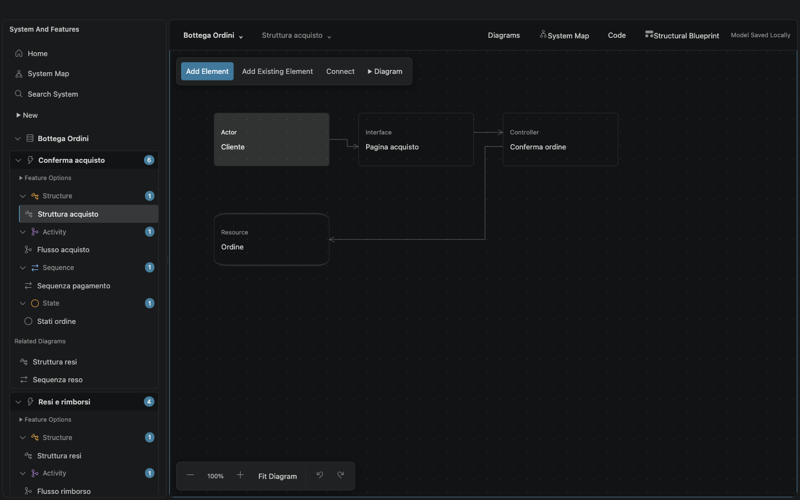

# Ordito

**A desktop IDE for designing software with diagrams.**

Built on Code OSS, Ordito connects system diagrams, software contracts, and source evidence in a shared project model. Start with a design or bring an existing codebase, then trace how a change affects the system and verify its behavior.

[](LICENSE.txt)
[](#getting-started)
[](https://github.com/FrappaF/Ordito/actions/workflows/desktop.yml)

[Getting started](#getting-started) · [Example project](#try-an-example) · [Documentation](#documentation) · [Report an issue](https://github.com/FrappaF/Ordito/issues)



*Bottega Ordini is the sample project used in the guided tour.*

## What you can do

- **Model a system across multiple views.** Reuse elements and relationships in C4, UML, entity-relationship, and other diagrams. Define types, contracts, and architecture decisions in the Structural Blueprint.
- **Explore an existing codebase.** Build a local source inventory and jump from findings to the corresponding files. Built-in semantic resolution covers JavaScript, TypeScript, and TSX.
- **Verify behavior.** Run independently defined cases and simulate interactions, state machines, and message delivery on supported profiles.
- **Review AI-assisted changes.** Connect Codex or Claude Code to generate diagram proposals from source or prepare code changes from the model. Review diagram evidence, code diffs, and verification results before applying the corresponding changes.

## Getting started

Ordito is in active development and builds from source. Install Git, Python 3, the native build tools for your platform, and the pinned Node.js version. The setup command installs locked dependencies, builds Ordito, and prepares Electron. [Build prerequisites](ordito/docs/fork-development.md#from-a-clean-clone) · [Pinned Node.js version](.nvmrc)

### macOS and Linux

With `nvm` installed, run the following commands.

```bash
git clone https://github.com/FrappaF/Ordito.git
cd Ordito
nvm install
nvm use
npm run ordito:setup
./ordito/scripts/dev.sh
```

### Windows

After installing the native build tools and selecting the version of Node.js in `.nvmrc`, run the following commands in PowerShell.

```powershell
git clone https://github.com/FrappaF/Ordito.git
cd Ordito
npm run ordito:setup
.\scripts\code.bat --user-data-dir .build\ordito-profile --extensions-dir .build\ordito-extensions
```

## Try an example

1. Extract the [example projects](ordito/docs/user-guide/example-projects.zip) to a writable folder outside the clone. Keep the hidden `.ordito` directories when extracting or copying a project.
2. Select **Open Project** on the start screen and open `01-bottega-visuale`.
3. In **Struttura acquisto** (Purchase Structure), select **Ordine** (Order). Choose **Rename** in its properties and confirm with **Save Changes**.
4. Open **Struttura resi** (Returns Structure) to see the same resource with its updated name. Select **Undo** to restore it.

You can also select **Import Codebase** and open `08-mercato-codebase` to trace findings back to the source. The tour, manual modeling, and local source inventory work without an AI account. [Codebase walkthrough](ordito/examples/guida/08-mercato-codebase/README.md)

## Documentation

| I want to | Start here |
| --- | --- |
| Explore Ordito or build a model from scratch | [User guide](ordito/docs/user-guide/README.md) · [Offline HTML](ordito/docs/user-guide/Ordito-User-Guide.html) · [PDF](ordito/docs/user-guide/Ordito-User-Guide.pdf) |
| Pick a diagram type | [Atlas of 16 diagrams](ordito/docs/user-guide/README.md#part-iii---atlas-of-16-diagrams) |
| Try an AI-assisted workflow | [Source to diagrams](ordito/docs/user-guide/README.md#l17-generate-purchase-and-returns-diagrams) · [Diagrams to code](ordito/docs/user-guide/README.md#l18-generate-code-from-diagrams) |
| Build, test, or understand the repository | [Development guide](ordito/docs/fork-development.md) · [Architecture](ordito/docs/architecture.md) |

## Contributing

Read the contribution guide before reporting a bug, proposing a feature, or submitting a pull request. Use the security policy to report vulnerabilities privately. [Contributing](CONTRIBUTING.md) · [Security policy](SECURITY.md)

The desktop workflow runs on Linux and can include macOS when started manually. [GitHub Actions](https://github.com/FrappaF/Ordito/actions)

## License and attribution

Ordito is licensed under MIT. The recorded upstream revision identifies the Code OSS snapshot used for the fork. [MIT license](LICENSE.txt) · [Code OSS](https://github.com/microsoft/vscode) · [Upstream revision](ordito/upstream.json) · [Third-party notices](ThirdPartyNotices.txt)
