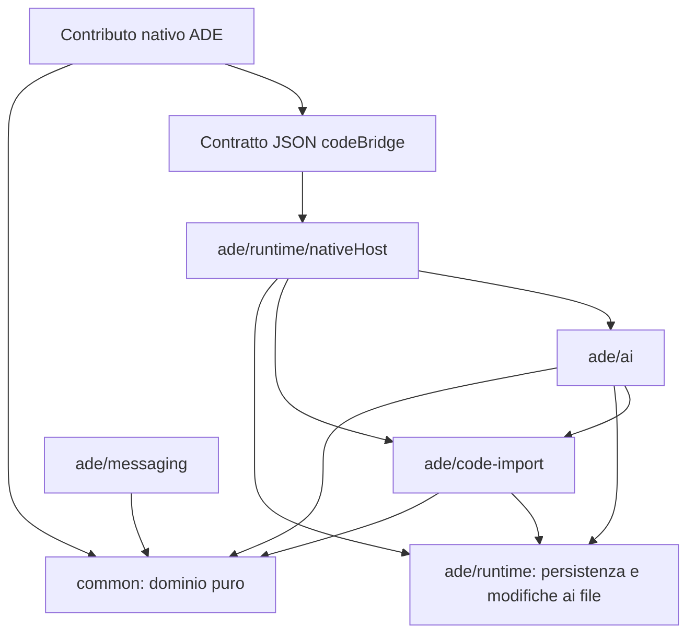

# Architettura A.D.E

ADE è un fork di Code OSS con un contributo nativo dedicato. Per ottenere un ambiente di sviluppo funzionante, parti dalla [guida di sviluppo](fork-development.md).

## Confini e dipendenze

Il dominio vive in `src/vs/workbench/contrib/ade/common/`: è TypeScript puro, senza dipendenze da filesystem, Node, browser o servizi del workbench. Il contributo nativo aggiunge gli adattatori UI e desktop. I tool in `ade/` consumano lo stesso dominio.



`ade/runtime/nativeHost.ts` è il punto di composizione del processo di analisi: valida il protocollo, coordina importazione e IA e conserva cache proprie per ciascuna istanza del motore. L'importatore non dipende dall'IA o dal dispatcher. I moduli infrastrutturali `projectStore.ts`, `sourceChanges.ts` e `schemas.ts` sono condivisi, ma non dipendono dai workflow applicativi.

Il contratto JSON in `common/codeBridge.ts` separa il renderer dal processo Node. `ade/runtime/codeProtocol.ts` valida le richieste in ingresso; il bundle mantiene il nome pubblico `adeCodeEngine.js`. Il formato dei progetti e il protocollo non dipendono dall'organizzazione dei file sorgenti.

## Dominio semantico

Il modello supporta i formati storici v2/v3 e i contratti v4/v5. Identità semantiche, proiezioni visuali, evidenze del codice e verifiche restano distinte. Un layout non determina la proprietà architetturale e un'evidenza sintattica non certifica un comportamento eseguito.

| Modulo in `common/` | Responsabilità |
| --- | --- |
| `modelTypes.ts` | Tipi del documento, identificatori di categoria e capacità dichiarate. |
| `modelSchema.ts` | Schemi JSON versionati e controllo della forma. |
| `modelFoundation.ts` | Fondazioni vuote, inventario degli oggetti e riconoscimento dei modelli di evidenza. |
| `modelValidation.ts` | Riferimenti, proprietà, diagnostiche e lettura di snapshot validati o bozze ispezionabili. |
| `modelContractValidation.ts` | Compatibilità dei contratti e vincoli del blueprint. |
| `modelNotation.ts`, `modelScenario.ts` | Regole delle notazioni e ordinamento parziale degli scenari. |
| `modelLegacyMigration.ts`, `modelMigration.ts` | Migrazioni esplicite dai formati storici e verso la fondazione v4. |
| `semanticModelService.ts` | Modello in memoria; la persistenza appartiene agli adattatori documentali. |
| `semanticModel.ts` | Ingresso compatibile dell'API pubblica; le implementazioni importano direttamente dai moduli proprietari. |

Gli schemi pubblicati in `ade/schema/` sono artefatti verificati rispetto alla sorgente. Un cambiamento di struttura del codice non deve alterare la grammatica dei documenti.

## Modifiche atomiche e runtime

`visualEditTypes.ts` dichiara l'unione discriminata delle operazioni. `visualEditing.ts` prepara un solo candidato e smista ogni operazione in modo esaustivo ai gestori `visualEditFoundation.ts`, `visualEditElements.ts`, `visualEditViews.ts` e `visualEditBehavior.ts`. La gestione delle identità, delle revisioni e della validazione resta al confine della transazione. `visualEditSupport.ts` raccoglie aggiornamento conservativo e calcolo delle dipendenze per la cancellazione.

Interazioni, macchine a stati e messaggistica mantengono compilazione, interpretazione e verifica nel dominio. I generatori `interactionRuntime.ts` e `stateRuntime.ts` sono consumati direttamente: i moduli che essi utilizzano non li riesportano, evitando dipendenze circolari.

Gli script `build-interaction-runtime.mjs`, `build-state-runtime.mjs` e `build-messaging-runtime.mjs` condividono `ade/runtime/runtimeSource.ts`. Quest'ultimo seleziona dichiarazioni TypeScript per nome tramite il parser, segnala dichiarazioni mancanti o ambigue e genera il JavaScript. La generazione non dipende dai titoli dei commenti o dalla posizione di una funzione. Gli artefatti `*.generated.ts` non si modificano manualmente. Un test di compatibilità conserva gli hash dei tre interpreti emessi, perché le regioni gestite nei progetti richiedono corrispondenza esatta del runtime.

## Contributo nativo

`browser/ade.contribution.ts` registra editor, viste e comandi. `AdeProjectService` mantiene il documento tramite i servizi testuali nativi: salvataggio, backup, conflitti e cronologia restano responsabilità di quegli adattatori. Navigazione, layout, selezione e analisi del modello consumano funzioni pure del dominio.

L'editor è composto da componenti con responsabilità esplicite:

| Componente | Responsabilità |
| --- | --- |
| `AdeEditor` | Ciclo di vita dell'editor, composizione delle superfici e navigazione. |
| `AdeCanvasController` | Camera, zoom, pan, movimento dei nodi e listener della singola renderizzazione. |
| `AdeCanvasSurface` | Rendering del canvas, menu e creazione delle connessioni. |
| `AdeInspector` | Proprietà contestuali di elementi e relazioni. |
| `AdeWorkflowContent` | Pannelli del workflow, impostazioni IA e strumenti secondari. |

Il controller registra i listener nel proprio `DisposableStore`, svuotato alla successiva renderizzazione e smaltito con l'editor. I renderer delle singole notazioni restano moduli dedicati. I componenti ricevono servizi e callback espliciti, senza dipendere dalla classe dell'editor.

`adeEditingCommands.ts` è il catalogo unico dei comandi di modifica. `adeEditing.ts` conserva la revisione del documento e il confine di applicazione; i gestori `adeEditingProject.ts`, `adeEditingSpecification.ts`, `adeEditingStructure.ts` e `adeEditingDiagram.ts` raccolgono l'intento tramite dialoghi. L'aggiunta di un comando richiede di completare lo smistamento tipizzato.

## Workflow IA

`electron-browser/adeAiService.ts` coordina componenti indipendenti:

- `AdeAiConnection`: account del provider, CLI originale, modelli e configurazione.
- `AdeAiDiagrams`: conversazione, esplorazione, generazione e revisione dei diagrammi.
- `AdeAiStructural`: preparazione continua, revisione strutturale, simulazione e pubblicazione.
- `AdeAiImplementation`: proposte implementative, riconciliazione, verifiche e confronti dei modelli.

Ogni componente possiede sessioni e risorse del proprio workflow. Il coordinatore condivide il blocco delle operazioni, cancellazione, avanzamento e notifiche tramite un contesto limitato alle capacità richieste. Le opzioni di esecuzione nominano la modalità IA, diagrammi o locale. I servizi necessari vengono iniettati nei costruttori; l'istanziatore è usato solo durante la composizione iniziale.

Le modifiche sono preparate per la revisione e applicate attraverso i workflow esistenti. Budget, consenso alla condivisione, verifica, recupero e annullamento restano parte dei rispettivi contratti. La [guida utente](guida-utente/README.md) descrive i percorsi di importazione, generazione e verifica dall’interfaccia.

## Test e manutenzione

I pacchetti Node indipendenti sono `ade/runtime`, `ade/code-import`, `ade/ai` e `ade/messaging`, ciascuno con dipendenze fissate e controlli TypeScript. `ade/tsconfig.tools.json` definisce le opzioni comuni senza far dipendere la configurazione IA dall'importatore. I test del dominio sono in `ade/test/`; i test del contributo nativo sono sotto `src/vs/workbench/contrib/ade/test/`.

Per preparare i soli tool, usare la versione Node fissata in `.nvmrc` e installare i pacchetti interessati:

```sh
npm --prefix ade/runtime ci --ignore-scripts
npm --prefix ade/code-import ci --ignore-scripts
npm --prefix ade/ai ci --ignore-scripts
npm --prefix ade/messaging ci --ignore-scripts
npm run ade:test
npm --prefix ade/runtime run check
npm --prefix ade/runtime test
npm --prefix ade/code-import run check
npm --prefix ade/code-import test
npm --prefix ade/ai run check
npm --prefix ade/ai test
```

I test architetturali del runtime controllano l'assenza di cicli a runtime, l'indipendenza del dominio e dell'importatore e la risoluzione dei nomi condivisi dagli scenari desktop. La suite verifica anche che la generazione dei runtime sia indipendente da commenti e ordine delle dichiarazioni.

Per il contributo nativo, dopo la preparazione descritta nella [guida di sviluppo](fork-development.md), usare `npm run ade:check`, `npm run ade:smoke:check`, la build client necessaria ai test e `npm run ade:ai:service-test`. Lo smoke desktop mantiene l'ingresso e i flag di `ade/scripts/smoke-desktop.mjs`: avvio, isolamento e raccolta degli errori vivono in `ade/scripts/smoke/harness.ts`, le interazioni comuni in `helpers.ts` e gli scenari nei moduli dedicati.

`ade/prototype/` conserva il prototipo iniziale e la sua copertura di compatibilità. Non è richiesto dall'avvio del prodotto nativo.
