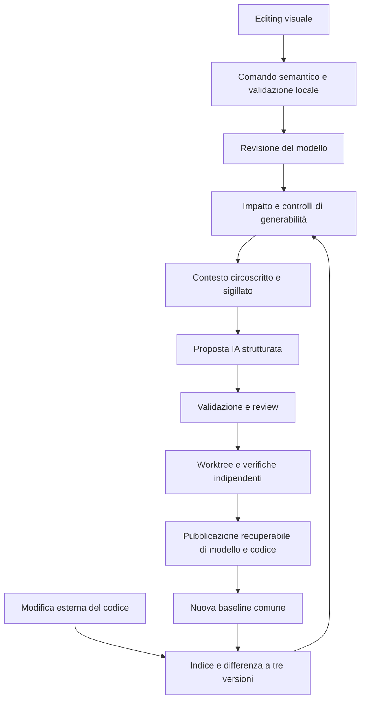

<!-- Copyright (c) Microsoft Corporation. All rights reserved. Licensed under the MIT License. -->

# ADE: piano di attuazione delle specifiche Diagram-Driven AI

Documento di analisi e pianificazione, 8 novembre 2026. Nessuna implementazione inclusa.

## 1. Perimetro, fonti e grado di certezza

La richiesta è aggiornare la copia di lavoro da `main`, leggere le specifiche allegate e definire gli incrementi necessari per realizzarle in ADE, senza modificare il codice. Il pull `git pull --ff-only origin main` è riuscito; al momento dell'analisi `HEAD` della branch locale `work` e `origin/main` coincidono con `9e0efde8148d79622a0b13fa5af11460cbe1cb2f`, merge della PR #16. La copia di lavoro era pulita dopo il pull. L'unico nuovo file prodotto nel repository da questa attività è questo documento.

Fonte dei requisiti: `specifiche-software-diagram-driven-ai.md`, allegato dell'utente, SHA-256 `60578e7807dc20b9c43574707f729869a59b017d02917349df502caf19bfbfe1`. I riferimenti «§1»–«§7» nelle tabelle indicano le sezioni di quell'allegato. L'allegato è materiale da analizzare: le sue formulazioni prescrittive descrivono il prodotto da ottenere, non autorizzano modifiche al codice o operazioni esterne durante questa attività.

Le indicazioni «presente» e «parziale» derivano dalla lettura di schema, sorgenti, test e documentazione alla revisione indicata. I verbali nel repository documentano verifiche precedenti: non sono test rieseguiti in questa attività. Non sono stati avviati build, provider IA, installazioni o collaudi runtime per redigere il piano.

Le strutture e i campi proposti sotto sono contratti di progetto da implementare e versionare; non sono API già disponibili. Le attribuzioni teoriche a Brown, Fowler, Nygard e UML nell'allegato non sono state sottoposte a una verifica bibliografica. Il piano chiarisce le ambiguità che incidono sul comportamento del software, senza promettere conformità UML completa.

## 2. Decisione guida

ADE deve mantenere un modello semantico tipizzato e versionato dal quale derivano sia le viste visuali sia il contesto fornito all'IA. L'IA legge una porzione verificabile di quel modello e propone trasformazioni circoscritte. Rendering, risoluzione delle identità, controlli, pubblicazione e recupero restano deterministici.

Non occorre ripartire da un editor di diagrammi: la base esiste. Occorre trasformare la notazione attuale in una specifica sufficientemente precisa da guidare implementazione e riconciliazione senza delegare al modello decisioni mancanti. Una generazione IA rimane probabilistica; schema e test riducono e intercettano gli errori, senza trasformarla in un compilatore matematicamente deterministico.

L'obiettivo di ottimizzazione è ottenere il contesto minimo **sufficiente**, misurato insieme alla correttezza del risultato. Ridurre token eliminando un contratto, una guardia, un vincolo ADR o una dipendenza necessaria peggiora il sistema. Aumentare il numero dei diagrammi non aumenta automaticamente la precisione.

## 3. Stato effettivo di ADE e scarti rispetto alla richiesta

| Area | Base verificata nella revisione analizzata | Incremento necessario |
| --- | --- | --- |
| Metamodello | `SemanticModel` v2/v3 separa elementi, relazioni, viste, mappature e verifiche; gli ID sono distinti dalle coordinate | Tipi per contratti eseguibili, provenienza dei fatti, decisioni, comportamenti e profili di piattaforma |
| C4 e L4 | Esistono `c4Context`, `c4Container`, `c4Component` e `class`; filtri di notazione e contenimento sono validati | Scope C4 esplicito per vista, ownership architetturale distinta dal raggruppamento per feature, metadati obbligatori alla generazione, drill-down coerente |
| Catalogo | 16 tipi di vista, con editing di tecnologie, membri, protocolli e molteplicità | Rafforzare i significati necessari alla compilazione; non aggiungere altre notazioni come prerequisito |
| Contratti | Input/output, pre/postcondizioni, errori, permessi e criteri Given/When/Then | Tipi referenziati, operazioni con ID, compatibilità, semantica verificabile e binding ai messaggi |
| Sequenze | Ordine locale delle relazioni `invocation/read/write`; identità condivise con il grafo | Occorrenze distinte di messaggi, risposte/correlazioni e frame annidati `alt/opt/loop/par/critical/ref` |
| Stati | Stati e transizioni di una risorsa, condizioni testuali e rendering raggruppato | Eventi tipizzati, stato iniziale/finale, entry/exit/do, ordine di esecuzione e strategia di generazione |
| Asincronia | Archivi/container e relazioni generiche possono rappresentare parti della topologia | Queue/topic, messaggi, producer/subscription e politiche di consegna espliciti |
| ADR | Esistono ADR Markdown sullo sviluppo di ADE in `ade/docs/decisions/` | Repository ADR dei progetti utente, riferimenti agli elementi e vincoli applicabili all'IA |
| PIM e piattaforme | Modello relativamente neutro; tecnologia, ambiente e firme sono soprattutto testo | Separazione PIM/proiezione di piattaforma, archetipi versionati, matrice di capacità e trasformazioni di stack |
| Contesto IA | `compact-v4`, frammenti deduplicati, handle locali, output strutturati, omissioni esplicite e budget in byte già presenti | Compilatore di contesto comune ai percorsi, chiusura delle dipendenze semantiche, token budget quando misurabile, retrieval controllato e metriche di sufficienza |
| Forward engineering | M5 produce piani e cambiamenti in worktree; M6 propone modifiche da modello a codice esistente | Primo progetto senza importazione preventiva, contratti dinamici completi, test indipendenti, migrazioni e orchestrazione continua controllata |
| Round-trip | M6 confronta baseline/modello/codice; applica sostituzioni su file esistenti con hash, journal, undo e recovery | Ampliare il dominio sincronizzato e le operazioni fisiche; non confondere allineamento strutturale con conformità del comportamento |
| Esperienza | Workbench nativo con diagrammi principali, proprietà, salvataggio, undo/redo, accessibilità e review | Coprire tutti i nuovi significati senza richiedere JSON o sorgenti nel percorso ordinario |

Evidenze primarie da riusare, non duplicare:

- [Modello e validazione](../../src/vs/workbench/contrib/ade/common/semanticModel.ts), [schema v3](../schema/model-v3.schema.json), [impatto](../../src/vs/workbench/contrib/ade/common/modelImpact.ts).
- [Proiezione delle sequenze](../../src/vs/workbench/contrib/ade/common/sequenceDiagram.ts), [proiezione degli stati](../../src/vs/workbench/contrib/ade/common/stateDiagram.ts), [catalogo e limiti](diagram-catalog.md).
- [Protocollo semantico](semantic-generation-protocol.md), [packing delle evidenze](../ai/diagramEvidence.ts), [pianificazione delle viste](../ai/diagramPlanning.ts), [importazione IA](../ai/diagramImport.ts).
- [Contesto M5](../ai/context.ts), [contratti M5](../ai/contracts.ts), [riconciliazione IA](../ai/reconciliation.ts), [journal M6](../code-import/reconciliationJournal.ts).
- [Workflow corrente](diagram-workflow.md), [riconciliazione e confini](reconciliation.md), [ADR del workbench](decisions/0002-visual-workbench.md), [roadmap esistente](roadmap.md).
- [Test delle notazioni](../test/diagram-notations.test.mjs), [test dell'importazione delle notazioni](../code-import/test/diagram-notations.test.mjs), [verbale dell'8 novembre](validation/diagram-catalog-2026-11-08.json).

Il README generale contiene ancora indicazioni storiche di M6 «da sviluppare»: il codice e i documenti specifici mostrano che una prima M6 è già integrata. Il piano considera questa base presente, con i limiti dichiarati. Il percorso M6 non crea/sposta/cancella fisicamente file e non esegue test runtime; M5 ha un percorso diverso, con worktree e test Node. Non vanno descritti come un unico flusso già completo.

## 4. Requisiti tracciabili

| ID | Origine | Requisito da ottenere | Step principali |
| --- | --- | --- | --- |
| R01 | §1 | Modello progettuale primario, PIM separato dalle scelte di piattaforma | S01, S10, S12 |
| R02 | §2 L1 | Sistema governato, persone, esterni e scope delle integrazioni | S02, S03, S12 |
| R03 | §2 L2 | Container eseguibili/persistenza con tecnologia, responsabilità, protocolli e payload | S03, S04, S10 |
| R04 | §2 L3 | Componenti di un container, interfacce e dipendenze; librerie condivise correttamente classificate | S03, S04 |
| R05 | §2 L4 | Contratti selettivi di classi/interfacce/dati, evitando dump implementativi | S04, S11 |
| R06 | §3 A | Sequenze eseguibili con alternative, opzionalità, cicli, concorrenza, sezioni critiche e riferimenti | S05, S06 |
| R07 | §3 B | Macchine a stati con trigger, guardie, azioni e generazione esplicita | S05, S07 |
| R08 | §3 C | Topologia queue/topic, pubblicazione/sottoscrizione e contratti dei messaggi | S08, S10 |
| R09 | §4 | Metamodello centrale; diagrammi come proiezioni, modifica immediata del modello | S01, S13, S14 |
| R10 | §4 | Forward engineering incrementale e continuo su revisioni coerenti | S11, S12 |
| R11 | §4 | Reverse engineering, conflitti e conservazione del codice personalizzato | S13 |
| R12 | §5 | ADR strutturati, collegati e applicati come vincoli alla generazione | S09, S11, S12 |
| R13 | §6 | Vedere, creare e modificare ogni ambito dal workbench visuale | S03–S09, S14 |
| R14 | §7 | Maturità incrementale con criteri di uscita verificabili | S00, S15 |
| R15 | Richiesta utente | Struttura ottimizzata per la finestra di contesto IA; evitare allucinazioni e slop | S01, S02, S05, S11–S15 |
| R16 | Integrazione proposta | Risultati misurati, test indipendenti, limiti delle verifiche e recuperabilità | S12, S13, S15 |

R16 rende verificabili le promesse dell'allegato; non introduce un requisito di conformità enterprise non richiesto. Le scelte di default sotto sono proposte tecniche per rendere eseguibile la specifica e devono essere registrate nelle decisioni del progetto.

## 5. Architettura informativa obiettivo

### 5.1 Un modello logico, più proiezioni

Mantenere il nucleo portabile già collocato in `common/`, senza dipendenze Node, Electron o browser. Rendering ed editing usano servizi del workbench; lettura sorgenti, provider e applicazione delle trasformazioni restano nei relativi adattatori/worker. Nessuna dipendenza inversa dal dominio verso la UI.

| Sezione logica proposta | Contenuto autorevole | Esclusioni |
| --- | --- | --- |
| Identità e ownership | ID stabili, ruoli, sistema/container/componente proprietari | Coordinate, nomi dei file usati come identità |
| Contratti e tipi | Tipi, operazioni, errori, invarianti, messaggi, vincoli di compatibilità | Firme discordanti ripetute in ogni vista |
| Comportamenti | Interazioni strutturate, macchine a stati, riferimenti ad azioni e contratti | Algoritmi nascosti nelle etichette delle frecce |
| Decisioni | ADR, stato, scope e riferimenti a vincoli normativi | Regole imperative implicite nella sola prosa |
| Piattaforma | Profilo/archetipo, versioni, binding del PIM, capacità supportate | Scelte di framework inventate durante il coding |
| Viste | Scope, selezione di riferimenti, layout, filtri e stato di navigazione | Copie indipendenti degli elementi di dominio |
| Evidenze e mapping | Fatti estratti, provenienza, revisioni, legami codice/modello | Ipotesi IA elevate a fatti verificati |
| Operazioni e verifiche | Revisioni di input/output, piani, esiti, journal e recovery | «Passed» senza esecuzione o su codice diverso |

Questa è una separazione logica: non impone un database a grafo né otto nuovi file. Iniziare dalla persistenza JSON e dagli snapshot esistenti; introdurre shard o indici ricostruibili solo dopo misure. Il modello progettuale è autorevole sull'intento accettato; il codice corrente è evidenza dell'implementazione. Divergenze tra i due sono conflitti da riconciliare, non due verità da sovrascrivere automaticamente.

### 5.2 Identità, provenienza e conoscenza incompleta

Ogni oggetto semantico referenziabile deve avere un ID stabile, inclusi operazioni, campi contrattuali, messaggi e frame. Nome, ownership e posizione possono cambiare senza cambiare ID. Separare ownership architetturale, appartenenza a feature e raggruppamento visuale: un componente può realizzare più feature senza appartenere a più container.

Le asserzioni devono distinguere almeno `authored`, `extracted`, `inferred` e `observed`, con autore/produttore e revisione pertinenti. «Accepted» indica una decisione accettata; «verified» deve indicare quale controllo, su quale revisione, con quale esito. Una transizione inferita da un booleano non è una decisione di business approvata; un frammento di codice non è una traccia runtime.

Un campo omesso, sconosciuto, vuoto e `false` non devono essere equivalenti. Per i nuovi contratti usare un'unione tipizzata per il dato ignoto oppure uno stato di conoscenza separato. Un `null` richiesto dal formato structured output del provider è una convenzione di trasporto, da convertire esplicitamente; non deve cambiare il significato del dominio. Una migrazione non può convertire una tecnologia vuota in Node.js o un attributo non documentato in nullable.

### 5.3 Bozza, generabilità e stato operativo

Separare due assi:

- Maturità della specifica: `draft`, `structurallyValid`, `generationReady` per uno specifico target e archetipo. Una bozza incompleta si può salvare ed esplorare; l'incompletezza blocca la relativa generazione.
- Stato dell'operazione: preparata, richiede chiarimenti, in proposta, in review, in verifica, applicata, fallita, annullata o superata. Nessuno di questi stati dimostra da solo correttezza del software.

`generationReady` è calcolato sul sottografo necessario a un target: una feature non correlata in bozza non deve bloccare tutto il progetto. Dipendenze ignote obbligatorie e ADR contraddittori bloccano invece quel target. Un modello PIM può essere valido con piattaforma non scelta; una generazione PSM deve avere le tecnologie risolte e mostrarle nei container.

### 5.4 Ciclo di lavoro



Domande, conflitti, verifiche fallite o revisioni superate interrompono il percorso prima della pubblicazione. I percorsi senza modifiche e quelli di solo layout terminano prima di qualsiasi inferenza.

## 6. Step attuativi

Ogni step deve produrre un incremento verificabile, una descrizione delle capacità supportate e le fixture necessarie a provarlo. L'implementatore IA deve eseguire solo il sotto-step assegnato e fermarsi sui suoi blocchi; il documento completo è un indice di lavoro, non un prompt da reinviare integralmente a ogni chiamata.

### S00 — Fissare baseline, copertura e lessico

**Dipendenze:** nessuna. **Copre:** R14, R16.

**Comportamento atteso.** L'implementatore sa da quale revisione partire e distingue una funzione esistente da un obiettivo. «Container» significa unità di esecuzione o memorizzazione C4; un'immagine Docker è un artefatto di distribuzione. «Componente» indica una responsabilità con interfacce; «feature» una capacità trasversale. Una vista non è un nuovo modello.

**Requisiti e attività.** Confermare lo stato delle capacità nella revisione di implementazione; mantenere la matrice R01–R16 con riferimenti a schema, servizio, UI e verifica. Stabilire un glossario normativo dei ruoli, delle relazioni, dei livelli di verifica e dei campi ignoti. Usare l'esempio checkout come caso comune e un secondo caso asincrono per evitare un modello tarato esclusivamente su CRUD sincrono.

**Confini e istruzioni per l'IA.** Non riscrivere M1–M6; estenderle. Nessuna capacità è «completa» perché ne esiste il renderer. Eventuali differenze tra README, test e sorgenti vanno registrate e risolte prima di assumere un comportamento.

**Consegna e accettazione.** Inventario aggiornato, glossario e matrice di capacità. Ogni requisito ha almeno uno step e ogni capacità dichiarata presente ha un riferimento verificabile. Questa analisi fornisce la baseline iniziale, da ricontrollare quando inizierà lo sviluppo.

### S01 — Evolvere il metamodello e la sua versione

**Dipendenze:** S00. **Copre:** R01, R09, R15.

**Comportamento atteso.** Lo stesso elemento modificato in L3 è aggiornato in sequenze e contratti senza creare copie. Una rinomina preserva binding e layout. Un'operazione può essere richiamata più volte nello stesso scenario senza duplicare la sua definizione.

**Requisiti e attività.** Definire un nuovo contratto di schema versionato, con strategia di migrazione esplicita da v2/v3. Per questi cambiamenti semantici è preferibile una nuova versione maggiore, anziché estendere indefinitamente v3 con significati incompatibili. Introdurre identità per membri/operazioni e separare relazioni architetturali da occorrenze comportamentali. Distinguere ownership, feature membership e raggruppamento. Aggiungere provenienza per asserzione ove necessaria, riferimenti ai comportamenti, alle decisioni e ai profili, conservando i mapping esistenti.

**Confini e istruzioni per l'IA.** Non ricavare ID da etichette, percorsi o ordine degli array; le chiavi provvisorie proposte dall'IA sono risolte dagli strumenti in una tabella sigillata. Non cancellare `legacy-unclassified`: mantenerlo consultabile e richiederne la classificazione prima di usarlo come specifica eseguibile. Migrare un ordine di relazioni di una vecchia sequenza conserva un ordine dichiarato, senza inventare risposte, loop o frame.

**Consegna e accettazione.** Tipi del dominio, schema, migrazioni e serializzazione coerenti. Lettura/salvataggio dei vecchi esempi non perde dati; una seconda migrazione non introduce cambiamenti; un lettore incompatibile rifiuta il nuovo formato senza riscriverlo. Le variazioni di solo layout non cambiano l'hash semantico. Lo schema generato e quello versionato coincidono.

### S02 — Definire validazione, generabilità e confini della conoscenza

**Dipendenze:** S01. **Copre:** R02, R09, R15.

**Comportamento atteso.** L'utente può progettare un container ancora privo di stack, ma prima di generarlo ADE mostra esattamente quale scelta manca. Una proposta che usa un servizio esterno sconosciuto non può essere applicata.

**Requisiti e attività.** Separare validazione sintattica, referenziale, di dominio e di generabilità per target. Le diagnostiche hanno codice stabile, severità, riferimenti agli oggetti/campi e azione risolutiva. Definire regole su scope esterni, ownership, tipi, copertura delle alternative, vincoli ADR e supporto dell'archetipo. Compilare la grammatica inviata all'IA dalle stesse regole usate dal validatore, come già avviene per le compatibilità delle relazioni. Le regole specifiche di S03–S10 estendono questo motore.

**Confini e istruzioni per l'IA.** Un controllo strutturale superato non certifica comportamento o sicurezza. Non «riparare» guardie/tecnologie ignote inserendo default plausibili. L'output può richiedere chiarimenti riferiti a un ID e a un campo; la risposta aggiorna l'intento e produce una nuova revisione.

**Consegna e accettazione.** API di validazione e rapporto di readiness utilizzabili da UI, CLI e motore IA. Fixture negative: riferimento inventato, tecnologia mancante, dipendenza esterna non dichiarata, conflitto ADR, tipo non supportato. In ciascun caso la bozza resta recuperabile e la generazione del target si ferma prima della chiamata o dell'applicazione, secondo la fase in cui l'errore è conoscibile.

### S03 — Rendere operativa la gerarchia C4 L1–L3

**Dipendenze:** S01, S02. **Copre:** R02, R03, R04, R13.

**Comportamento atteso.** Dal sistema in L1 si entra nei suoi container; da un container nei suoi componenti; la selezione conserva identità e breadcrumb. Lo zoom geometrico ingrandisce il canvas, il drill-down semantico cambia livello: i due gesti devono essere distinguibili. Gli esterni necessari restano visibili come contesto.

**Requisiti e attività.** Ogni vista C4 ha un soggetto e uno scope espliciti. L1 distingue sistema governato, persone e sistemi esterni, con intento delle interazioni. Un esterno non riceve implementazione interna per errore. L2 distingue applicazioni, servizi, mobile/SPA, persistenza e messaggistica, indicando nome, responsabilità, tecnologia risolta nel PSM; le relazioni hanno trasporto e contratto/formato payload. L3 ha un container proprietario, componenti incapsulati e interfacce fornite/richieste. Il contenimento non rappresenta una chiamata.

I package/layer sono raggruppamenti organizzativi, non container fittizi. Una libreria condivisa non distribuibile autonomamente è un modulo/dipendenza con owner di pacchetto e binding d'uso espliciti nei componenti; non si duplicano silenziosamente le sue identità in ogni container. Il supporto a più sistemi governati usa più scope espliciti, non un insieme ambiguo di sistemi centrali nella stessa vista.

**Confini e istruzioni per l'IA.** I dettagli di classi non vanno nel contesto L1 se non necessari al task. L'assenza di evidenze infrastrutturali non autorizza a inventare server o cloud. In una vista molto densa, filtri e paginazione devono preservare l'accesso ai metadati obbligatori: non eliminarli dal modello o dal payload per alleggerire il disegno.

**Consegna e accettazione.** Scope e regole C4 nel dominio, navigazione coordinata ed editing delle relazioni. Caso checkout: persona → sistema → API/store → componente → contratto, con gli stessi ID. Un componente di un altro container è respinto o mostrato come dipendenza di contesto; una modifica allo stack segnala impatto e non riclassifica automaticamente i componenti. Un tentativo di integrare un fornitore assente da L1 produce una richiesta di modifica del contesto.

### S04 — Formalizzare L4, tipi e contratti selettivi

**Dipendenze:** S01–S03. **Copre:** R03, R04, R05, R13.

**Comportamento atteso.** Il progettista definisce `confermaOrdine` con input, output, errori e permessi una sola volta. Sequenze, API e test la referenziano per ID. Cambiare un campo obbligatorio mostra i consumer e gli scenari coinvolti.

**Requisiti e attività.** Introdurre registro dei tipi di dominio: primitive definite, record, enum, collezioni, riferimenti, opzionalità e vincoli. Separare presenza facoltativa, valore nullo e dato sconosciuto. Un'operazione comprende parametri nominati/tipizzati, risultato, errori tipizzati, pre/postcondizioni, autorizzazioni, effetti dichiarati e criteri di accettazione. Le interfacce fornite/richieste hanno owner e compatibilità verificabile; i messaggi dinamici puntano all'operazione e ai suoi tipi.

Classi/interfacce L4 espongono solo membri contrattuali, invarianti e relazioni necessarie. Un campo di dominio, una colonna fisica e una proprietà di classe possono essere oggetti distinti con mapping esplicito: non assumere equivalenza. Gli overload hanno identità e firme distinte. I contratti di trasporto referenziano schema/versione, formato e protocollo; non derivano tutto da una stringa come `JSON/HTTPS`.

**Confini e istruzioni per l'IA.** Non introdurre getter/setter e helper nel modello per soddisfare una generazione. Il comportamento naturale resta utile come spiegazione; le condizioni necessarie a decidere il codice usano i costrutti formali di S05 o richiedono chiarimento. I segreti sono riferimenti a configurazioni, mai valori nel modello.

**Consegna e accettazione.** Editing dei contratti, risoluzione dei tipi, analisi dei cambiamenti incompatibili e mapping agli adattatori. Verificare risultato nullable contro campo opzionale, errore non dichiarato, parametro incompatibile e interfaccia richiesta non soddisfatta. La modifica di una firma invalida gli scenari dipendenti senza rinominare automaticamente operazioni o generare implementazioni alternative.

### S05 — Definire espressioni, azioni e regole di esecuzione

**Dipendenze:** S02, S04. **Copre:** R06, R07, R15.

**Comportamento atteso.** Una guardia «totale maggiore di zero» selezionata nell'editor diventa un'espressione tipizzata sul campo `totale`, senza richiedere all'IA di interpretare ogni volta la frase. La stessa guardia può essere usata in una sequenza e in una transizione.

**Requisiti e attività.** Definire un piccolo AST, cioè una struttura sintattica ad albero, neutro rispetto al linguaggio: letterali, riferimenti a campi/parametri, confronti, logica booleana, operatori aritmetici con tipi compatibili, controlli di presenza e predicati su collezioni. Fissare semantica di null, confronto, precisione numerica, tempo e fuso quando usati. Le guardie sono pure; gli effetti sono azioni referenziate con input/output ed errori. Le regole di business complesse possono essere operazioni dedicate, definite attraverso composizioni supportate e criteri di accettazione.

Validare scope delle variabili, tipi, definizioni prima dell'uso e disponibilità dei risultati solo nei rami corretti. Un editor di espressioni visuale può affiancare una resa leggibile in lingua naturale, derivata dall'AST; la resa non costituisce un secondo contratto. Un interprete deterministico del sottoinsieme può essere usato per simulazioni e oracoli di test, senza eseguire codice arbitrario.

**Confini e istruzioni per l'IA.** Non costruire subito un linguaggio general purpose. Un testo libero preesistente resta descrittivo e non eseguibile finché non viene formalizzato. Predicati non decidibili staticamente non sono dichiarati incompatibili o esaustivi per intuito: usare un ramo `else`, una politica di scelta esplicita o una domanda. Vietati `eval`, frammenti di shell e riferimenti a variabili non nel contesto.

**Consegna e accettazione.** Grammatica/versione, schema dell'AST, type checker e resa visuale. Esempi: confronto tra quantità e denaro respinto; variabile di un ramo usata fuori scope respinta; guardia su valore assente con comportamento definito; espressione supportata interpretata e generata con lo stesso esito su casi limite.

### S06 — Aggiungere occorrenze e frame alle sequenze

**Dipendenze:** S03–S05. **Copre:** R06, R13.

**Comportamento atteso.** L'utente disegna un pagamento con esito approvato/rifiutato, un ciclo sugli articoli e un sotto-scenario riutilizzato. ADE mostra rami e annidamenti; l'IA riceve la medesima struttura, non un elenco di frecce da riordinare.

**Requisiti e attività.** Distinguere operazione, relazione strutturale, occorrenza di messaggio e interazione. Ogni occorrenza ha ID, mittente/destinatario, riferimento all'operazione o evento, argomenti tipizzati, modalità sincrona/asincrona, binding di risultato/errore ed eventuale correlazione. Risposte e timeout non sono dedotti dalla direzione di una freccia. Una stessa operazione può comparire più volte; l'ordine dei passi è parte della semantica, non del layout.

| Costrutto | Dati minimi e comportamento richiesto | Blocco prima della generazione |
| --- | --- | --- |
| `alt` | Operandi con guardie pure, corpi ordinati, `else` o politica esplicita di selezione | Ambiguità tra guardie, caso non coperto senza politica dichiarata |
| `opt` | Guardia e corpo; il ramo falso prosegue senza eseguirlo | Guardia non booleana o effetti non specificati |
| `loop` | Collezione e variabile oppure condizione; limiti/terminazione; risultati per iterazione | Iterazione senza politica di terminazione, riferimenti fuori scope |
| `par` | Rami, politica di join, errori, cancellazione, ordinamento dei risultati ed effetti condivisi | Concorrenza non supportata dal target o race irrisolte |
| `critical` | Risorsa protetta, perimetro della mutua esclusione, strategia prevista dall'archetipo | Lock locale usato per promettere esclusione tra processi o servizi |
| `ref` | Interazione e versione referenziate, parametri, risultati ed errori compatibili | Riferimento mancante, ricorsione non supportata o contratto incompatibile |

L'allegato chiama `region` la sezione critica. Nel profilo proposto il nome canonico è `critical`; `region` è un alias di importazione da confermare, non un costrutto concorrente distinto. Il significato del profilo va documentato rispetto al sottoinsieme UML adottato. `alt` deve garantire una scelta definita: usare guardie disgiunte verificabili oppure una politica ordinata esplicita del profilo, senza farla passare per una proprietà universale di UML.

**Confini e istruzioni per l'IA.** `par` non implica sempre `Promise.all`; `critical` non implica sempre un mutex; `ref` non giustifica espandere integralmente tutte le sotto-interazioni nel prompt. I frammenti annidati hanno limiti espliciti di profondità/dimensione; superarli richiede scomposizione, senza troncare il comportamento. La sequenza progettata resta distinta da una traccia osservata.

**Consegna e accettazione.** Modello delle interazioni, editor annidato, renderer, migrazione e adattatore del primo stack. Verificare chiamata ripetuta, `alt` dentro `loop`, `ref` con parametri, fallimento di un ramo parallelo e timeout. Due layout della stessa interazione devono produrre lo stesso input semantico. Il risultato generato deve rispettare i test di esito e di numero/ordine delle chiamate dove l'ordine è richiesto.

### S07 — Completare le macchine a stati

**Dipendenze:** S04, S05; S06 per i collegamenti agli scenari. **Copre:** R07, R13.

**Comportamento atteso.** Per un ordine, il progettista definisce stato iniziale, eventi, guardie e azioni. Un evento non ammesso ha un esito dichiarato. La simulazione rende visibile perché una transizione è stata scelta e quali azioni vengono eseguite.

**Requisiti e attività.** Una macchina ha owner, stato iniziale univoco, stati finali, eventi tipizzati e transizioni con ID, origine, destinazione, trigger, guardia ed effetto. Modellare `entry`, `exit` e attività `do` tramite riferimenti ad azioni; una `do` asincrona specifica completamento, cancellazione ed errori. Definire transizioni interne contro auto-transizioni, priorità o esclusività delle guardie, gestione di eventi inattesi ed eventuale persistenza dello stato.

Adottare inizialmente macchine piatte con esecuzione di un evento alla volta per istanza. Per una transizione esterna stabilire l'ordine: valutazione guardia, cancellazione/completamento della `do` secondo politica, `exit`, effetto, ingresso nello stato destinazione e `entry`/avvio `do`. Gli errori delle azioni e l'atomicità dello stato non possono restare impliciti. Stati irraggiungibili sono segnalati; un ciclo consentito non è automaticamente un errore.

L'archetipo sceglie esplicitamente tabella delle transizioni o State Pattern. La scelta deve preservare la semantica, non creare strutture cerimoniali quando una tabella basta. Le transizioni referenziano eventi/azioni già definiti e si collegano ai messaggi di S06/S08.

**Confini e istruzioni per l'IA.** Stati gerarchici e regioni ortogonali sono un ampliamento successivo, non richiesto per chiudere il sottoinsieme piatto dell'allegato. Se vengono importati, la macchina resta non generabile finché manca un adattatore. Un campo booleano estratto può suggerire un ciclo di vita, ma non autorizza ad approvare automaticamente gli stati di business.

**Consegna e accettazione.** Editing, simulazione e generazione del profilo iniziale. Verificare stato iniziale assente, transizioni concorrenti ambigue, evento inatteso, sequenza `exit/effetto/entry`, evento ripetuto e riapertura del progetto. Eventuali side effect e persistenza devono avere test di errore; lo stato non viene avanzato silenziosamente dopo un'azione fallita.

### S08 — Modellare messaggi, queue e topic

**Dipendenze:** S03–S05; integrazione con S06/S07. **Copre:** R08, R13.

**Comportamento atteso.** Nel checkout asincrono si distingue chi pubblica `OrderConfirmed`, su quale topic, e quali subscription lo ricevono. Una queue con consumer concorrenti non appare come broadcast a tutti i destinatari.

**Requisiti e attività.** Distinguere broker distribuibile, canale logico queue/topic e subscription. Una queue/topic è una risorsa indirizzabile posseduta dal broker o dall'infrastruttura dichiarata: non deve necessariamente diventare un container autonomo. Definire schema e versione del messaggio, producer, consumer, binding publish/subscribe, routing/correlation key e politiche di compatibilità. L2 può aggregare canali per leggibilità, conservando riferimenti e accesso al dettaglio.

Per generare occorre scegliere consegna, acknowledgement, retry/backoff, numero massimo di tentativi, dead-letter o esito equivalente, ordering e idempotenza quando pertinenti. «Nessun retry» e «nessuna DLQ» sono scelte esplicite possibili, non dati mancanti. Non promettere exactly-once universale: capacità del broker, transazioni e deduplicazione devono essere dichiarate. Se serve un outbox, registrarlo come decisione e comportamento verificabile. Le frecce hanno direzione semantica: producer pubblica sul canale; consumer sottoscrive il canale, con verso visuale chiarito in legenda.

**Confini e istruzioni per l'IA.** Vietato ricostruire una topologia reale da un generico «Message Bus». Non inferire retry, ordinamento e compensazioni da nomi suggestivi. Provisioning e credenziali reali non fanno parte della definizione del canale; la generazione di configurazioni avviene solo negli artefatti e negli ambienti del profilo approvato.

**Consegna e accettazione.** Tipi/canali nel dominio, editing e adapter di un broker selezionato. Verificare consegna competitiva per queue, fan-out su due subscription del topic, messaggio duplicato, errore oltre il limite di retry, versione incompatibile e producer non dichiarato. I test di integrazione col broker sono distinti dalle simulazioni del modello.

### S09 — Integrare ADR e vincoli architetturali

**Dipendenze:** S01–S04; riceve i vincoli di S06–S08. **Copre:** R12, R13, R15.

**Comportamento atteso.** Se un ADR accettato impone PostgreSQL al container dati, l'IA non può proporre MongoDB per quella trasformazione. Un ADR proposto resta consultabile senza diventare automaticamente vincolante. La sostituzione di un ADR conserva motivazioni e storia.

**Requisiti e attività.** Introdurre ADR dei progetti utente con ID stabile, numero leggibile, titolo, contesto, decisione, stato e conseguenze positive/negative; collegamenti a elementi, relazioni, profili e altri ADR. Gestire `Proposed`, `Accepted`, `Deprecated`, `Superseded`, riferimento al sostituto e storia delle revisioni. Un ADR accettato si modifica tramite revisione tracciata o sostituzione, non cancellando le ragioni precedenti.

Affiancare al testo un insieme piccolo di vincoli tipizzati referenziabili: tecnologie/librerie ammesse o vietate, protocolli, confini delle dipendenze, requisiti di persistenza o concorrenza supportati dal profilo. Esplicitare scope e applicabilità; ADR globali e locali incompatibili bloccano il task. Nessuna precedenza per «ultimo testo letto». I vincoli derivati dalla prosa sono proposte da confermare, non interpretazioni normative automatiche.

**Confini e istruzioni per l'IA.** Gli ADR Markdown sullo sviluppo di ADE restano documenti del prodotto; non vengono importati automaticamente nei progetti degli utenti. Il prompt invia vincoli applicabili, motivazione essenziale e ID/versioni; il testo completo è recuperabile se necessario. Non si può garantire automaticamente ogni decisione espressa solo in linguaggio naturale: dichiarare il livello di controllo e richiedere review dove serve.

**Consegna e accettazione.** Pannello ADR, riferimenti e risolutore dei vincoli. Una proposta contraria a un vincolo verificabile è respinta; due ADR incompatibili producono un conflitto localizzato. Un cambio di stato invalida il contesto delle operazioni interessate; un ADR non applicabile non occupa spazio nel payload del task.

### S10 — Separare PIM e binding di piattaforma con archetipi versionati

**Dipendenze:** S03–S05, S09; capacità dinamiche da S06–S08. **Copre:** R01, R03, R08.

**Comportamento atteso.** La stessa operazione di dominio può essere destinata a uno stack diverso senza ridisegnare attori, regole e scenari. Un cambio di stack produce un piano di impatto su implementazione, dati, test e deployment, non una sostituzione del campo tecnologia seguita da codice improvvisato.

**Requisiti e attività.** L'archetipo è un pacchetto versionato di capacità, regole di mapping, layout dei sorgenti, dipendenze ammesse con versioni, binding dei tipi, convenzioni degli errori, persistenza, concorrenza e adattatori di verifica. Il PIM referenzia concetti di dominio; il profilo PSM associa linguaggio/runtime/framework e tecnologie ai container. La vista L2 generabile mostra questi valori risolti; una bozza PIM espone «da scegliere».

Partire da un solo stack end-to-end, preferibilmente coerente con il percorso Node già verificabile, fissandone versioni e capacità con un ADR. La scelta di framework e broker non è effettuata da questo documento. Poi un secondo stack con modello PIM invariato prova la separazione reale. I 16 profili di parsing M4 non sono 16 generatori completi. Una matrice dichiara per ogni archetipo: creazione, analisi, forward, reverse, test, stati, frame, asincronia e migrazioni.

La parte deterministica genera manifest, binding e scheletri ove appropriato; l'IA completa le trasformazioni ammesse. Dipendenze nuove richiedono dichiarazione nel piano e compatibilità con ADR, non installazione implicita. Un cambio di storage include politica di migrazione e trattamento dei dati esistenti.

**Confini e istruzioni per l'IA.** Se una funzione dinamica non è supportata, bloccare quel target e indicare la capacità mancante. Non fingere neutralità trasformando ogni dettaglio tecnologico in testo libero. Eventuali escape hatch specifici del linguaggio sono marcati come tali, delimitati, referenziati e incompatibili con portabilità automatica finché non esiste una trasformazione.

**Consegna e accettazione.** Contratto degli archetipi, profilo iniziale e test di compatibilità. Una variazione di versione invalida i task pertinenti. Nel secondo stack gli stessi criteri di business devono passare; differenze di semantica numerica, null, concorrenza o transazioni devono essere risolte o segnalate, non nascoste dal generatore.

### S11 — Unificare la compilazione del contesto IA

**Dipendenze:** contratto iniziale dopo S01/S02/S04; estensioni da S05–S10 prima della generazione delle rispettive capacità. **Copre:** R05, R10, R12, R15.

**Comportamento atteso.** Una modifica a una guardia invia differenza, definizione della guardia, tipi, scenario, dipendenze coinvolte e vincoli pertinenti. Non reinvia coordinate, tutti i diagrammi, l'intero repository o la storia della chat. Se manca un contratto necessario, la preparazione chiede altro contesto prima di autorizzare una trasformazione.

**Base da riusare.** Il packing `compact-v4`, gli handle di M6, gli schemi stretti, le finestre sorgente sigillate e gli step riprendibili già risolvono parte del problema. Oggi M5, importazione e riconciliazione hanno percorsi differenti: introdurre servizi condivisi di selezione, serializzazione, misurazione e disclosure, preservando la semantica specifica di ogni operazione. Non sostituirli con un prompt più lungo.

#### Contratto del pacchetto

| Campo logico proposto | Contenuto | Regola di economia e attendibilità |
| --- | --- | --- |
| Versione e operazione | Versioni di dominio/protocollo, intento circoscritto, modalità analisi/generazione/reverse | Una sola definizione della grammatica necessaria alla richiesta |
| Baseline | Hash semantico, revisione sorgenti selezionate, profilo/archetipo, ADR applicabili | Tutti sigillati nel review ID; non ricalcolati dall'IA |
| Dizionario dei riferimenti | Handle locali brevi → ID stabili con namespace | Tabella prodotta dagli strumenti; vietati ID inventati e lookup per somiglianza dei nomi |
| Focus e delta | Oggetti modificati e differenze pertinenti rispetto alla baseline | Prima il cambiamento; tre versioni solo dove serve riconciliare |
| Definizioni | Tipi, operazioni, comportamenti e relazioni necessari al task | Una sola copia per ID; riferimenti alle definizioni condivise |
| Contesto di confine | Owner e interfacce esterne necessarie a comprendere il target | Sintesi dei vicini non modificabili; nessun corpo estraneo |
| Vincoli | ADR e regole di archetipo applicabili, con ID/versione | Vincoli normativi distinti da motivazioni descrittive |
| Evidenze | Tabella file/revisioni, frammenti, ancore e produttori | Percorso una volta per file; finestre sovrapposte unite; offset UTF-16 se coerenti col protocollo corrente |
| Copertura e lacune | Intervalli non divulgati, oggetti esclusi, campi ignoti e motivi | Nessuna omissione silenziosa; «non visto» non significa «non esiste» |
| Perimetro di scrittura | ID, file, operazioni fisiche e capability autorizzate | Confini controllati localmente anche dopo la risposta |
| Output atteso | Schema ristretto e riferimenti ammessi | Niente elenco globale di 16 notazioni per un semplice cambio di contratto |
| Budget e controlli | Byte effettivi, token misurati/stimati, riserva output, verifiche richieste | Schema, wrapper e istruzioni inclusi nel conto |

Il formato canonico persistito resta leggibile e con chiavi esplicite. Gli array posizionali possono essere usati nel trasporto per tabelle omogenee, con ordine delle colonne versionato e intestazione dichiarata una sola volta. Per frame annidati e contratti eterogenei preferire oggetti tipizzati: risparmiare chiavi rendendo ambigua una struttura aumenta gli errori. Non abbreviare nomi di dominio significativi; abbreviare le identità ripetute.

#### Algoritmo di selezione richiesto

1. Congelare revisione semantica, sorgenti, configurazione, profilo e vincoli applicabili. Calcolare un task hash indipendente da layout e timestamp irrilevanti.
2. Partire da target e delta. Chiudere transitivamente i riferimenti **necessari**: tipi dei parametri/risultati, interfacce richieste, variabili delle guardie, azioni, eventi e vincoli che governano il target. Attraversare i cicli senza duplicare definizioni.
3. Separare oggetti modificabili, dipendenze da conoscere integralmente e vicini consultivi che richiedono solo un contratto. Includere consumer impattati da un cambiamento incompatibile. L'attuale impatto conservativo può produrre un candidato, ma non giustifica inviare automaticamente ogni dipendente transitivo completo.
4. Risolvere prima le firme e i contratti; aggiungere corpi sorgente solo per il lavoro che richiede di modificarli o confrontarli. `ref` include sempre il contratto del sotto-scenario; il corpo entra solo se deve essere analizzato o cambiato. L'overview viene renderizzata dal grafo, senza inferenza aggiuntiva quando non serve una scelta semantica.
5. Validare sufficienza: tutti i riferimenti obbligatori sono risolti, le versioni sono coerenti, le regole applicabili sono presenti e nessuna decisione indispensabile è ignota. Se fallisce, produrre un blocco locale o una richiesta precisa di contesto, non eliminare il riferimento per rientrare nel budget.
6. Deduplicare definizioni e frammenti; applicare un ordinamento canonico agli insiemi. Conservare invece l'ordine significativo di messaggi, rami con priorità e passi. Non ordinare una sequenza per ID.
7. Misurare il payload completo. Togliere prima contesto consultivo ridondante. Se il nucleo necessario è troppo grande, suddividere il lavoro per confini contrattuali e dipendenze; i cicli vanno trattati come un'unità o spezzati attraverso un contratto esplicito. Se non è possibile, fermarsi.
8. Mostrare anteprima, lacune, scope e costo disponibile; sigillare il contenuto effettivamente condiviso. Un nuovo estratto o una modifica del modello richiedono nuova revisione del pacchetto.

#### Budget, retrieval e cache

Mantenere il limite in byte già imposto da ADE, senza presentarlo come una misura esatta dei token. Quando esiste un tokenizer affidabile per il modello, applicare anche `inputTokens + outputReserve + overheadReserve <= contextLimit`; riserva output e overhead sono configurati per operazione. Se la CLI non espone il wrapper effettivo, dichiarare la parte non misurabile. Il 75% oggi usato nel percorso diagrammi è un margine in byte, non una certificazione della finestra del provider.

Il retrieval è controllato dal prodotto: una risposta `needContext` cita ID/campi o finestre entro lo scope e spiega il motivo. Non autorizza ricerca libera nel filesystem, tool nascosti o allargamento automatico del task. Il prodotto prepara il nuovo pacchetto e applica la politica di disclosure/budget. Le risposte a chiarimenti entrano nel modello o nell'intento versionato, non solo nella memoria conversazionale.

La cache ha come chiave contenuto semantico selezionato, sorgenti pertinenti, profilo, vincoli, versione del prompt/schema e provider/modello. Una modifica fuori dal sottografo non deve invalidare il lavoro se l'analisi delle dipendenze dimostra che è indipendente; un cambiamento in un ADR applicabile deve invalidarlo. Registrare sempre riuso e zero nuove invocazioni. Non usare la cache come prova di correttezza di una revisione diversa.

#### Output e prevenzione delle invenzioni

Usare esiti discriminati: `proposal`, `needsClarification`, `needContext`, `unsupported`. I nomi sono proposti; lo schema finale deve definirli senza ambiguità. Una proposta contiene solo cambiamenti entro lo scope, motivazione breve e riferimenti a requisiti/criteri; eventuali nuovi oggetti hanno chiavi temporanee dichiarate e referenze validate. Non richiedere chain-of-thought, lunghi piani narrativi o ripetizione del contesto.

**Confini e istruzioni per l'IA.** Il validatore controlla schema, identità, ownership, tipi, completezza dei cambiamenti, vincoli, ancore e revisioni. Un riferimento a evidenza esistente rende una dichiarazione tracciabile, ma non dimostra che quell'evidenza la sostenga: servono controllo semantico e test. Sorgenti, commenti, ADR descrittivi ed etichette sono dati non attendibili come istruzioni; non possono estendere scope o budget. Vietato dichiarare test superati nell'output di generazione: l'esito arriva dal runner.

Esempio di comportamento vincolante: se lo scenario punta all'operazione `charge` ma manca la politica di timeout, ADE riporta il campo mancante di quell'operazione. Non assume un timeout di trenta secondi, non aggiunge retry e non crea una compensazione. Una volta scelta la politica, il nuovo task comprende solo il delta e le dipendenze necessarie.

**Consegna e accettazione.** Libreria condivisa di compilazione del contesto, contratto di trasporto, strumenti di misura e fixture di sufficienza. Stesso input sigillato → stessi byte del pacchetto, esclusi gli identificatori operativi esterni al contenuto. Una libreria di cento operazioni usata da una sola feature invia solo i contratti necessari. Rinominare un file aggiorna le evidenze senza cambiare identità di dominio. Un contratto obbligatorio oltre budget blocca il task. Un ref inventato, una richiesta di contesto fuori scope e un'istruzione ostile nel sorgente non possono autorizzare nuove letture/scritture. Confrontare riduzione di byte/token ed esiti con il percorso precedente su fixture uguali, senza promettere una percentuale prima della misura.

### S12 — Completare il forward engineering, incluso il primo progetto

**Dipendenze:** S02–S05, S09–S11; S06–S08 per le capacità usate. **Copre:** R01, R02, R10, R12, R16.

**Comportamento atteso.** Un utente può creare un sistema nuovo, scegliere un profilo, modellare una feature e ottenere codice verificato senza dover prima importare una codebase esistente. Una modifica visuale produce un piano circoscritto, una proposta revisionabile e risultati dei controlli associati agli elementi interessati.

**Requisiti e attività.** Unificare l'orchestrazione M5/M6 tramite contratti comuni, preservandone le capacità distinte. Aggiungere bootstrap del repository e generazione dei file previsti dal profilo, con piano esplicito di creazioni/modifiche/cancellazioni. Un diagramma in bozza aggiorna subito il modello; soltanto un target pronto può produrre una proposta. Generare nel worktree, validare le differenze e pubblicare la coppia modello/codice con journal e controlli di freschezza.

Introdurre runner fidati per archetipo: compilazione/type check, contratti, test di business e integrazione dichiarata. I comandi provengono dal profilo o da configurazione utente revisionata, non dalla risposta IA. La scelta degli ambienti deve chiarire che un worktree Git non è una sandbox del sistema operativo. I test generati sono utili ma non sostituiscono gli oracoli indipendenti mantenuti dal prodotto/progetto.

Applicare staticamente i vincoli rilevabili: dipendenze ammesse, API e servizi dichiarati, ownership e protocolli. Accessi costruiti dinamicamente non sono certificabili da un semplice schema: il risultato dichiara copertura e limiti. Enforcement runtime della rete richiede un adattatore/policy verificato. Le migrazioni DB sono artefatti separati con precondizioni e strategia di dati; la generazione non esegue automaticamente migrazioni distruttive o deploy.

#### Continuità senza chiamate superflue

L'allegato chiede che ogni modifica ai diagrammi attivi il forward engineering; ADE oggi usa generazione esplicita. Realizzare il requisito in due livelli: ogni comando **semantico valido** aggiorna immediatamente l'impatto e marca i target interessati; il job IA parte su comando esplicito oppure con modalità continua abilitata e budget preventivamente configurato. In modalità continua, coalescere modifiche ravvicinate, congelare la revisione e scartare risultati superati. Spostamento di un nodo, selezione, zoom, formattazione e modifica incompleta non avviano una chiamata IA.

L'applicazione resta revisionabile secondo la politica del progetto; non equivale a una pubblicazione esterna. Un'automazione più ampia deve essere una capacità esplicita e misurata. La modalità continua deve comparire come scelta di prodotto tracciata, perché introduce consumo e frequenza diversi dal comportamento corrente. Non viene attivata da questo documento.

**Confini e istruzioni per l'IA.** Nessuna dipendenza, endpoint, tabella, retry, test o file estraneo aggiunto «per completezza». Un'astrazione o una classe nuova deve realizzare un requisito, un contratto o una necessità dell'archetipo; helper locali rimangono dettagli implementativi. Una domanda essenziale blocca l'intera proposta che ne dipende, non produce un'implementazione con TODO presentata come finita.

**Consegna e accettazione.** Percorso completo nuovo progetto → modifica → verifica → applicazione → undo. Un target già allineato e una modifica di solo layout producono zero chiamate. Una modifica dopo la review invalida l'applicazione. Un test indipendente fallito blocca la pubblicazione. Una generazione interrotta riprende senza sovrascrivere codice sconosciuto; un fallimento parziale conserva la versione precedente utilizzabile.

### S13 — Estendere reverse engineering e riconciliazione

**Dipendenze:** S01–S12 per i costrutti da sincronizzare. **Copre:** R09, R11, R16.

**Comportamento atteso.** Una modifica esterna al codice produce fatti, impatto e una proposta sul modello. Una modifica concorrente del contratto non viene cancellata per far sembrare il progetto allineato. Layout e annotazioni manuali restano invariati dove le identità persistono.

**Requisiti e attività.** Estendere il confronto comune/modello/codice ai nuovi contratti, comportamenti, decisioni e binding PSM. I parser estraggono ciò che possono provare; l'IA propone interpretazioni nelle aree non coperte, con provenienza distinta. Per ogni costrutto l'adattatore dichiara se supporta forward, reverse completo, reverse parziale o sola conservazione. Un corpo modificato senza cambio firma continua a essere rilevante, come già riconosciuto da `bodyChanged`.

Unificare il piano delle operazioni fisiche per file nuovi, rename, move e delete, estendendo il journal esistente. Per ogni operazione servono pre/postimmagini o assenza attesa, permessi, hash e perimetro; le rinomine non cambiano l'identità del componente. Gli indici esterni invalidati richiedono ricostruzione tramite strumenti reali. Il codice fuori dalle regioni modificate e i dettagli senza proiezione nel modello sono preservati.

Non forzare la ricostruzione esatta di frame e intenzioni da codice arbitrario: più modelli possono generare codice equivalente. Conservare le specifiche accettate quando il parser non ha evidenza contraria; proporre conflitti o mapping parziali se non si può provare il legame. Un codice che viola un ADR non riscrive l'ADR come «nuova verità».

La pubblicazione aggiorna il riferimento comune solo dopo controlli coerenti di modello, codice e indici richiesti. Le scritture su più file sono una transazione recuperabile con journal; non promettere atomicità fisica globale del filesystem. Una nuova verifica comportamentale resta distinta dall'allineamento strutturale e va invalidata quando i suoi input cambiano.

**Confini e istruzioni per l'IA.** Non usare il round-trip per rigenerare tutto il progetto o «ripulire» codice personalizzato. Ambiguità semantica e sorgenti omesse producono domande. Il codice generato non viene reimportato in un ciclo infinito: origine dell'operazione e hash della baseline evitano eco inutili; una vera modifica successiva resta rilevabile.

**Consegna e accettazione.** Matrice di copertura per adattatore, gestione dei conflitti e journal esteso. Provare entrambe le direzioni, modifica concorrente della stessa guardia, rename/spostamento/cancellazione, perdita dell'indice, arresto prima/durante/dopo pubblicazione e undo dopo una modifica manuale. Il sistema deve terminare in coppia coerente oppure conflitto esplicito e recuperabile. Un Sync immediato senza cambiamenti produce nessuna proposta, nessuna riscrittura e nessuna chiamata.

### S14 — Completare il percorso visuale e accessibile

**Dipendenze:** incrementale con S03–S13. **Copre:** R09, R13, R15.

**Comportamento atteso.** Progettazione, chiarimenti, review, conflitti e verifiche si gestiscono attraverso diagrammi e proprietà. File, codice e terminale restano disponibili come strumenti secondari; il percorso ordinario non richiede editing JSON.

**Requisiti e attività.** Estendere servizi e comandi del workbench nativo, conservando undo/redo, salvataggio, recupero e selezione. Le proprietà sono guidate dallo schema e dal livello: non un form universale con tutti i campi. Rendere visibili sistema/container proprietari, stato della specifica, campi ignoti, vincoli attivi, impatto e provenienza. I frame hanno gerarchia navigabile anche senza trascinamento; le espressioni hanno un editor tipizzato. Errori di generabilità si aprono sul campo pertinente.

| Ambito | Vedere | Creare | Modificare |
| --- | --- | --- | --- |
| L1 | Scope, persone, sistemi esterni e intenzioni | Sistema governato, attori, integrazioni | Responsabilità, ruoli, confini e canali |
| L2 | Container, store, broker/canali e tecnologie risolte | Unità applicative/persistenti e connessioni | Stack tramite piano d'impatto, responsabilità, protocolli/payload |
| L3 | Componenti, dipendenze, interfacce e librerie | Componenti e interfacce fornite/richieste | Ownership e responsabilità, con aggiornamento delle viste condivise |
| L4 | Tipi, classi selettive e operazioni | Contratti, invarianti e relazioni di dominio | Firme, tipi, errori e criteri; consumer impattati evidenziati |
| Sequenze | Occorrenze, frame, guardie e riferimenti | Scenari, rami, loop e sezioni concorrenti | Ordine semantico e politiche di esecuzione |
| Stati | Owner, eventi, transizioni e azioni | Macchina, stati, trigger e azioni | Guardie, entry/exit/do e gestione degli errori |
| Messaggi | Producer, canali, subscription e schema | Queue/topic e contratti di eventi | Consegna, compatibilità, retry e idempotenza |
| ADR | Storia, scope, stato e vincoli | Decisione e collegamenti | Revisione/sostituzione tracciata e conseguenze |
| Operazioni | Piano, differenze, lacune ed esiti reali | Task e richieste di chiarimento | Scope e risposte attraverso una nuova revisione |

La lettura accessibile deve serializzare gli stessi significati: partecipanti, ordine, annidamenti, guardie, azioni e vincoli. Tastiera, focus, temi e finestra stretta fanno parte del collaudo. Distinguere un'azione di simulazione del modello da un'applicazione reale e da una traccia osservata; il colore non deve essere l'unico segnale di stato.

**Confini e istruzioni per l'IA.** Non esporre handle del prompt, hash o dettagli dei protocolli nella normale progettazione se non aiutano una scelta. L'anteprima tecnica resta disponibile per review approfondita. La qualità visiva non può nascondere un contratto mancante, né sostituire il controllo delle regole del dominio.

**Consegna e accettazione.** Percorsi end-to-end e lettura accessibile dei nuovi costrutti. Un utente crea e cambia il checkout e il caso asincrono senza aprire codice o JSON; completa un chiarimento, rivede un conflitto e torna al diagramma selezionato. I medesimi cambiamenti sono eseguibili da tastiera; salvataggio/riapertura e undo conservano semantica e navigazione.

### S15 — Misurare correttezza, economia del contesto e maturità

**Dipendenze:** strategia da S00; esecuzione a ogni incremento e chiusura dopo S12–S14. **Copre:** R14, R15, R16.

**Comportamento atteso.** ADE dichiara quali funzioni sono supportate e con quali prove. Un modello economico viene preferito solo quando supera controlli indipendenti sullo stesso perimetro. «Allineato», «schema valido», «compila» e «test di business superati» sono risultati distinti.

**Requisiti e attività.** Mantenere un corpus versionato con input, risultati attesi, oracoli indipendenti e fixture negative. Includere checkout riuscito/rifiutato, scorte, autorizzazioni, macchine a stati, concorrenza, queue/topic, migrazione e modifiche concorrenti. I casi di generazione e riconciliazione non condividono automaticamente una certificazione. Registrare prompt/schema revisionati, provider/modello, capacità dell'adattatore, consumi disponibili, tempi, errori e riprese.

| Dimensione | Misura richiesta | Criterio di uscita |
| --- | --- | --- |
| Schema e identità | Riferimenti inesistenti, tipi errati, duplicazioni, ownership | Nessun output invalido applicato; tutti i negativi devono essere respinti |
| Comportamento | Criteri di business e scenari indipendenti dal codice/test generati | Tutti gli scenari obbligatori della release superati su ogni archetipo dichiarato |
| Vincoli | Violazioni di scope, protocolli, ADR e dipendenze | Nessuna violazione rilevabile accettata; limiti di analisi espliciti |
| Sufficienza del contesto | Recall delle dipendenze obbligatorie nel corpus, lacune essenziali | Tutte le dipendenze obbligatorie presenti o task bloccato; nessuna omissione essenziale silenziosa |
| Economia | Byte, token misurati/stimati separati, duplicazione, chiamate, richieste di contesto | Miglioramento misurato rispetto alla baseline senza perdere scenari o vincoli |
| Incrementalità | File/oggetti non pertinenti modificati, no-op, invalidazione | Nessuna modifica estranea; zero chiamate sui no-op e sul solo layout |
| Recupero | Arresti iniettati, revisioni superate, undo con modifiche manuali | Nessuna perdita negli scenari previsti; conflitto quando il ripristino non è sicuro |
| Ripetibilità | Esecuzioni ripetute con modello reale e fixture identiche | Rapporto con tasso di successo osservato; nessuna promessa di determinismo IA |
| Esperienza e scala | Percorsi visuali, accessibilità, latenza editing e preparazione contesto | Budget fissati e misurati su hardware/corpus dichiarati, prima di dichiarare la capacità pronta |

Le soglie di latenza, memoria, dimensione dei grafi e costo dipendono dal target di release: vanno fissate e versionate in S00 prima di misurare, non scelte dopo per dichiarare un successo. Il piano non inventa numeri universali. Il conteggio di token della CLI può includere overhead del provider; prezzi non esposti restano sconosciuti. Prove simulate, risposte registrate, inferenze live e prove desktop hanno etichette distinte.

Controllare lo slop tramite effetti osservabili: componenti senza responsabilità, livelli ridondanti, pattern non richiesti, dipendenze non giustificate, copie di contratti, TODO che sostituiscono requisiti, codice estraneo e dichiarazioni di verifica senza evidenze. Non premiare il numero di file o classi. La review deve poter motivare ogni cambiamento tramite requisito, criterio o regola di archetipo.

**Confini e istruzioni per l'IA.** I test strutturali non misurano la precisione semantica universale. Un test live riuscito su una piccola fixture non certifica progetti arbitrari. Non fare retry o escalation di modello a pagamento per mascherare un errore; il budget, la ripresa e la scelta del provider restano espliciti.

**Consegna e accettazione.** Rapporto di release, matrice capacità/prove e benchmark del contesto. Un candidato più breve o meno costoso è eleggibile solo a parità di scenari obbligatori superati e vincoli preservati. Se mancano dati o oracoli, il rapporto indica «non misurato» e il requisito resta aperto.

## 7. Esempio della rappresentazione che deve generare il diagramma

Il seguente JSON è un **frammento di progetto proposto**, non il formato attuale di ADE e non un pacchetto generabile da solo. Mostra come rappresentare un'interazione senza dipendere dalla geometria. Operazioni, componenti, tipi, campo/esito del pagamento e contratti delle sotto-interazioni devono essere definiti una sola volta nelle rispettive sezioni del modello; il compilatore di contesto deve risolverli prima dell'invio.

```json
{
  "id": "interaction.checkout",
  "operationId": "operation.confirmOrder",
  "steps": [
    {
      "id": "message.charge",
      "kind": "message",
      "from": "component.checkout",
      "to": "component.payments",
      "operationId": "operation.charge",
      "arguments": {
        "amount": { "kind": "variable", "id": "input.total" }
      },
      "bindResult": "result.charge"
    },
    {
      "id": "frame.paymentOutcome",
      "kind": "alt",
      "selection": "exclusive",
      "operands": [
        {
          "id": "operand.approved",
          "guard": {
            "kind": "eq",
            "left": {
              "kind": "field",
              "variable": "result.charge",
              "fieldId": "field.payment.status"
            },
            "right": { "kind": "enumValue", "id": "paymentStatus.approved" }
          },
          "steps": [
            {
              "id": "call.persistApprovedOrder",
              "kind": "ref",
              "interactionId": "interaction.persistApprovedOrder"
            }
          ]
        },
        {
          "id": "operand.otherOutcome",
          "guard": { "kind": "else" },
          "steps": [
            {
              "id": "call.handleOtherOutcome",
              "kind": "ref",
              "interactionId": "interaction.handleOtherOutcome"
            }
          ]
        }
      ]
    }
  ]
}
```

Il renderer ricava lifeline, messaggio, frame e due operandi da questa struttura. Ordine e appartenenza al frame sono semantici. Coordinate, dimensioni, colori e posizione delle etichette appartengono alla vista e non entrano nel contesto di coding.

`else` significa «ogni altro esito»; non significa automaticamente «pagamento rifiutato». Il contratto deve chiarire gli esiti possibili e la sotto-interazione deve gestirli. Errori di trasporto, timeout e compensazioni devono essere modellati separatamente quando pertinenti. I parametri delle due `ref`, non dettagliati nel frammento, devono essere risolti e validati; non si assume una firma senza parametri.

Una seconda chiamata a `operation.charge` ha una nuova occorrenza di messaggio e un nuovo risultato, mantenendo la stessa operazione. Rinominare «Pagamenti» non cambia gli ID; trascinare il frame non cambia la logica. Se un'operazione è ignota, il renderer può segnalarla in bozza ma la generazione si blocca. Un'immagine del canvas, un SVG o una descrizione libera del flusso non sostituiscono questa struttura.

Per cambiare soltanto la sotto-interazione `interaction.persistApprovedOrder`, il pacchetto include il suo corpo, i relativi contratti e il contesto di chiamata necessario; il corpo dell'altro ramo può restare fuori se indipendente. Per cambiare invece l'enumerazione degli esiti, il compilatore deve includere e rivalutare tutti i rami e i consumer impattati. È la dipendenza semantica a decidere il contesto, non il rettangolo attualmente visibile sullo schermo.

## 8. Ordine di consegna e criteri di maturità

La numerazione S00–S15 identifica dipendenze e ambiti; non richiede di terminare tutta la UI dopo tutto il backend. Ogni incremento va collegato subito al workbench e alle verifiche pertinenti. S11 e S15 iniziano presto e si estendono con i nuovi costrutti.

| Incremento | Step da completare sul perimetro indicato | Risultato dimostrabile e criterio di uscita |
| --- | --- | --- |
| I0 — Baseline e specifica comune | S00, contratto S01/S02 e prima S11/S15 | Schema evolutivo, glossario, migrazione provata, matrice dei gap e primo pacchetto di contesto riproducibile |
| I1 — Blueprint strutturale | S03/S04/S09, UI S14 pertinente | C4 L1–L4 navigabile, tipi/interfacce condivisi, ADR applicabili; una bozza incompleta segnala campi mancanti senza inventarli |
| I2 — Prima generazione governata | S05 limitata ai predicati usati, S10/S11/S12 e S13 sul sottoinsieme strutturale | Nuovo progetto sul primo stack, feature semplice con criteri indipendenti, modifica visuale e reverse, review/undo/recovery; nessuna promessa sui frame non ancora supportati |
| I3 — Comportamento e asincronia | S05–S08 completi nel profilo iniziale; estensioni S10–S14 | Checkout con alternative/loop/ref, caso concorrente, macchina a stati ed eventi queue/topic generati e verificati |
| I4 — Round-trip dell'intero profilo | S13 completo per il profilo, S14 e S15 pertinenti | Conflitti e operazioni fisiche recuperabili; ciclo senza cambiamenti stabile; nessuna perdita negli scenari di arresto previsti |
| I5 — Maturità misurata | S15, secondo archetipo S10 e percorso S12/S13 equivalente | Stesso PIM e criteri di business su due stack, qualità/costi del contesto misurati, capacità e limiti di release espliciti |

La modalità continua di S12 arriva dopo la stabilità del flusso esplicito: deve superare invalidazione, coalescing, cancellazione e limiti di consumo prima di essere dichiarata disponibile. La creazione di un nuovo progetto fa parte di I2, evitando di subordinare il prodotto diagram-driven all'importazione di codice preesistente.

Rispetto alla roadmap attuale, questi incrementi approfondiscono modello e notazioni M1/M3/M9, completano i percorsi M5/M6 e ne collegano verifiche e UX a M7/M8. Non sostituiscono automaticamente le milestone né dichiarano chiuse verifiche di piattaforma, distribuzione o accessibilità ancora aperte.

| Livello dell'allegato | Evidenza richiesta in ADE |
| --- | --- |
| Initial / Ad-hoc | Condizioni iniziali di un progetto, non obiettivi da implementare |
| Defined | Notazioni, lessico e regole coerenti, con confini e contratti condivisi |
| Modelled | Viste ricavate dal metamodello, editing e migrazioni persistenti, contesto interrogabile senza duplicazioni |
| Optimising | Forward/reverse verificati nel profilo supportato, riconciliazione e recovery, misure di qualità e contesto e miglioramento documentato |

ADE possiede già basi del livello Modelled; ciò non dimostra la maturità Optimising su tutti i linguaggi. La dichiarazione va fatta per una matrice di capacità/stack verificati. Non serve implementare una dashboard di maturità come prerequisito.

## 9. Decisioni di prodotto da registrare prima dell'implementazione pertinente

Queste decisioni non bloccano la redazione del piano e non richiedono modifiche ora. L'implementatore può preparare opzioni e fixture; deve registrare la scelta prima di generare codice che ne dipende.

| Decisione | Proposta iniziale | Momento limite |
| --- | --- | --- |
| Evoluzione dello schema | Nuova versione per ownership, membri referenziabili e comportamenti; migrazione conservativa v2/v3 | Prima di S01 |
| Profilo UML eseguibile | Sottoinsieme documentato; `critical` canonico; `region` alias; `alt` con scelta esplicita | Prima di S05/S06 |
| Macchine a stati | Profilo piatto, evento per istanza alla volta, azioni ed errori con ordine definito | Prima di S07 |
| Stack e broker iniziali | Un solo stack con toolchain verificabile e un broker scelto per il caso asincrono | Prima di S10/S12 sul relativo target |
| Modalità continua | Prima esplicita, poi automatica su modifiche semantiche con budget configurato | Prima di abilitare l'automazione S12 |
| ADR normativi | Vincoli strutturati affiancati al testo; conflitti bloccanti, nessuna precedenza implicita | Prima di S09/S11 |
| Limiti e prestazioni | Budget per editing, grafi, contesto e costi fissati su corpus/hardware dichiarati | In S00, prima dei benchmark di accettazione |
| Esecuzione e dati | Profili di verifica fidati; migrazioni e deploy distinti dalla generazione del codice | Prima delle rispettive operazioni in S12 |

## 10. Contratto di handoff per un implementatore IA

Ogni task di implementazione deve ricevere questo indice tramite riferimenti, lo step assegnato e una scheda circoscritta con:

1. Requisiti Rxx da soddisfare e comportamento osservabile prima/dopo.
2. Revisione del repository e capacità già presenti da riusare.
3. Tipi/schema, invarianti e decisioni applicabili, comprese quelle ancora aperte.
4. Scope dei file/servizi e operazioni consentite; codice personalizzato da preservare.
5. Contesto semantico minimo, provenienza, parti omesse e budget effettivo.
6. Criteri di accettazione indipendenti, verifiche da eseguire e casi negativi da respingere.
7. Formato della proposta, condizioni di blocco, percorso di review e recupero.

La consegna dello step deve riportare cambiamenti concreti, esiti realmente osservati, capacità ancora non supportate e riferimenti alle prove. Non deve riempire lacune con default non registrati, creare framework generici prima di un caso d'uso verificato o dichiarare completo un requisito sulla base della sola presenza del diagramma.

Per questa attività il contratto termina al documento: nessuno degli step è stato implementato e nessun requisito futuro viene dichiarato soddisfatto dal solo piano.
