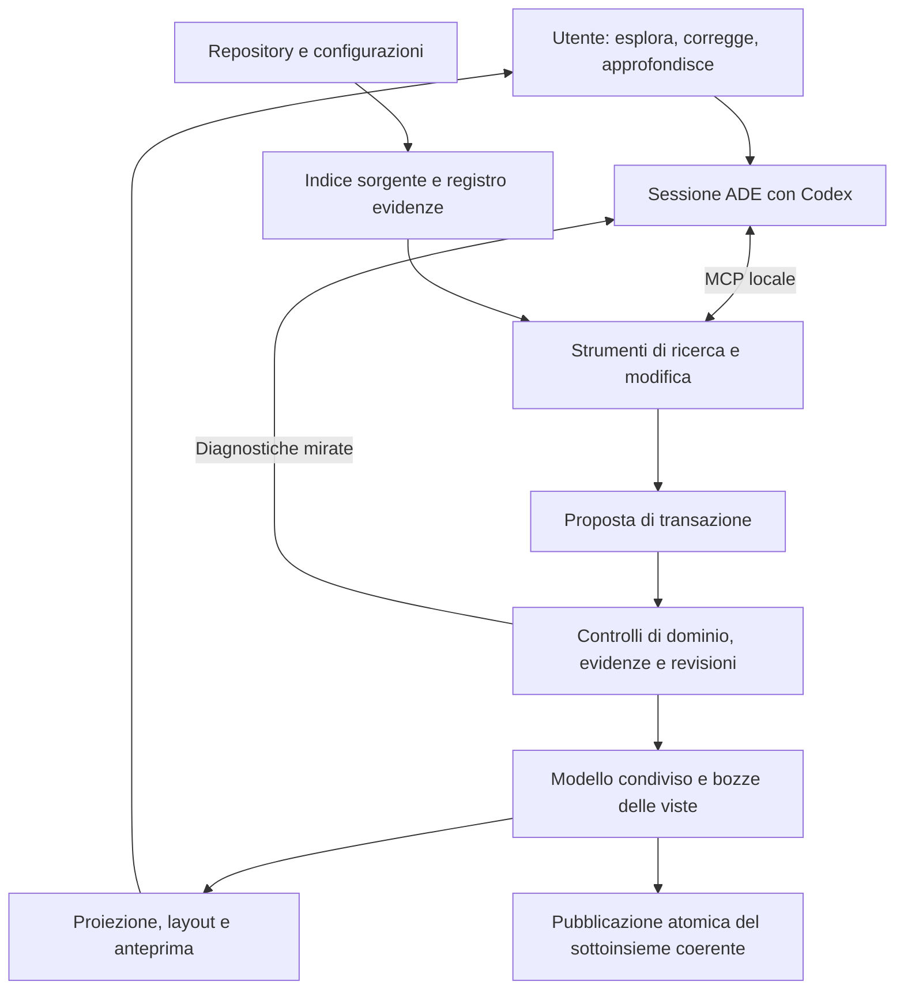

<!-- Copyright (c) Microsoft Corporation. All rights reserved. Licensed under the MIT License. -->

# Importazione e dialogo IA per i diagrammi: analisi e nuova architettura

Proposta del 10 novembre 2026, sulla branch `feat/m6-dai-validation`, HEAD `b82c4727c4812ce1a8b240a38b731996805d68b5` con le modifiche locali dei collaudi. Stato: piano, non nuova implementazione. La richiesta di riprogettazione interrompe ulteriori tentativi di generazione; i checkpoint reali restano conservati. Le tecnologie esterne sono state esaminate nella documentazione primaria online, non integrate o collaudate in ADE durante questa analisi. Il controllo locale `codex app-server --help` conferma la presenza dell'interfaccia nella CLI installata; non prova ancora il percorso completo di integrazione.

## 1. Decisione proposta

Sostituire la pipeline «classifica tutte le unità → sintetizza tutto → approva un piano immutabile → genera ogni vista → pubblica soltanto alla fine» con una **sessione di esplorazione incrementale**, collegata al Codex dell'utente, che interroga strumenti locali e propone transazioni piccole sul modello condiviso.

L'importazione deve rendere disponibile subito un inventario navigabile. L'IA costruisce una prima panoramica delle responsabilità principali e approfondisce i singoli scenari quando servono. Ogni vista può essere salvata come bozza, corretta, sostituita o pubblicata indipendentemente, includendo la chiusura delle sue dipendenze. Il documento pubblicato resta sempre internamente consistente.

La nuova unità di lavoro è una domanda architetturale o uno scenario, ad esempio «come viene persistito un upload senza retention?», anziché un gruppo di 40 frammenti. Una vista è una proiezione del modello e, per il comportamento, di uno scenario esplicito. L'ordine di un array di relazioni non deve diventare una dichiarazione temporale.

## 2. Cosa dimostrano i test reali

Le revisioni dei campioni e il metodo sono nel [verbale HTTPie/ChartMuseum](validation/httpie-chartmuseum-diagrams.md). Questi risultati includono interruzioni, correzioni e riprese; non sono misure di una singola esecuzione indisturbata.

| Campione | Risultato conservato | Implicazione |
| --- | --- | --- |
| HTTPie CLI, commit `5b604c37c6c67e18e7c3e9aee6c88a8c22b98345` | 1.805 unità; tutti i 46 gruppi analizzati; 52 invocazioni CLI reali, inclusa una richiesta fermata dalla quota; sintesi bloccata dal budget prima della CLI; nessuna proposta finale e nessuna vista pubblicata | Il costo dell'analisi è già sostenuto quando il passaggio globale scopre di non rientrare. Aumentare il budget rende il job incompatibile con Resume. |
| ChartMuseum, commit `dcbb99069784841bc19a7e434ae0fc9e11f2d159` | 35 invocazioni reali e una rivalidazione di una risposta reale registrata; 12 viste salvate su 13; ultima vista classi irrealizzabile con il grafo dichiarato; nessuna pubblicazione finale | Un errore di pianificazione impedisce di usare tutte le altre viste. Il piano approvato non dispone di una revisione locale. |
| ChartMuseum, fedeltà | Sequenza con letture prima dell'invocazione dell'handler; due endpoint alternativi messi in serie; ramo ordinario di persistenza omesso; direzione di bootstrap errata; confine C4 visivamente errato | Uno schema valido, riferimenti esistenti, grafo connesso e rendering senza eccezioni non dimostrano correttezza architetturale. |

I processi completati riportano complessivamente 1.553.121 token di input e 83.607 di output per HTTPie, 740.079 e 54.484 per ChartMuseum. Sono consumi riportati dalla CLI, comprendono le riprese e non equivalgono a prezzi addebitati o token tutti unici. Mancano misure complete per gli eventuali tentativi falliti senza evento finale. Entrambi i test usavano l'importazione predefinita senza SCIP: zero dipendenze statiche risolte disponibili. L'assenza di diagnostiche non implica disponibilità di informazioni sulle chiamate.

## 3. Punti deboli dell'implementazione

| Problema | Riscontro nel codice attuale | Conseguenza | Cambiamento necessario |
| --- | --- | --- | --- |
| L'IA non può cercare altro codice | `ade/ai/providers.ts`, `createCliProvider`: chiamate `exec --ephemeral`, strumenti shell disabilitati, `mcp_servers={}`; interfaccia `StructuredProvider.complete` | Una lacuna del pacchetto diventa una domanda all'utente o un'ipotesi; l'esplorazione non può guidare il recupero | Sessione con strumenti di ricerca e lettura, autorizzati nello scope del progetto |
| Segmentazione scollegata dall'intento | `prepareDiagramImport` e `advanceDiagramImport`: gruppi contigui di massimo 40 unità; singolo passaggio entro 160 | Entrypoint, chiamante, implementazione e configurazione possono trovarsi in richieste diverse; i primi gruppi possono essere strumenti/test | Recupero per modulo, dipendenza, entrypoint e scenario; lavoro completo sull'inventario locale senza classificazione IA obbligatoria di ogni unità |
| Collo di bottiglia finale | Catalogo e copertura di tutte le unità nella sintesi; schema con una proprietà obbligatoria per ogni riferimento; responsabilità tagliate a 160 | Input e output crescono anche quando si desidera una sola vista; omissioni dichiarate ma non recuperabili nello stesso passo | Strumenti paginati, indice interrogabile e riepiloghi gerarchici con riferimenti alle evidenze |
| Identità e classificazione mescolate | Riferimenti `uN`, chiavi `c:`/`f:`, alias e `normalizeReferences`; stessa dichiarazione sorgente usata come oggetto architetturale | Errori di prefisso, vincoli tra gruppi, ruoli che cambiano significato secondo la vista | ID persistenti separati da simboli e handle di sessione; collegamenti molti-a-molti tra codice e responsabilità |
| Piano non verificato abbastanza presto | `validateDiagramPlan` controlla focus e ruoli; la costruzione e `validatePlannedDiagram` scoprono dopo interazioni mancanti | Proposta di una vista classi senza membri/relazioni sufficienti; ripresa vincolata alla proposta iniziale | Fattibilità locale prima di proporre una vista e revisione del singolo obiettivo quando emergono nuove evidenze |
| Grammatica troppo uniforme | `diagramChoices`, ruoli e relazioni comuni; massimo sei nuove connessioni fra oggetti già esistenti | Per correggere una prospettiva manca talvolta proprio l'oggetto/operazione necessario; filtri preventivi lo rendono irraggiungibile | Comandi tipizzati per arricchire il dominio e per costruire uno scenario, ciascuno con scope e validazione propri |
| Comportamento ridotto a grafo | Le viste legacy selezionano nodi e relazioni, la sequenza ne ordina le relazioni | Nessuna identità delle ripetizioni, ramificazione o causalità sufficiente per controllare l'ordine | Occorrenze e scenari descrittivi con trigger, alternative, precondizioni e ordine parziale |
| Tracciabilità scambiabile per prova | La relazione deve citare un'unità divulgata; il controllo non dimostra che il testo sostenga tipo, direzione e condizione | Un riferimento esistente può sostenere una relazione semanticamente sbagliata | Evidenze puntuali per singola affermazione, verifiche specifiche e stato dell'incertezza visibile |
| Ripresa troppo rigida | `prepareDiagramImport` confronta tutta la configurazione con `isDeepStrictEqual`; hash globale dell'inventario | Aumentare il budget o cambiare un file può obbligare a ricominciare il job | Invalidazione per dipendenze e revisione degli oggetti letti/scritti; budget operativo separato dall'identità semantica |
| Stato di errore incompleto | Il controllo del budget avviene prima del blocco che salva `failed` | HTTPie resta `ready` nel checkpoint pur non potendo avanzare | Errori tipizzati e persistiti, con azione di recupero e costo già sostenuto |
| Pubblicazione accoppiata all'intero piano | Tutte le viste approvate devono riuscire prima dello snapshot attivo | 12 viste pronte non accessibili nel flusso ordinario | Bozze accessibili e pubblicazione atomica di un sottoinsieme coerente |
| Layout non gerarchico | `diagramLayout.ts`: posizioni dei nodi e rettangoli dei confini calcolati separatamente | Nodi esterni racchiusi visivamente da un sistema | Layout con nodi composti e test geometrici sui confini |
| Due percorsi di prodotto | `assertLegacyDiagramModel` rifiuta v4; `diagramDriven.ts` e `modelTaskContext.ts` offrono già conoscenza, task e recupero selettivo | Le capacità più adatte alla nuova importazione esistono in una fondazione che il vecchio percorso non usa | Un solo dominio e servizi di task condivisi con diagram-driven AI |

Il problema non si risolve scegliendo JSON meno verboso, aumentando i limiti o aggiungendo retry. JSON Schema resta utile per gli argomenti di piccoli strumenti; oggi gli viene affidata anche l'organizzazione dell'intera analisi.

Percorsi principali esaminati: [orchestrazione dell'importazione](../ai/diagramImport.ts), [piano e controlli delle viste](../ai/diagramPlanning.ts), [provider CLI](../ai/providers.ts), [dominio semantico](../../src/vs/workbench/contrib/ade/common/semanticModel.ts), [task e selezione del contesto](../../src/vs/workbench/contrib/ade/common/modelTaskContext.ts), [recupero e proposte](../../src/vs/workbench/contrib/ade/common/modelTaskResponse.ts), [servizio IA nell'app](../../src/vs/workbench/contrib/ade/electron-browser/adeAiService.ts), [MCP nel provider Codex dell'host](../../src/vs/platform/agentHost/node/codex/codexMcpServers.ts). I problemi della tabella riguardano il percorso d'importazione legacy; non attribuiscono automaticamente gli stessi limiti ai task strutturali v4.

## 4. Approcci e tecnologie esistenti

Fonti consultate il 10 novembre 2026. Le capacità documentate sotto sono distinte dall'adeguatezza ad ADE, che è una valutazione progettuale da verificare nei prototipi.

| Tecnologia / approccio | Cosa è già documentato | Valutazione per ADE |
| --- | --- | --- |
| [Structurizr: modello e viste](https://docs.structurizr.com/dsl), [MCP](https://docs.structurizr.com/ai/mcp) | Un modello di elementi/relazioni alimenta più viste; il server MCP valida, analizza e ispeziona il DSL, esportando anche viste | Adottare separazione modello/viste e ciclo proposta → compilazione → diagnostica. Usare come riferimento ed eventuale export C4; non sostituire con il DSL tutto il dominio di ADE, che include riconciliazione e comportamento. |
| [LikeC4: AI Tools](https://likec4.dev/tooling/ai-tools/), [viste](https://likec4.dev/dsl/views/) | Strumenti per cercare elementi, interrogare vicini e dipendenze, leggere e visualizzare viste; anteprima da DSL senza salvataggio | È il precedente più vicino all'esperienza desiderata. Riprendere strumenti di interrogazione e preview; valutare un adapter/export, mantenendo un solo modello autorevole in ADE. |
| [Aider: repository map](https://aider.chat/docs/repomap.html) | Mappa compatta di simboli e firme, selezionata con analisi delle dipendenze per rientrare in un budget | Usare una mappa iniziale e ranking per recuperare contesto pertinente. È orientamento per il modello, non certificazione delle chiamate o dell'architettura. |
| [Tree-sitter](https://tree-sitter.github.io/tree-sitter/) e [SCIP](https://sourcegraph.com/docs/code-navigation/precise-code-navigation) | Parsing incrementale; definizioni/riferimenti risolti tramite indexer specifici del linguaggio, inclusi Go, Python e TypeScript | Riutilizzare parser/SCIP già presenti e aggiungere adapter dove serve. Distinguere esplicitamente dipendenza, riferimento e chiamata; SCIP da solo non fornisce l'ordine di esecuzione. |
| [Joern / Code Property Graph](https://docs.joern.io/code-property-graph/) | Rappresentazione interrogabile del programma che integra informazioni sintattiche, di controllo e di dati | Riferimento per le interrogazioni di flusso e possibile adapter avanzato. Non introdurre JVM e CPG completo come requisito di ogni importazione desktop. |
| [Codex App Server](https://learn.chatgpt.com/docs/app-server) | Thread, turni, streaming, ripresa, interruzione e strumenti; account gestito da Codex; binding generabili dalla versione installata | Riutilizzare l'Agent Host già integrato. Il trasporto e i `dynamicTools` hanno superfici sperimentali: isolare l'adapter e preferire inizialmente MCP, già gestito dall'host. L'autenticazione rimane quella del Codex dell'utente. |
| [MCP: tools](https://modelcontextprotocol.io/specification/2025-06-18/server/tools) | Scoperta e chiamata di strumenti con contratti strutturati, errori e risultati | Pubblicare un server ADE locale con operazioni stabili. MCP trasporta gli strumenti; regole, scope, transazioni e correttezza restano responsabilità di ADE. |
| [LangGraph: persistenza](https://docs.langchain.com/oss/javascript/langgraph/persistence), [fault tolerance](https://docs.langchain.com/oss/javascript/langgraph/fault-tolerance) | Checkpoint, ripresa, isolamento dei passi e gestione degli esiti incerti | Riprendere i principi di checkpoint per task, idempotenza e recupero. Per il primo incremento bastano i servizi e il journal ADE; aggiungere il framework solo se un confronto dimostra un risparmio reale. |
| [ELK Layered](https://eclipse.dev/elk/reference/algorithms/org-eclipse-elk-layered.html) | Layout gerarchico, porte, etichette, nodi composti e collegamenti fra livelli | Primo candidato per layout strutturale/C4; prototipo su grafi reali e conservazione delle posizioni manuali. Sequenze richiedono un renderer guidato dagli scenari. |
| [OpenTelemetry: traces](https://opentelemetry.io/docs/concepts/signals/traces/) | Span, relazioni parent/child e link fra operazioni osservate | Futuro ingresso di evidenza runtime. Una traccia prova un'esecuzione osservata, non tutti i rami; i timestamp non autorizzano da soli un ordine totale tra operazioni concorrenti. |
| [Microsoft GraphRAG](https://microsoft.github.io/graphrag/) | Estrazione di un knowledge graph dal testo, comunità e sintesi per interrogazioni | Potenzialmente utile per documentazione e ricerca concettuale. Non sceglierlo come base dell'estrazione delle chiamate: introdurrebbe un altro passaggio inferenziale prima di aver sfruttato gli indici del codice. |

Scelta iniziale: **dominio ADE evoluto dalla v4 + strumenti MCP locali + Agent Host Codex esistente + indice sorgente interrogabile + layout ELK da validare**. Nessun database a grafo remoto, vector DB o servizio cloud aggiuntivo è necessario per dimostrare il nuovo percorso. Mermaid/PlantUML restano formati di export e riferimenti per la notazione, senza diventare il documento autorevole.

## 5. Architettura proposta

La conversazione non è il database del progetto. Stato semantico, evidenze, decisioni e bozze vengono salvati localmente e possono essere ricaricati anche in un thread nuovo. La cronologia aiuta la continuità, ma un checkpoint valido non dipende dalla capacità del modello di ricordare tutte le risposte precedenti.

### 5.1 Indice sorgente ed evidenze

Mantenere `ImportSnapshot`, `SemanticGraph`, guard delle revisioni e adapter SCIP. Aggiungere query su moduli, simboli, riferimenti, dichiarazioni di routing/configurazione e frammenti. Entrypoint e manifest orientano la panoramica; README e documentazione possono contribuire come evidenza dichiarata, senza diventare fatti estratti dal codice. Test e fixture restano interrogabili come evidenze di verifica e vengono distinti dal runtime.

Ogni provider dichiara le proprie capacità effettive: `syntax`, `definitions`, `references`, `calls`, `controlFlow`, `runtimeObservations`. Se un provider offre solo riferimenti, il chiamante non riceve un call graph fittizio. Per TypeScript usare i servizi del compilatore esistenti; per Go/Python partire da SCIP/servizi del linguaggio disponibili, con estrazione sintattica conservativa. Il supporto ad altri linguaggi può fornire soltanto testo e struttura, dichiarando il limite.

Un `EvidenceRecord` contiene ID, revisione del contenuto, percorso e range con codifica esplicita, produttore/versione, natura dell'evidenza e riferimenti ai fatti estratti. La query restituisce frammento e limitazioni. Gli offset sono convertiti dal singolo adapter al formato interno, conservando revisione e ancoraggio. Un range su una revisione superata è obsoleto, non trasferito implicitamente alle stesse righe del file nuovo.

La mappa del repository comprende tutto lo scope importato localmente; l'IA riceve una selezione motivata. Il recupero combina ricerca testuale, simboli, vicini nel grafo e rilevanza per lo scenario. Ogni pagina espone limiti, elementi omessi e cursore. Gli embedding sono opzionali per ricerche concettuali: non devono sostituire riferimenti e query deterministiche.

### 5.2 Modello condiviso e conoscenza incompleta

Riutilizzare `Knowledge`, `ModelAssertion`, `ModelReference`, ownership/membership separate, migrazione e serializzazione della fondazione v4. Gli ID degli oggetti architetturali sono assegnati da ADE una volta e persistiti. Gli ID dei simboli rimangono identità dell'indice; un elemento architetturale può essere sostenuto da molti simboli e viceversa. Gli handle brevi del prompt risolvono a questi ID e non compaiono come identità canoniche nel documento.

Per ciascuna affermazione conservare evidenze puntuali, produttore, stato `extracted/inferred/observed/authored`, accettazione e verifiche. Questi concetti già esistono in `ModelAssertion`: serve collegarli al registro evidenze e renderli utilizzabili nell'importazione. «Accettato dall'utente», «estratto staticamente» e «osservato a runtime» restano proprietà distinte. Nessuna percentuale di fiducia inventata dal modello viene presentata come probabilità calibrata.

La copertura viene separata in tre misure: inventario dei file nello scope, fatti disponibili dagli analizzatori, responsabilità/scenari effettivamente analizzati. Le evidenze non ancora studiate sono `unexplored`; quelle illeggibili `unavailable`; quelle escluse conservano il motivo. Non richiedere una classificazione IA di ogni funzione per mostrare un diagramma. Nessuna panoramica parziale può essere etichettata come copertura integrale della codebase.

### 5.3 Scenari descrittivi e comportamento eseguibile

La v4 possiede già occorrenze, interazioni e frame; i contratti eseguibili richiedono però argomenti, risposte, timeout e politiche che l'importazione potrebbe non conoscere. Riutilizzare questi concetti e introdurre un **profilo descrittivo esplicito** nel medesimo dominio: scenario con trigger/scope, partecipanti, occorrenze, evidenze, alternative e vincoli di ordine conosciuti. Chiamate ripetute hanno occurrence ID distinti anche quando condividono operazione ed estremi. La relazione architetturale non coincide con il singolo evento.

Le condizioni descrittive possono essere note dal sorgente o sconosciute; non vengono convertite in un'espressione eseguibile senza un adapter che ne dimostri la traduzione. Un ordine parziale può rappresentare `A prima di B`, alternative esclusive e parallelismo conosciuto; l'assenza di ordine non va resa come sequenza numerata certa. L'editor può mostrare lo scenario incompleto con diagnostica o una vista strutturale finché non esiste abbastanza informazione temporale.

**Versionamento proposto:** protocollo sessione/strumenti v2, indipendente dalla versione del modello. Per la nuova rappresentazione descrittiva persistente adottare schema modello v5, evoluzione conservativa della v4, con discriminante fra descrittivo ed eseguibile e riferimenti alle evidenze. Le parti eseguibili v4 mantengono semantica e requisiti; nessuna migrazione completa dati mancanti o cambia gli ID. È un'evoluzione del dominio comune, non un terzo grafo di diagrammi separato. P1 deve fissare l'ADR e lo schema prima di implementare tool di scrittura; v2/v3/v4 restano leggibili e la conversione lavora su una copia. Questa scelta aggiorna esplicitamente ADR 0004, senza reinterpretare silenziosamente v4.

La readiness si valuta rispetto al compito: `viewable`, `reviewable`, `executable`. Una bozza descrittiva può essere visualizzabile e revisionabile anche se non è eseguibile. I controlli di generazione codice continuano a bloccare sui dati necessari mancanti.

### 5.4 Viste, piano e layout

Una `ViewSpec` contiene intento, tipo, soggetto/scenario e selettori di oggetti; una `ViewProjection` contiene gli ID risolti; una `ViewLayout` contiene geometria e posizioni manuali. Le tre revisioni sono separate. Le viste condividono gli oggetti e conservano piccole esclusioni/inclusioni esplicite per il focus. I selettori vengono risolti contro una revisione precisa, senza allargare una proposta già approvata in seguito a modifiche del grafo.

Il piano è una coda modificabile di obiettivi con dipendenze, non un manifesto di successo indivisibile. Prima di proporre una vista, controllare che esistano soggetto, evidenze e capacità necessarie. Una classe può essere mostrata anche senza rapporti OO se lo scopo è descriverne i membri; non obbligare ogni notazione a essere un unico grafo connesso. Un insieme di helper senza scenario comune non diventa invece una sequenza per soddisfare lo stesso vincolo.

Prototipare ELK per viste strutturali/C4 con contenitori come nodi composti. Misurare testo e porte prima del layout; nessun elemento esterno deve finire dentro un confine che non gli appartiene. Bloccare le posizioni modificate dall'utente oppure rilayoutare soltanto il gruppo interessato. Le sequenze derivano dagli scenari e dai frame, con un layout specifico.

## 6. Strumenti e protocollo del dialogo

Il server locale espone pochi strumenti con schema stabile. I nomi seguenti sono proposte, non API già implementate. Le operazioni del dominio devono essere chiamabili anche da UI e test senza MCP.

| Strumento | Scopo e risposta |
| --- | --- |
| `project.inspect` | Revisione, linguaggi, entrypoint candidati, mappa compatta, capacità degli analizzatori, viste e limiti di copertura |
| `source.search` | Ricerca testuale/simbolica con filtri; risultati paginati e ID delle evidenze |
| `source.read` | Simbolo o range esplicito; frammento, revisione e limitazioni; richiesta successiva possibile se troncato |
| `graph.query` | Definizioni/riferimenti, chiamanti/chiamati solo se supportati, ownership, integrazioni e percorsi limitati; query tipizzata, senza SQL/Cypher arbitrario |
| `model.inspect` | Definizioni e affermazioni attuali, provenienza, scenari, viste e diagnostiche pertinenti |
| `model.propose` | Transazione con comandi di dominio: dichiara/aggiorna/collega/unisci oggetti, annota affermazioni, descrivi occorrenze/ordine, proponi/rivedi una vista; ritorna diff e diagnostiche, senza modificare il modello pubblicato |
| `view.preview` | Proiezione e layout deterministici della proposta; diff visuale, problemi di leggibilità e ancore sorgente; eventuale immagine per l'IA se il client la supporta |
| `task.update` | Registra esito, lacune e proposta di revisione dell'obiettivo; non può autonomamente estendere scope o budget della sessione |

La pubblicazione è una chiamata diretta del servizio UI dopo l'applicazione scelta dall'utente o la policy della sessione già autorizzata. L'IA può richiederla tramite una proposta ma non sostituire la decisione del servizio. Ricerca, letture, validazione e preview proseguono senza modali a ogni chiamata; domande all'utente soltanto per intenzioni ambigue, tradeoff di dominio o limiti che richiedono una scelta. Mancanza di un file nel contesto attuale significa prima una ricerca.

Ogni risultato include versione, revisione, dati e diagnostiche; le liste hanno paginazione e conteggio delle omissioni. Gli errori di dominio indicano `code`, oggetto/campo interessato, evidenze richieste e possibilità di recupero. Lo schema non incorpora l'elenco di tutti i riferimenti della codebase: gli ID sono convalidati localmente. Le dichiarazioni nuove possono usare alias temporanei risolti atomicamente da ADE, evitando il protocollo manuale `c:c-parser`.

Il ciclo diventa: recupera contesto → propone una modifica circoscritta → riceve errori precisi o anteprima → corregge quella proposta → applica. Una proposta può aggiungere un'operazione o un partecipante appena scoperto, senza rigenerare quanto già analizzato. Riprendere `needContext`, `needsClarification`, `unsupported`, sealing e scope da `modelTaskContext/modelTaskResponse`; estendere il loro insieme di operazioni oltre le sole modifiche di operazioni attualmente supportate.

### Esempio sul difetto ChartMuseum

Alla richiesta «mostrami l'upload normale», Codex cerca route e handler, legge `uploadChartPackage` e `PutWithLimit`, chiede il ramo mancante se l'estratto è incompleto. Propone uno scenario con trigger upload e ramo `ChartLimits == nil`, includendo la chiamata a `PutObject` nel ramo ordinario. La preview evidenzia eventuali messaggi senza prova o ordine non determinato. La successiva richiesta «aggiungi il caso con retention» aggiunge un'alternativa dello stesso scenario; non modifica i diagrammi di lettura, il bootstrap o gli ID delle responsabilità.

## 7. Sessione Codex e orchestrazione

`adeAiService.ts` usa già `IAgentHostService` e `ICodexAccountService`; `codexMcpServers.ts` traduce configurazioni MCP per thread. Partire da questi servizi per mantenere account, modello, cancellazione e conversazione coerenti con la chat nativa. Evitare un secondo client di autenticazione e l'accesso diretto ai file di credenziali.

P0 verifica registrazione del server ADE **nel perimetro della sessione**, ciclo delle chiamate, eventi progressivi e ripresa. La conversione MCP per thread esistente non dimostra ancora che ADE possa registrare un server solo per quella sessione attraverso la superficie pubblica dell'host: è il rischio tecnico da risolvere per primo. Non modificare automaticamente la configurazione globale dell'utente per aggirarlo. Se occorre, aggiungere la minima API all'host; l'adapter diretto App Server resta alternativa isolata, con binding generati dalla versione supportata e test di compatibilità. Non progettare il prodotto intorno ai soli `dynamicTools` sperimentali.

Una sessione mantiene `sessionId`, task, revisioni lette/scritte, registro delle chiamate, proposte, consumo noto e stato. Un task passa fra `queued/running/waitingContext/waitingUser/blocked/ready/applied/cancelled`; le transizioni sono metodi espliciti e testabili. Gli eventi servono al progresso della UI, non sostituiscono l'orchestrazione dei servizi.

Il budget è della sessione e degli obiettivi: limiti di turni del modello, letture, byte recuperati, token quando esposti e tempo. Una tool call locale non è contata come un'inferenza. I byte sono una protezione del trasporto, non una misura esatta dei token; wrapper e compattazione del provider vanno dichiarati se non misurabili. Un aumento del budget non invalida le evidenze accettate. Un cambio di modello/provider crea una nuova revisione dell'esecuzione e conserva la provenienza del lavoro precedente.

Retry automatici solo per errori recuperabili e dentro il budget già autorizzato. Errori semantici rientrano nello stesso ciclo di correzione con un numero massimo di tentativi; la quota mette in pausa, l'autenticazione richiede l'azione pertinente, un'inferenza con esito sconosciuto non viene reinvocata alla cieca. Non promettere esecuzione remota «exactly once»: garantire idempotenza dell'applicazione locale e conservare gli esiti incerti.

## 8. Persistenza, invalidazione e pubblicazione

Conservare JSON canonico, snapshot, lock e journal recuperabili già presenti in `projectStore/sourceChanges/structuralProject`. Separare logicamente indice derivato, evidenze, sessioni/proposte, modello e geometria. Se si aggiungono namespace a `.ade`, registrarli nel gestore esistente; evitare un secondo meccanismo di pubblicazione. Un database può diventare cache locale ricostruibile solo dopo misure: non è il documento autorevole.

Ogni proposta conserva `proposalId`, `baseSemanticRevision`, insieme letto di oggetti/evidenze, insieme scritto, comandi, diagnostiche e risultato dell'applicazione. Gli ID nuovi vengono riservati una volta. Riapplicare la stessa proposta ritorna l'esito precedente; una proposta con lo stesso ID e contenuto diverso viene rifiutata. Le annotazioni manuali sono conservate con il merge e la policy di ownership esistenti.

Al cambiamento di un file, marcare obsolete soltanto evidenze e affermazioni dipendenti; invalidare transitivamente viste e scenari consumatori. Una ricerca senza risultati o una query «tutti i chiamanti» dipende anche dalla versione della porzione di indice interrogata: nuovi file/simboli possono invalidarla pur senza modificare gli oggetti già restituiti. Questo evita cache apparentemente fresche ma incomplete.

Prima di pubblicare, sotto il lock esistente, verificare revisioni lette, conflitti e chiusura delle dipendenze. Se la proposta modifica un oggetto usato da altre viste, rivalidare quelle viste o richiedere una risoluzione mirata; non pubblicare dangling reference. Pubblicare atomicamente il sottoinsieme coerente e aggiornare il puntatore con gli strumenti esistenti. Le bozze restano accessibili e marcate; una vista bloccata non rende inutilizzabili le altre. Annullamento e crash conservano l'ultimo documento pubblicato valido.

I checkpoint legacy restano consultabili come artifact. Non dichiararli riprendibili dalla nuova macchina di stato: eventuale recupero delle affermazioni passa attraverso un importatore esplicito con provenienza e validazione. I diagrammi pubblicati esistenti restano apribili.

## 9. Validazione della qualità

Distinguere quattro livelli, mostrati separatamente nell'editor:

1. **Integrità:** schema, ID, riferimenti, proprietà, limiti e revisione delle evidenze. Errori bloccanti per la transazione.
2. **Compatibilità del dominio e della vista:** ruoli, ownership, soggetto C4, capacità richieste dalla notazione, occorrenze e frame coerenti. I requisiti eseguibili si applicano solo alla generazione/esecuzione.
3. **Fedeltà alle evidenze:** ancore puntuali, direzione della chiamata risolta se disponibile, condizioni estratte, esclusività dei rami e ordine dimostrabile. Un controllo sintattico può provare un ordine locale semplice; non certifica tutto il comportamento dinamico. Ciò che non è dimostrabile rimane inferito o sconosciuto.
4. **Leggibilità e utilità:** confini corretti, sovrapposizioni, etichette visibili, scenari separati e capacità di raggiungere il codice. Un'immagine senza errori JavaScript non basta.

Una revisione IA indipendente può suggerire difetti, ma non diventa l'unico oracolo di accettazione. Il corpus deve contenere affermazioni e controesempi verificati manualmente sui sorgenti. Ogni miglioramento si misura su correttezza e copertura dichiarata insieme al costo; meno chiamate con una panoramica vuota non è un successo.

## 10. Piano di attuazione

Gli incrementi sono dimensionati per review separate. Non sono stime temporali né promesse che il primo prototipo sostituisca tutte le sedici notazioni.

| Passo | Consegna e file interessati | Dipendenze | Condizione di uscita |
| --- | --- | --- | --- |
| **P0 — Baseline e prova del dialogo** | Corpus fissato di Express, HTTPie e ChartMuseum; rubrica semantica; prototipo MCP con `project.inspect/source.read` attraverso Agent Host; misure di lifecycle/account/ripresa. Isolare il prototipo dai comandi di produzione. | Nessuna | Nella stessa conversazione il modello chiede un secondo frammento e usa la risposta; cancellazione e riapertura funzionano con l'account Codex esistente. Contratto host scelto e rischio della registrazione per sessione risolto. |
| **P1 — Dominio e transazioni** | ADR successore di 0004, schema v5 descrittivo/eseguibile, `EvidenceRecord`, estensione delle assertion; `ModelInteraction/ModelOccurrence/ModelFrame` condivisi; transazioni tipizzate, ID, migrazione e readiness in `common/`. | P0 per il contratto di integrazione; progettazione del dominio avviabile in parallelo | Migrazione v4 conservativa/idempotente; round trip dei modelli precedenti; bozza descrittiva visualizzabile senza inventare politiche eseguibili; applicazione idempotente e conflitti rilevati. |
| **P2 — Indice interrogabile e recupero** | Servizi in `ade/code-import` sopra `SemanticGraph/scip`; mappa e ranking, query paginate, letture esatte, evidenze e capacità per linguaggio; riuso di `modelTaskContext/modelTaskResponse/contextTransport`. | P1 per gli ID e l'evidenza canonica | Ricerca/lettura su entrambe le repository senza classificazione IA completa; nessun riferimento viene presentato come chiamata; aggiornamento locale e test delle dipendenze negative delle query. |
| **P3 — Sessione e strumenti ADE** | Nuovo adapter di sessione accanto a `providers.ts`, server MCP locale e servizi di proposta; integrazione con `adeAiService`/Agent Host; budget, errori, journal e cancellazione. `StructuredProvider` resta disponibile per i flussi che ne hanno ancora bisogno. | P0, P1, P2 | Ciclo ricerca → proposta → errore mirato → correzione → preview; ripresa senza ripetere passi accettati; nessun server o file sorgente fuori scope; niente nuovo login se quello esistente è valido. |
| **P4 — Primo percorso completo nel prodotto** | Importazione → panoramica → approfondimento di uno scenario → modifica conversazionale; bozze e applicazione selettiva. Adattare `adeProjectService`, bridge, canvas e pubblicazione esistente. | P3 | HTTPie produce una panoramica utilizzabile prima dell'analisi esaustiva; ChartMuseum pubblica viste coerenti anche se la proposta classi è respinta; sorgenti intatti e modifiche manuali conservate. |
| **P5 — Scenari e layout** | Proiezione di occorrenze/alternative in sequenza e attività; prototipo ELK promosso solo dopo benchmark; anteprima con diagnostiche e drill-down alle evidenze. | P1; spike del layout indipendente da P2/P3, integrazione dopo P4 | Upload con/senza limiti corretto; lettura indice e oggetto in scenari distinti; nessuna inversione dimostrata; nessun esterno racchiuso dal sistema; una correzione non sposta viste estranee. |
| **P6 — Collaudo comparativo e migrazione di prodotto** | Valutazione reale ripetuta, fault injection, compatibilità documenti, feature flag, documentazione e dismissione del percorso legacy d'importazione dopo parità. | P4, P5 | Gate della sezione 11 soddisfatti; risultati completi pubblicati nel repository; recupero e rollback provati. Estendere le notazioni ulteriori per capacità reali, senza promettere modelli non supportati dagli analizzatori. |

Percorso critico: P0 → P1/P2 → P3 → P4 → integrazione P5 → P6. I prototipi servono a scegliere trasporto e layout prima di legare il dominio a una libreria. P4 è il primo risultato di prodotto; la parità di catalogo arriva dopo la verifica di qualità, senza moltiplicare subito i casi.

## 11. Gate di accettazione e misure

Prima di nuove prove fissare versione ADE, revisione repository, modello, capacità degli analizzatori e budget. Usare l'account Codex reale già collegato e la stessa scelta esplicita del modello per il confronto; nessun cambio implicito di provider. Tenere separati run reali, replay e test simulati. Come minimo tre run iniziali e due run di aggiornamento per ciascuna repository, con limite complessivo dichiarato; non avviare il benchmark durante la sola redazione del piano.

| Area | Gate verificabile |
| --- | --- |
| Esito | Ogni run restituisce una panoramica valida o un motivo specifico di indisponibilità; un fallimento rimane nel denominatore. L'importazione completa richiede successo in tutti i run del corpus scelto, non soltanto in quelli ripresi manualmente. |
| Prima utilità | Obiettivo iniziale: panoramica di HTTPie entro 8 turni del modello, con responsabilità e integrazioni della rubrica presenti o esplicitamente sconosciute; misurare separatamente tempo, token e letture. È un target da validare, non un risultato già ottenuto. |
| Fedeltà | Nessuno dei difetti critici ChartMuseum si ripresenta; almeno il 95% delle affermazioni del campione revisionato è sostenuto dalle evidenze dichiarate; nessuna affermazione critica falsa. La percentuale usa un campione stratificato predefinito e riporta numerosità e incertezze, senza estenderla automaticamente a tutta la repository. |
| Copertura | Tutti i file nello scope sono inventariati o esclusi con ragione; tutte le capacità della rubrica risultano rappresentate o indicate come non esplorate/non disponibili. Nessuna percentuale unica confonde inventario e comprensione. |
| Modifica conversazionale | «Aggiungi retention», «separa i due endpoint», «Redis è opzionale», «mostra solo il flusso upload» modificano il sottoinsieme pertinente, conservando gli ID e le annotazioni delle viste estranee. |
| Recupero | Quota, auth, timeout, crash dopo risposta, crash prima del commit, budget aumentato e file modificato producono stati persistiti corretti; riapplicazione senza duplicati; nessuna rigenerazione integrale obbligatoria per un errore locale. |
| Rendering | Confini C4 verificati geometricamente; assenza di sovrapposizioni critiche; nodi e messaggi raggiungibili; navigazione e selezione funzionanti. Screenshot e controlli automatici affiancano la revisione umana. |
| Incrementalità | Cambio di un handler invalida soltanto fatti/scenari dipendenti e le query interessate; query negative invalidabili con nuovi file; stesso aggiornamento rigiocato non cambia ulteriormente il modello. |
| Costo | Registrare inferenze, tool call locali, input/output/cached token se esposti, byte, latenza e riparazioni. Target sul costo fino alla prima vista: riduzione almeno del 50% dei token d'input rispetto a un confronto equivalente del vecchio percorso, a parità di rubrica. Le baseline attuali fallite sono un limite di costo osservato, non un denominatore equivalente di successo. |

## 12. Cosa conservare e cosa sostituire

Conservare lettori/migrazione, fondazione semantica v4 come base dell'evoluzione, servizi di readiness, adapter SCIP, indice sorgente, context sealing, controlli delle revisioni, merge delle modifiche manuali, lock, snapshot e recovery. Conservare anche i test reali falliti: sono il corpus di partenza, non materiale da normalizzare in esiti positivi.

Sostituire per l'importazione il contratto globale `CompactInterpretation`, l'obbligo di assegnare ogni unità tramite IA, la sintesi unica, il piano immutabile e la pubblicazione condizionata al successo di tutte le viste. Sostituire le correzioni per prefissi e le enormi enum di riferimenti con handle risolti dagli strumenti e diagnostiche locali. Il vecchio provider strutturato può restare negli altri task fino alla loro migrazione; non occorre riscrivere tutti i flussi contemporaneamente.

La prima verifica decisiva è P0/P4: una conversazione che sa acquisire l'evidenza mancante e migliorare un diagramma già utile. Se quel percorso continua a richiedere l'analisi globale e il ripristino manuale del piano, la riprogettazione non ha raggiunto l'obiettivo.

## 13. Valutazione MCP e affinamento di P0

La [valutazione dedicata dei server MCP](mcp-diagram-evaluation.md) raccomanda un unico server ADE per evidenze/modello/anteprime e una prova comparativa di Serena per simboli e riferimenti. La lettura degli snapshot può essere esposta subito, senza attendere lo schema v5; le scritture seguono invece il contratto di transazione di P1.

L'ispezione aggiuntiva ha identificato anche `IAgentHostActiveClientService.setSessionTools` e il relativo inoltro al provider Codex: il prototipo interno può riusare strumenti registrati del workbench. P0 deve quindi confrontare questo adapter e quello MCP sopra gli stessi servizi, verificando scope, lifecycle e costi. La presenza di `addMcpServerConfiguration` nell'interfaccia generale non ne garantisce l'implementazione nel provider Codex esaminato. Questa precisazione restringe il rischio d'integrazione della sezione 7 e non equivale a un collaudo end-to-end già riuscito.
