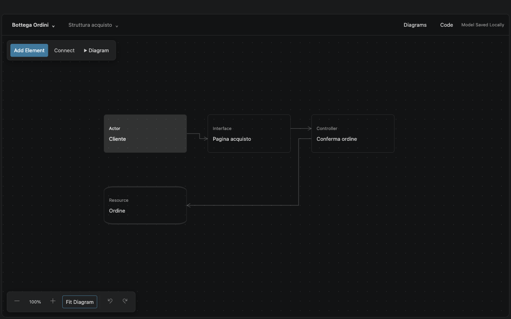
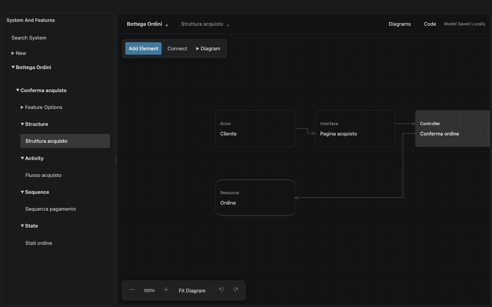
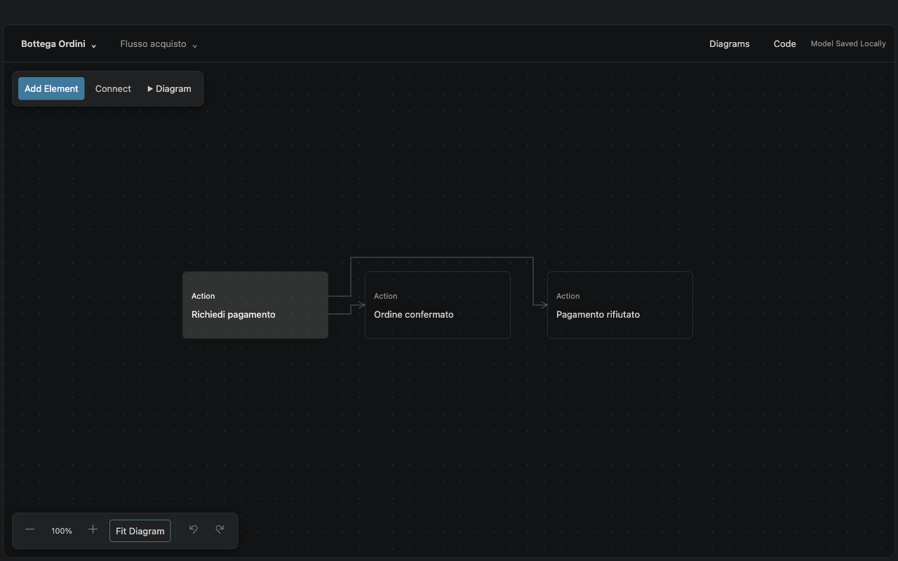
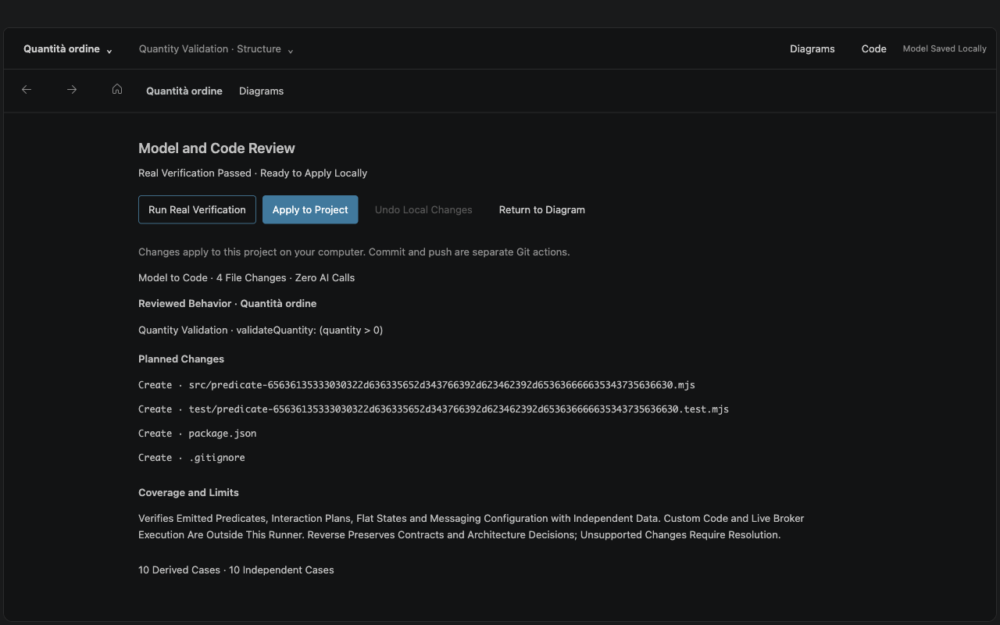
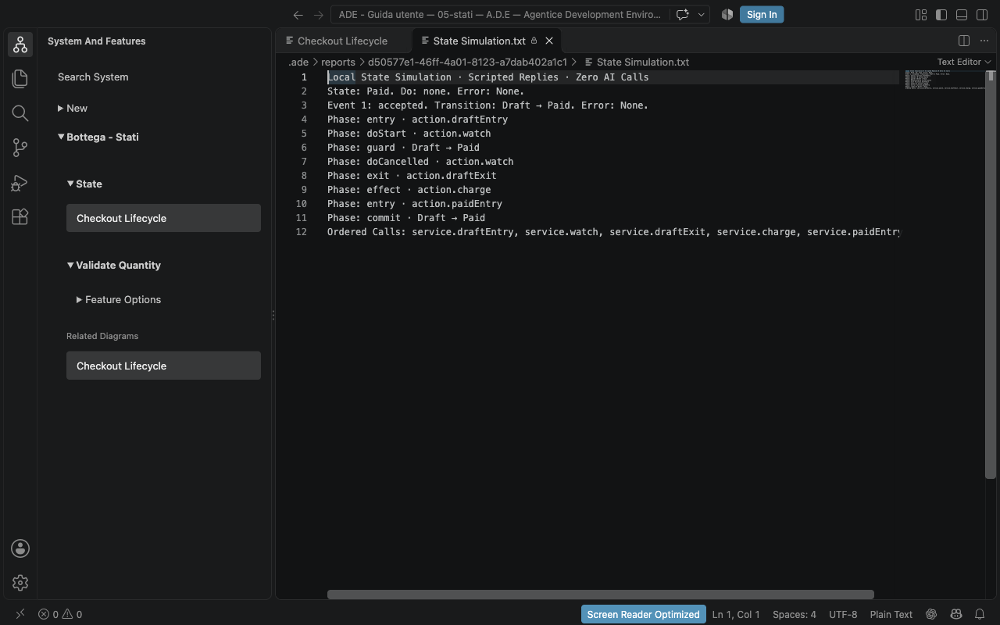
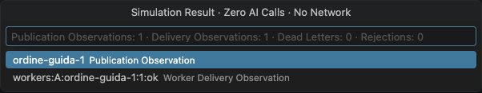
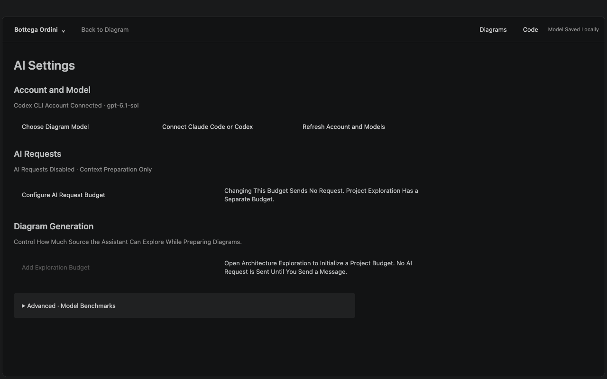
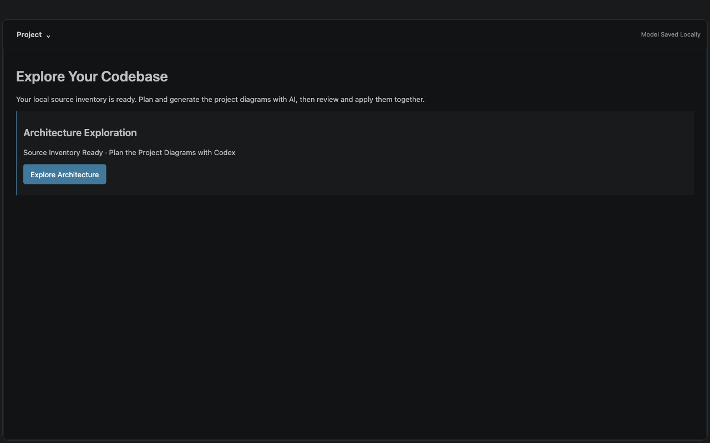

<!-- Copyright (c) Microsoft Corporation. All rights reserved. Licensed under the MIT License. -->

# Guida completa ad ADE

## 1. Iniziare con Bottega Ordini

ADE è un ambiente desktop per progettare software con diagrammi, descrivere contratti e comportamenti, esplorare codice e collaborare con l’IA. I diagrammi occupano l’area principale; codice, terminale e altri strumenti dell’IDE si aprono quando servono.

Il caso di studio di questa guida è **Bottega Ordini**: un cliente conferma un acquisto, il sistema controlla la quantità, richiede un pagamento e registra l’esito. Il materiale comprende sei versioni progressive dello stesso caso, così puoi imparare una capacità alla volta e ripartire da una copia pulita.

**Primo percorso consigliato:** prepara ADE, estrai i progetti, apri `01-bottega-visuale` e svolgi i capitoli 4-8. Passa poi a `02-quantita-ordine` per creare casi e produrre codice verificato. Queste attività funzionano senza account IA e senza modificare JSON.

| Cartella nel pacchetto | Punto di partenza | Cosa impari |
| --- | --- | --- |
| `01-bottega-visuale` | Progetto con struttura, flusso, sequenza e stati descrittivi | Navigazione, proprietà, relazioni e identità condivise |
| `02-quantita-ordine` | Template eseguibile, otto casi indipendenti, nessun sorgente generato | Contratti, predicati, input guidati, review, verifica, applicazione e undo |
| `03-codebase-ordini` | Piccola applicazione JavaScript con sette test e nessuna dipendenza | Importazione, evidenze, codice, test e collaborazione IA facoltativa |
| `04-interazioni` | Checkout con pagamento, alternativa, sotto-interazione e notifica opzionale | Sequenze eseguibili, risposte simulate e casi indipendenti |
| `05-stati` | Macchina Draft, Paid, Cancelled con casi già scritti | Eventi, guardie, azioni, deduplica e simulazione |
| `06-messaggistica` | Queue, topic, producer, consumer e policy dichiarate | Pubblicazione, consegna, retry e simulazione senza broker |

Scarica [i progetti di esempio](progetti-esempio.zip), estrai l’archivio e copia le cartelle in una directory tua, ad esempio `Documenti/ADE-Progetti`. Copia le cartelle intere: contengono anche i dati nascosti del modello. Conserva l’archivio originale per ripetere gli esercizi. Il clone di ADE contiene l’IDE; le copie dei progetti sono il tuo spazio di lavoro.

La guida mantiene i nomi inglesi dei pulsanti dell’interfaccia. Un percorso come **Progetto > Project Settings > Executable Behavior** significa: apri il menu con il nome del progetto, poi scegli le voci indicate. **Palette** significa `F1`, oppure `Cmd+Shift+P` su macOS e `Ctrl+Shift+P` su Windows/Linux. Puoi cercare il titolo di un comando senza ricordarne la posizione nei menu.

## 2. Preparare e avviare ADE

Se ADE è già installato e funzionante, passa al capitolo 3. Per l’avvio dai sorgenti servono Git, Python 3, gli strumenti di compilazione della piattaforma e la versione Node indicata nel file `.nvmrc` del clone. In questa revisione è Node **24.22.1**. Bun serve soltanto se scegli il relativo profilo eseguibile.

### macOS e Linux

Clona il repository in una cartella dedicata oppure aggiorna un clone pulito. Chiudi l’istanza di sviluppo prima di aggiornare dipendenze e build. Con nvm, dalla radice del clone:

```sh
git clone https://github.com/FrappaF/ADE.git
cd ADE
nvm install
nvm use
npm run ade:setup
./ade/scripts/dev.sh
```

`ade:setup` prepara dipendenze, client, motori locali, estensioni ed Electron. Il primo avvio richiede una connessione per gli artifact scaricati. Per gli avvii successivi bastano `nvm use` e `./ade/scripts/dev.sh`. Puoi aggiungere al comando il percorso della cartella di un progetto.

Su macOS verifica gli strumenti con `xcode-select -p`, `xcrun --find clang` e `python3 --version`. Se mancano i Command Line Tools, usa `xcode-select --install` e completa l’installazione. Su Debian/Ubuntu servono i pacchetti di compilazione e le librerie desktop elencati nella [preparazione del fork](../fork-development.md#da-un-clone-pulito). La stessa pagina descrive i prerequisiti Windows e l’avvio con `scripts\code.bat`.

Dopo un aggiornamento da Git, seleziona nuovamente Node e riesegui `npm run ade:setup`. Il semplice riavvio non ricompila sempre i sorgenti cambiati. Il controllo dei tipi e le suite del repository sono strumenti per sviluppare ADE; non servono per usare i progetti di questa guida.

### Account e dati necessari

Per disegnare, salvare, importare sorgenti, simulare i casi e usare i profili deterministici non serve un account IA. Per conversazioni, interpretazione architetturale e implementazioni assistite devi configurare il provider richiesto dall’azione. Il capitolo 14 spiega la distinzione fra connessione, modello e budget.

Usa **Manage Workspace Trust** nella palette per consultare la fiducia della cartella. Le operazioni che avviano CLI o test possono richiedere un workspace attendibile. Accorda fiducia alle copie degli esempi che hai estratto e controllato; un progetto importato può contenere comandi eseguibili propri.

## 3. Capire cosa stai modificando

In ADE ci sono tre livelli da tenere distinti:

| Livello | Esempio in Bottega Ordini | Cosa ottieni |
| --- | --- | --- |
| Descrizione visuale | Cliente invia un acquisto a Conferma ordine | Una rappresentazione del sistema e del comportamento dichiarato |
| Specifica eseguibile | `quantity > 0`, con tipo intero e risultato booleano | Un comportamento formalizzato che un profilo può compilare |
| Prova | Input 0, risultato atteso Not Satisfied | Un controllo eseguito sul comportamento emesso o simulato |

Una freccia non dimostra una chiamata realmente avvenuta. Una condizione testuale non diventa automaticamente una guardia eseguibile. Per ottenere codice usa un’azione dedicata, leggi la review ed esegui le verifiche previste. **Apply to Project** scrive file locali; commit, push e deploy rimangono operazioni separate.

Un **elemento** ha un’identità stabile: puoi chiamarlo “Ordine” e mostrarlo in più diagrammi. Un **diagramma** è una prospettiva su quegli elementi, con il proprio layout. **Remove from Diagram** toglie una rappresentazione; l’eliminazione dal sistema rimuove la definizione condivisa e richiede di considerare i riferimenti.

Una **feature** raggruppa una capacità, come “Conferma acquisto”. Una **operazione condivisa** definisce una firma e un contratto riutilizzabili. Il **blueprint** raccoglie tipi, ownership, operazioni, interfacce, collegamenti, tecnologia e decisioni. Le versioni del modello vengono gestite da ADE: per gli esercizi non devi convertirle o editarle a mano.

## 4. Orientarsi nell’interfaccia

Dalla Home scegli **Open Project**, seleziona la cartella `01-bottega-visuale` e conferma. Devi vedere **Bottega Ordini** e il diagramma **Struttura acquisto**.


La testata contiene il menu del progetto, il nome del diagramma corrente, **Diagrams** e **Code**. **Save** compare quando ci sono modifiche. Lo stato distingue salvataggio, modifiche pendenti, attività, caricamento e problemi. Il menu **Diagram** sul canvas contiene strumenti della vista; zoom, **Fit Diagram**, Undo e Redo stanno in basso.



- Clicca il **nome del diagramma** per cambiarlo o raggiungere le azioni di creazione.
- Clicca **Diagrams** per aprire la navigazione laterale. Cliccalo nuovamente per richiuderla.
- Clicca un **elemento o una relazione** per aprire le proprietà pertinenti. Chiudile con **Close Properties**.
- Apri il **nome del progetto** per Home, apertura, Project Settings, AI Settings e **Show IDE**.
- Aprendo un file di codice tornano automaticamente gli strumenti dell’editor. Chiudendolo e tornando al diagramma, la vista torna focalizzata. **Focus on Diagrams** consente di ripristinare esplicitamente questa modalità.

Su finestre strette progetto e diagramma occupano due righe. I pannelli e le liste possono scorrere. Se il diagramma sembra vuoto o tagliato, prova **Fit Diagram** prima di aggiungere altri elementi.

### Cercare e ritrovare il contesto

Nella navigazione laterale usa **Search System** per cercare elementi e diagrammi per nome e contesto. I risultati possono aprire una vista che contiene l’elemento oppure i dettagli di un elemento non ancora disegnato. **System Map**, disponibile anche dalla palette, mostra tutte le identità e la loro gerarchia. Usa la navigazione indietro/avanti per tornare alle destinazioni visitate.



**Controllo:** apri Struttura acquisto, Flusso acquisto, Sequenza pagamento e Stati ordine. Devi ritrovare la stessa feature attraverso rappresentazioni diverse. Il modello non viene modificato dal semplice cambio di vista.

## 5. Creare un progetto e una feature

Per esercitarti da zero, torna alla Home con il menu progetto oppure con **A.D.E: Open Home** nella palette.

1. Scegli **Create Project**.
2. Inserisci un nome, ad esempio “La mia Bottega”.
3. Seleziona una cartella nuova e conferma. Evita di usare la cartella del clone dell’IDE.
4. Scegli **Add Feature** e chiamala “Conferma acquisto”.
5. ADE prepara struttura e flusso della feature. Apri la struttura e aggiungi i primi elementi.

Per creare un diagramma aggiuntivo usa il selettore del diagramma o **Add Diagram** nella navigazione. Scegli la notazione, il nome e il contesto/proprietario quando richiesto. Un diagramma di stato richiede una risorsa: puoi sceglierne una esistente oppure crearla insieme alla vista.

Puoi creare anche diagrammi a livello di sistema, senza aggiungere una feature per forza. La funzione di rinomina conserva l’identità. Eliminare una vista conserva gli elementi semantici che appartengono al sistema; eliminare una feature o un elemento può coinvolgere riferimenti e richiede una verifica dell’impatto.

**Salvare:** premi `Cmd+S` o `Ctrl+S`, oppure **Save**. Se ADE propone **Update Codebase from Diagrams**, **Cancel** lascia il modello salvato e non invia la richiesta. Puoi richiedere l’aggiornamento in seguito da Code. **Project Settings > Open and Save** offre copia e ricaricamento. **Reload Project** riprende il contenuto su disco e può comportare lo scarto delle modifiche locali dopo conferma.

**Controllo:** salva, chiudi il progetto e riaprilo dalla stessa cartella. Il nome, la feature e le modifiche devono essere presenti. Prima di cambiare progetto con modifiche pendenti, scegli consapevolmente salvataggio, scarto o annullamento.

## 6. Disegnare elementi e collegamenti

### Un piccolo esercizio sul progetto visuale

Lavora in una copia di `01-bottega-visuale`. Apri **Struttura acquisto**.

1. Premi **Add Element**. Le scelte comuni comprendono Actor, Component, Resource e Interface; **More Element Types** mostra le altre categorie pertinenti.
2. Scegli **Component**, inserisci “Notifiche ordine” e conferma.
3. Trascina il nuovo componente in una posizione libera.
4. Seleziona **Conferma ordine** e premi **Connect**, oppure **Connect Selection** nelle proprietà.
5. Scegli un tipo compatibile, ad esempio Invocation, indica “Notifiche ordine” e assegna il nome “invia conferma”. Se il percorso richiede una condizione, usa “ordine confermato”.
6. Clicca la relazione e controlla estremi, nome, condizione ed eventuale errore associato.
7. Salva, poi prova Undo e Redo. Salva nuovamente lo stato che vuoi conservare.

Durante una creazione di collegamento puoi annullare con **Escape**. I tipi proposti dipendono dalla notazione e dagli estremi: se una destinazione non è compatibile, correggi il tipo o scegli un elemento pertinente.

### Proprietà e identità

Le proprietà espongono prima le azioni comuni, come rinomina e descrizione. Le sezioni avanzate **Architecture**, **Code Generation** e **Details and Actions** si aprono solo quando servono. Il contenuto varia secondo l’oggetto selezionato: un’entità, un messaggio, un’interfaccia e uno stato non hanno gli stessi campi.


Per vedere un elemento in un’altra prospettiva usa **Add Existing Element**. Creare due elementi con lo stesso nome produce due identità diverse; non equivale a riutilizzarne uno. Prima di eliminare un oggetto condiviso consulta **Show Change Impact**. La vista mostra dipendenti e diagrammi interessati e consente di raggiungerli.

Le relazioni possono esprimere invocazione, dipendenza, lettura, scrittura, transizione, associazione, ereditarietà, composizione, aggregazione, implementazione, hosting, comunicazione, data flow, include/extend e control flow, secondo il diagramma. Nelle proprietà pertinenti puoi definire cardinalità, membri o colonne e protocollo. Un errore di contratto associato a una relazione deve restare riferito a un errore valido dell’origine.

### Layout e lettura

Trascina lo sfondo per spostare la vista. Usa zoom e **Fit Diagram** per inquadrare. **Diagram > Layout** raccoglie disposizione e opzioni di visualizzazione: **Arrange Diagram** offre Compact, Balanced e Spacious. Il layout riguarda la vista ed è annullabile. Non determina l’ordine delle operazioni eseguibili.

Le etichette delle relazioni si rendono leggibili al passaggio del puntatore o con la selezione; l’opzione **Show Relationship Labels** permette di mostrarle tutte. Se i nodi si sovrappongono, separali o usa Arrange Diagram. Una relazione difficile da instradare rimane consultabile dalle proprietà e dalla lettura testuale.

## 7. Scegliere il diagramma adatto

ADE offre sedici notazioni. Parti da una domanda concreta; aggiungi prospettive quando rispondono a domande diverse.

| Notazione | Domanda a cui risponde | Esempio Bottega |
| --- | --- | --- |
| Structure | Quali responsabilità collaborano? | Cliente, pagina acquisto, controller, ordine |
| C4 System Context | Chi usa il sistema e quali sistemi sono esterni? | Cliente, Bottega, servizio pagamenti |
| C4 Container | Quali applicazioni o servizi lo compongono? | Web client, API, archivio, broker |
| C4 Component | Come è organizzato un container? | Validazione, pagamento e gestione ordine dentro l’API |
| ERD | Quali entità e associazioni esistono? | Cliente e Ordine, con cardinalità |
| Database Schema | Come sono rappresentati i dati fisici? | Tabelle, colonne, PK, FK, unique e nullabilità |
| Sequence | Chi interagisce e in quale ordine dichiarato? | Pagamento, registrazione ed eventuale notifica |
| Activity / Flowchart | Quali azioni e alternative formano il flusso? | Richiedi pagamento, conferma o rifiuto |
| State Machine | Come cambia lo stato di una risorsa? | In attesa, confermato, pagamento rifiutato |
| Deployment | Dove sono collocati servizi e artifact? | Client, servizio applicativo e ambiente |
| Class | Quali tipi e relazioni strutturano il codice? | Order, interfaccia e relativi membri |
| Use Case | Quali capacità usa ciascun attore? | Confermare e annullare un acquisto |
| UML Component | Quali componenti e interfacce si collegano? | Checkout e contratto di pagamento |
| Package | Quali moduli o layer dipendono fra loro? | Dominio, applicazione, adapter |
| Data Flow | Quali dati attraversano processi e archivi? | Dati ordine dal cliente alla persistenza |
| Network / Infrastructure | Quali connessioni e confini di rete sono dichiarati? | Client, servizio e protocollo |

Elementi e collegamenti ammessi cambiano con la notazione. Un’entità logica, una tabella fisica e una classe restano oggetti distinti anche se si chiamano tutti “Ordine”. Usa mapping espliciti per collegare queste rappresentazioni. Le viste architetturali non eseguono DDL, provisioning o discovery dei servizi.

## 8. Descrivere flussi, sequenze e cicli di vita

In `01-bottega-visuale`, **Flusso acquisto** mostra “Richiedi pagamento”, “Ordine confermato” e “Pagamento rifiutato”. Seleziona le frecce per leggere le condizioni. Le due alternative descrivono il comportamento desiderato.



**Sequenza pagamento** riusa le relazioni del modello: i partecipanti sono disposti su linee di vita e i messaggi hanno un ordine locale. Le azioni della sequenza consentono di includere messaggi e partecipanti e spostarli nell’ordine pertinente. Togliere un messaggio dalla sequenza conserva la relazione nel sistema.

**Stati ordine** rappresenta il lifecycle della risorsa Ordine. Clicca una transizione per consultare evento, guardia ed errore. Qui le condizioni sono descrittive. Il progetto `05-stati` mostrerà invece il contratto eseguibile necessario per la simulazione.

Negli scenari descrittivi v5, generati o revisionati nell’esplorazione, una stessa interazione può avere occorrenze distinte. ADE conserva trigger, partecipanti, alternative e vincoli d’ordine dichiarati; sequenza e attività possono proiettare lo stesso scenario. Un ordine inferito o sconosciuto deve essere revisionato, non interpretato come osservazione del sistema in produzione.

**Esercizio:** rinomina la risorsa “Ordine” in “Ordine cliente”. Raggiungila da un’altra vista o dalla ricerca: il nome deve risultare aggiornato sulla stessa identità. Poi annulla e salva. Non rinominare elementi omonimi distinti aspettandoti che diventino lo stesso oggetto.

## 9. Definire contratti e architettura

Un contratto rende esplicito cosa riceve e produce una responsabilità, quali condizioni richiede, quali effetti può avere e come si riconosce un risultato accettabile.

### Contratti descrittivi e operazioni condivise

Il contratto descrittivo di un elemento offre input, output, condizioni ed errori. Le **operazioni condivise del blueprint** aggiungono firme tipizzate, permessi e criteri Given/When/Then modificabili da form. I criteri legacy di una feature sono un percorso distinto: non tutte le funzioni storiche espongono lo stesso editor guidato. Per i nuovi esercizi usa il blueprint e il template eseguibile.

Apri `02-quantita-ordine`. Dalla palette scegli **A.D.E: Edit Structural Blueprint**, poi **Data and Operations > Shared Operations > validateQuantity**. Il form dell’operazione raggruppa le azioni:

| Area | Cosa modifichi |
| --- | --- |
| Signature | Input Parameters, Results, Typed Errors |
| Behavior Rules | Effetti dichiarati, precondizioni e postcondizioni descrittive |
| Access and Acceptance | Permessi e criteri di accettazione |
| Rename | Nome dell’operazione |
| Remove Contract Member | Membro da rimuovere quando presente e rimovibile |


Il titolo conserva l’operazione corrente. **Back** torna alla scelta precedente; **Escape** annulla la modifica in lavorazione. Le proprietà di componenti e contratti pertinenti possono offrire un accesso diretto alle stesse operazioni.

Un criterio efficace per la quantità è: **Given** una quantità intera, **When** viene valutata la precondizione, **Then** soltanto i valori positivi la soddisfano. Il criterio descrive la regola; i casi indipendenti del capitolo 11 indicano valori concreti e risultati attesi.

### Tipi condivisi

In **Data and Operations > Shared Types** definisci primitivi, record, enum, collezioni e riferimenti. Un campo può essere obbligatorio o facoltativo e avere nullabilità ammessa, vietata o ancora sconosciuta. Presenza e nullabilità sono proprietà separate: un campo assente non è un campo presente con valore null.

I vincoli pertinenti comprendono minimo, massimo, pattern e lunghezze. Condividi lo stesso tipo fra operazioni per evitare contratti divergenti. Zero, false, stringa vuota e null sono valori distinti: non usarli come sostituti generici dell’assenza.

### Ownership, porte e integrazioni

Le aree **Structure**, **Connections** e **Technology** del blueprint permettono di dichiarare sistema governato, sistemi esterni, container, ownership, appartenenze alle feature, interfacce richieste/fornite e collegamenti. Dichiara chi possiede l’operazione e quale porta la espone; collega consumer e provider e mappa le operazioni compatibili.

Le verifiche confrontano tipi, campi obbligatori, nullabilità, risultati, errori, effetti e permessi. Il disegno di una freccia non sostituisce questi binding. Un sistema esterno può essere contesto della vista senza diventare un target da generare nel progetto.

Per trasporti e mapping dichiara protocollo, formato e versione del payload. Collega un campo di dominio a una colonna o a un membro fisico senza fonderne le identità. Una scelta tecnologica sconosciuta può restare esplicita: salva la bozza e risolvi la diagnostica prima di chiedere un comportamento eseguibile.

## 10. Usare decisioni, diagnostiche e impatto

Apri le decisioni architetturali dal blueprint o cerca **Architecture Decisions** nella palette. Crea una decisione con titolo, contesto, scelta, conseguenze e perimetro. Puoi mantenerla proposta, accettarla, rifiutarla, deprecarla o sostituirla con un’altra decisione. Le revisioni conservano la storia.

Esempio: “I prezzi e i totali sono espressi come interi in centesimi”. Collega la decisione alle responsabilità pertinenti. Se serve un vincolo che il motore possa verificare, aggiungi il vincolo strutturato su tecnologia, libreria, protocollo, persistenza, dipendenza o concorrenza. La sola prosa non viene trasformata in un controllo eseguibile.

Le diagnostiche di readiness indicano cosa impedisce il passo successivo: ownership mancante, tipo sconosciuto, binding incompatibile, criterio o profilo incompleto. Apri l’editor indicato, correggi il dato e prepara di nuovo la review. Una bozza può essere salvata anche quando non è ancora pronta alla generazione.

Prima di modificare un’interfaccia condivisa usa **Show Change Impact** sull’oggetto pertinente. Controlla consumer, relazioni, occorrenze, diagrammi e mapping interessati. Visita i dipendenti e correggi le incompatibilità. L’impatto considera ciò che è rappresentato nel modello e negli indici, non dipendenze runtime mai osservate.

## 11. Rendere eseguibile la regola della quantità

### Creare il template dal principio

Puoi usare la cartella `02-quantita-ordine` già pronta oppure creare un progetto vuoto e richiamare **A.D.E: Add Pure Quantity Feature** dalla palette. Il comando prepara feature, tipi, operazione `validateQuantity`, predicato e casi di base. Salva il modello. Il nodo visibile “Domain” è il contesto della regola.

La precondizione del template è **quantity maggiore di zero**. I valori appartengono a un tipo intero sicuro. Il testo `due` è quindi un errore di tipo, mentre 0 è un input del tipo corretto che non soddisfa la condizione.

### Modificare il predicato dal form

Cerca **A.D.E: Edit Pure Predicate** nella palette, scegli `validateQuantity`, poi la precondizione esistente. Conferma lo scope pertinente: **Precondition · Inputs Only** usa gli input; **Postcondition · Inputs and Outputs** consente anche i risultati.

Il costruttore offre **Add Value** per riferimenti e letterali, **Combine Values** per operatori compatibili, cancellazione dell’espressione in lavorazione e **Choose Result and Save** quando esiste un risultato adatto. Un predicato deve terminare con una condizione booleana. I risultati non booleani non vengono proposti come esito finale del predicato.

Per una prova reversibile aggiungi un letterale del tipo Quantity e inserisci `2`: è un numero normale, senza sintassi JSON. Per un testo digita direttamente le parole; per booleani ed enumerazioni scegli una voce. Gli operatori numerici comprendono somma, sottrazione, moltiplicazione, divisione e resto nel sottoinsieme degli interi sicuri. Puoi distinguere presenza e null, combinare condizioni e usare count/any/every sulle collezioni supportate.

Premi **Escape** per uscire senza pubblicare la prova. Per cambiare davvero il limite, componi una nuova condizione, scegli il risultato, conferma e salva. **Clear Detached Expression** svuota la copia in lavorazione: non è una cancellazione immediata del predicato salvato.

### Scrivere due casi indipendenti

Apri **Progetto > Project Settings > Executable Behavior > Cases and Simulation > Independent Business Expectations**. Scegli **Add Predicate Test Case**, l’operazione e il criterio di business. Crea i due casi seguenti:

| Nome | Input da scegliere | Valore | Risultato atteso |
| --- | --- | --- | --- |
| Zero quantità | Value for quantity | 0 | Not Satisfied |
| Testo non numerico | Different Value Type, poi Text | due | Input Type Error |


Il nome non può essere vuoto o duplicato. Un testo inserito nel normale campo intero viene rifiutato: per testare deliberatamente un tipo errato usa **Different Value Type**. **Absent** e **Null** permettono di rappresentare quelle condizioni nei casi negativi. Nei form ordinari restano disponibili soltanto le alternative consentite dal contratto.

Seleziona un caso esistente per **Edit Inputs**, **Edit Expected Result** o **Delete Case**. Cambiare un input conserva l’aspettativa precedente finché non la modifichi esplicitamente. L’eliminazione richiede una conferma; **Keep Case** conserva il dato. La conferma senza cambiamenti e l’annullamento non devono creare una nuova revisione.

I risultati attesi disponibili comprendono Satisfied, Not Satisfied, Indeterminate, Input Type Error, Division by Zero e Nonintegral Result or Integer Overflow. Scegli secondo la regola di business e il tipo di espressione. Non ricavare l’atteso copiando automaticamente quello che il programma ha appena restituito.

### Preparare, verificare, applicare e annullare

1. Salva il modello e apri **Code > Review and Verification > Prepare Model to Code Review**.
2. Leggi comportamento e file previsti. L’azione prepara una proposta locale, senza inferenza IA per il profilo del template.
3. Premi **Run Real Verification** e conferma l’esecuzione locale.
4. Controlla lo stato corrente. Con gli otto casi iniziali e i due appena aggiunti, l’esercizio verificato mostra **10 Derived Cases e 10 Independent Cases**.
5. Solo con review corrente e verifiche superate, scegli **Apply to Project**. Leggi l’elenco dei file e conferma.
6. Controlla i file con Files o il terminale. Per la prova di ritorno scegli **Undo Local Changes** e conferma.



Nel template iniziale la proposta crea un modulo, il test associato, `package.json` e `.gitignore`. Il nome del modulo è assegnato da ADE. Non è necessario rinominarlo o editarlo per completare l’esercizio. La verifica riguarda il comportamento formalizzato e gli attesi del runner; non è un test end-to-end di un negozio reale.

Se cambi modello, criteri o sorgenti pertinenti dopo la review, preparala di nuovo. Quando Code mostra **Review Changes**, aprila e scegli **Prepare New Review**. Una vecchia verifica verde non autorizza ad applicare una revisione nuova. Se l’undo incontra modifiche manuali successive, ADE lo blocca: conserva il tuo lavoro e confronta i file prima di riprovare.

## 12. Modellare interazioni eseguibili

Apri `04-interazioni` e il diagramma **Checkout e pagamento**. Scorri verticalmente per seguire l’intero flusso. L’interazione principale chiama Payments, valuta un’alternativa, può richiamare la sotto-interazione di persistenza e gestisce una notifica opzionale.


Premi **Edit Executable Interaction** nel canvas o usa il comando omonimo nella palette. Seleziona l’interazione e naviga la gerarchia di messaggi, frame e rami. Per ogni chiamata dichiara mittente, destinatario proprietario dell’operazione, argomenti, modalità sincrona/asincrona, risposta, deadline, correlazione, risultati ed errori pertinenti.

| Costrutto | Uso pratico |
| --- | --- |
| alt | Scegliere un solo ramo in base a guardie; il ramo else copre gli altri esiti |
| opt | Eseguire un corpo soltanto quando la condizione lo richiede |
| loop | Ripetere con guardia, contatore e massimo esplicito |
| par | Avviare rami locali concorrenti e attenderne il join previsto |
| critical | Proteggere una risorsa locale con ordine dei lock coerente |
| ref | Richiamare una sotto-interazione con contratto e revisione espliciti |

Risultati di chiamate ripetute hanno identità distinte. Mantieni gli argomenti nello scope del ramo e della chiamata pertinenti. Il motore rifiuta cicli fra sotto-interazioni e ordini di lock incompatibili.

I casi del progetto comprendono pagamento approvato, alternative, notifica e condizioni di errore. Apri **Independent Business Expectations** per aggiungere un caso dell’interazione: scegli il criterio, inserisci input e risposte simulate, ritardi, completamento/fallimento, output e ordine delle chiamate attesi. Le risposte sono dati: questa verifica non contatta il servizio Payments.

**Esercizio verificato:** prepara la review da Code ed esegui Run Real Verification. L’esempio distribuito ha **sette casi derivati e sette indipendenti**. Prova poi un caso con `notify` vero e scrivi l’ordine atteso includendo la notifica. Annulla gli edit esplorativi se non vuoi conservarli.

## 13. Simulare stati e messaggi

### Macchine a stati

Apri `05-stati`. **Checkout Lifecycle** contiene Draft, Paid e Cancelled. Il contratto eseguibile dichiara inizializzazione, eventi, azioni entry/exit/do, guardie, priorità ed effetti ordinati. Il solo disegno di tre stati non sarebbe sufficiente per eseguirlo.

Dalla palette richiama **A.D.E: Simulate State Machine** e scegli **checkout.paid**. Il rapporto deve mostrare stato **Paid**, evento accettato e transizione **Draft verso Paid**. La traccia distingue valutazione della guardia, annullamento dell’attività do, exit, effetto, entry e commit.



Ripeti con `checkout.failed-charge` per osservare un fallimento dichiarato e con `checkout.dedup-reopen` per il caso con consegna duplicata e riapertura. I risultati attesi sono già inclusi nella variante del progetto.

Per modificare la macchina usa **Edit Executable State Machine**. Dichiara ownership architetturale e di lifecycle, un solo stato iniziale, eventuali stati finali, eventi con payload tipizzato, transizioni interne/esterne, guardia, priorità e azioni. Le azioni richiamano interazioni revisionate. Una self-transition interna e una esterna non hanno lo stesso ciclo di entry/exit.

Nei casi indipendenti dichiara input iniziale, eventi, risposte delle azioni, esiti accettato/rifiutato/duplicato/fallito, transizione ed errore attesi, stato finale, quiescenza e checkpoint quando necessari. Il profilo supporta macchine piatte: niente stati compositi o regioni ortogonali. La simulazione non è un monitor di istanze applicative vive.

### Queue, topic e policy

Apri `06-messaggistica`. La topologia **checkout.messaging** contiene un producer di queue e uno di topic; le subscription comprendono workers, billing e analytics. Usa **Edit Messaging Topology** per consultare contratti, canali, producer/consumer e policy.

Una queue assegna il lavoro a consumer concorrenti; un topic consente il fan-out alle subscription dichiarate. I contratti dei messaggi hanno nome/versione, payload record e campi per identità, routing e correlazione. Dichiara ack, attesa, tentativi, backoff, dead letter queue, capacità e deduplica/idempotenza invece di assumerli impliciti.

**Simulazione guidata senza broker:**

1. Richiama **A.D.E: Simulate Messaging** e scegli `checkout.messaging`.
2. Scegli **Publish Message**, tempo logico `0` e producer **publish.queue**.
3. Inserisci identità `ordine-guida-1`, `orderId` uguale a `42` e `correlationId` uguale a `checkout-42`.
4. Scegli **Deliver to Worker**, tempo `0`, subscription **workers**, worker `A` e **Handler Succeeds**.
5. Scegli **Finish Scenario**.

Devi osservare una pubblicazione e una consegna, con zero dead letters e zero rifiuti. Il risultato della consegna identifica worker, messaggio, tentativo ed esito.



Per esplorare retry e backoff scegli Handler Fails e tempi logici coerenti con la policy. Per osservare fan-out usa publish.topic e subscription differenti. I casi indipendenti già forniti comprendono competizione, fan-out, deduplica, idempotenza, tentativi esauriti e incompatibilità del contratto; si verificano dalla review del profilo.

La simulazione è locale e non usa la rete. ADE non offre un pannello per avviare o amministrare un broker NATS reale. Un caso simulato passato non dimostra la consegna su un’infrastruttura esterna.

## 14. Collegare e controllare l’IA

Apri **Progetto > AI Settings**. **Account and Model** distingue connessione, modello per diagrammi e aggiornamento dello stato. **Connect Claude Code or Codex** segue il login offerto dal provider o riconosce una CLI già autenticata. Se hai fatto login esternamente usa **Refresh Account and Models**.



Scegli il modello dal catalogo dell’account quando disponibile. Se il catalogo non viene fornito, usa un identificativo esatto ammesso dal provider. Un modello disponibile in Copilot non diventa automaticamente disponibile nella CLI Codex o Claude. Un eseguibile mancante, un account non autenticato e un modello non valido sono problemi distinti.

**AI Requests** governa le operazioni strutturate: zero prepara soltanto il contesto; una o due invocazioni autorizzano il relativo numero di richieste nel percorso previsto. **Diagram Generation** usa un budget di esplorazione distinto. Aumentare una quota non equivale ad avere già inviato una richiesta; l’invio nella conversazione avvia il lavoro del provider.

Apri soltanto la codebase e i file che vuoi coinvolgere. Prima di inviare leggi contesto, selezioni e perimetro. Lo stato nella modale distingue preparazione, attività degli strumenti, attesa, risposta ed errori. Durante una richiesta evita invii ripetuti; usa il controllo di interruzione se necessario.

La modale dei diagrammi ha una conversazione temporanea: chiudendola la richiesta attiva viene annullata e la cronologia della modale viene azzerata. Piano e bozze già completate rimangono nel progetto. Non usare la chiusura come archivio della conversazione.

Il confronto modelli è in **Advanced · Model Benchmarks**. Serve per prove esplicite: leggi progetto, modello, esito, contesto, tempi e uso riportato. Risultati simulati, token comunicati dal provider e una fattura effettiva sono misure diverse. Il confronto non sostituisce la scelta del modello disponibile al tuo account.

## 15. Importare e comprendere una codebase

La cartella `03-codebase-ordini` contiene `src/orders.mjs`, una piccola demo e sette test. I prezzi sono in centesimi, la quantità deve essere intera e positiva e checkout restituisce confirmed o declined. Non serve installare dipendenze.

Per provare direttamente l’applicazione, apri un terminale nella cartella ed esegui:

```sh
npm test
npm start
```

Devi ottenere sette test superati e la demo `{ status: 'confirmed', totalCents: 2500 }`.

### Importazione locale

1. Dalla Home scegli **Import Codebase** e la cartella `03-codebase-ordini`.
2. Scegli **Structure and Available Semantic Analysis** per includere la risoluzione JS/TS disponibile, oppure Structure Only per il solo inventario strutturale.
3. Attendi **Source Inventory Ready**. L’importazione non ha installato dipendenze o eseguito l’applicazione.
4. Richiama **A.D.E: Inspect Code Evidence** dalla palette.
5. Cerca la dichiarazione **validateQuantity**: deve puntare a `src/orders.mjs`. Aprila e verifica la funzione.




L’inventario non coincide con un’architettura di dominio già interpretata. Nell’esplorazione incrementale corrente, **Explore Architecture** avvia il percorso IA del capitolo 16. Senza account puoi comunque esaminare le evidenze e continuare la progettazione manuale nei progetti visuali.

### Copertura, scope e versioni

L’importer include sedici profili: JavaScript, TypeScript, TSX, Python, Java, C#, C, C++, Go, Rust, PHP, Ruby, Swift, Dart, Kotlin e Scala. La risoluzione semantica integrata riguarda JS/TS/TSX; bundle SCIP coerenti possono integrare altri produttori supportati. Un riferimento statico non prova una chiamata avvenuta a runtime.

Consulta **Open Full Analysis Details** nell’elenco delle evidenze per inventario, revisioni, diagnostiche e produttori. Distingui analizzato, parziale, non supportato e non classificato. La presenza di evidenze semantiche non elimina automaticamente tutti i residui sintattici.

Usa le azioni di configurazione dello scope del progetto per inclusioni/esclusioni. Leggi l’anteprima e applicala localmente; mantieni fuori cartelle generate e metadati non pertinenti. Le regole Git ignore e le esclusioni ADE partecipano all’inventario. Uno scope cambiato richiede una nuova analisi e può rendere obsolete evidenze e ricerche precedenti.

Le versioni di modello/indice permettono recupero e confronto. Il ripristino storico dell’indice non riscrive i sorgenti correnti. Se un’evidenza risulta superata, aggiorna l’analisi o apri consapevolmente il file corrente senza applicare un vecchio range.

## 16. Generare e revisionare diagrammi con Codex

Dopo l’importazione del progetto 03, con account e modello configurati, premi **Explore Architecture**. Leggi il messaggio iniziale e invialo soltanto quando sei pronto a condividere il contesto selezionato.

Per l’esempio puoi chiedere:

> Analizza questa piccola codebase degli ordini. Prepara una panoramica delle responsabilità e un flusso del checkout. Distingui la validazione della quantità, il calcolo in centesimi e l’esito del pagamento. Usa le evidenze dei sorgenti; segnala ciò che non puoi ricavare.

L’assistente esplora inventario e sorgenti nel perimetro, propone un piano di viste e prepara bozze condivise. Controlla che il piano risponda alle tue domande e che le responsabilità riusino identità coerenti. Puoi chiedere correzioni, separare scenari o chiarire il significato di una relazione.

Quando il piano è pronto:

1. Apri **Review All Changes**.
2. Leggi prima le anteprime: responsabilità, collegamenti, condizioni e ordine dichiarato.
3. Controlla sorgenti, esclusioni, lacune e diagnostiche pertinenti. Espandi i dettagli quando servono.
4. Se qualcosa non va, torna alla conversazione e chiedi una correzione mirata.
5. Usa **Apply All Changes** per applicare il gruppo revisionato al modello locale.

Un piano incompleto, una bozza invalida o una review diventata obsoleta impediscono Apply. **Continue Generation** riprende il lavoro incompleto; l’esaurimento del budget richiede un ampliamento esplicito. Se cambiano i sorgenti, usa il percorso di aggiornamento per rivedere ciò che è diventato obsoleto invece di ricreare manualmente tutte le viste.

La generazione sceglie le notazioni pertinenti, non una vista di ogni tipo. Gli stati descrittivi non sono attualmente generati da questo percorso incrementale: puoi modellarli manualmente o usare il profilo eseguibile dedicato. I nomi e il numero delle bozze dipendono dall’analisi del provider, quindi non devono coincidere parola per parola con uno screenshot.

## 17. Aggiornare il codice dai diagrammi

**Code > Update Codebase from Diagrams** apre il percorso di implementazione assistita dal modello salvato. Può essere proposto anche dopo un salvataggio significativo. Il messaggio iniziale è modificabile e include il modello attivo e, quando disponibile, il cambiamento prima/dopo dell’ultimo salvataggio.

Per la codebase di Bottega, una richiesta concreta è:

> Limita a 10 le unità di un ordine. Mantieni i prezzi e il totale in centesimi. Aggiungi i controlli per 0, 1, 10 e 11, per un valore non intero e per un testo. Conserva gli esiti confirmed/declined e il comportamento non coinvolto. Mostra i test eseguiti e le eventuali scelte ancora da chiarire.

Prima prepara il cambiamento corrispondente nel modello e salvalo. Apri l’azione, controlla la cartella e l’intento e invia il messaggio. Se nel frattempo cambia il modello, prepara un nuovo contesto. Spostare soltanto i nodi non richiede di implementare nuovamente il business.

Al termine leggi le modifiche effettive, controlla i file e riesegui i test del progetto. La chat può modificare codice esistente, ma questo percorso non eredita automaticamente il journal e l’undo del profilo deterministico. Per scartare il lavoro usa la review delle modifiche e gli strumenti Git appropriati. Non considerare il completamento della risposta una prova che tutti i test siano stati eseguiti.

Una copia senza diagrammi interpretati può richiedere prima l’esplorazione o la creazione delle viste. L’aggiornamento usa la codebase del progetto aperto; evita di usare il clone dell’IDE come cartella di destinazione.

## 18. Implementare una feature in un worktree

Il percorso strutturato in worktree è distinto dalla chat precedente. Richiede una codebase Git importata, almeno un commit, sorgenti senza modifiche pendenti e una feature con criteri di accettazione utilizzabili dal percorso. Il primo runner esegue test Node direttamente avviabili.

Prima crea una copia della codebase 03 e inizializzala con Git dalla vista **Source Control** o dal terminale. Per una copia nuova senza repository:

```sh
git init
git add .
git commit -m "Base del progetto di esempio"
git status --short
```

L’ultimo comando deve risultare vuoto. La cartella `.ade` è già esclusa dal file ignore dell’esempio. Se Git chiede nome/email, configura la tua identità Git prima del commit.

Nel progetto importato seleziona la feature e cerca **Implement Feature** nelle azioni pertinenti o nella palette. Descrivi l’intento e scegli i file da condividere. Leggi il contesto esatto, poi il piano e le domande. Risolvi i chiarimenti prima della generazione.

ADE prepara le modifiche in un worktree separato: i sorgenti principali restano intatti durante la preparazione. Leggi **Inspect Code Changes** e **Questions and Validation**, esegui i test previsti e controlla l’esito corrente. Solo dopo verifica e review valide applica i file al progetto.

Se la feature non ha criteri riconosciuti o il formato non è supportato, l’azione può restare indisponibile. I criteri delle operazioni condivise e quelli delle feature legacy non sono intercambiabili automaticamente. Questa guida usa il percorso eseguibile del capitolo 11 per il laboratorio locale interamente guidato; l’importazione della sola codebase 03 non completa i prerequisiti del worktree.

**Resume Implementation** riprende una review salvata. **Recover Interrupted Implementation** gestisce una transazione interrotta. L’undo ripristina preimmagini soltanto quando non sovrascrive modifiche manuali successive. Un test annullato o interrotto richiede una nuova esecuzione riuscita. Il worktree non è una sandbox del sistema operativo e il percorso non installa automaticamente dipendenze suggerite dal modello.

## 19. Usare Sync e riconciliazione

Sync confronta **baseline comune, modello corrente e codice corrente** nel perimetro configurato. Non equivale a salvare né a fare Git pull. La disponibilità dipende dal formato e dagli adapter: un progetto v5 di esplorazione non abilita implicitamente il Sync legacy.

Apri **Code > Recovery and Synchronization** per le azioni disponibili o cerca **Sync Project** nella palette. Leggi prima il riepilogo locale: file, simboli, dipendenze, viste e conflitti. Se serve una proposta IA, seleziona i file e revisiona il contesto e le finestre di codice prima dell’invio.

Una proposta può includere modifiche puntuali al modello e sostituzioni ancorate nel testo dei file esistenti. Leggi **Sync Proposal** e il confronto del codice. Se ci sono domande aperte, rispondi in modo concreto e prepara la proposta aggiornata. Apply deve restare bloccato finché mancano le condizioni richieste.

Quando modifichi contemporaneamente lo stesso contratto nel modello e nei sorgenti, confronta le tre versioni e decidi quale intento preservare. Conferma le corrispondenze di rinomina soltanto quando sono corrette. Non risolvere un conflitto scegliendo una versione solo per rendere verde la review.

Dopo Apply esegui i test e la build del progetto: Sync non li esegue automaticamente. **Undo Last Sync** ripristina modello e sorgenti se le immagini sono ancora valide. **Recover Sync** gestisce una riconciliazione interrotta. Il ripristino di un vecchio snapshot modello/indice lascia invece invariati i sorgenti.

Il Sync testuale attuale modifica file esistenti; creazione, spostamento ed eliminazione fisica appartengono ai profili strutturali che le supportano. Una proposta in cache può essere riusata senza una nuova chiamata solo per il medesimo contesto valido.

## 20. Reverse, runtime e preparazione continua

### Tornare dal codice al modello

Dopo avere applicato il template quantitativo, apporta in una copia una piccola variazione supportata a un letterale o confronto già emesso. Usa **Reverse Model Behavior from Code** nelle azioni di comportamento, prepara la review, confronta gli effetti e verifica prima di applicare.

Il reverse è delimitato: non ricostruisce l’intento da codice arbitrario. Predicati, interazioni, stati e messaging supportano sottoinsiemi dichiarati. Una modifica fuori grammatica può produrre un mapping parziale e bloccare Apply. ADR, annotazioni e contratti vengono conservati invece di essere dedotti dal testo del sorgente.

Le azioni di spostamento del sorgente gestito permettono percorsi annidati ammessi e aggiornano i riferimenti supportati. Usa la review per controllare collisioni e identità. Non spostare manualmente più copie dello stesso artifact aspettandoti che ADE scelga automaticamente quella corretta.

### Scegliere Node o Bun

In **Project Settings > Model and Architecture** usa **Choose Runtime and Review Stack Plan**. I profili correnti sono Node ESM e Bun ESM, con versioni previste dal prodotto. Per questa guida il laboratorio usa Node 24.22.1; il profilo Bun richiede Bun 1.3.2 disponibile all’avvio di ADE.

Il piano esplicita implementazione, dipendenze, storage, dati, test, deploy e ritorno. Conserva l’intento di business e riesegui gli stessi casi indipendenti nel runtime scelto. Un vincolo ADR incompatibile deve essere risolto esplicitamente. Il comando non installa Bun e non migra database o broker vivi.

### Task, chiarimenti e continuità

**Tasks and Clarifications** consente di associare un intento a un target, aggiungere domande/risposte e conservare le revisioni precedenti. Una risposta di chiarimento cambia il contesto: prepara nuovamente la review pertinente.

In **Code > Automatic Preparation** puoi attivare la preparazione continua con un budget di tentativi. Le modifiche semantiche stabilizzate preparano review locali; selezione, zoom e layout non consumano tentativi di business. Il lavoro viene accorpato e serializzato. Il cambio progetto o l’interruzione esplicita fermano la continuità.

Questa modalità prepara proposte, non le applica. Verifica e pubblicazione restano manuali. Un budget esaurito richiede una scelta esplicita; il riavvio non deve avviare da solo nuovi job.

## 21. Lavorare con file, codice e terminale

Apri **Progetto > Show IDE**, oppure **Project Settings > Developer Tools** per Files, Terminal, Debug e Git. Files apre il workspace del progetto. Terminal crea un nuovo terminale nella sua root; le sessioni già attive conservano directory e processi.

### File e workspace

Nell’Explorer crea, rinomina, copia, sposta o elimina file e cartelle dal menu contestuale. Puoi copiare percorsi, rivelare un file nel sistema operativo e consultare timeline e cronologia locale. Apri cartelle e workspace salvati, aggiungi root e dividi gli editor quando devi confrontare più file.

Usa Save As per una copia del documento, Save All per tutti i documenti e l’impostazione Auto Save se adatta al lavoro. Codifica e terminatori sono opzioni del file: cambiarli è una modifica del contenuto fisico. La cronologia locale aiuta a recuperare un file, ma non sostituisce un repository condiviso.

### Cercare e modificare

| Azione | macOS | Windows / Linux |
| --- | --- | --- |
| Aprire la palette | Cmd+Shift+P oppure F1 | Ctrl+Shift+P oppure F1 |
| Salvare | Cmd+S | Ctrl+S |
| Aprire rapidamente un file | Cmd+P | Ctrl+P |
| Cercare nel file | Cmd+F | Ctrl+F |
| Cercare nel workspace | Cmd+Shift+F | Ctrl+Shift+F |
| Annullare | Cmd+Z | Ctrl+Z |
| Definizione del simbolo | F12, se il provider la supporta | F12, se il provider la supporta |
| Rinominare un simbolo | F2, se supportato | F2, se supportato |

Le associazioni effettive sono consultabili in **Keyboard Shortcuts** e possono essere personalizzate. La rinomina semantica di un simbolo è diversa da cercare/sostituire una parola in tutto il workspace. Prima di una sostituzione globale consulta l’anteprima e limita i percorsi inclusi/esclusi.

L’editor offre più cursori, selezione di occorrenze e colonne, spostamento/duplicazione righe, commenti, indentazione, snippet, folding e wrap. Per comprendere codice usa outline, breadcrumb, definizioni, riferimenti e gerarchie offerte dal servizio del linguaggio. Completamenti, refactoring, quick fix e formattazione dipendono dal provider disponibile.

JS/TS includono il servizio TypeScript; HTML, CSS e JSON hanno i servizi web pertinenti. La colorazione di un linguaggio non installa automaticamente compilatore o debugger. Questo vale anche per Python, Java, C/C++, Go e gli altri linguaggi riconosciuti.

### Terminale e task

Nel progetto 03 esegui `npm test` e `npm start`. Puoi aprire più terminali, dividerli, rinominarli, scegliere il profilo shell, cercare nell’output e terminare un processo dai controlli del terminale. La shell integration, quando presente, mostra comandi e relativo stato.

Dalla palette **Tasks: Run Task** avvia uno script o un task riconosciuto. I task possono essere di build/test, dipendenti o in background e usare problem matcher. Avviare un task è una scelta di esecuzione; l’importazione ordinaria ADE non lo avvia al tuo posto.

## 22. Usare Git, debug e test dell’editor

### Git

Apri **Source Control**. Controlla file modificati e diff, prepara i file o i singoli hunk, scrivi un messaggio e crea il commit. **Push** pubblica i commit sul remoto configurato; richiede account e permessi. **Pull** e la sincronizzazione Git sono operazioni diverse da ADE Sync.

Puoi creare/cambiare branch, consultare cronologia, tag e worktree, usare stash, confrontare revisioni e risolvere conflitti con gli strumenti presenti. Prima di scartare file o ripristinare una revisione leggi il diff. L’undo di una pubblicazione ADE e lo scarto Git proteggono ambiti diversi.

Le pull request complete dipendono da provider o estensioni aggiuntive: la presenza della vista Git non equivale a un client PR completo.

### Debug tecnico

Apri **Run and Debug** per avviare o collegare un debugger disponibile. Nel progetto JavaScript puoi provare una configurazione Node o un terminale di debug JavaScript, se l’estensione integrata è presente. Inserisci un breakpoint in `calculateTotal`, avvia `src/demo.mjs`, controlla `quantity` e `total` e usa step/continue.

I breakpoint possono essere condizionali, logpoint o altri tipi supportati dall’adapter. Stack, variabili, watch e console appartengono al debugger tecnico. Non esiste ancora un debugger visuale ADE che mostri dal vivo l’esecuzione di tutti i diagrammi.

### Test tecnici e verifiche ADE

La vista **Testing** scopre ed esegue test soltanto se un provider li espone. Puoi consultare esiti, stack, output e coverage quando disponibili. In assenza di discovery per l’esempio Node, `npm test` nel terminale rimane il percorso diretto.

Un test del progetto, un caso indipendente ADE, una simulazione messaging e la verifica del profilo sono prove diverse. Scegli quella pertinente al comportamento che vuoi validare e registra anche ciò che è rimasto non eseguito.

## 23. Documenti, browser, estensioni e chat dell’IDE

### Documenti e contenuti

Apri un file Markdown e usa **Markdown: Open Preview** o la preview affiancata. Puoi seguire collegamenti, inserire immagini e usare Mermaid e formule nei contesti supportati. Mermaid nella documentazione e il modello semantico ADE sono oggetti distinti: una figura Mermaid non aggiorna automaticamente le identità del progetto.

I notebook richiedono un kernel per eseguire le celle. La lettura del formato IPYNB e dei renderer non installa da sola un ambiente Jupyter. Immagini, audio, video, webview e editor personalizzati dipendono dai formati e dalle estensioni disponibili.

### Browser

Il browser integrato dell’editor può aprire URL, navigare, cercare, regolare lo zoom e offrire strumenti di sviluppo ed emulazione. Le azioni di condivisione della scheda, screenshot o elementi con l’agente dipendono dall’integrazione attiva. Puoi sempre aprire il risultato dell’applicazione nel browser esterno quando l’azione è disponibile.

### Personalizzazione ed estensioni

Usa **Preferences: Open Settings (UI)** per impostazioni grafiche, **Color Theme** per il tema e **Keyboard Shortcuts** per i tasti. Le impostazioni possono essere utente, workspace, cartella o linguaggio: controlla il livello prima di cambiarle. I profili separano preferenze ed estensioni per attività diverse.

La vista Extensions mostra estensioni integrate e installate e permette installazione da VSIX e gestione dell’abilitazione. Il prodotto non configura automaticamente il Marketplace Microsoft: disponibilità di gallerie, debugger, kernel e servizi online dipende dalla distribuzione.

Per diagnosticare un problema consulta Problems, Output e i log del servizio pertinente. Mantieni distinta una diagnostica del modello da un errore del parser, del compilatore o dell’estensione.

### Chat e MCP

La chat generale e quella inline del codice richiedono un provider disponibile. Puoi allegare file/selezioni e altri contesti offerti dall’interfaccia, scegliere modello/modalità e accettare o rifiutare modifiche. È una superficie diversa dalla conversazione temporanea dei diagrammi.

I comandi MCP permettono di aggiungere server, scegliere configurazione utente/workspace, consultarne stato/output e gestire fiducia e strumenti. Avvia server che hai deciso di usare e controlla quali capacità rendono disponibili. La presenza di servizi upstream non significa che tutti siano già configurati per ADE.

## 24. Accessibilità e lavoro da tastiera

Sul canvas usa Tab per raggiungere gli elementi ed Enter per selezionarli. Le frecce spostano il nodo focalizzato; Shift amplia il passo. Con il focus sullo sfondo, le frecce spostano la vista. **Shift+F10** apre il menu contestuale dell’oggetto focalizzato.

**Diagram > Read** offre la lettura testuale. L’Accessible View nativa descrive elementi, relazioni, condizioni, contratti e struttura pertinente; con una review attiva legge la review. L’aiuto contestuale mostra le associazioni effettive della configurazione. Su macOS i suggerimenti standard comprendono Option+F1 per l’aiuto e Option+F2 per la lettura, quando non rimappati.

Chiudi il lettore con Escape per tornare al contesto. Se preferisci meno suggerimenti cerca la verbosità ADE nelle impostazioni grafiche. Temi chiari, scuri e ad alto contrasto e preferenze di movimento ridotto aiutano ad adattare la presentazione.

La navigazione implementata e i test automatici non costituiscono una certificazione completa VoiceOver/NVDA su tutte le piattaforme. Se un controllo non annuncia nome o stato, annota oggetto, azione, sistema operativo e tecnologia assistiva per la segnalazione.

## 25. Risolvere i problemi più comuni

| Cosa osservi | Cosa controllare e fare |
| --- | --- |
| Non vedo il mio progetto | Open Project deve puntare alla cartella della copia, non al clone ADE né al solo file di codice |
| Il canvas sembra vuoto | Controlla il diagramma corrente e usa Fit Diagram; cerca l’elemento nella System Map |
| Voglio un elemento già presente | Add Existing Element riusa l’identità; Add Element crea una nuova definizione |
| Ho tolto un nodo ma esiste ancora | È stato rimosso dalla vista; consulta Details/Impact prima dell’eventuale eliminazione dal sistema |
| Non vedo file e terminale | Menu progetto, Show IDE oppure Project Settings > Developer Tools |
| Una voce non compare | Seleziona l’oggetto e la notazione pertinenti; controlla tipo di documento e prerequisiti |
| Il testo viene rifiutato nel caso numerico | Usa un numero intero oppure Different Value Type per un caso negativo intenzionale |
| Una condizione non si può salvare | Il risultato finale del predicato deve essere booleano; completa confronto o logica con tipi compatibili |
| Il modello è salvabile ma non generabile | Risolvi le diagnostiche di readiness su tipi, ownership, criteri, binding e runtime |
| Apply non è disponibile | Leggi lo stato corrente: review incompleta/obsoleta, domande aperte o verifica mancante/fallita |
| Ho cambiato un criterio dopo i test | Prepara e verifica una nuova review; non riusare il vecchio risultato |
| I test sono stati annullati | Riesegui la verifica e attendi un esito completo; annullato non equivale a passato |
| Undo è bloccato da un file | Confronta e conserva le modifiche manuali successive; ripristina solo se è la scelta desiderata |
| L’import non ha prodotto architettura | Source Inventory Ready precede Explore Architecture nel percorso incrementale |
| Un’evidenza è superata | Aggiorna l’analisi; apri il file corrente senza assumere valida la vecchia posizione |
| L’account è connesso ma la richiesta fallisce | Controlla separatamente eseguibile, modello esatto, quota e configurazione del provider |
| È finito il budget | Aumenta esplicitamente quello dell’operazione pertinente; il budget IA strutturato e l’esplorazione sono separati |
| Ho chiuso la chat e non vedo la cronologia | La modale è temporanea; riparti dal piano/bozze persistenti o dalla nuova conversazione |
| Sync non è disponibile | Verifica formato del modello e adapter; l’esplorazione v5 non abilita il percorso legacy |
| Bun manca | Installa la versione del profilo e rendila disponibile all’avvio; ADE non ripiega silenziosamente su Node |
| Non vedo test o un debugger | Verifica il provider/estensione; per l’esempio Node puoi comunque eseguire npm test nel terminale |
| Non riesco a salvare | Leggi l’errore corrente e verifica destinazione, permessi, conflitti e stato del documento; salva una copia se appropriato |

Per segnalare un difetto prepara passi riproducibili, risultato atteso/osservato, versione ADE, sistema operativo, diagramma coinvolto e uno screenshot pertinente. Usa una copia sintetica del progetto quando possibile. I log sono negli strumenti Output e nei comandi di apertura log della palette.

## 26. Sapere cosa è pronto e cosa significa un risultato

| Capacità | Cosa puoi fare oggi | Cosa non implica |
| --- | --- | --- |
| Disegno | Modificare modelli e sedici notazioni nel loro sottoinsieme | Implementazione automatica di ogni forma UML/C4 |
| Importazione | Inventario e analisi dei profili supportati | Esecuzione o comprensione completa di qualsiasi linguaggio |
| Diagrammi IA | Esplorazione, piano, bozze, correzione e review | Prova delle chiamate runtime o infrastruttura realmente installata |
| Chat modello-codice | Chiedere implementazione e test contestuali | Journal/undo deterministico di ogni modifica dell’assistente |
| Worktree | Revisione separata e test Node nel percorso ammesso | Sandbox del sistema operativo o runner universale |
| Profilo eseguibile | Predicati, interazioni, macchine piatte e messaging formalizzati | Corpi arbitrari, framework completi o transazioni distribuite |
| Simulazione | Provare dati, eventi e risposte dichiarati | Monitoraggio di servizi o broker reali |
| Reverse e Sync | Trasformazioni nei sottoinsiemi dichiarati, con review | Ricostruzione illimitata dell’intento da codice arbitrario |
| Dati e runtime | Mapping, schemi rappresentati e piano Node/Bun | Migrazioni automatiche di database o servizi vivi |
| Apply | Scrivere modifiche locali revisionate | Commit, push o deploy |

Gli esempi permettono di provare progettazione e profili locali senza aggiungere servizi. La configurazione IA, gli SDK, gli eseguibili esterni, i kernel e i debugger dipendono dall’ambiente effettivamente installato.

## 27. Verificare di avere imparato il percorso

**Livello visuale:** sai aprire un progetto, scegliere un diagramma, trovare un elemento, modificarne nome/descrizione, creare una relazione, riusare un’identità, distinguere rimozione dalla vista ed eliminazione, salvare e riaprire.

**Livello di specifica:** sai trovare il contratto di un’operazione, separare input e risultati, dichiarare tipi/presenza/nullabilità, leggere un criterio Given/When/Then e capire perché un target non è pronto.

**Livello eseguibile:** sai modificare un predicato da form, creare casi indipendenti, distinguere 0 da assenza/null, preparare una review, eseguire verifiche reali, applicare localmente e annullare senza sovrascrivere modifiche successive.

**Livello di esplorazione:** sai importare il progetto 03, aprire validateQuantity dalla sua evidenza, riconoscere l’inventario e revisionare un piano di diagrammi prima di Apply. Sai distinguere i budget e il momento in cui invii una richiesta al provider.

**Livello avanzato:** sai leggere un frame di interazione, una traccia di transizione e una consegna messaging. Sai scegliere test tecnici, casi del profilo o simulazione secondo ciò che vuoi dimostrare.

### Esercizio finale con soluzione guidata

Usa una copia del progetto 02. La nuova regola accetta gli interi da 1 a 10. Scrivi prima gli attesi: 0 e 11 devono essere Not Satisfied; 1 e 10 devono essere Satisfied.

1. Apri **Edit Pure Predicate**, scegli validateQuantity, la precondizione esistente e Precondition · Inputs Only.
2. Con **Add Value > Add Typed Literal > Quantity**, inserisci `10`.
3. Con **Combine Values > Add Comparison**, scegli `quantity`, poi il letterale `10` e il confronto **minore o uguale**.
4. Con **Combine Values > Add Boolean Logic > All True**, scegli prima la condizione `quantity > 0`, poi `quantity` minore o uguale a `10`.
5. Con **Choose Result and Save**, scegli il risultato che inizia con **and(** e comprende entrambe le condizioni. Salva il modello.
6. Nei casi indipendenti aggiungi “Limite 10” con input 10 e atteso Satisfied e “Oltre limite 11” con input 11 e atteso Not Satisfied.
7. Controlla anche gli attesi iniziali: il caso con input **9007199254740991** era soddisfatto dalla vecchia regola; con il nuovo limite deve essere **Not Satisfied**. Modifica esplicitamente quel risultato con Edit Expected Result. Gli altri attesi iniziali restano pertinenti.
8. Prepara e verifica una nuova review. Se Code mostra Review Changes, aprila e scegli Prepare New Review. Leggi la regola combinata e i risultati, poi applica se vuoi conservare il cambiamento. Non cambiare un atteso soltanto per nascondere un errore: qui la modifica del caso massimo deriva dalla nuova regola di business.

Per confrontare il risultato puoi aprire con Open Project la sottocartella **02-quantita-ordine/soluzione-limite** del pacchetto: contiene il predicato completo e i dieci casi indipendenti della soluzione.

Controlla infine che modificare soltanto il layout non cambi la regola. Se sai spiegare perché 11 viene rifiutato e quali file saranno applicati, hai completato il percorso principale.

## 28. Glossario e riferimenti

| Termine | Significato operativo |
| --- | --- |
| Modello | Definizioni condivise di elementi, relazioni, tipi e comportamenti |
| Vista / diagramma | Prospettiva con notazione e layout sul modello |
| Identità | Riferimento stabile, indipendente da nome e posizione |
| Feature | Capacità o area funzionale del sistema |
| Blueprint | Fondazione architetturale e contrattuale condivisa |
| Ownership | Responsabilità esplicita di sistema, container, componente o lifecycle |
| Contratto | Input, risultati, errori, effetti, permessi e criteri pertinenti |
| Predicato | Condizione pura tipizzata con risultato booleano o indeterminato ammesso |
| Criterio di accettazione | Regola di business dichiarata, spesso Given/When/Then |
| Caso indipendente | Input e atteso scritti dall’autore separatamente dal generatore |
| Evidenza | Collegamento versionato a un fatto o range di sorgente |
| Scenario | Occorrenze, condizioni e ordine dichiarato di un comportamento |
| Bozza | Proposta non ancora applicata al modello pubblicato |
| Review | Contenuto e differenze da leggere prima di un’applicazione |
| Baseline | Stato comune usato per confrontare modello e codice |
| Worktree | Cartella Git separata per una revisione del codice |
| Readiness | Completezza e compatibilità per il target/profilo scelto |
| Apply | Applicazione locale delle modifiche revisionate |
| Reverse | Ricostruzione delimitata di modifiche supportate dal sorgente |
| Recovery | Ripresa controllata di un’operazione interrotta |
| ADR | Decisione architetturale con motivazioni, stato e storia |

La guida descrive l’interfaccia della revisione **2c8d8c23**, pubblicata su main il **14 novembre 2026**. Le schermate sono acquisizioni dell’applicazione con i progetti inclusi. Le etichette possono dipendere da contesto, piattaforma e configurazione dei tasti.

Approfondimenti del repository: [editing visuale](../visual-editing.md), [esploratore semantico](../semantic-explorer.md), [accessibilità](../accessibility.md), [importazione](../code-import.md), [collaborazione IA](../ai-collaboration.md), [riconciliazione](../reconciliation.md) e [profili eseguibili](../diagram-driven-ai/dai-12.md). Questi documenti comprendono anche verbali storici: per il percorso utente corrente parti dai capitoli di questa guida.

Gli esempi sono sintetici e derivano dai modelli dimostrativi del repository ADE e dal laboratorio Bottega. Sono distribuiti con la licenza MIT del progetto. Il pacchetto non contiene account, credenziali, cronologie IA o repository Git personali.
