<!-- Copyright (c) Microsoft Corporation. All rights reserved. Licensed under the MIT License. -->

# Guida completa ad ADE

**Un tour, un progetto costruito da zero, un atlante da consultare.** Edizione revisionata del 17 novembre 2026. Riferimento: ADE desktop, `main` al commit `8a069e4b7207be8bcbfee2d572fdeb45e2fc3e6c`.

ADE è un ambiente di sviluppo integrato (IDE) desktop per progettare software con diagrammi, definire contratti e comportamenti, esplorare codice e lavorare con l’intelligenza artificiale (IA). I diagrammi chiariscono chi fa cosa, quali dati usa e cosa accade se qualcosa fallisce. Con questa guida costruirai un modello di negozio, lo salverai e proverai alcune regole locali. Il modello descrittivo, il codice prodotto e le verifiche hanno risultati distinti, indicati in ogni fase.

## Come usare questa guida

La guida si rivolge a chi progetta o sviluppa software e usa ADE per la prima volta. Per iniziare basta saper gestire file e cartelle e conoscere i concetti di dato, funzione e condizione; le notazioni vengono spiegate quando servono. L16 e la modifica diretta di L20 richiedono anche basi di JavaScript e del terminale. Per installare ADE dai sorgenti servono gli strumenti indicati in A1.

Prima di T1 verifica che ADE si avvii e di poter scrivere nella cartella degli esempi estratti. Se devi ancora preparare l’applicazione, completa A1. Il tour e la progettazione manuale non richiedono un account IA; per generare e verificare i profili locali di L12-L15 serve Node 24.22.1 disponibile all’avvio di ADE. Le simulazioni guidate di L14-L15 non richiedono un broker. I prerequisiti esterni delle attività assistite sono in L17-L19.

**La Parte I è un tour di Bottega Ordini**, già pronto. **La Parte II è il laboratorio Mercato**, da costruire nella tua copia. **La Parte III è l’atlante**: consultalo quando vuoi scegliere o approfondire una notazione. Le appendici raccolgono installazione, strumenti dell’IDE e recupero degli errori.

| Obiettivo | Percorso | Risultato riconoscibile |
| --- | --- | --- |
| Orientarti al primo utilizzo | A1 se necessario, poi T1-T5 | Apri, leggi, modifichi e riapri Bottega Ordini |
| Progettare Mercato | L1-L11, con l’atlante come riferimento | Modello salvato con 18 viste, tipi, contratto e decisione |
| Verificare una regola locale | L12, poi reverse in L20 | Limite 1–10 verificato, file applicati e prova di annullamento |
| Esplorare altri comportamenti locali | L13-L15, dopo i concetti di L7 e la review di L12 | Leggi le chiamate e simuli stati e consegne in moduli separati |
| Confrontarti con il codice | L16 | Sette test superati, demo e dichiarazione aperta dalle evidenze |
| Usare IA, worktree o Sync | L17-L19, solo con i prerequisiti della sezione | Bozze o modifiche revisionate nel percorso compatibile |
| Consegnare il lavoro | L21 | Progetto riapribile, risultati e decisioni aperte documentati |

L’ordine L1-L11 prepara gli oggetti riusati nelle lezioni successive. L13-L15 sono esercizi autonomi e puoi sceglierne uno dopo aver imparato la review in L12. L17-L19 sono rami facoltativi: il completamento delle attività locali non li richiede.

Per il tour prevedi circa mezz’ora; il tempo dipende dalla familiarità con l’interfaccia. Il laboratorio richiede più sessioni: fermati ai controlli di tappa, salva e riprendi. Le domande iniziali anticipano cosa chiarirai; i controlli finali indicano quando procedere. Nei progetti reali crea solo le viste utili a una decisione: il laboratorio le attraversa tutte per insegnarne l’uso.

Estrai [i progetti di esempio](progetti-esempio.zip) in una cartella tua. Copia le cartelle intere, inclusi i dati nascosti. Conserva l’archivio originale per ripartire. **Non devi aprire o modificare il JSON del modello:** tutti gli esercizi usano comandi, proprietà e form. Se ADE non parte ancora, svolgi prima A1.

| Materiale | Uso nella guida |
| --- | --- |
| `01-bottega-visuale` | Tour con Acquisto e Resi e rimborsi: due feature, otto viste |
| `07-mercato-laboratorio/inizio` | Spazio iniziale del laboratorio, senza un modello precostruito |
| `07-mercato-laboratorio/tappe` | Due checkpoint visuali per confrontare i primi risultati |
| `07-mercato-laboratorio/soluzione` | Riferimento completo con 18 viste nelle 16 notazioni |
| `07-mercato-laboratorio/moduli` | Esercizi eseguibili di quantità, interazioni, stati e messaggi; ogni sottocartella è un progetto ADE autonomo |
| `07-mercato-laboratorio/codice` | Piccolo modulo JavaScript da eseguire e importare |
| `02` fino a `06` | Le stesse basi dei laboratori avanzati, disponibili anche separatamente |

I nomi inglesi in grassetto riprendono i controlli dell’interfaccia. **Progetto > Project Settings** significa aprire il menu con il nome del progetto. **Palette** significa `F1`, oppure `Cmd+Shift+P` su macOS e `Ctrl+Shift+P` su Windows/Linux. La ricerca nella palette è anche un’alternativa ai menu. Nella versione HTML l’indice e la ricerca raggiungono i capitoli; clicca le immagini per ingrandirle.

Prima di iniziare, distingui tre termini: una **feature** è una capacità del prodotto, come l’acquisto; il **modello** conserva definizioni e collegamenti condivisi; una **vista** o **diagramma** ne mostra una prospettiva sul **canvas**, l’area di disegno. Una **review** è la revisione di una proposta prima di applicarla. Le immagini aiutano a orientarti; nomi dei comandi e risultati testuali permettono di seguire le procedure anche senza riconoscerne colori o posizione.

## Parte I - Tour di Bottega Ordini

### T1. Apri il negozio e trova i comandi essenziali

Il tour parte da un negozio già modellato, con acquisti e resi. Come apriamo il progetto e riconosciamo la vista attiva? Quali comandi servono per orientarci e leggere il modello senza modificarlo?

Dalla Home premi **Open Project**, seleziona `01-bottega-visuale` e conferma. Apri la cartella del progetto, non il file del modello. Devi leggere **Bottega Ordini** nella testata e **Struttura acquisto** come diagramma attivo.


Il negozio di esempio permette a un cliente di confermare un acquisto. Un pagamento autorizzato porta all’ordine confermato; un pagamento rifiutato porta all’esito negativo. La seconda feature gestisce la richiesta di reso e il rimborso. “Entro 30 giorni” è una regola didattica di questo progetto, non una descrizione di obblighi commerciali o legali.


Per ora usa solo quattro punti dell’interfaccia:

1. **Nome del diagramma:** apre il selettore delle viste. Digita parte del nome se l’elenco è lungo.
2. **Un elemento del canvas:** apre le sue proprietà; **Close Properties** le richiude.
3. **Fit Diagram:** inquadra l’intero contenuto. Zoom e trascinamento dello sfondo aiutano a leggere.
4. **Nome del progetto:** consente di tornare alla Home o aprire un altro progetto. Le impostazioni servono più avanti.

**Diagrams** apre e chiude la navigazione laterale; **Code** raccoglie il lavoro sul codice. Nella sidebar, **New** raccoglie Add Feature, Add Diagram e Structural Blueprint. Il cambio di vista non modifica il modello. **Save** appare con modifiche pendenti; **Model Saved Locally** indica il salvataggio locale, non un commit o una pubblicazione online.

**Controllo T1:** apri il selettore e trova le due feature e le otto viste. Richiudilo con Escape. Se il canvas sembra vuoto, premi Fit Diagram prima di creare qualcosa.

### T2. Segui un acquisto attraverso quattro prospettive

Lo stesso acquisto compare in quattro diagrammi. Perché servono prospettive diverse? Come ci aiutano a capire chi collabora, quali alternative esistono, in quale ordine avvengono le chiamate e come cambia l’ordine?

Apri **Struttura acquisto**. Leggi da Cliente a Pagina acquisto, poi a Conferma ordine e infine a Ordine. Il Cliente è un ruolo; Pagina acquisto è l’interfaccia del negozio; Conferma ordine coordina la richiesta; Ordine è la risorsa registrata. La pagina del negozio non è un “diagramma”: è un elemento rappresentato nel diagramma.

Seleziona la relazione verso Ordine. **Write**, “crea ordine”, indica chi registra il dato; la condizione “pagamento autorizzato” dichiara quando la registrazione è prevista. Questa vista descrive la regola: non esegue il pagamento e non impedisce scritture nel codice. Le proprietà spiegano i ruoli senza affollare il canvas di etichette.

Passa a **Flusso acquisto**. Parti da Richiedi pagamento e segui le alternative verso Ordine confermato o Pagamento rifiutato. Qui la domanda è “che cosa succede a seconda dell’esito?”, non “quale oggetto possiede il dato?”.


Apri **Sequenza pagamento**. Le colonne sono i partecipanti; le due frecce mostrano “conferma ordine” se il pagamento è autorizzato e “mostra errore” se è rifiutato. Sono esiti alternativi: la posizione delle frecce non implica che avvengano entrambi nello stesso acquisto. Questa sequenza minima non mostra la chiamata di autorizzazione e la successiva scrittura dell’Ordine; costruirai quel dettaglio in L7. Poi apri **Stati ordine**: In attesa, Confermato e Pagamento rifiutato distinguono le condizioni dell’ordine. L’azione “richiedi pagamento” avvia un tentativo; lo stato “confermato” ne descrive l’esito positivo.

**Controllo T2:** racconta l’acquisto con quattro frasi: chi collabora, quali alternative esistono, chi chiama chi, come cambia l’ordine. Non premere Code per “eseguire” queste figure: questa variante è descrittiva. L11-L15 mostreranno come aggiungere contratti e prove eseguibili.

### T3. Esplora la seconda feature: resi e rimborsi

Alla conferma d’acquisto si aggiunge il reso. Quali dati dell’acquisto dobbiamo riusare e quali appartengono alla nuova richiesta? Come distinguiamo l’ammissione del reso dall’effettivo rimborso?

Dal selettore apri **Struttura resi**. La richiesta parte dallo stesso Cliente già usato nell’acquisto, passa da Pagina resi a Gestione resi, legge l’Ordine esistente e registra una nuova Richiesta di reso. Ordine e Richiesta di reso sono due oggetti diversi: il reso fa riferimento a un acquisto, non lo sostituisce.

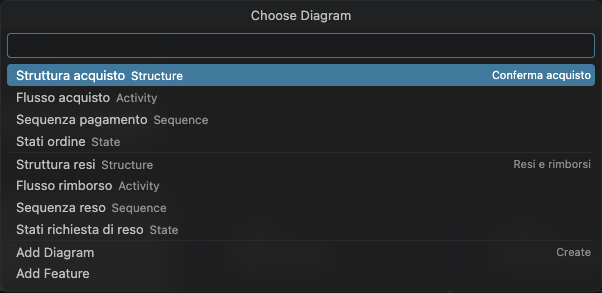

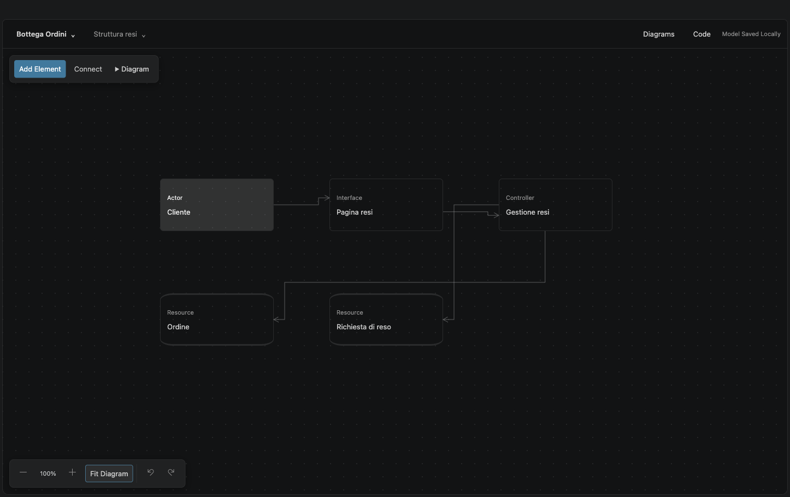

Apri in successione le altre tre viste:

| Vista | Cosa seguire | Domanda a cui rispondere |
| --- | --- | --- |
| Flusso rimborso | Valuta richiesta, Emetti rimborso, Reso non ammesso | Quale condizione ammette il rimborso? |
| Sequenza reso | Richiesta del cliente, invio, lettura ordine, registrazione | Quale informazione deve esistere prima della registrazione? |
| Stati richiesta di reso | Richiesto, Autorizzato, Rimborsato, Rifiutato | Quando una richiesta autorizzata diventa rimborsata? |

Seleziona ogni freccia del flusso e leggi la condizione. Poi guarda la transizione Autorizzato verso Rimborsato: autorizzare e completare il rimborso sono due momenti distinti. Il progetto non contatta una banca né calcola una scadenza: rappresenta la regola concordata per l’esempio.

**Controllo T3:** trova una lettura dell’Ordine e una scrittura della Richiesta di reso. Spiega perché la seconda feature riusa l’Ordine invece di crearne un duplicato chiamato “Ordine resi”.

### T4. Ritrova un elemento e riconosci l’identità condivisa

Lo stesso Ordine interessa sia l’acquisto sia il reso. Come lo ritroviamo nelle diverse viste? Come riconosciamo un’identità condivisa e controlliamo quali riferimenti risentono di una rinomina?

Apri **Diagrams**, poi **Search System**. Cerca “Ordine” e consulta il tipo e i diagrammi associati. La ricerca considera anche le modifiche non ancora salvate; un risultato può aprire una vista che contiene l’oggetto oppure i dettagli di un’identità ancora non disegnata. La navigazione indietro/avanti torna alle destinazioni visitate.

Apri **System Map** nella sidebar: Home, System Map e Search System sono disposti in verticale. Il clic aggiunge filtri cumulativi, la freccia apre un livello e **×** rimuove il proprio filtro. Gli elementi interni e condivisi delle feature collegate all’attore restano disponibili. La sezione **A9** illustra accessi, filtri e relazioni.

Un elemento conserva la propria identità cambiando nome o posizione. Un diagramma seleziona elementi e relazioni e conserva un layout proprio. **Add Existing Element** riusa un’identità; **Add Element** ne crea una nuova. Due nomi identici non rendono identici due oggetti.

In una copia del tour rinomina la risorsa Ordine in “Ordine cliente” dalle proprietà. Raggiungila da Struttura resi: il nome della stessa risorsa deve essere aggiornato. Cerca **Show Change Impact** sull’elemento per vedere i diagrammi e i riferimenti interessati; poi annulla la rinomina e salva.

**Controllo T4:** distingui il nome della risorsa dai nomi dei diagrammi “Stati ordine” e “Struttura acquisto”, che non devono essere rinominati automaticamente. La rinomina cambia l’identità selezionata, non ogni testo che contiene la parola ordine.

### T5. Fai una prima modifica reversibile

L’acquisto è definito, ma manca la notifica al cliente. Dove rappresentiamo questa nuova responsabilità e quando deve intervenire? Come salviamo, annulliamo e ritroviamo la modifica?

Lavora in una copia di Bottega Ordini per provare anche salvataggio e annullamento. Apri Struttura acquisto:

1. Premi **Add Element > Component** e scrivi “Notifiche ordine”.
2. Posizionala in uno spazio libero. Seleziona Conferma ordine e premi **Connect**, oppure **Connect Selection** nelle proprietà.
3. Scegli **Invocation**, la destinazione Notifiche ordine e il nome “invia conferma”. In **Condition (Optional)** scrivi `ordine confermato` e premi Invio per completare la relazione. Escape annulla l’intero collegamento.
4. Seleziona la freccia e controlla origine, destinazione e testo. Richiudi le proprietà.
5. Salva con `Cmd+S` o `Ctrl+S`. Se compare Update Codebase from Diagrams, scegli **Cancel**: qui stai definendo la responsabilità; la sua implementazione verrà dopo. Il modello rimane salvato.
6. Prova Undo e Redo. Salva la versione che vuoi conservare, chiudi il progetto e riaprilo.


Per togliere solo una rappresentazione apri il menu contestuale dell’elemento con clic destro o **Shift+F10** e scegli **Remove from This Diagram**. In alternativa, selezionalo e cerca **A.D.E: Remove Element from Diagram** nella palette. L’eliminazione dal sistema rimuove la definizione condivisa e può coinvolgere altri riferimenti; controlla l’impatto prima di confermarla. Eliminare una vista conserva gli elementi semantici. Se cambi progetto con modifiche pendenti, scegli salvataggio, scarto o annullamento.

**Controllo T5:** dopo la riapertura ritrova la notifica e la relazione; oppure, se hai scelto di annullarle, controlla che siano assenti. Hai completato il tour quando sai raggiungere una vista, leggere una relazione, riusare un’identità e recuperare una modifica.

## Parte II - Laboratorio: costruisci Mercato da zero

### L1. Prepara il laboratorio e scegli la cartella giusta

Per progettare **Mercato**, un piccolo e-commerce didattico, dobbiamo distinguere il nostro lavoro dagli esempi da consultare. Da quale cartella partiamo? Quali regole guideranno gli esercizi e quali risultati potremo verificare?

Il Cliente acquista e chiede resi; l’Assistenza li gestisce. Pagamenti esterni autorizza il pagamento, Corriere esterno rappresenta la consegna e Catalogo prodotti fornisce il contesto dei dati. Otterrai un modello coerente e prove locali di comportamenti delimitati; il pacchetto non avvia un negozio reale.

Prepara prima il materiale:

1. Estrai `progetti-esempio.zip` e conserva l’archivio originale.
2. Trova `07-mercato-laboratorio`. **Non aprire questa cartella contenitore come progetto ADE.** Aprirai ogni volta la sottocartella indicata dalla lezione.
3. Per costruire il progetto usa `inizio`, che contiene solo istruzioni, oppure crea con il gestore file una cartella vuota chiamata `Mercato-mio`. Non copiarvi il modello della soluzione.
4. Avvia ADE e raggiungi la Home. Se stai già guardando un diagramma, apri il menu con il nome del progetto e scegli Home; in alternativa cerca **A.D.E: Open Home** con F1.

La regola didattica è: quantità intera da 1 a 10 per riga, prezzi in centesimi per evitare arrotondamenti impliciti, almeno una riga per ordine, conferma solo dopo autorizzazione del pagamento, reso riferito a un ordine esistente e ammesso entro 30 giorni. Il coupon sarà un esempio opzionale nei casi d’uso. Tasse, pagamenti reali, sicurezza e regole commerciali effettive richiedono una specifica ulteriore.

| Lezioni | Cartella da aprire | Cosa farai |
| --- | --- | --- |
| L2-L11 | La tua `Mercato-mio` o `inizio` | Costruzione manuale delle viste e dei contratti |
| Confronto dopo L3 | `tappe/01-confini` | Controllo della prima tappa senza sovrascrivere il tuo lavoro |
| Confronto dopo L5 | `tappe/02-architettura-dati` | Controllo di architettura e dati |
| Confronto dopo L10-L11 | `soluzione` | Riferimento finale |
| L12 | `moduli/quantita`, in una copia | Regola eseguibile, casi, review, verifica, Apply e Undo |
| L13-L15 | `moduli/interazioni`, poi `moduli/stati`, poi `moduli/messaggi` | Tre esercizi locali distinti |
| L16-L20 | `codice`, in una copia, e il progetto pertinente alla lezione | Test, importazione e percorsi avanzati |

“Root del progetto” significa precisamente la cartella scelta in Open Project o Create Project. Il clone dell’IDE e la cartella del tuo negozio hanno scopi diversi. **Open Project** apre un modello già presente; **Create Project** prepara quello nuovo; **Import Codebase** analizza una cartella di sorgenti.

Salva alla fine di ogni lezione. Per confrontare una tappa, aprine una copia con Open Project e poi riapri la tua cartella per continuare. Non incollare il file della soluzione sopra il tuo modello. I moduli eseguibili sono progetti autonomi: il modello descrittivo principale non si trasforma da solo in un intero e-commerce.

### L2. Crea il progetto, le feature e la prima struttura

Mercato deve gestire acquisti, catalogo e resi: sono le feature, cioè le capacità del prodotto. Come rappresentiamo ciascuna feature attraverso i diagrammi? Quali responsabilità, dati e collegamenti inseriamo nella prima vista, e come organizziamo più feature nello stesso progetto?

#### Creazione e navigazione iniziale

1. Nella Home premi **Create Project**.
2. Nel campo **Name** scrivi `Mercato` e premi Invio.
3. Seleziona la cartella preparata in L1 e conferma l’apertura. Nel selettore di cartelle puoi anche inserire il percorso completo. Attendi la schermata con Mercato e **Add Feature**.
4. Premi **Add Feature**, scrivi `Acquisto` e conferma. Il diagramma attivo diventa **Acquisto · Structure**; ADE crea anche **Acquisto · Flow**.
5. Per la seconda feature clicca il **nome del diagramma nella testata**, cerca **Add Feature**, scegli la voce, scrivi `Catalogo prodotti` e conferma.
6. Ripeti per `Resi e rimborsi`. Il pulsante iniziale Add Feature è stato sostituito dal selettore e dalla navigazione: puoi sempre ritrovare l’azione lì.
7. Clicca nuovamente il nome della vista nella testata, cerca **Acquisto · Structure** e aprila. Tutti gli oggetti della prossima tabella vanno creati qui.

Nel laboratorio le viste ordinarie saranno associate alla feature scelta dal form, prevalentemente Acquisto; le due viste Resi avranno la propria feature. Le viste C4 si creano dal blueprint e compaiono anche nella navigazione del sistema. La classificazione della vista non duplica gli elementi che essa mostra.

#### Aggiungi i primi sei elementi

Per ogni riga premi **Add Element**, scegli il tipo nel percorso indicato, inserisci il nome e premi Invio. Ripeti l’azione per il prossimo oggetto. Nei gruppi usa Back per tornare alla lista precedente; Escape annulla il form.

| Nome | Percorso dal pulsante Add Element | Responsabilità |
| --- | --- | --- |
| Cliente | Actor | Richiede l’acquisto |
| Web shop | More Element Types > Architecture > Application / Container | Applicazione web del negozio |
| Checkout | Component | Coordina la conferma |
| Ordine | Resource | Risultato di dominio registrato |
| Pagamenti esterni | More Element Types > Architecture > Software System | Servizio esterno di autorizzazione |
| Gestione resi | Component | Consulta l’acquisto per gestire il reso |

La forma Software System verrà qualificata come esterna in L3. Per ora basta crearla. Se una scheda finisce fuori dall’inquadratura premi **Fit Diagram**. Non aggiungere un duplicato per sostituire una scheda che non riesci a vedere.

#### Crea una relazione dall’inizio alla fine

Esegui prima il collegamento Cliente verso Web shop:

1. Clicca la scheda **Cliente**. Nelle proprietà premi **Connect Selection**; puoi usare anche Connect sul canvas dopo la selezione.
2. In **Relationship Type** scegli **Communication**.
3. In **Target Element** cerca e scegli **Web shop**.
4. In **Relationship Name** scrivi `naviga` e premi Invio.
5. In **Condition (Optional)** lascia il campo vuoto e premi Invio. Il collegamento viene completato. Escape in questo passaggio annullerebbe il form.

Ripeti lo stesso procedimento per le quattro righe seguenti. Compila la condizione soltanto dove indicata.

| Origine | Relationship Type | Destinazione | Relationship Name | Condition |
| --- | --- | --- | --- | --- |
| Web shop | Invocation | Checkout | invia acquisto | Vuota |
| Checkout | Invocation | Pagamenti esterni | autorizza pagamento | Vuota |
| Checkout | Write | Ordine | registra ordine | pagamento autorizzato |
| Gestione resi | Dependency | Checkout | consulta acquisto | Vuota |

Communication descrive l’accesso al negozio, Invocation una richiesta, Write la registrazione del dato. La condizione sul Write dichiara che la registrazione è prevista solo dopo l’autorizzazione; il diagramma non esegue né verifica la regola. Dependency dichiara ciò che Gestione resi usa, senza imporre un ordine di chiamate.

**Riusare un elemento e riusare una relazione sono due operazioni distinte.** Add Existing Element aggiunge soltanto la scheda. In una vista ordinaria includi prima entrambi gli estremi, poi usa **Diagram > Contents > Add Existing Relationship** e scegli il collegamento. Il wizard C4 può includere le relazioni compatibili fra i visibili; controlla prima il canvas. Sequence usa invece Add Existing Message. Non usare Connect per copiare un collegamento: creerebbe una seconda relazione nel sistema.

#### Rinomina, disponi e salva

Chiudi le proprietà con **Close Properties**. Apri **Diagram > Contents > Rename Diagram**, scrivi `01 Panoramica delle responsabilità` e conferma. Il nome nella testata deve cambiare.

Apri **Diagram > Layout and Display > Arrange Diagram**, scegli **Balanced**, poi premi **Fit Diagram**. Puoi trascinare le schede per rendere più chiaro il percorso. **Show Relationship Labels**, nello stesso gruppo Layout and Display, mostra tutte le etichette; le proprietà permettono sempre di leggere la relazione selezionata.

Salva con `Cmd+S` su macOS o `Ctrl+S` su Windows/Linux. Se compare Update Codebase from Diagrams, scegli Cancel: il salvataggio del modello resta valido. Il risultato atteso è **Model Saved Locally**.

**Controllo L2:** torna alla Home, scegli Open Project e riapri la stessa cartella. Devi trovare tre feature, sei elementi nella panoramica e cinque relazioni. Le altre viste automatiche possono essere ancora vuote. Continua sulla tua panoramica: non occorre crearne una seconda a livello di sistema.

### L3. Definisci il contesto e gli obiettivi degli utenti

Prima di progettare l’interno di Mercato, dobbiamo definirne il perimetro. Che cosa governiamo e da quali servizi esterni dipendiamo? Quali obiettivi vogliono raggiungere Cliente e Assistenza, e quali comportamenti sono necessari oppure opzionali?

#### Usa il wizard Structural Blueprint

Apri **New > Structural Blueprint** nella sidebar, oppure cerca **A.D.E: Edit Structural Blueprint** nella palette. In **Choose** clicca l’attività, raggruppata per area e ricercabile. Un percorso come **Structure > C4 View Subject and Context** indica l’area e l’attività nella stessa schermata. In **Configure** seleziona o compila ogni campo e premi **Next**, anche per confermare una lista o un campo facoltativo vuoto. In **Review** controlla il riepilogo, correggi un passaggio con **Edit** e conferma con **Apply Changes**. Solo allora il modello viene modificato; salva poi il progetto.

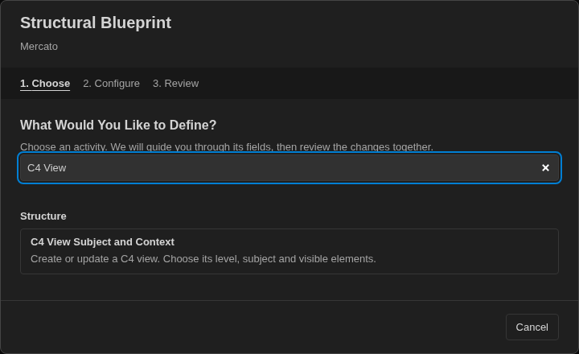

**Back** conserva le risposte; cambiare una scelta scarta quelle che ne dipendono. **Cancel** o Escape chiudono senza applicare. Dalla sidebar o dalla palette il wizard chiede **Element** quando serve un target: la sola selezione sul canvas non lo imposta. Un’azione specifica delle proprietà, come Scope and Responsibility, apre invece l’attività per quell’elemento. Anche Project Architecture Decisions usa questo wizard; Apply Changes riguarda il modello, mentre Apply to Project di L12 scrive i sorgenti.

#### Crea e qualifica il sistema

Nella panoramica usa Add Element > More Element Types > Architecture > Software System per creare **Mercato** e **Corriere esterno**. Aggiungi **Assistenza** con Add Element > Actor. Cliente e Pagamenti esterni esistono già.

Seleziona la scheda Software System **Mercato**. Apri **Properties > Architecture > Scope and Responsibility**, scegli **Governed System**, premi Next e poi **Apply Changes** nel riepilogo: è il sistema che stai progettando. Ripeti per Pagamenti esterni e Corriere esterno scegliendo **External System**: Mercato ne usa i servizi, ma non ne governa l’interno. Ogni sistema richiede la propria applicazione del wizard; non occorre un account.

#### Crea il C4 Context

Il modello C4 descrive l’architettura per livelli: dal contesto del prodotto alle applicazioni e ai loro componenti. Il soggetto fissa ciò che analizzi; il contesto ne dichiara le dipendenze esterne; i visibili scelgono cosa disegnare. Il perimetro resta così esplicito anche mostrando solo parte del modello.

1. Chiudi le proprietà e apri **New > Structural Blueprint**, oppure il comando omonimo della palette.
2. In Choose clicca **C4 View Subject and Context** nell’area Structure. In Configure seleziona **Create New** e premi **Next**.
3. In **C4 Level** scegli **L1 · System Context**, poi Next.
4. In **View Subject** scegli **Mercato**, poi Next. Se l’elenco è vuoto, controlla che sia un Software System con scope Governed System già applicato.
5. In **View Name** scrivi `02 C4 Contesto Mercato`, poi Next.
6. In **Context Dependencies (Outside the Subject)** spunta solo Cliente, Assistenza, Pagamenti esterni e Corriere esterno, poi Next. Se filtri l’elenco, le selezioni restano.
7. In **Visible Elements** mantieni Mercato selezionato e spunta gli stessi quattro oggetti di contesto, poi Next.
8. In **Review Your Blueprint Changes** controlla livello, soggetto, contesto e visibili, poi premi **Apply Changes**.
9. La creazione non apre necessariamente la vista: scegli **02 C4 Contesto Mercato** dal selettore prima di continuare.

Crea quattro relazioni Communication, con condizione vuota: Cliente verso Mercato “acquista e richiede resi”; Assistenza verso Mercato “gestisce richieste”; Mercato verso Pagamenti esterni “autorizza e rimborsa”; Mercato verso Corriere esterno “richiede consegna”. Se una relazione è già visibile, riusala.

Se manca il soggetto nei visibili, ADE segnala Draft Needs Correction. Riapri Structural Blueprint > Structure > C4 View Subject and Context, scegli la vista esistente e completa i campi con Next; applica la correzione dal riepilogo. Non serve modificare il modello testuale.

#### Crea Use Case e aggiungi gli elementi esistenti

Dal selettore scegli **Add Diagram > Acquisto > More Diagram Types > Behavior > Use Case**. Assegna il nome `12 Casi d’uso`. Questa creazione apre direttamente la nuova vista.

Per riusare Cliente apri **Diagram > Contents > Add Existing Element**, cerca Cliente e scegli la riga di tipo **Actor**. Ripeti per Assistenza e per il **Software System Mercato**. Aggiungere un esistente alla vista non ne crea una copia.

Con Add Element > Use Case crea Confermare acquisto, Autorizzare pagamento, Richiedere reso e Applicare coupon. Collega:

| Origine | Tipo | Destinazione | Nome | Condizione |
| --- | --- | --- | --- | --- |
| Cliente | Association | Confermare acquisto | avvia | Vuota |
| Cliente | Association | Richiedere reso | richiede | Vuota |
| Assistenza | Association | Richiedere reso | gestisce | Vuota |
| Confermare acquisto | Include | Autorizzare pagamento | include | Vuota |
| Applicare coupon | Extend | Confermare acquisto | extend | coupon presente |

Per ciascun caso d’uso apri **Structural Blueprint > Structure > Architectural or Lifecycle Owner**. Nel primo campo **Element** scegli il caso da modificare; nel successivo elenco dei proprietari scegli **Mercato**, poi **Ownership Role > Architecture**. Avanza con Next e conferma il riepilogo con Apply Changes. Nelle proprietà Architecture deve comparire **Owner: Mercato**. Con Mercato visibile il diagramma rappresenta il confine dei suoi casi. Usa **Arrange Diagram > Balanced**, poi Fit Diagram per disporre gli ovali e mantenerne leggibili i nomi.

L’autorizzazione del pagamento è necessaria alla conferma: usa Include. Il coupon è opzionale: usa Extend, dal comportamento aggiuntivo al caso base. La distinzione evita di rendere obbligatoria un’opzione o facoltativo un requisito. L’ordine dei passi verrà descritto in Activity e Sequence.

**Controllo L3:** salva. Nel Context distingui un sistema governato, due attori e due sistemi esterni. Nei casi d’uso riconosci i due obiettivi del Cliente e l’azione opzionale del coupon. Il checkpoint `tappe/01-confini` permette di confrontare il lavoro raggiunto.

### L4. Costruisci C4 Container e C4 Component

Definito il confine del negozio, dobbiamo organizzarne l’interno. Quali applicazioni e archivi lo compongono, e come comunicano? Come suddividiamo l’API in responsabilità più piccole e dichiariamo a quale parte appartiene ciascun elemento?

#### Crea i container e scegli i ruoli mostrati dal form

Torna alla panoramica. Crea API Mercato, Archivio Mercato e Broker eventi con Add Element > More Element Types > Architecture > Application / Container. Web shop è già presente. API significa interfaccia di programmazione: qui API Mercato è il servizio che riceve le richieste del negozio.

Seleziona ogni container e apri **Properties > Architecture > Scope and Responsibility**. Il wizard chiede **Responsibility**, poi **Container Role**: avanza con Next dopo ogni campo e applica il riepilogo. Usa queste scelte:

| Container | Responsibility | Container Role |
| --- | --- | --- |
| Web shop | Interfaccia web del negozio | Web Client |
| API Mercato | Conferma acquisti e gestisce resi | Service |
| Archivio Mercato | Conserva ordini e prodotti | Data Store |
| Broker eventi | Distribuisce eventi | Messaging |

Apri **Structural Blueprint > Structure > Architectural or Lifecycle Owner**. In **Element** scegli il container da modificare; nell’elenco dei proprietari scegli **Mercato**, poi **Architecture**. Completa Next, Review e Apply Changes per ogni container: dichiari così quali parti compongono il sistema. Spostare una scheda nel rettangolo non assegna questa appartenenza.

#### Crea e apri la vista Container

Dal wizard C4 di L3 scegli Create New, **L2 · Containers**, soggetto Mercato e nome `03 C4 Applicazioni e dati`. Seleziona Cliente nel contesto. Nei visibili mantieni Mercato e includi Cliente e i quattro container. Conferma ogni passo con Next, poi Apply Changes nel riepilogo e **apri la nuova vista dal selettore**.

Cliente verso Web shop “naviga” è già una relazione condivisa: conservala. Crea Communication da Web shop ad API Mercato “invia ordini”, dall’API ad Archivio Mercato “legge e scrive” e dall’API a Broker eventi “pubblica eventi”, tutte con condizione vuota. Può apparire anche la comunicazione già dichiarata Cliente–Mercato del Context: è lo stesso modello, non un errore di importazione.

Per impostare un protocollo seleziona la freccia e premi **Edit Cardinalities and Protocol** nelle Relationship Properties. Il form presenta **cinque campi in sequenza**: Source Multiplicity, Target Multiplicity, Source Attribute / Column, Target Attribute / Column, Protocol / Transport. Per queste comunicazioni lascia vuoti i primi quattro, confermando ogni volta con Invio. Nell’ultimo inserisci il protocollo:

| Relazione | Protocol / Transport |
| --- | --- |
| Cliente verso Web shop | HTTPS |
| Web shop verso API Mercato | HTTPS / JSON |
| API Mercato verso Archivio Mercato | SQL |
| API Mercato verso Broker eventi | Messaggistica dichiarata |

Il nome spiega a cosa serve il collegamento; il protocollo come si prevede di comunicare. Entrambi permettono di valutare l’integrazione prima di implementarla.

Per selezionare una freccia puoi cliccare il tratto o la sua etichetta. Da tastiera raggiungila con Tab e premi Invio. La dicitura nelle proprietà consente di controllare sempre origine e destinazione prima di modificare.

#### Costruisci prima i componenti, poi il contratto

Torna alla panoramica e aggiungi i Component **Registro esiti** e **Scorte**. Checkout e Gestione resi esistono. Nel wizard di ownership scegli ciascun componente in **Element** e assegna l’owner **API Mercato**, ruolo Architecture; applica ogni riepilogo. Scorte rappresenta la responsabilità applicativa per la disponibilità; Archivio Mercato rappresenta la persistenza.

Crea dal wizard C4 una vista **L3 · Components**, soggetto API Mercato, nome `04 C4 Componenti API`. Nel contesto lascia tutto deselezionato e premi Next. Nei visibili mantieni API Mercato e seleziona Checkout, Registro esiti, Gestione resi e Scorte. Avanza al riepilogo, premi Apply Changes e apri la nuova vista.

Qui premi **Add Element > Contract** e crea **Contratto acquisto**. Il percorso nativo della vista lo colloca sotto API Mercato. Non cercare Contract nel gruppo Interfaces della panoramica: quel gruppo offre Interface Contract, che è un tipo diverso.

Aggiungi Checkout verso Registro esiti con **Communication**, nome “registra esito”; Checkout verso Contratto acquisto con **Implementation**, “espone contratto”; Checkout verso Scorte con **Dependency**, “richiede disponibilità”. Gestione resi verso Checkout “consulta acquisto” è già presente: riusala. La vista C4 propone i collegamenti architetturali compatibili; le invocazioni operative saranno mostrate nella sequenza di L7.

**Controllo L4:** salva e premi Fit Diagram. Ogni container ha Owner Mercato e un ruolo dichiarato; i quattro componenti appartengono all’API; Contratto acquisto è il contratto dell’API fornito da Checkout. Trascinare una scheda cambia il layout, mentre il form di ownership cambia la struttura dichiarata.
### L5. Crea entità, colonne e riferimenti con i form

Un acquisto deve conservare dati coerenti su cliente, prodotti e resi. Quali entità e attributi servono, e quanti oggetti possono essere collegati? Come traduciamo queste regole in tabelle, chiavi e riferimenti senza confondere dominio e persistenza?

#### Crea l’ERD nel gruppo Data

L’ERD (Entity–Relationship Diagram) rappresenta entità e relazioni fra i dati. Dal selettore scegli **Add Diagram > Acquisto > More Diagram Types > Data > Entity–Relationship**. Inserisci `05 Entità e cardinalità`. Con **Add Element > Entity** crea Cliente, Ordine, Riga ordine, Prodotto e Reso.

Usa Add Element: queste entità definiscono i dati del dominio. L’Actor Cliente descrive chi agisce e la Resource Ordine l’oggetto coinvolto; l’ERD ne dettaglia invece attributi e legami. Per mostrare la stessa entità in un altro diagramma dati userai Add Existing Element.

#### Compila un attributo dall’inizio alla fine

Comincia dall’entità Cliente:

1. Seleziona la scheda **Cliente**, apri **Properties > Details and Actions > Edit Attributes and Technology**.
2. Nel menu con il nome dell’entità scegli **Add Attribute or Method**.
3. In **Member Kind** scegli **Attribute / Column**.
4. In **Member Name** scrivi `customerId` e premi Invio.
5. In **Type or Method Signature (Empty if Unknown)** scrivi `string` e premi Invio.
6. In **Key Kind** scegli **No Key**.
7. In **Field Presence** scegli **Required**.
8. In **Nullability (Independent of Presence)** scegli **Non-null Value**.

Il form si conclude e sulla scheda compare `customerId: string`. Per il prossimo attributo riapri Edit Attributes and Technology e scegli nuovamente Add Attribute or Method. Per correggere un membro esistente, selezionalo nell’elenco, scegli **Edit Member** e completa di nuovo il form: aggiorni così il membro senza duplicarlo.

In questa lezione il campo del tipo è una dichiarazione descrittiva: scrivi letteralmente **string** per il testo e **integer** per gli interi. Il form non richiede di creare prima Shared Types. I tipi condivisi dei contratti saranno costruiti in L11.

Per tutte le righe della tabella usa Attribute / Column, No Key, Required e Non-null Value:

| Entità | Membri da aggiungere con nome e tipo |
| --- | --- |
| Cliente | customerId: string; email: string |
| Ordine | orderId: string; totalCents: integer |
| Riga ordine | quantity: integer; unitPriceCents: integer |
| Prodotto | sku: string; priceCents: integer |
| Reso | returnId: string; reason: string |

Required richiede che il campo sia presente; Non-null Value vieta che il suo valore sia null. Qui servono entrambi: un ordine senza totale, o con totale null, non fornisce l’importo da usare.

#### Disegna e completa le cardinalità

Crea le quattro relazioni Association con la procedura di L2 e Condition vuota. Poi seleziona ogni relazione e apri Edit Cardinalities and Protocol. I primi due campi ricevono le molteplicità; lascia vuoti i due campi Attribute / Column e il Protocol / Transport, premendo Invio per ciascuno.

| Origine | Destinazione | Relationship Name | Source Multiplicity | Target Multiplicity |
| --- | --- | --- | --- | --- |
| Cliente | Ordine | effettua | `1` | `0..*` |
| Ordine | Riga ordine | contiene | `1` | `1..*` |
| Riga ordine | Prodotto | riguarda | `0..*` | `1` |
| Reso | Ordine | si riferisce a | `0..*` | `1` |

Cliente `1` verso Ordine `0..*` ammette un cliente senza acquisti, ma assegna ogni ordine a un cliente. Ordine verso Riga ordine `1..*` richiede invece almeno una riga: un ordine vuoto non è valido. Leggi entrambe le direzioni; le cardinalità dichiarano regole, non contano record presenti.

#### Crea lo schema fisico

Scegli **Add Diagram > Acquisto > More Diagram Types > Data > Database Schema** e il nome `06 Schema dati progettato`. Crea le cinque **Table** elencate sotto. Per ogni colonna ripeti il form completo degli attributi, usando il ruolo di chiave indicato; Field Presence resta Required e Nullability resta Non-null Value.

| Tabella | Colonne: nome, tipo e Key Kind |
| --- | --- |
| customers | id, string, Primary Key; email, string, Unique Key |
| orders | id, string, Primary Key; customer_id, string, Foreign Key; total_cents, integer, No Key |
| order_lines | id, string, Primary Key; order_id, string, Foreign Key; product_id, string, Foreign Key; quantity, integer, No Key |
| products | id, string, Primary Key; sku, string, Unique Key; price_cents, integer, No Key |
| returns | id, string, Primary Key; order_id, string, Foreign Key; reason, string, No Key |

Crea una Association **orders verso customers**, nome `customer_id`, condizione vuota. Seleziona la relazione, apri Edit Cardinalities and Protocol e compila tutti i passaggi:

| Campo del form | Valore |
| --- | --- |
| Source Multiplicity | `0..*` |
| Target Multiplicity | `1` |
| Source Attribute / Column (Empty if Unknown) | `customer_id` |
| Target Attribute / Column (Empty if Unknown) | `id` |
| Protocol / Transport (Empty if Unknown) | Vuoto, poi Invio |

I nomi dei membri si **scrivono** nel campo: non includere `orders.` o `customers.`. Il riferimento è già associato alle due tabelle della relazione. Se il membro non esiste, correggi il nome o crea prima la colonna: non usare un nome inventato per superare la validazione.

Ripeti con queste tre relazioni, sempre Source Multiplicity `0..*`, Target Multiplicity `1`, Target Attribute / Column `id` e protocollo vuoto:

| Origine | Destinazione | Relationship Name e Source Attribute / Column |
| --- | --- | --- |
| order_lines | orders | order_id |
| order_lines | products | product_id |
| returns | orders | order_id |

Il ruolo Foreign Key (FK, chiave esterna) identifica la colonna di riferimento; la relazione dice quale dato deve esistere all’altro estremo. Insieme esprimono, per esempio, che un reso deve riferirsi a un ordine esistente. Il solo testo FK non ne indica la destinazione.

**Controllo L5:** salva e riapri. L’ERD contiene cinque entità, dieci attributi e quattro associazioni; lo schema cinque tabelle, quindici colonne e quattro riferimenti. Confronta il checkpoint `tappe/02-architettura-dati`. Non hai creato un database o eseguito SQL. I mapping fra tipi di dominio e colonne richiedono i tipi condivisi di L11: affrontali dopo averli creati.

### L6. Costruisci Class, UML Component e Package

Dai dati passiamo all’organizzazione del software con UML (Unified Modeling Language), un linguaggio per rappresentarne tipi e collaborazioni. Quali operazioni e contratti servono? Come raggruppiamo i moduli e orientiamo le dipendenze per cambiare un dettaglio esterno senza riscrivere le regole del negozio?

#### Class appartiene al gruppo Data

Scegli **Add Diagram > Acquisto > More Diagram Types > Data > Class**, nome `11 Classi e repository`. Con Add Element crea le Class **Order** e **CheckoutService** e l’**Interface Contract OrderRepository**. Sono tre nuovi tipi del progetto; non devi convertire la Resource Ordine o l’entità Ordine.

Aggiungi a Order gli attributi `orderId: string` e `totalCents: integer`, ripetendo il form di L5 con No Key, Required e Non-null Value.

Per aggiungere il metodo confirm seleziona Order e apri Details and Actions > Edit Attributes and Technology > Add Attribute or Method. Questa volta scegli **Member Kind > Method**, nome `confirm`, tipo/firma `string`, Field Presence Required e Nullability Non-null Value. Per Method il form salta Key Kind: non aspettare una domanda sulle chiavi. Il canvas visualizza `confirm(): string`; inserisci il nome senza parentesi.

Ripeti per il metodo `submit` di CheckoutService e `save` di OrderRepository, sempre con risultato descrittivo string. In L11 userai input e risultati tipizzati per un contratto più completo.

Crea due Dependency con condizione vuota: CheckoutService verso Order, nome “valida e conferma”; CheckoutService verso OrderRepository, nome “usa contratto”. I membri descrivono i tipi: non sono implementazioni già scritte.

#### UML Component riusa i contratti esistenti

Scegli **Add Diagram > Acquisto > More Diagram Types > Implementation > UML Component**, nome `13 Componenti e interfacce`. Con **Diagram > Contents > Add Existing Element** aggiungi Checkout, Contratto acquisto, Registro esiti e OrderRepository. Controlla il tipo della riga, in particolare Component Checkout e Interface Contract OrderRepository.

Gli elementi da soli non portano con sé tutte le frecce. Apri **Diagram > Contents > Add Existing Relationship** e scegli **Checkout → Contratto acquisto: espone contratto**. Ripeti per **Checkout → Registro esiti: registra esito**. Ora crea la nuova Implementation da Registro esiti verso OrderRepository, nome “fornisce persistenza”, condizione vuota. Devi vedere tre collegamenti. Il riuso conserva identità e dettagli della relazione: Connect ne creerebbe una nuova.

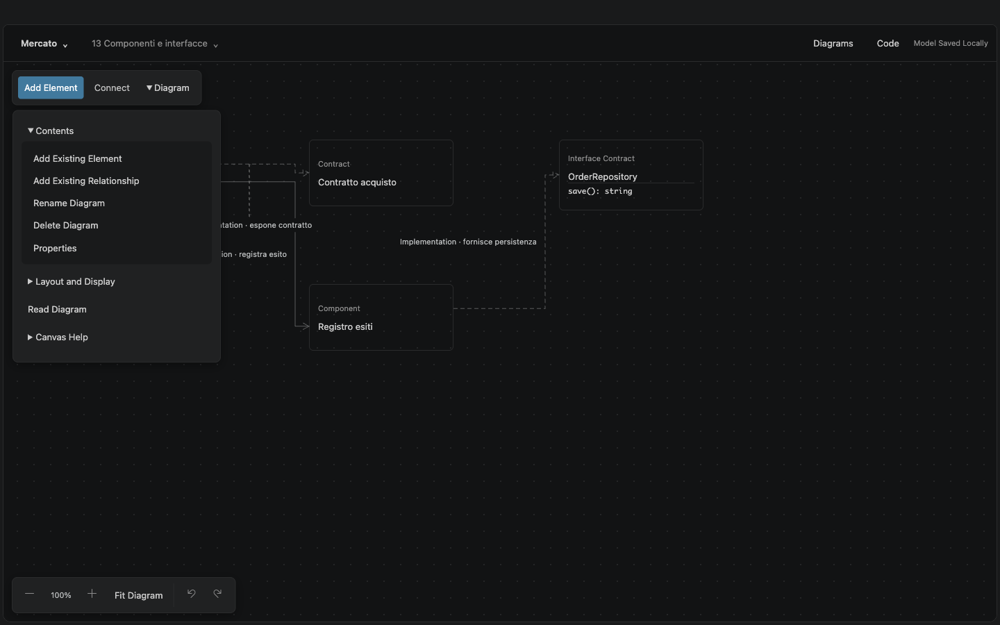

#### Package mostra i layer logici

Scegli **Add Diagram > Acquisto > More Diagram Types > Implementation > Package**, nome `14 Moduli applicativi`. Crea tre elementi Package: Dominio, Applicazione, Adapter. Aggiungi Dependency, con condizione vuota, da Applicazione a Dominio “usa regole”, da Adapter a Dominio “implementa contratti” e da Adapter ad Applicazione “collega esterni”. Questa direzione mantiene le regole del negozio indipendenti dai dettagli esterni, così cambiare un adapter non richiede di riscriverle.

**Controllo L6:** salva. OrderRepository è la stessa interfaccia nelle viste Class e UML Component; la sua modifica deve essere visibile in entrambe. Nel Package il dominio non dipende dagli adapter. Classe, componente e package rispondono a domande diverse e rimangono identità distinte.
### L7. Costruisci flusso, sequenza e stati dell’acquisto

Il pagamento può riuscire o essere rifiutato. Quale percorso segue l’acquisto in ciascun caso? Chi interviene e in quale ordine? In quale stato rimane l’Ordine, e come controlliamo che le tre prospettive raccontino un comportamento coerente?

#### Activity: azioni e alternative

Apri dal selettore **Acquisto · Flow**. È la vista creata con la feature: rinominala attraverso Diagram > Contents > Rename Diagram in `08 Flusso acquisto`.

Usa Add Element per aggiungere questi oggetti. I tipi Start, Decision ed End si trovano in More Element Types > Flow; Action si trova in More Element Types > Behavior.

| Tipo | Nomi da creare |
| --- | --- |
| Start | Inizio |
| Action | Valida carrello; Richiedi pagamento; Conferma ordine; Rifiuta ordine |
| Decision | Scorte disponibili? |
| End | Fine |

Crea tutti i collegamenti come **Control Flow**, confermando il nome e poi la Condition. Il nome e la condizione sono due campi distinti.

| Origine | Destinazione | Relationship Name | Condition |
| --- | --- | --- | --- |
| Inizio | Valida carrello | avvia | Vuota |
| Valida carrello | Scorte disponibili? | controlla | Vuota |
| Scorte disponibili? | Richiedi pagamento | prosegui | disponibili |
| Scorte disponibili? | Rifiuta ordine | rifiuta | non disponibili |
| Richiedi pagamento | Conferma ordine | conferma | pagamento autorizzato |
| Richiedi pagamento | Rifiuta ordine | rifiuta | pagamento rifiutato |
| Conferma ordine | Fine | termina | Vuota |
| Rifiuta ordine | Fine | termina | Vuota |

Premi Fit Diagram e segui i due esiti. Le condizioni sono descrittive; questa lezione non contatta un servizio di pagamento.

#### Sequence: partecipanti e messaggi sono due selezioni diverse

Scegli **Add Diagram > Acquisto > Sequence Diagram** e il nome `07 Sequenza acquisto`. Con Diagram > Contents > Add Existing Element aggiungi, nell’ordine, Cliente di tipo Actor, Checkout di tipo Component, Pagamenti esterni di tipo Software System e Ordine di tipo Resource.

Nell’elenco possono comparire anche l’Entity Cliente e l’Entity Ordine create in L5. Leggi il tipo della riga prima di confermare. La sequenza può mostrare inizialmente **No messages**: aggiungere partecipanti non include automaticamente le relazioni già dichiarate.

1. Seleziona Cliente e usa Connect Selection > Invocation > Checkout. Scrivi `conferma acquisto`, poi conferma Condition vuota. Questo è il primo messaggio.
2. Apri **Diagram > Contents > Add Existing Message**. Scegli **Checkout → Pagamenti esterni: autorizza pagamento**, di tipo Invocation. Non creare di nuovo quella relazione con Connect.
3. Ripeti Add Existing Message e scegli **Checkout → Ordine: registra ordine**, di tipo Write. La condizione pagamento autorizzato viene conservata.

Il risultato atteso è: 1 Cliente–Checkout, 2 Checkout–Pagamenti esterni, 3 Checkout–Ordine. L’autorizzazione deve precedere la registrazione condizionata dell’ordine: invertire i messaggi cambierebbe il comportamento progettato. I partecipanti conservano le identità condivise; spostare le schede non riordina le chiamate.

#### State: scegli prima la risorsa del lifecycle

Scegli **Add Diagram > Acquisto > State Diagram**. Il primo form è **Resource Lifecycle**: seleziona la Resource **Ordine**, già esistente. Poi inserisci il nome `09 Stati ordine`. Non scegliere Create New Resource per questo esercizio.

Il canvas include la risorsa Ordine e il pulsante **Add State**. Premilo tre volte, creando In attesa, Confermato e Rifiutato. Sono condizioni dello stesso ordine, perciò appartengono alla sua risorsa; creare tre risorse separate perderebbe questo ciclo di vita.

Seleziona In attesa e premi Connect Selection. In Relationship Type scegli **Transition**, in Target Element Confermato, in Relationship Name `Pagamento autorizzato`, in Condition `esito positivo`. Ripeti da In attesa verso Rifiutato con nome `Pagamento rifiutato` e condizione `esito negativo`.

**Controllo L7:** salva. Activity contiene sette nodi e otto Control Flow; Sequence quattro partecipanti e tre messaggi nell’ordine indicato; State una risorsa e tre stati con due transizioni. Sono descrizioni: le interazioni e i lifecycle eseguibili saranno affrontati nei moduli di L13-L14.

### L8. Costruisci le viste Resi e verifica il riuso

Il reso deve riferirsi a un acquisto già registrato. Quali elementi riusiamo e quali creiamo per la nuova feature? Come esprimiamo ammissione e rifiuto del rimborso, e verifichiamo che le modifiche a un Ordine restino condivise fra le viste?

#### Riusa la struttura automatica della feature

Apri **Resi e rimborsi · Structure** e rinominala `Resi - responsabilità condivise`. Aggiungi con **Add Existing Element** Cliente di tipo Actor e Ordine di tipo Resource. Crea invece questi tre nuovi elementi:

| Nome | Percorso da Add Element |
| --- | --- |
| Pagina resi | Interface |
| Coordinamento reso | More Element Types > Behavior > Controller |
| Richiesta di reso | Resource |

Interface qui rappresenta una pagina/interfaccia del negozio; Interface Contract è il tipo di contratto usato in L6. Il Component Gestione resi di C4 è la responsabilità applicativa; il Controller Coordinamento reso ne descrive il coordinamento di dettaglio.

Apri **Structural Blueprint > Structure > Architectural or Lifecycle Owner**. In **Element** scegli Coordinamento reso, poi **API Mercato** come proprietario e Architecture come ruolo; applica il riepilogo. Nel laboratorio controller e Gestione resi appartengono allo stesso container: il primo dettaglia il coordinamento del reso. Il wizard propone proprietari compatibili e senza cicli.

Crea quattro relazioni con Condition vuota:

| Origine | Tipo | Destinazione | Nome |
| --- | --- | --- | --- |
| Cliente | Invocation | Pagina resi | chiede reso |
| Pagina resi | Invocation | Coordinamento reso | invia richiesta |
| Coordinamento reso | Read | Ordine | verifica acquisto |
| Coordinamento reso | Write | Richiesta di reso | registra reso |

Ordine viene letto, Richiesta di reso viene registrata. L’Ordine originale rimane condiviso con Acquisto.

#### Completa il flusso del rimborso

Apri **Resi e rimborsi · Flow**, rinominala `Resi - ammissione e rimborso` e crea tre Action dal gruppo Behavior: Valuta reso, Emetti rimborso, Rifiuta richiesta. Collega Valuta reso a Emetti rimborso con **Control Flow**, nome `autorizza`, condizione `entro 30 giorni`; collega Valuta reso a Rifiuta richiesta con Control Flow, nome `rifiuta`, condizione `termine superato`.

#### Controlla impatto e identità

Torna alla struttura Resi, seleziona Ordine e apri **Properties > Details and Actions > Show Change Impact**. Consulta i riferimenti e le viste interessate, poi premi la freccia **Back** nella navigazione del progetto. La pagina Impact non ha il selettore dei diagrammi. Dalle proprietà ordinarie usa Rename Element per rinominare temporaneamente la risorsa `Ordine cliente`. Apri la panoramica di Acquisto: sulla stessa risorsa deve comparire il nome nuovo. Annulla con Undo e salva.

**Controllo L8:** ritrovi il nome Ordine ripristinato in entrambe le viste. Non è stato creato un Ordine resi separato. La richiesta di reso è una nuova risorsa; il controller è un dettaglio della responsabilità Gestione resi. Il flusso contiene due alternative con condizioni esplicite.
### L9. Progetta collocazione e connessioni

Le responsabilità applicative sono definite; ora dobbiamo progettarne l’esecuzione. Dove collochiamo software e dati? Quali parti devono comunicare, attraverso quali confini e protocolli? Come distinguiamo queste scelte dall’appartenenza architetturale già dichiarata?

#### Deployment: dove sono collocate le parti

Scegli **Add Diagram > Acquisto > More Diagram Types > Implementation > Deployment**, nome `10 Distribuzione locale progettata`.

Dal pulsante Add Element entra in **More Element Types > Infrastructure** e crea tre **Deployment Node**: Host Web, Host API, Host dati. Dallo stesso gruppo crea due **Artifact**: Web bundle, API ESM. ESM indica il formato dei moduli JavaScript previsto per questo esempio. Con Diagram > Contents > Add Existing Element includi i container API Mercato e Archivio Mercato.

Crea quattro relazioni **Hosts**, con condizione vuota:

| Origine ospitante | Destinazione ospitata | Nome |
| --- | --- | --- |
| Host Web | Web bundle | ospita |
| Host API | API ESM | ospita |
| Host API | API Mercato | ospita |
| Host dati | Archivio Mercato | ospita |

Per ciascun Host seleziona la scheda e apri **Properties > Details and Actions > Edit Attributes and Technology**. Scegli **Technology**, inserisci `Processo locale progettato` e conferma. Riapri lo stesso menu, scegli **Environment**, inserisci `Didattico locale` e conferma. Ogni modifica conclude il form: per la successiva riaprilo.

#### Network: quali collegamenti sono dichiarati

Scegli **Add Diagram > Acquisto > More Diagram Types > Implementation > Network / Infrastructure**, nome `16 Connessioni progettate`. Da Add Element > More Element Types > Infrastructure crea due **Network Node**: Rete client e Rete backend. Includi Web shop, API Mercato e Archivio Mercato con Add Existing Element.

Crea tre Communication, con Condition vuota, poi imposta il protocollo con il form a cinque campi di L4: primi quattro vuoti e ultimo compilato.

| Origine | Destinazione | Nome | Protocol / Transport |
| --- | --- | --- | --- |
| Rete client | Web shop | accesso web | HTTPS 443 |
| Rete client | Rete backend | confine applicativo | HTTPS 443 |
| Rete backend | API Mercato | API | HTTPS / JSON |

Il quarto collegamento esiste già: **Diagram > Contents > Add Existing Relationship > API Mercato → Archivio Mercato: legge e scrive**. Il protocollo SQL viene riusato con la relazione. Non ricrearlo con Connect. Devi vedere quattro relazioni nella Network.

Nel Deployment controlla anche i gruppi ospitanti: se Arrange Diagram dispone i figli di due host nello stesso rettangolo, trascina API ESM sotto API Mercato e tieni Archivio Mercato e Web bundle separati, poi premi Fit Diagram. Il raggruppamento visuale segue gli oggetti ospitati; la relazione Hosts resta dichiarata.

Salva e premi Fit Diagram. Il Deployment risponde a “dove sono collocate le parti”; la Network a “quali collegamenti sono previsti”. Le frecce non avviano processi, non aprono porte e non dimostrano una connessione reale.

### L10. Segui i dati e controlla tutte le notazioni

Abbiamo descritto responsabilità e comportamenti; resta da seguire l’informazione. Da dove arrivano prezzi e disponibilità, che cosa conserviamo e che cosa riceve il Cliente? Come controlliamo che le viste siano complete e coerenti fra loro?

Scegli **Add Diagram > Acquisto > More Diagram Types > Behavior > Data Flow**, nome `15 Dati dell’acquisto`. Data Flow si trova in Behavior, mentre ERD, Database Schema e Class sono in Data.

Includi l’**Actor Cliente** con Add Existing Element. Con Add Element crea **Process Elabora ordine** e due **Data Store**, Dati ordini e Dati catalogo. Qui il picker propone direttamente questi tipi, senza altri gruppi.

Crea quattro relazioni **Data Flow**, con Condition vuota:

| Origine | Destinazione | Nome del dato trasferito |
| --- | --- | --- |
| Cliente | Elabora ordine | dati acquisto |
| Dati catalogo | Elabora ordine | prezzi e disponibilità |
| Elabora ordine | Dati ordini | ordine confermato |
| Elabora ordine | Cliente | esito acquisto |

Salva, disponi e premi Fit Diagram. Un nome di dato risponde a “che cosa passa?”, non a “quale pulsante viene premuto?”.

Le due viste automatiche di Catalogo prodotti sono ancora vuote. Se vuoi una navigazione uguale al riferimento, apri ciascuna e usa **Diagram > Contents > Delete Diagram**. Controlla il nome nella conferma e premi Delete solo per quella vista. La feature e gli elementi del sistema rimangono. Undo permette di recuperare una cancellazione appena effettuata.

Perché la panoramica torni a rispondere a “chi collabora all’acquisto?”, togli i dettagli ora spiegati nelle viste dedicate. Seleziona, uno alla volta, Mercato, Corriere esterno, Assistenza, API Mercato, Archivio Mercato, Broker eventi, Registro esiti e Scorte, poi cerca **A.D.E: Remove Element from Diagram**. Restano i sei elementi di L2; identità e altre viste si conservano. Non usare Delete Element. Disponi e premi Fit Diagram.

Salva e riapri la tua root. Usa la tabella per verificare la copertura; i numeri indicano la prospettiva, non l’ordine in cui l’hai creata.

| Notazione | Vista del riferimento | Lezione |
| --- | --- | --- |
| Structure | 01 Panoramica delle responsabilità | L2 |
| C4 System Context | 02 C4 Contesto Mercato | L3 |
| C4 Container | 03 C4 Applicazioni e dati | L4 |
| C4 Component | 04 C4 Componenti API | L4 |
| ERD | 05 Entità e cardinalità | L5 |
| Database Schema | 06 Schema dati progettato | L5 |
| Sequence | 07 Sequenza acquisto | L7 |
| Activity / Flowchart | 08 Flusso acquisto | L7 |
| State Machine | 09 Stati ordine | L7 |
| Deployment | 10 Distribuzione locale progettata | L9 |
| Class | 11 Classi e repository | L6 |
| Use Case | 12 Casi d’uso | L3 |
| UML Component | 13 Componenti e interfacce | L6 |
| Package | 14 Moduli applicativi | L6 |
| Data Flow | 15 Dati dell’acquisto | L10 |
| Network / Infrastructure | 16 Connessioni progettate | L9 |

Con le due viste Resi hai **18 viste e 16 tipi di diagramma**. Apri ogni riga dal selettore, controlla gli elementi e almeno una relazione pertinente. Nella tua copia possono restare viste vuote automatiche: non sono errori, ma non sostituiscono una delle prospettive costruite.

**Controllo di coerenza:** Cliente e Ordine sono riusati nelle prospettive compatibili; entità, tabelle e classi restano distinte; tutte le relazioni hanno estremi pertinenti; le condizioni descrivono esiti comprensibili; le ownership corrispondono ai confini; la lettura testuale riporta i dettagli. Non occorre raggiungere una disposizione identica agli screenshot per aver progettato correttamente.


### L11. Formalizza tipi, contratto e decisione

Per implementare il checkout servono accordi precisi fra chi lo chiama e chi lo realizza. Come definiamo input, esiti ed errori? Chi fornisce il contratto, come colleghiamo i suoi dati alla persistenza e dove conserviamo le ragioni delle scelte?

#### Crea prima i tipi, nell’ordine delle dipendenze

Apri **New > Structural Blueprint**, poi **Shared Types** nell’area Data and Operations. In Configure scegli **Create New**, poi **Type Name** e **Type Kind**, avanzando con Next. Completa i campi del tipo e applica il riepilogo prima di crearne un altro: così le definizioni successive possono riusarlo.

| Type Name | Type Kind | Dato successivo |
| --- | --- | --- |
| Testo | Primitive | Nel campo Primitive Defined by the Selected Profile scrivi `string` |
| Intero | Primitive | Nello stesso campo scrivi `integer` |
| Riga ordine | Record | Applica la creazione iniziale dal riepilogo; aggiungi poi i due campi sotto |
| Righe ordine | Collection | Scegli il tipo Riga ordine, già creato e applicato |
| Dati ordine | Record | Aggiungi poi orderId e rows |
| Esito acquisto | Enumeration | Nel campo Values (Separated by Semicolons) scrivi `confirmed;declined` |
| Errore input | Record | Lascialo senza campi per questo esercizio: il codice dell’errore sarà dichiarato nell’operazione |

Per aggiungere un campo riapri **Shared Types**, scegli il record, poi **Add or Edit Field > Create New**. Inserisci il nome; scegli il tipo; scegli **Required**, poi **Non-null Value**. Conferma ogni passo con Next e il riepilogo con Apply Changes. Ripeti per ogni riga:

| Record | Nome campo | Tipo da scegliere |
| --- | --- | --- |
| Riga ordine | productId | Testo |
| Riga ordine | quantity | Intero |
| Dati ordine | orderId | Testo |
| Dati ordine | rows | Righe ordine |

Per seguire l’esempio, completa prima i campi di Riga ordine, poi crea la collezione e infine rows. È un ordine consigliato per controllare i dati progressivamente. Il requisito del form è che il tipo riferito sia già stato creato e applicato; puoi completarne i campi anche dopo. Required e Non-null Value sono scelte distinte; “almeno una riga” va dichiarato nel contratto, perché una collezione può essere vuota.

#### Crea l’operazione sul contratto corretto

1. Apri **Data and Operations > Shared Operations > Create New**.
2. In **Operation Owner** scegli **Contratto acquisto**, poi inserisci `submitCheckout` come nome. Checkout è il componente che fornisce il contratto; qui la firma appartiene al Contract.
3. Riapri Shared Operations e scegli submitCheckout. Apri **Signature > Input Parameters > Create New**. Nome `ordine`, tipo Dati ordine, Required, Non-null Value.
4. Riapri l’operazione e scegli **Signature > Results > Create New**. Nome `esito`, tipo Esito acquisto, Required, Non-null Value.
5. Riapri e scegli **Signature > Typed Errors > Create New**. Codice `INPUT_INVALID`, Error Description `Ordine assente o non valido`, Declared Type Errore input.

Ogni punto richiede una propria applicazione: dopo i campi premi Next fino a Review, controlla il riepilogo e scegli **Apply Changes**. Per cambiare un membro scegli la sua voce al posto di Create New. Back conserva le risposte; Escape chiude senza applicarle.


Riapri submitCheckout per le regole:

| Percorso dall’operazione | Valore |
| --- | --- |
| Behavior Rules > Preconditions (Descriptive) | L’ordine contiene almeno una riga |
| Behavior Rules > Postconditions (Descriptive) | L’esito viene registrato |
| Access and Acceptance > Acceptance Criteria > Create New | Given: Scorte disponibili; When: Il cliente conferma; Then: Le scorte sono riservate una sola volta |

I campi descrittivi ammettono dichiarazioni separate da punto e virgola. Il criterio chiede direttamente **Given**, **When**, **Then**, senza un campo iniziale per il titolo. Queste frasi non sono ancora una guardia o un’implementazione eseguibile. Il percorso quantitativo di L12 formalizza una regola delimitata.

#### Esponi il contratto e dichiara chi lo fornisce

Apri **Data and Operations > Interfaces and Invariants > Create New**. Scegli **Contratto acquisto**, Contract Version `1`, spunta **submitCheckout** in Shared Operations e lascia vuoto **Invariants (Descriptive, Separated by Semicolons)**. Avanza con Next dopo ogni campo, poi applica il riepilogo. Se l’operazione non compare, controlla che sia stata creata e applicata con owner Contratto acquisto.

Apri **Structural Blueprint > Connections > Provided or Required Interface**. In **Element** scegli **Checkout**, poi Create New, Contratto acquisto e **Provided**. Conferma ogni passo con Next e applica il riepilogo: dichiari così il fornitore del contratto. Puoi anche selezionare Checkout e aprire l’azione specifica Provided or Required Interface nelle sue proprietà Architecture: in quel caso il target è già impostato. Il binding permette ai controlli di riconoscere il provider oltre alla freccia Implementation.

Le interfacce richieste, le connessioni consumer/provider e i trasporti si configurano nello stesso gruppo Connections quando il progetto ne ha bisogno. Non aggiungerli a caso per eliminare una diagnostica: un servizio di pagamento reale richiederebbe contratti e policy che questo esempio non fornisce.

#### Mappa il campo e collega il Catalogo

Apri **Structural Blueprint > Technology > Domain Field Mapping**. Il primo elenco è già Domain Field: scegli **Dati ordine · orderId**, poi **orders · id** in Physical Column or Class Member, avanzando con Next. Non c’è un Create New intermedio. Controlla e applica il riepilogo: il mapping esplicita dove si conserva il dato, anche se il nome cambia; tipo di dominio e colonna mantengono le proprie identità.

Apri **Structural Blueprint > Structure > Feature Memberships** e scegli **Scorte** in Element. Spunta Catalogo prodotti, conservando Acquisto se già selezionato; premi Next e applica il riepilogo. L’owner architetturale rimane API Mercato. Una feature organizza la capacità, mentre l’ownership colloca la responsabilità.

#### Registra una decisione verificabile

Una decisione architetturale (ADR, Architectural Decision Record) conserva una scelta e le sue ragioni. Registra perché gli importi usano centesimi: chi cambierà tipi o codice potrà valutarne le conseguenze invece di dedurle dai nomi dei campi.

Cerca **A.D.E: Project Architecture Decisions**: il wizard apre direttamente l’attività delle decisioni. Scegli **Create New** e compila in ordine, premendo Next dopo ogni campo:

| Campo | Valore dell’esercizio |
| --- | --- |
| Decision Number | ADR-001 |
| Decision Title | Importi in centesimi |
| Context | Prezzi e totali devono essere confrontabili senza arrotondamenti impliciti |
| Decision | Usare interi in centesimi per prezzi e totali |
| Positive and Negative Consequences (Separated by Semicolons) | Mostrare la valuta soltanto al confine della UI;Validare gli importi nel dominio |
| Applicable Scope | Seleziona soltanto Checkout e Registro esiti, poi Next |

Controlla il riepilogo e premi **Apply Changes**: la decisione nasce Proposed. Per rileggerla riapri il comando e scegli **ADR-001 · Importi in centesimi**. **Revise Record and Scope**, **Change Status** e **Add or Edit Normative Constraint** modificano rispettivamente contenuto, stato e vincoli; ciascun percorso termina con Review e Apply Changes. Per il laboratorio conserva Proposed: la prosa da sola non diventa un controllo automatico sugli importi.

Salva e riapri Mercato. Non devono comparire Draft Needs Correction o tipi mancanti. Se una bozza impedisce il canvas, puoi selezionare l’elemento con Search System e correggerne l’ownership dal blueprint; non serve intervenire sul JSON.

**Controllo L11:** ritrovi sette tipi, l’operazione con input/risultato/errore, il contratto versione 1, Checkout come provider, il mapping e ADR-001. Il riferimento finale contiene questi dati. Le diagnostiche di generazione che dipendono da adapter, implementazioni o scelte non fornite non trasformano questa progettazione descrittiva in un negozio eseguibile.

### L12. Implementa e verifica il limite della quantità

L’obiettivo finale è accettare solo quantità intere da 1 a 10. Prima verifichi il template, che accetta gli interi positivi, e provi Apply e Undo; poi aggiungi il massimo 10 e controlli i confini. La prima review dimostra la regola iniziale, la seconda quella aggiornata.

#### Creare il template dal principio

Puoi usare la cartella `07-mercato-laboratorio/moduli/quantita` già pronta oppure creare un progetto vuoto e richiamare **A.D.E: Add Pure Quantity Feature** dalla palette. Il comando prepara feature, tipi, operazione `validateQuantity`, predicato e casi di base. Salva il modello. Il nodo visibile “Domain” è il contesto della regola.

La precondizione del template è **quantity maggiore di zero**. I valori appartengono a un tipo intero sicuro. Il testo `due` è quindi un errore di tipo, mentre 0 è un input del tipo corretto che non soddisfa la condizione.

#### Modificare il predicato dal form

Cerca **A.D.E: Edit Pure Predicate** nella palette, scegli `validateQuantity`, poi la precondizione esistente. Conferma lo scope pertinente: **Precondition · Inputs Only** usa gli input; **Postcondition · Inputs and Outputs** consente anche i risultati.

Il costruttore offre **Add Value** per riferimenti e letterali, **Combine Values** per operatori compatibili e **Choose Result and Save** per il risultato. Il predicato deve rispondere “la quantità è ammessa?”: serve quindi una condizione booleana. I risultati di altro tipo non sono proposti come esito finale.

Per una prova reversibile aggiungi un letterale del tipo Quantity e inserisci `2`: è un numero normale, senza sintassi JSON. Per un testo digita direttamente le parole; per booleani ed enumerazioni scegli una voce. Gli operatori numerici comprendono somma, sottrazione, moltiplicazione, divisione e resto nel sottoinsieme degli interi sicuri. Puoi distinguere presenza e null, combinare condizioni e usare count/any/every sulle collezioni supportate.

Premi **Escape** per uscire senza pubblicare la prova. Per cambiare davvero il limite, componi una nuova condizione, scegli il risultato, conferma e salva. **Clear Detached Expression** svuota la copia in lavorazione: non è una cancellazione immediata del predicato salvato.

#### Scrivere due casi indipendenti

Scrivi gli attesi dalla regola di business, separatamente dal generatore: se regola e codice condividessero lo stesso errore, i soli casi derivati potrebbero non rilevarlo. Zero e testo distinguono una quantità vietata da un dato del tipo sbagliato.

Apri **Progetto > Project Settings > Executable Behavior > Cases and Simulation > Independent Business Expectations**. Scegli **Add Predicate Test Case**, l’operazione e il criterio di business. Crea i due casi seguenti:

| Nome | Input da scegliere | Valore | Risultato atteso |
| --- | --- | --- | --- |
| Zero quantità | Value for quantity | 0 | Not Satisfied |
| Testo non numerico | Different Value Type, poi Text | due | Input Type Error |


Il nome non può essere vuoto o duplicato. Un testo inserito nel normale campo intero viene rifiutato: per testare deliberatamente un tipo errato usa **Different Value Type**. **Absent** e **Null** permettono di rappresentare quelle condizioni nei casi negativi. Nei form ordinari restano disponibili soltanto le alternative consentite dal contratto.

Seleziona un caso esistente per **Edit Inputs**, **Edit Expected Result** o **Delete Case**. Cambiare un input conserva l’aspettativa precedente finché non la modifichi esplicitamente. L’eliminazione richiede una conferma; **Keep Case** conserva il dato. La conferma senza cambiamenti e l’annullamento non devono creare una nuova revisione.

I risultati attesi disponibili comprendono Satisfied, Not Satisfied, Indeterminate, Input Type Error, Division by Zero e Nonintegral Result or Integer Overflow. Scegli secondo la regola di business e il tipo di espressione. Non ricavare l’atteso copiando automaticamente quello che il programma ha appena restituito.

#### Preparare, verificare, applicare e annullare

La review mostra cosa sarà scritto, la verifica confronta il comportamento con gli attesi, Apply conserva i file approvati. Segui questo ordine per giudicare la proposta prima che diventi codice del progetto; l’undo ti fa provare il ritorno allo stato precedente.

1. Salva il modello e apri **Code > Review and Verification > Prepare Model to Code Review**.
2. Leggi comportamento e file previsti. L’azione prepara una proposta locale, senza inferenza IA per il profilo del template.
3. Premi **Run Real Verification** e conferma l’esecuzione locale.
4. Controlla lo stato corrente. Con gli otto casi iniziali e i due appena aggiunti, l’esercizio verificato mostra **10 Derived Cases e 10 Independent Cases**.
5. Solo con review corrente e verifiche superate, scegli **Apply to Project**. Leggi l’elenco dei file e conferma.
6. Controlla i file con Files o il terminale. Per la prova di ritorno scegli **Undo Local Changes** e conferma.


Nel template iniziale la proposta crea un modulo, il test associato, `package.json` e `.gitignore`. Il nome del modulo è assegnato da ADE. Non è necessario rinominarlo o editarlo per completare l’esercizio. La verifica riguarda il comportamento formalizzato e gli attesi del runner; non è un test end-to-end di un negozio reale.

Se cambi modello, criteri o sorgenti pertinenti dopo la review, preparala di nuovo. Quando Code mostra **Review Changes**, aprila e scegli **Prepare New Review**. Una vecchia verifica verde non autorizza ad applicare una revisione nuova. Se l’undo incontra modifiche manuali successive, ADE lo blocca: conserva il tuo lavoro e confronta i file prima di riprovare.

#### Esercizio completo: da quantità positiva a massimo dieci


Usa una copia del modulo quantità di Mercato. La nuova regola accetta gli interi da 1 a 10. Prova i confini e i valori appena fuori: 0 e 11 devono essere Not Satisfied; 1 e 10 devono essere Satisfied. Questi casi distinguono un limite incluso da un confronto errato.

1. Apri **Edit Pure Predicate**, scegli validateQuantity, la precondizione esistente e Precondition · Inputs Only.
2. Con **Add Value > Add Typed Literal > Quantity**, inserisci `10`.
3. Con **Combine Values > Add Comparison**, scegli `quantity`, poi il letterale `10` e il confronto **≤** (minore o uguale).
4. Con **Combine Values > Add Boolean Logic > All True**, scegli prima la condizione `quantity > 0`, poi `quantity` minore o uguale a `10`.
5. Con **Choose Result and Save**, scegli il risultato che inizia con **and(** e comprende entrambe le condizioni. Salva il modello.
6. Nei casi indipendenti aggiungi “Limite 10” con input 10 e atteso Satisfied e “Oltre limite 11” con input 11 e atteso Not Satisfied.
7. Riapri **Structural Blueprint > Data and Operations > Shared Operations > validateQuantity > Access and Acceptance > Acceptance Criteria**. Scegli il criterio esistente, conserva il significato di Given e When e cambia Then in “Soltanto i valori da 1 a 10 soddisfano la precondizione”. Avanza con Next e applica il riepilogo. Modificare questa voce conserva l’identità del criterio e i casi associati. Controlla anche gli attesi iniziali: il caso con input **9007199254740991** era soddisfatto dalla vecchia regola; con il nuovo limite deve essere **Not Satisfied**. Modifica esplicitamente quel risultato con Edit Expected Result. Gli altri attesi iniziali restano pertinenti.
8. Prepara e verifica una nuova review. Se hai seguito tutti i passaggi di L12, ora gli indipendenti sono **12**; anche i derivati sono **12** nella variante qui verificata. Se Code mostra Review Changes, aprila e scegli Prepare New Review. Leggi la regola combinata e i risultati, poi applica se vuoi conservare il cambiamento. Non cambiare un atteso soltanto per nascondere un errore: qui la modifica del caso massimo deriva dalla nuova regola di business.

Per confrontare il risultato puoi aprire con Open Project la sottocartella **07-mercato-laboratorio/moduli/quantita/soluzione-limite** del pacchetto: contiene il predicato completo e i **dodici casi indipendenti** del percorso completo: otto iniziali, Zero quantità, Testo non numerico, Limite 10 e Oltre limite 11.

Controlla infine che modificare soltanto il layout non cambi la regola. Se sai spiegare perché 11 viene rifiutato e quali file saranno applicati, hai completato il percorso principale.

**Traguardo L12:** parti dal template, aggiungi gli attesi indipendenti, modifichi il predicato con il costruttore visuale, prepari una nuova review, verifichi, applichi e annulli. Conserva nel diario del progetto il limite scelto e i casi 0, 1, 10, 11 e tipo errato. Il valore massimo sicuro deve ora essere atteso Not Satisfied: cambiare la regola richiede anche rivedere gli attesi di business.


### L13. Rendi esplicite le chiamate del checkout

L’ordine delle chiamate è descritto, ma ora vogliamo verificarne il comportamento. Quali argomenti inviamo e quali risposte o errori attendiamo? Come rappresentiamo alternative e notifiche opzionali, e proviamo il checkout senza contattare un servizio di pagamento reale?

Apri `07-mercato-laboratorio/moduli/interazioni` e il diagramma **Checkout e pagamento**. Scorri verticalmente per seguire l’intero flusso. L’interazione principale chiama Payments, valuta un’alternativa, può richiamare la sotto-interazione di persistenza e gestisce una notifica opzionale.


Premi **Edit Executable Interaction** nel canvas: si apre direttamente l’interazione della vista. Se usi il comando omonimo nella palette, scegli prima l’interazione checkout. Naviga la gerarchia di messaggi, frame e rami. Per ogni chiamata dichiara mittente, destinatario proprietario dell’operazione, argomenti, modalità sincrona/asincrona, risposta, deadline, correlazione, risultati ed errori pertinenti.

| Costrutto | Uso pratico |
| --- | --- |
| alt | Scegliere un solo ramo in base a guardie; il ramo else copre gli altri esiti |
| opt | Eseguire un corpo soltanto quando la condizione lo richiede |
| loop | Ripetere con guardia, contatore e massimo esplicito |
| par | Avviare rami locali concorrenti e attenderne il join previsto |
| critical | Proteggere una risorsa locale con ordine dei lock coerente |
| ref | Richiamare una sotto-interazione con contratto e revisione espliciti |

Risultati di chiamate ripetute hanno identità distinte. Mantieni gli argomenti nello scope del ramo e della chiamata pertinenti. Il motore rifiuta cicli fra sotto-interazioni e ordini di lock incompatibili.

I casi del progetto comprendono pagamento approvato, alternative, notifica e condizioni di errore. Apri **Independent Business Expectations** per aggiungere un caso dell’interazione: scegli il criterio, inserisci input e risposte simulate, ritardi, completamento/fallimento, output e ordine delle chiamate attesi. Le risposte sono dati: questa verifica non contatta il servizio Payments.

**Esercizio verificato:** prepara la review da Code ed esegui Run Real Verification. L’esempio distribuito ha **sette casi derivati e sette indipendenti**. Per l’esplorazione apri Edit Executable Interaction e scegli il frame **opt** per leggere il ramo della notifica. Premi Escape per uscire senza salvare modifiche. L’aggiunta di un nuovo caso completo tramite **Independent Business Expectations > Author Independent Interaction Case** è un approfondimento: richiede input, risposte simulate e ordine atteso coerenti; non è necessaria per il traguardo locale dei sette casi forniti.

**Collegamento a Mercato:** Payments rappresenta Pagamenti esterni; Orders la registrazione dell’Ordine; Notifications la notifica. Studia prima il modulo senza rinominarne le identità o gli attesi. Poi riporta nella tua specifica i contratti effettivamente necessari. Un diagramma descrittivo della soluzione e questa interazione eseguibile sono due livelli distinti del percorso.

**Controllo L13:** sai distinguere la chiamata, la risposta simulata, il ramo alternativo e il criterio indipendente. Una verifica passata non prova un pagamento reale.


### L14. Simula il ciclo di vita dell’ordine

L’ordine cambia nel tempo in risposta agli eventi. Quali passaggi sono ammessi e quali effetti devono accompagnarli? Che cosa accade se un’azione fallisce o un evento arriva due volte, e come leggiamo la traccia della simulazione?

#### Macchine a stati

Apri `07-mercato-laboratorio/moduli/stati`. **Checkout Lifecycle** contiene Draft, Paid e Cancelled. Il contratto eseguibile dichiara inizializzazione, eventi, azioni entry/exit/do, guardie, priorità ed effetti ordinati. Il solo disegno di tre stati non sarebbe sufficiente per eseguirlo.

Dalla palette richiama **A.D.E: Simulate State Machine** e scegli **checkout.paid**. Il risultato si apre come documento **State Simulation.txt** nell’IDE. Leggilo nell’editor; per tornare al canvas riapri la scheda **Checkout Lifecycle** (quella del diagramma, distinta da State Simulation.txt), poi richiama **A.D.E: Back to Diagrams** con F1. Il rapporto deve mostrare stato **Paid**, evento accettato e transizione **Draft verso Paid**. La traccia distingue valutazione della guardia, annullamento dell’attività do, exit, effetto, entry e commit.


Torna al canvas e ripeti con `checkout.failed-charge`: attesi stato Draft ed errore denied. Ripeti poi con `checkout.dedup-reopen`: attesi stato Paid e tre eventi, accepted, duplicate e rejected con deliveryConflict. I risultati attesi sono già inclusi nella variante del progetto.

Per modificare la macchina usa **Edit Executable State Machine**. Dichiara ownership architetturale e di lifecycle, un solo stato iniziale, eventuali stati finali, eventi con payload tipizzato, transizioni interne/esterne, guardia, priorità e azioni. Le azioni richiamano interazioni revisionate. Una self-transition interna e una esterna non hanno lo stesso ciclo di entry/exit.

Nei casi indipendenti dichiara input iniziale, eventi, risposte delle azioni, esiti accettato/rifiutato/duplicato/fallito, transizione ed errore attesi, stato finale, quiescenza e checkpoint quando necessari. Il profilo supporta macchine piatte: niente stati compositi o regioni ortogonali. La simulazione non è un monitor di istanze applicative vive.


**Collegamento a Mercato:** Draft, Paid e Cancelled sono i nomi degli stati del modulo eseguibile. Confrontali semanticamente con In attesa, Confermato e Rifiutato della tua progettazione; non considerarli equivalenti automaticamente, perché “annullato” e “pagamento rifiutato” possono richiedere transizioni diverse. Prima di integrare il modulo nel dominio reale decidi quale lifecycle adottare e i relativi eventi. Questo è un punto di modellazione da discutere, non un mapping implicito.


### L15. Simula pubblicazione e consegna dei messaggi

Un evento pubblicato deve raggiungere i destinatari previsti. Quando serve una queue e quando un topic? Come gestiamo errori, nuovi tentativi e duplicati, e verifichiamo queste policy localmente senza avviare un broker?

Apri `07-mercato-laboratorio/moduli/messaggi`. La topologia **checkout.messaging** contiene un producer di queue e uno di topic; le subscription comprendono workers, billing e analytics. Usa **Edit Messaging Topology** per consultare contratti, canali, producer/consumer e policy.

Una queue assegna il lavoro a consumer concorrenti; un topic consente il fan-out alle subscription dichiarate. I contratti dei messaggi hanno nome/versione, payload record e campi per identità, routing e correlazione. Dichiara ack, attesa, tentativi, backoff, dead letter queue, capacità e deduplica/idempotenza invece di assumerli impliciti.

**Simulazione guidata senza broker:**

1. Richiama **A.D.E: Simulate Messaging** e scegli `checkout.messaging`.
2. Scegli **Publish Message**, tempo logico `0` e producer **publish.queue**.
3. Inserisci identità `ordine-guida-1`, `orderId` uguale a `42` e `correlationId` uguale a `checkout-42`.
4. Scegli **Deliver to Worker**, tempo `0`, subscription **workers**, worker `A` e **Handler Succeeds**.
5. Scegli **Finish Scenario**.

Si apre il selettore **Simulation Result · Zero AI Calls · No Network** con due righe: **ordine-guida-1** (Publication Observation) e **workers:A:ordine-guida-1:1:ok** (Worker Delivery Observation). Non devono comparire righe di rifiuto o dead letter. Premi Escape per chiudere il risultato.


Per esplorare retry e backoff scegli Handler Fails e tempi logici coerenti con la policy. Per osservare fan-out usa publish.topic e subscription differenti. I casi indipendenti già forniti comprendono competizione, fan-out, deduplica, idempotenza, tentativi esauriti e incompatibilità del contratto; si verificano dalla review del profilo.

La simulazione è locale e non usa la rete. ADE non offre un pannello per avviare o amministrare un broker NATS reale. Un caso simulato passato non dimostra la consegna su un’infrastruttura esterna.

**Collegamento a Mercato:** usa il broker progettato in L4 come contesto e il modulo per verificare una policy locale. Descrivi un evento OrderConfirmed con identità, orderId e correlazione; decidi chi lo pubblica e chi lo consuma. Se vuoi un servizio reale, serviranno implementazione, configurazione, credenziali e prove d’integrazione separate.


### L16. Esegui il modulo di codice e importalo

Ora confrontiamo la progettazione con sorgenti reali. Come eseguiamo il modulo e ne controlliamo il comportamento iniziale? Come importiamo il codice in ADE e ritroviamo la funzione che implementa una regola, distinguendo evidenze e interpretazione architetturale?

**Apri una copia di `07-mercato-laboratorio/codice`**, distinta dai moduli simulati: contiene `src/orders.mjs`, una demo e sette test, senza dipendenze da installare. Il modulo usa prezzi in centesimi, quantità intere positive ed esiti confirmed o declined.

Per provare direttamente l’applicazione serve Node con npm disponibile nel terminale (qui verificato con Node 24.22.1). Apri il Terminale del sistema nella copia della cartella codice: `pwd` su macOS/Linux, oppure `Get-Location` in PowerShell, deve indicare quella cartella. Usa `cd` seguito dal suo percorso, racchiuso fra virgolette se contiene spazi. Poi esegui:

```sh
npm test
npm start
```

Devi ottenere sette test superati e la demo `{ status: 'confirmed', totalCents: 2500 }`.

#### Importazione locale

1. Dalla Home scegli **Import Codebase** e la cartella `07-mercato-laboratorio/codice`.
2. Scegli **Structure and Available Semantic Analysis** per includere la risoluzione JS/TS disponibile, oppure Structure Only per il solo inventario strutturale.
3. Attendi **Source Inventory Ready**. L’importazione non ha installato dipendenze o eseguito l’applicazione.
4. Richiama **A.D.E: Inspect Code Evidence** dalla palette.
5. Cerca la dichiarazione **validateQuantity**: scegli la prima riga di tipo Extracted Declaration, che punta a `src/orders.mjs:3`, distinta dai riferimenti nei test. Attendi l’apertura di orders.mjs nell’editor e verifica la funzione.
6. Per continuare con l’esplorazione, riapri la scheda **Create Diagrams: codice** nella barra delle schede dell’editor. Se serve poi richiama Back to Diagrams. Un semplice cambio di modalità non riattiva una scheda diversa.


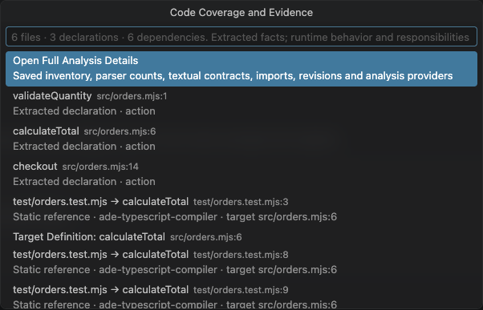

L’inventario non coincide con un’architettura di dominio già interpretata. Nell’esplorazione incrementale corrente, **Explore Architecture** avvia il percorso IA della sezione L17. Senza account puoi comunque esaminare le evidenze e continuare la progettazione manuale nei progetti visuali.

#### Copertura, scope e versioni

L’importer include sedici profili: JavaScript, TypeScript, TSX, Python, Java, C#, C, C++, Go, Rust, PHP, Ruby, Swift, Dart, Kotlin e Scala. La risoluzione semantica integrata riguarda JS/TS/TSX; bundle SCIP coerenti possono integrare altri produttori supportati. Un riferimento statico non prova una chiamata avvenuta a runtime.

Consulta **Open Full Analysis Details** nell’elenco delle evidenze per inventario, revisioni, diagnostiche e produttori. Distingui analizzato, parziale, non supportato e non classificato. La presenza di evidenze semantiche non elimina automaticamente tutti i residui sintattici.

Usa le azioni di configurazione dello scope del progetto per inclusioni/esclusioni. Leggi l’anteprima e applicala localmente; mantieni fuori cartelle generate e metadati non pertinenti. Le regole Git ignore e le esclusioni ADE partecipano all’inventario. Uno scope cambiato richiede una nuova analisi e può rendere obsolete evidenze e ricerche precedenti.

Le versioni di modello/indice permettono recupero e confronto. Il ripristino storico dell’indice non riscrive i sorgenti correnti. Se un’evidenza risulta superata, aggiorna l’analisi o apri consapevolmente il file corrente senza applicare un vecchio range.

**Controllo L16:** nel nuovo percorso `codice` ottieni sette test passati e un inventario delle dichiarazioni. Apri validateQuantity dal risultato delle evidenze e confrontala con la regola del laboratorio: il modulo iniziale accetta quantità positive senza il massimo 10. È il punto di partenza per la modifica di L18, non la soluzione già aggiornata al nuovo limite.


### L17. Usa l’IA per esplorare, con contesto e review

Una codebase importata contiene evidenze, ma non ancora una lettura del progetto. Come chiediamo all’IA di proporre viste utili, scegliendo contesto, modello e budget? Come distinguiamo fatti e ipotesi e revisioniamo le bozze prima di applicarle?

**Ramo facoltativo, con prerequisiti esterni.** Questa lezione richiede un account e un modello disponibili. Se non li hai, passa direttamente a L20 tornando al modulo quantità. Non inviare messaggi per il solo fatto che il form è aperto. Puoi completare il tour, tutte le viste e i moduli locali precedenti senza eseguirla. I passaggi che seguono spiegano il flusso condizionato; la guida non include una nuova esecuzione remota dei tuoi progetti.

Apri il menu con il nome del progetto, poi il pulsante **AI Settings**. **Account and Model** distingue connessione, modello per diagrammi e aggiornamento dello stato. **Connect Claude Code or Codex** segue il login offerto dal provider o riconosce un’interfaccia a riga di comando (CLI) già autenticata. Se hai fatto login esternamente usa **Refresh Account and Models**.


Scegli il modello dal catalogo dell’account quando disponibile. Se il catalogo non viene fornito, usa un identificativo esatto ammesso dal provider. Un modello disponibile in Copilot non diventa automaticamente disponibile nella CLI Codex o Claude. Un eseguibile mancante, un account non autenticato e un modello non valido sono problemi distinti.

**AI Requests** governa le operazioni strutturate con un budget di **invocazioni dell’interfaccia a riga di comando (CLI) per operazione**: zero prepara soltanto il contesto, una consente il piano, due il piano e l’implementazione. Non limita il numero di richieste HTTP, turni, tentativi interni o token gestiti dalla CLI. **Diagram Generation** usa un budget di esplorazione distinto. Cambiare il budget non invia una richiesta; l’invio nella conversazione avvia il lavoro del provider.

Apri soltanto la codebase e i file che vuoi coinvolgere. Prima di inviare leggi contesto, selezioni e perimetro. Lo stato nella modale distingue preparazione, attività degli strumenti, attesa, risposta ed errori. Durante una richiesta evita invii ripetuti; usa il controllo di interruzione se necessario.

La modale dei diagrammi ha una conversazione temporanea: chiudendola la richiesta attiva viene annullata e la cronologia della modale viene azzerata. Piano e bozze già completate rimangono nel progetto. Non usare la chiusura come archivio della conversazione.

Il confronto modelli è in **Advanced · Model Benchmarks**. Serve per prove esplicite: leggi progetto, modello, esito, contesto, tempi e uso riportato. Risultati simulati, token comunicati dal provider e una fattura effettiva sono misure diverse. Il confronto non sostituisce la scelta del modello disponibile al tuo account.

#### Dal codice alle viste proposte

Dopo l’importazione del modulo codice di Mercato, con account e modello configurati, premi **Explore Architecture**. Leggi il messaggio iniziale e invialo soltanto quando sei pronto a condividere il contesto selezionato.

Per l’esempio puoi chiedere:

> Analizza questa piccola codebase degli ordini. Prepara una panoramica delle responsabilità e un flusso del checkout. Distingui la validazione della quantità, il calcolo in centesimi e l’esito del pagamento. Usa le evidenze dei sorgenti; segnala ciò che non puoi ricavare.

L’assistente esplora inventario e sorgenti nel perimetro, propone un piano di viste e prepara bozze condivise. Controlla che il piano risponda alle tue domande e che le responsabilità riusino identità coerenti. Puoi chiedere correzioni, separare scenari o chiarire il significato di una relazione.

Quando il piano è pronto:

1. Apri **Review All Changes**.
2. Leggi prima le anteprime: responsabilità, collegamenti, condizioni e ordine dichiarato.
3. Controlla sorgenti, esclusioni, lacune e diagnostiche pertinenti. Espandi i dettagli quando servono.
4. Se qualcosa non va, torna alla conversazione e chiedi una correzione mirata.
5. Usa **Apply All Changes** per applicare il gruppo revisionato al modello locale.

Un piano incompleto, una bozza invalida o una review diventata obsoleta impediscono Apply. **Continue Generation** riprende il lavoro incompleto; l’esaurimento del budget richiede un ampliamento esplicito. Se cambiano i sorgenti, usa il percorso di aggiornamento per rivedere ciò che è diventato obsoleto invece di ricreare manualmente tutte le viste.

La generazione sceglie le notazioni pertinenti, non una vista di ogni tipo. Gli stati descrittivi non sono attualmente generati da questo percorso incrementale: puoi modellarli manualmente o usare il profilo eseguibile dedicato. I nomi e il numero delle bozze dipendono dall’analisi del provider, quindi non devono coincidere parola per parola con uno screenshot.

**Controllo L17:** prima dell’invio sai quale cartella e quale contesto coinvolgi; prima dell’applicazione sai distinguere evidenza, ipotesi, bozza e vista approvata. Se l’account manca, documenta la lezione come non eseguita e continua con le attività locali.


### L18. Richiedi un aggiornamento del codice e lavora in isolamento

La regola “massimo 10” deve valere anche nella codebase. Come comunichiamo il cambiamento all’assistente e controlliamo codice e test prodotti? Quando possiamo preparare il lavoro in un worktree separato, e come lo revisioniamo prima di applicarlo?

**Continua qui soltanto se hai completato l’esplorazione e applicato le viste di L17 nella copia del modulo codice.** Un inventario pronto non è ancora un modello interpretato. Senza account o senza queste viste, salta il ramo assistito e continua in L20 sul modulo quantità; i diagrammi del Mercato principale non vengono trasferiti automaticamente nella cartella codice.

**Code > Update Codebase from Diagrams** apre il percorso di implementazione assistita dal modello salvato. Può essere proposto anche dopo un salvataggio significativo. Il messaggio iniziale è modificabile e include il modello attivo e, quando disponibile, il cambiamento prima/dopo dell’ultimo salvataggio.

Per la codebase didattica, una richiesta concreta è:

> Limita a 10 le unità di un ordine. Mantieni i prezzi e il totale in centesimi. Aggiungi i controlli per 0, 1, 10 e 11, per un valore non intero e per un testo. Conserva gli esiti confirmed/declined e il comportamento non coinvolto. Mostra i test eseguiti e le eventuali scelte ancora da chiarire.

Prima prepara il cambiamento corrispondente nel modello e salvalo. Apri l’azione, controlla la cartella e l’intento e invia il messaggio. Se nel frattempo cambia il modello, prepara un nuovo contesto. Spostare soltanto i nodi non richiede di implementare nuovamente il business.

Al termine leggi le modifiche effettive, controlla i file e riesegui i test del progetto. La chat può modificare codice esistente, ma questo percorso non eredita automaticamente il journal e l’undo del profilo deterministico. Per scartare il lavoro usa la review delle modifiche e gli strumenti Git appropriati. Non considerare il completamento della risposta una prova che tutti i test siano stati eseguiti.

Una copia senza diagrammi interpretati può richiedere prima l’esplorazione o la creazione delle viste. L’aggiornamento usa la codebase del progetto aperto; evita di usare il clone dell’IDE come cartella di destinazione.

#### Una feature in un worktree

Il percorso strutturato in worktree è distinto dalla chat precedente. Richiede una codebase Git importata, almeno un commit, sorgenti senza modifiche pendenti e una feature con criteri di accettazione utilizzabili dal percorso. Il primo runner esegue test Node direttamente avviabili.

Prima crea una copia del modulo codice di Mercato e inizializzala con Git dalla vista **Source Control** o dal terminale. Per una copia nuova senza repository:

```sh
git init
git add .
git commit -m "Base del progetto di esempio"
git status --short
```

Il commit conserva una base con cui confrontare e recuperare il lavoro; uno stato pulito distingue le nuove modifiche da quelle precedenti. Per questo l’ultimo comando deve risultare vuoto. `.ade` è già esclusa dall’ignore. Se Git chiede nome/email, configura la tua identità prima del commit.

Nel progetto importato seleziona la feature e cerca **Implement Feature** nelle azioni pertinenti o nella palette. Descrivi l’intento e scegli i file da condividere. Leggi il contesto esatto, poi il piano e le domande. Risolvi i chiarimenti prima della generazione.

ADE prepara le modifiche in un worktree separato: i sorgenti principali restano intatti durante la preparazione. Leggi **Inspect Code Changes** e **Questions and Validation**, esegui i test previsti e controlla l’esito corrente. Solo dopo verifica e review valide applica i file al progetto.

Se la feature non ha criteri riconosciuti o il formato non è supportato, l’azione può restare indisponibile. I criteri delle operazioni condivise e quelli delle feature legacy non sono intercambiabili automaticamente. Questa guida usa il percorso eseguibile della sezione L12 per il laboratorio locale interamente guidato; l’importazione del solo modulo codice di partenza non completa i prerequisiti del worktree.

**Resume Implementation** riprende una review salvata. **Recover Interrupted Implementation** gestisce una transazione interrotta. L’undo ripristina preimmagini soltanto quando non sovrascrive modifiche manuali successive. Un test annullato o interrotto richiede una nuova esecuzione riuscita. Il worktree non è una sandbox del sistema operativo e il percorso non installa automaticamente dipendenze suggerite dal modello.

**Esercizio Mercato:** usa una copia del modulo `codice`, porta il limite a 10, aggiungi prove per 0, 1, 10, 11, decimali e testo e verifica che i totali rimangano in centesimi. La consegna è il diff dei file e il risultato dei test. Non presentare come completata l’implementazione se hai soltanto salvato il diagramma o preparato il messaggio.


### L19. Riconcilia modello e sorgenti con Sync

Modello e codice possono cambiare separatamente. Come riconosciamo le modifiche di ciascun lato e risolviamo le contraddizioni? Quali prerequisiti richiede Sync, che cosa dobbiamo revisionare e come recuperiamo una riconciliazione interrotta?

**Scheda avanzata per progetti compatibili.** Non è un passaggio automaticamente eseguibile dopo L18: l’importazione/esplorazione corrente del modulo codice non crea una baseline Sync legacy. Per procedere occorrono formato e adapter supportati, corrispondenze modello/codice e una baseline comune valida; per una nuova proposta assistita serve anche l’account. Se mancano, consulta questa sezione e prosegui in L20: non creare file di baseline a mano.

Usa Sync quando modello e codice sono cambiati e devi recuperarne la coerenza. Confronta **baseline comune, modello corrente e codice corrente** per distinguere le modifiche di ciascun lato e riconoscere i conflitti. Servono formato e adapter compatibili: un progetto v5 di esplorazione non abilita implicitamente il Sync legacy.

Apri **Code > Recovery and Synchronization** per le azioni disponibili o cerca **Sync Project** nella palette. Leggi prima il riepilogo locale: file, simboli, dipendenze, viste e conflitti. Se serve una proposta IA, seleziona i file e revisiona il contesto e le finestre di codice prima dell’invio.

Una proposta può includere modifiche puntuali al modello e sostituzioni ancorate nel testo dei file esistenti. Leggi **Sync Proposal** e il confronto del codice. Se ci sono domande aperte, rispondi in modo concreto e prepara la proposta aggiornata. Apply deve restare bloccato finché mancano le condizioni richieste.

Quando modifichi contemporaneamente lo stesso contratto nel modello e nei sorgenti, confronta le tre versioni e decidi quale intento preservare. Conferma le corrispondenze di rinomina soltanto quando sono corrette. Non risolvere un conflitto scegliendo una versione solo per rendere verde la review.

Dopo Apply esegui i test e la build del progetto: Sync non li esegue automaticamente. **Undo Last Sync** ripristina modello e sorgenti se le immagini sono ancora valide. **Recover Sync** gestisce una riconciliazione interrotta. Il ripristino di un vecchio snapshot modello/indice lascia invece invariati i sorgenti.

Il Sync testuale attuale modifica file esistenti; creazione, spostamento ed eliminazione fisica appartengono ai profili strutturali che le supportano. Una proposta in cache può essere riusata senza una nuova chiamata solo per il medesimo contesto valido.

**Quando il progetto è compatibile e ha una baseline:** dopo una modifica effettiva aggiorna l’analisi, confronta il nuovo limite con il modello e revisiona la proposta. Conserva la scelta precedente finché il conflitto non è risolto. ADE Sync e Git Sync non sono lo stesso comando: il primo riconcilia artefatti del progetto, il secondo scambia commit con un remoto.


### L20. Completa il ciclo: reverse, runtime e continuità

Il lavoro continua anche dopo la prima implementazione. Come riportiamo una modifica del codice nel modello senza accettare una regressione? Come controlliamo un cambio di runtime e conserviamo decisioni, chiarimenti e review da riprendere?

#### Tornare dal codice al modello

Una modifica diretta al codice può contraddire la regola concordata. Il reverse propone di riportarla nel modello; i casi indipendenti servono a decidere se quel nuovo comportamento è accettabile. La prova seguente deve proprio far emergere una divergenza.

**Torna con Open Project alla copia del modulo quantità di L12.** Se avevi concluso con Undo, prepara una nuova review, esegui Run Real Verification e Apply to Project: prima del reverse devono esistere i file generati. Le simulazioni di L13-L15 e l’importazione di L16 non li creano in questa cartella.

Per una prova reversibile:

1. Con Files apri il file `src/predicate-…mjs` creato dalla review di L12. Conserva una copia del suo testo o assicurati di poter annullare l’edit dell’editor.
2. Nella funzione generata cerca il letterale del limite, qui `const v3=10;`, e cambia soltanto `10` in `9`. Il nome della variabile può variare: identifica il valore del confronto `<=`, non un numero nel commento dei metadati. Non modificare quel commento. Salva il file.
3. Torna alla scheda ADE e apri **Progetto > Project Settings > Executable Behavior > Code and Context > Reverse Model Behavior from Code**.
4. Nella review **Code to Model** deve comparire `quantity ≤ 9`. Premi Run Real Verification e conferma. L’esito atteso è **Real Verification Failed · Application Blocked**: espandi Verification Output e trova il caso **Limite 10** fallito. Apply deve essere disabilitato.
5. Non applicare la prova e non cambiare l’atteso per farla passare. Torna al file e ripristina il letterale `10`, poi salvalo.
6. Ripeti Reverse Model Behavior from Code. Quando file e modello sono di nuovo equivalenti, ADE mostra **Model Behavior Is Aligned · No Proposal · No AI Calls**. Dal terminale nella cartella quantità esegui `node --test test/*.test.mjs`: nella soluzione completa devono passare i **12 test indipendenti** emessi nel progetto. La review ADE esegue anche i dodici derivati nel proprio ambiente di verifica. Il package generato dal profilo non definisce uno script npm test; è diverso dal modulo codice di L16.

Questa prova insegna a riconoscere una divergenza e a fermarsi prima di applicarla. Per accettare davvero un nuovo limite servirebbero una decisione di business, il criterio aggiornato e gli attesi coerenti, seguiti da una nuova verifica.

Il reverse è delimitato: non ricostruisce l’intento da codice arbitrario. Predicati, interazioni, stati e messaging supportano sottoinsiemi dichiarati. Una modifica fuori grammatica può produrre un mapping parziale e bloccare Apply. ADR, annotazioni e contratti vengono conservati invece di essere dedotti dal testo del sorgente.

Le azioni di spostamento del sorgente gestito permettono percorsi annidati ammessi e aggiornano i riferimenti supportati. Usa la review per controllare collisioni e identità. Non spostare manualmente più copie dello stesso artifact aspettandoti che ADE scelga automaticamente quella corretta.

#### Scegliere Node o Bun

In **Project Settings > Model and Architecture** usa **Choose Runtime and Review Stack Plan**. I profili correnti sono Node ESM e Bun ESM, con versioni previste dal prodotto. Per questa guida il laboratorio usa Node 24.22.1; il profilo Bun richiede Bun 1.3.2 disponibile all’avvio di ADE.

Il piano esplicita implementazione, dipendenze, storage, dati, test, deploy e ritorno. Riesegui gli stessi casi indipendenti per controllare che cambiare runtime conservi il comportamento di business. Risolvi eventuali vincoli ADR incompatibili. Il comando non installa Bun e non migra database o broker vivi.

#### Task, chiarimenti e continuità

Usa **Tasks and Clarifications** per conservare intento, target e domande/risposte, così chi riprende il lavoro ritrova le ragioni delle scelte. Una risposta cambia il contesto: prepara nuovamente la review perché valuti anche quella decisione.

In **Code > Automatic Preparation** puoi attivare la preparazione continua con un budget di tentativi. Le modifiche semantiche stabilizzate preparano review locali; selezione, zoom e layout non consumano tentativi di business. Il lavoro viene accorpato e serializzato. Il cambio progetto o l’interruzione esplicita fermano la continuità.

Questa modalità prepara proposte, non le applica. Verifica e pubblicazione restano manuali. Un budget esaurito richiede una scelta esplicita; il riavvio non deve avviare da solo nuovi job.

**Controllo L20:** distingui modifiche semantiche e modifiche di layout, preparazione e applicazione, profilo dichiarato e runtime disponibile. La disponibilità di Bun, di un provider o di una connessione esterna è un prerequisito da verificare, non un risultato garantito dall’apertura della cartella.


### L21. Consegna il progetto a un’altra persona

Il progetto deve essere comprensibile anche senza il suo autore. Come verifichiamo che un’altra persona sappia orientarsi fra acquisto e reso? Quali materiali, decisioni ancora aperte e prove dobbiamo consegnare per rendere verificabile il lavoro?

Apri la tua copia principale Mercato; chiedi a un collega di trovare Cliente, Ordine, conferma e richiesta di reso usando solo navigazione e ricerca. Nomi delle viste e relazioni devono spiegare quale domanda risolvono.

Prepara una consegna con il progetto intero, le decisioni ancora aperte, i moduli di codice pertinenti e un riepilogo delle prove. Se usi Git controlla il diff, crea un commit e pubblicalo soltanto sul remoto che vuoi condividere. Non copiare cache, credenziali o cronologie del provider nei materiali didattici.

| Risultato da consegnare | Come lo dimostri |
| --- | --- |
| Modello salvato e riapribile | Chiudi, riapri e raggiungi una vista per ciascuna notazione |
| Due feature collegate senza duplicati | Segui Ordine dall’acquisto al reso e consulta l’impatto |
| Architettura comprensibile | Distingui contesto, container, componenti, package e deployment |
| Dati coerenti | Leggi cardinalità, chiavi e mapping fra identità distinte |
| Comportamento quantitativo verificato | Review corrente, casi indipendenti, Apply e Undo locali |
| Interazioni e policy dichiarate | Casi, tracce di stati e scenario messaging |
| Rapporto con i sorgenti | File aperti dalle evidenze e test tecnici eseguiti |
| IA usata consapevolmente, se disponibile | Perimetro, review, diff e prove; altrimenti indicazione non eseguita |

Una consegna completa non richiede di affermare che il negozio sia pronto per la produzione. Richiede di rendere verificabile ciò che hai progettato, eseguito e lasciato da decidere. Per editor, terminale, Git, debug, accessibilità e strumenti aggiuntivi usa A2-A7.


## Parte III - Atlante dei 16 diagrammi

### D0. Scegli la prospettiva e leggi i simboli

Una domanda di progetto richiede una prospettiva adatta. Come scegliamo fra le sedici notazioni? Come leggiamo elementi, frecce e condizioni, e riusiamo il modello senza creare duplicati? Quali dettagli vanno dichiarati oltre al disegno?

Prima di aggiungere una vista chiarisci la domanda e il pubblico. Usa la tabella per scegliere da dove partire; consulta poi il capitolo indicato per simboli, procedura e limiti. Non occorre creare tutte le viste per ogni feature.

| Domanda da chiarire | Vista da consultare | Capitolo |
| --- | --- | --- |
| Chi collabora e quale responsabilità ha? | Structure | D1 |
| Qual è il confine del prodotto, come si divide e cosa contiene un’applicazione? | C4 Context, Container, Component, dal generale al dettaglio | D2–D4 |
| Quali dati esistono e come saranno conservati? | ERD per il dominio; Database Schema per tabelle e chiavi | D5–D6 |
| Chi chiama chi e in quale ordine? | Sequence | D7 |
| Quali passi e alternative portano al risultato? | Activity / Flowchart | D8 |
| Quali eventi cambiano lo stato di una risorsa? | State Machine | D9 |
| Dove sono collocate le parti e come comunicano? | Deployment per gli host; Network per connessioni e protocolli | D10; D16 |
| Come organizzo tipi, contratti e moduli? | Class, UML Component e Package, secondo il livello | D11; D13–D14 |
| Quale obiettivo raggiunge un attore? | Use Case | D12 |
| Quali dati entrano, vengono trasformati e sono conservati? | Data Flow | D15 |

C4 descrive l’architettura per livelli di dettaglio. UML (Unified Modeling Language) è il linguaggio di modellazione da cui provengono, fra le altre, le viste di classi e casi d’uso. ERD (Entity–Relationship Diagram) indica il diagramma di entità e relazioni. ADE offre i sottoinsiemi descritti nei capitoli seguenti.

#### La procedura comune, senza modello testuale

1. Apri la root del progetto. Clicca il nome del diagramma e scegli **Add Diagram**. Nel Mercato scegli la feature richiesta dal form: Acquisto per le viste generali, Resi e rimborsi per quelle dedicate. Per C4 con un soggetto segui invece il punto 3.
2. I quattro tipi comuni sono Structure Diagram, Activity Flow, Sequence Diagram e State Diagram. **More Diagram Types** raggruppa gli altri in Architecture, Data, Implementation e Behavior. Entra nel gruppo, scegli la notazione e assegna un nome che dica cosa rappresenta.
3. Per **C4** apri **New > Structural Blueprint** nella sidebar o il comando della palette. In Choose clicca C4 View Subject and Context nell’area Structure; in Configure scegli Create New, livello, soggetto, nome, contesto e visibili, confermando ogni passo con **Next**. Concludi con **Review > Apply Changes**, come in L3. L1 è Context, L2 Container, L3 Component. Mantieni il soggetto fra i visibili. L4 Contract è un perimetro di contratto, non un diciassettesimo tipo di diagramma.
4. Per **State Diagram** scegli la risorsa proprietaria prima del nome della vista. Per gli altri tipi aggiungi gli elementi compatibili con Add Element o riusa identità con Add Existing Element. Se un elenco è lungo, filtralo digitando il nome.
5. Per includere una relazione già esistente, aggiungi entrambi gli estremi e usa **Diagram > Contents > Add Existing Relationship**. Sequence usa **Add Existing Message**; State offre Add Existing Transition. Per una relazione nuova seleziona l’origine e usa Connect; scegli tipo, destinazione, nome e conferma anche Condition (Optional), vuoto se non serve. Completa condizioni, cardinalità, membri o protocollo quando pertinenti. In una sequenza includi e ordina i messaggi; non usare le coordinate come sostituto dell’ordine dichiarato.
6. Completa proprietà, confini e dettagli. Salva e riapri; usa Read Diagram o la vista accessibile per controllare informazioni che il canvas sintetizza.

Se una vista C4 mostra **Draft Needs Correction**, riapri **Structural Blueprint > Structure > C4 View Subject and Context**, scegli la vista e completa i passaggi, inclusi i visibili, poi applica il riepilogo. subjectAndScopeRequired indica il perimetro mancante; subjectNotVisible richiede di includere il soggetto. Non serve aprire Edit Model Specification.

#### Gli elementi: vocabolario condiviso

Il testo del tipo sulla scheda è più affidabile del solo colore. Le forme aiutano la lettura, ma ADE non riproduce ogni convenzione grafica dei linguaggi originali. I picker filtrano i tipi compatibili; la tabella spiega il vocabolario complessivo, non suggerisce di inserire ogni tipo in ogni vista.

| Elemento | Significato e confine d’uso |
| --- | --- |
| Feature | Capacità organizzativa del progetto, ad esempio Resi; raggruppa prospettive, non equivale a un servizio |
| Actor | Ruolo esterno o soggetto che interagisce, ad esempio Cliente; non una specifica persona registrata |
| System | Sistema governato o sistema esterno; il suo scope distingue ciò che progetti da ciò da cui dipendi |
| Container | Applicazione/client, servizio, archivio o messaggistica distribuibile; in C4 non significa necessariamente container Docker |
| Component | Responsabilità interna, ad esempio Checkout; il contenimento dice a quale applicazione appartiene |
| Resource | Oggetto di dominio con identità, contratti o lifecycle, ad esempio Ordine; non è automaticamente una tabella |
| View / Interface della UI | Interfaccia del sistema, come Pagina resi; è un oggetto del prodotto, distinto dal diagramma aperto nell’IDE |
| Controller | Coordinamento di richieste o comportamento; non necessariamente una classe concreta del framework |
| Contract | Definizione condivisa del contratto; può essere collegata al provider e alle operazioni |
| Interface Contract | Interfaccia con membri/operazioni; distinta dalla pagina visuale del prodotto |
| Action | Attività espressa da un verbo; rappresenta qualcosa che accade |
| State | Condizione stabile di una risorsa, espressa di solito con un nome/aggettivo; rappresenta come si trova l’oggetto |
| Entity | Concetto logico dei dati e suoi attributi; indipendente dalla tabella fisica |
| Table | Struttura fisica progettata, con colonne, chiavi e vincoli dichiarati |
| Class | Tipo del progetto software con attributi e metodi; non ogni classe deve diventare un componente |
| Package | Modulo/layer logico non distribuibile; organizza dipendenze del software |
| Deployment Node | Ambiente/nodo che ospita applicazioni o artifact; ne dichiara la collocazione |
| Artifact | Prodotto distribuibile, ad esempio un bundle o modulo; non il ruolo dell’applicazione in sé |
| Network Node | Nodo o confine di connessione; descrive una parte della rete progettata |
| Use Case | Obiettivo/capacità dal punto di vista di un attore; non una singola schermata |
| Process | Trasformazione dei dati in un Data Flow; non implica un processo del sistema operativo |
| Data Store | Archivio nella prospettiva dati o infrastrutturale; può essere logico senza specificare un DBMS |
| Decision | Punto in cui il flusso sceglie in base a condizioni; le uscite devono chiarire le alternative |
| Start | Punto iniziale di un flusso di attività |
| End | Termine dichiarato di un flusso di attività |

#### Come leggere un collegamento

**Invocation** va da chi invoca a chi riceve; **Read/Write** da chi legge/scrive alla risorsa; **Dependency** da chi dipende a ciò che usa. **Transition** collega stato origine e destinazione; **Control Flow** ordina il percorso fra attività. **Data Flow** indica il trasferimento di un dato e deve nominarlo. **Communication** descrive una comunicazione architetturale o di rete, eventualmente con protocollo. **Hosts** va dal nodo ospitante all’oggetto ospitato.

**Association** esprime un legame strutturale; le molteplicità ai due estremi ne precisano il numero consentito. **Composition** e **Aggregation** qualificano un rapporto tutto/parte; **Inheritance** va dal tipo specializzato al generale; **Implementation** dall’implementazione al contratto. Per **Include/Extend** vedi D12. La freccia e il suo testo non sono una prova di esecuzione né un binding completo fra porte e operazioni.

Una **condizione testuale** spiega quando una relazione vale. Una **guardia eseguibile** è invece un’espressione tipizzata nel contratto pertinente. Un **protocollo** dichiara come comunicare; non dimostra una connessione. Una **cardinalità** dichiara quantità ammesse; non conta le istanze correnti. Mantieni queste distinzioni mentre leggi i capitoli seguenti.

### D1. Structure: la mappa delle responsabilità

Per capire una feature serve una prima mappa. Quali responsabilità collaborano, da dove entra la richiesta e quale risultato producono? Come distinguiamo una chiamata, un accesso ai dati e una dipendenza?

#### Quando e perché usarla

Usa Structure come prima mappa di una feature o come panoramica trasversale. È utile all’avvio di un progetto e quando devi orientare chi entra in una codebase. Il livello è flessibile: scegli uno scopo e mantienilo. Una panoramica con ogni funzione, tabella e file diventa rapidamente illeggibile.

Nel riferimento apri **01 Panoramica delle responsabilità**. Il Cliente usa Web shop; il web invia l’acquisto a Checkout; Checkout chiede l’autorizzazione e registra Ordine. Gestione resi dipende da Checkout per consultare l’acquisto. La vista sintetizza responsabilità, non la cronologia completa delle chiamate.

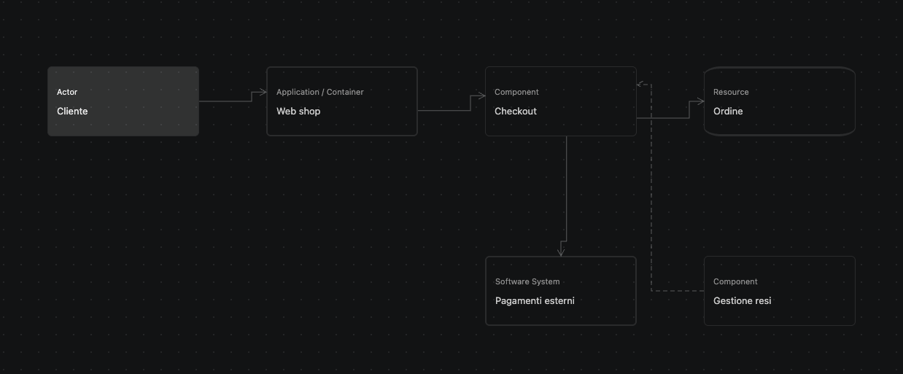

#### Elementi e dettagli

| Elemento utile | Come impiegarlo nel diagramma |
| --- | --- |
| Actor | Ruolo che avvia o usa la capacità; Cliente è uno solo anche se compare in altre feature |
| Component / Controller | Responsabilità e coordinamento; il nome deve dire cosa fa, non soltanto “Manager” |
| Resource | Dato/oggetto centrale con identità; Ordine è distinto dal suo schermo e dalla tabella |
| Interface / View | Punto d’interazione, come una pagina o un’interfaccia del sistema |
| System / Container | Contesto esterno o applicazione, quando il perimetro della panoramica lo richiede |
| Contract e altri tipi compatibili | Dettagli mirati da introdurre solo se aiutano a leggere responsabilità e vincoli |

Dalle proprietà assegna descrizione e contenimento. I contratti possono precisare input, output, condizioni ed errori; la vista non obbliga a formalizzare tutto immediatamente. Le categorie avanzate del picker servono a raggiungere tipi meno frequenti, non a riempire il diagramma.

#### Collegamenti, costruzione e controllo

Usa Invocation per la richiesta, Read/Write per l’accesso alla risorsa, Dependency per l’uso strutturale. Nella panoramica Mercato la registrazione è un Write condizionato al pagamento autorizzato. Se la relazione descrive solo una dipendenza non chiamarla “esegue” per suggerire un ordine temporale che non hai dichiarato.

Segui D0, crea una Structure e aggiungi prima Cliente, Web shop, Checkout e Ordine; collega il percorso, poi introduci pagamento e resi. Riusa le identità esistenti. Per l’ordine delle chiamate aggiungi Sequence; per il confine del prodotto passa a C4 Context.

**Controllo:** un nuovo lettore sa trovare l’ingresso, chi coordina e il risultato. Evita duplicati omonimi, frecce senza significato e mescolanza di livelli non spiegata. Rimuovere dalla vista una responsabilità condivisa non deve eliminarla dal sistema.

### D2. C4 System Context: il confine del prodotto

Prima dei dettagli tecnici serve un confine condiviso. Che cosa comprende il nostro prodotto e chi lo usa? Da quali sistemi esterni dipende, e come rendiamo riconoscibile ciò che governiamo?

#### Quando e perché usarlo

Usa il Context con stakeholder, nuovi membri del team e nelle discussioni sul perimetro. Aiuta a chiarire responsabilità e confini prima di entrare nei dettagli tecnici. Il [riferimento C4 sul Context](https://c4model.com/diagrams/system-context) pone al centro un sistema e il suo ambiente.

Apri **02 C4 Contesto Mercato**: Mercato è il soggetto governato; Cliente e Assistenza sono ruoli; Pagamenti esterni e Corriere esterno sono sistemi di contesto. La vista racconta cosa il negozio deve fare e dove finisce il suo controllo.

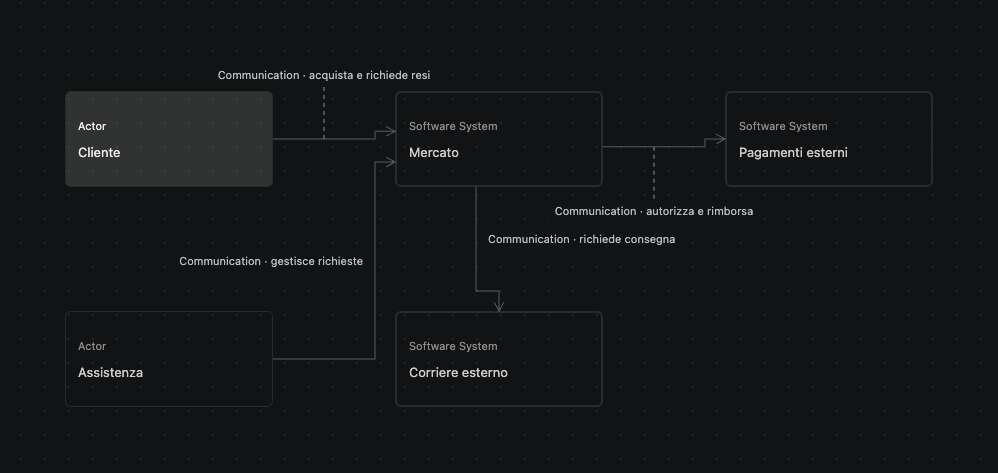

#### Elementi

| Elemento | Significato e dato da curare |
| --- | --- |
| Sistema soggetto | Un solo sistema al centro dell’analisi; nome e descrizione esprimono il prodotto |
| Actor | Ruolo umano o soggetto che usa il sistema; Cliente e Assistenza hanno obiettivi diversi |
| External Software System | Sistema non governato qui; pagamento e consegna non diventano codice interno perché compaiono nella vista |
| Contesto dichiarato | Identità esterne ammesse nel perimetro della vista; non una seconda ownership |

Non inserire API, classi o tabelle per colmare spazio. Il tipo System distingue governato ed esterno; il soggetto è impostato dal blueprint. La presenza come contesto non autorizza la generazione o modifica del sistema esterno.

#### Collegamenti e uso in ADE

Communication o Dependency devono descrivere un rapporto comprensibile al lettore: “autorizza e rimborsa”, “richiede consegna”. La direzione segue chi usa/richiede l’altro sistema. Se la comunicazione è bidirezionale, chiarisci la responsabilità con nomi e collegamenti pertinenti invece di presumere che ogni freccia significhi entrambe le direzioni.

Crea il Context dal wizard C4 di D0: L1, soggetto Mercato, nome, quattro oggetti di contesto e visibili incluso Mercato. Premi Next a ogni passaggio e Apply Changes nel riepilogo. Se mancano attori o sistemi, creali e completa di nuovo la vista. Aggiungi le relazioni e salva.

**Controllo:** esiste un perimetro unico; i due attori sono distinguibili dai sistemi; nessun componente interno compete con il prodotto per la stessa gerarchia. Se vuoi sapere come Mercato è suddiviso, apri D3. Un Context non rappresenta una topologia di rete né osservazioni di traffico reale.

### D3. C4 Container: applicazioni e archivi

Definito il prodotto, dobbiamo suddividerlo in parti realizzabili. Quali applicazioni, servizi e archivi lo compongono? Come ne dichiariamo responsabilità, appartenenza e comunicazioni senza confonderli con gli host di esecuzione?

#### Quando e perché usarlo

Usa questa vista per discutere responsabilità distribuibili, tecnologia e confini fra client, servizio e persistenza. Nel lessico C4 un container è un’applicazione o un archivio: non presuppone Docker. Il [riferimento C4 Container](https://c4model.com/diagrams/container) distingue questo livello dalla distribuzione fisica.

In **03 C4 Applicazioni e dati** il sistema Mercato comprende Web shop, API Mercato, Archivio Mercato e Broker eventi; il Cliente resta contesto. Sono scelte progettate per l’esempio, non processi rilevati sul computer.


#### Elementi

| Elemento | Uso corretto |
| --- | --- |
| Sistema soggetto/confine | Il sistema che possiede i container; deve essere visibile nella configurazione |
| Application / Container | Applicazione web o mobile, servizio, archivio o messaggistica; assegna responsabilità e runtime pertinenti |
| Data Store | Archivio dichiarato, se è il ruolo che vuoi rappresentare; evita un duplicato del container store già esistente |
| Resource | Risorsa di contesto ammessa dal picker; usala se chiarisce una dipendenza di dominio |
| Actor / External Software System | Contesto che usa o è usato dalle applicazioni, conservando lo scope esterno |

L’ownership è un dato del blueprint: le schede interne sono possedute da Mercato. Trascinarle nel rettangolo non assegna il proprietario. Tecnologia e ambiente vanno dichiarati solo se conosciuti o esplicitamente progettati.

#### Collegamenti, procedura e controllo

Le comunicazioni di Mercato sono HTTPS dal Cliente al Web shop, HTTPS / JSON dal web all’API, SQL dall’API all’archivio e una pubblicazione verso il broker. Il nome della freccia esprime l’intento; il protocollo esprime il mezzo dichiarato. Se due oggetti sono collegati solo per dipendenza architetturale, non inventare protocollo o porta.

Dal wizard C4 scegli L2, soggetto Mercato, contesto Cliente e i visibili: soggetto, quattro container e attore; applica il riepilogo. Per l’ownership scegli prima il target in Element e poi il proprietario. Completa i ruoli e collega gli oggetti; posiziona il contesto fuori dal confine. Leggi D4 per il dettaglio dell’API e D10 per la collocazione.

**Controllo:** ogni container ha una responsabilità e un proprietario; applicazione e host restano distinguibili; un archivio non appare due volte come se fossero due sistemi reali. La vista non esegue installazioni, provisioning, comunicazioni o migrazioni.

### D4. C4 Component: l’interno di un’applicazione

Un’applicazione può racchiudere responsabilità diverse. Quali componenti organizzano l’interno dell’API e quali contratti offrono? Come distinguiamo le parti interne dalle dipendenze esterne al container scelto?

#### Quando e perché usarlo

Usa C4 Component quando il livello applicazioni è troppo generico per discutere responsabilità, dipendenze e contratti. Non occorre un diagramma per ogni applicazione: il [riferimento C4 Component](https://c4model.com/diagrams/component) suggerisce di usarlo quando aggiunge valore alla comunicazione.

La vista **04 C4 Componenti API** sceglie API Mercato come soggetto. Checkout, Registro esiti, Gestione resi e Scorte ne sono responsabilità interne. Scorte gestisce la disponibilità a livello applicativo; Archivio Mercato è invece la persistenza. Contratto acquisto appartiene anch’esso ad API Mercato ed è fornito da Checkout. Leggi l’ownership e il binding, non dedurli solo dalla posizione.


#### Elementi e ownership

| Elemento | Come interpretarlo |
| --- | --- |
| Container soggetto | L’applicazione di cui stai mostrando l’interno; qui API Mercato |
| Component | Responsabilità interna, come Checkout e Registro esiti |
| Controller | Coordinamento interno quando tale ruolo è più preciso del generico componente |
| Resource | Oggetto/risorsa necessario al dettaglio, senza convertirlo automaticamente in classe o tabella |
| Contract / Interface Contract | Contratto condiviso o interfaccia delle responsabilità; operazioni e tipi si completano nel blueprint |
| Context Container e altre dipendenze ammesse | Oggetti esterni al soggetto, dichiarati nel contesto invece di riassegnarli al container |

La soluzione formalizza Contratto acquisto versione 1 e Checkout come provider nel blueprint (L11). La dipendenza verso Scorte non implica un ulteriore binding.

#### Collegamenti e uso

Dependency “richiede disponibilità” collega Checkout a Scorte; Communication “registra esito” lo collega a Registro esiti; Implementation esprime l’esposizione del Contratto acquisto; Gestione resi dipende da Checkout. Queste relazioni descrivono il rapporto; il controllo di compatibilità fra operazioni richiede porte, tipi e binding espliciti.

Crea il livello L3 dal wizard C4, scegli API Mercato, contesto e visibili incluso il soggetto, poi applica il riepilogo. In Architectural or Lifecycle Owner scegli ogni target in Element, poi il proprietario compatibile e il ruolo; applica ciascuna modifica. Riusa le identità esistenti, salva e controlla il confine anche in lettura testuale.

**Controllo:** nessun componente diventa un container solo per cambiare forma; nessuna dipendenza esterna viene trascinata nel sistema governato. Se il problema è l’interfaccia fra moduli piuttosto che il perimetro di un’applicazione, usa anche UML Component (D13).

### D5. ERD: concetti, attributi e cardinalità

Prima delle tabelle dobbiamo concordare il significato dei dati. Quali concetti hanno un’identità propria e quali attributi li descrivono? Quanti oggetti possono essere collegati, e quali regole esprimono le cardinalità?

#### Quando e perché usarlo

Usa l’ERD per concordare il dominio prima di decidere nomi di tabelle o dettagli del database. È utile quando due persone danno significati diversi alla stessa parola: un ordine, una sua riga e una richiesta di reso hanno identità e vincoli differenti.

Apri **05 Entità e cardinalità**: Cliente, Ordine, Riga ordine, Prodotto e Reso mostrano attributi essenziali. L’ERD del laboratorio è logico; non sostiene che esista già un database con quella struttura.


#### Elementi e membri

| Elemento/dettaglio | Significato |
| --- | --- |
| Entity | Concetto logico con identità, come Prodotto; scegli nomi singolari coerenti |
| Resource | Risorsa ammessa dalla notazione, utile se già definita; decidi se è davvero lo stesso oggetto prima di riusarla |
| Attributo | Dato caratteristico dell’entità: quantity appartiene alla Riga ordine, non al Prodotto |
| Tipo | Dominio del valore; testo e intero sono diversi anche quando il valore visualizzato è “42” |
| Presenza e nullabilità | Campo richiesto/facoltativo e valore null ammesso/vietato sono due proprietà distinte |

Un attributo non deve diventare una nuova entità solo per comparire. Viceversa una lista di righe con quantità e prezzo proprio merita un’entità distinta: inserirla come testo libero dentro Ordine nasconde i vincoli.

#### Legami e cardinalità

Association nomina un legame; ove pertinenti la notazione ammette rapporti tutto/parte. Per il laboratorio usa associazioni esplicite. **1** significa esattamente uno; **0..1** nessuno oppure uno; **0..\*** zero o più; **1..\*** uno o più. Il numero vicino a un’entità indica quante istanze di quella entità possono corrispondere all’oggetto all’altro estremo.

“Cliente 1 - Ordine 0..\*” significa che ogni ordine ha un cliente e ogni cliente può avere più ordini. “Riga ordine 0..\* - Prodotto 1” significa che una riga riguarda un prodotto e un prodotto può apparire in molte righe. Il legame Reso verso Ordine dichiara che il reso non è indipendente dall’acquisto.

Crea Entity e membri dalle proprietà, poi collega le identità e modifica le cardinalità. **Controllo:** leggi ogni associazione in entrambe le direzioni. Se una regola non è ancora decisa, segnalala invece di scegliere 1 per comodità. Non interpretare una molteplicità come vincolo già eseguito su record reali; lo schema fisico è D6.

### D6. Database Schema: tabelle e vincoli progettati

I concetti del dominio devono trovare una rappresentazione nella persistenza. Quali tabelle, colonne e chiavi servono? Come indichiamo la destinazione di un riferimento e colleghiamo i campi del dominio alle colonne progettate?

#### Quando e perché usarlo

Usa questa vista dopo aver chiarito il dominio o durante la lettura di schema e migrazioni esistenti. Una proposta di schema deve essere distinta da uno schema verificato sui sorgenti. In Mercato è un progetto didattico SQL, senza DBMS distribuito.

Apri **06 Schema dati progettato**. Le tabelle customers, orders, order_lines, products e returns sono identità differenti dalle cinque entità logiche, anche quando il loro significato è collegato.

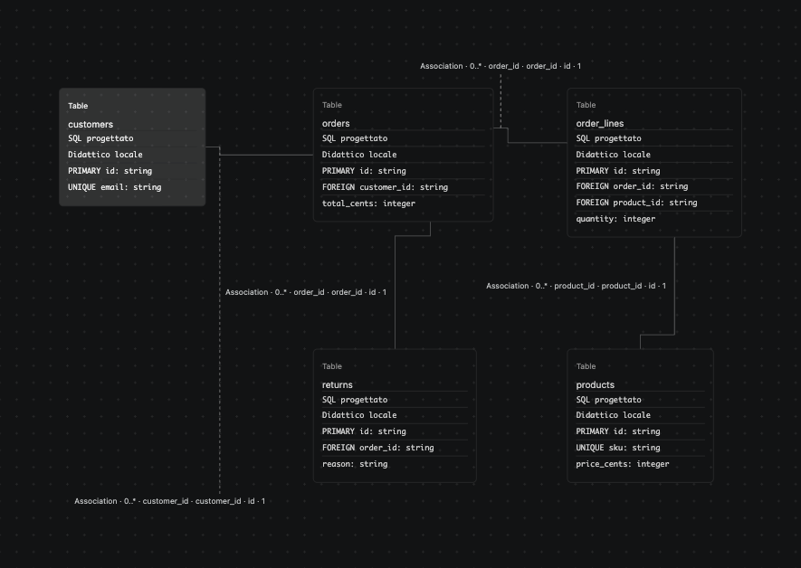

#### Elementi e colonne

| Elemento/dettaglio | Come usarlo |
| --- | --- |
| Table | Tabella fisica progettata; nome coerente con le convenzioni del progetto |
| Colonna e tipo | Campo memorizzato e dominio del valore; total_cents intero documenta l’unità monetaria scelta |
| Primary key (PK, chiave primaria) | Identifica una riga nella tabella; il diagramma ne dichiara il ruolo |
| Foreign key (FK, chiave esterna) | Colonna di riferimento; indica anche la colonna di destinazione |
| Unique | Valore o vincolo univoco dichiarato, ad esempio sku; non sostituisce automaticamente la PK |
| Field Presence / Nullability | Presenza richiesta o facoltativa e valore null ammesso o vietato sono scelte distinte |
| Data Store / Resource | Archivio o risorsa di contesto ammessi; un archivio può fare da confine facoltativo |

I membri si modificano con Edit Attributes and Technology. Dichiara i tipi delle colonne come in L5; i tipi condivisi e i mapping di L11 collegano poi persistenza e contratto. Così puoi cambiare la rappresentazione fisica mantenendo esplicita la corrispondenza con il dominio. ADE non deduce un DBMS da un’etichetta SQL generica.

#### Riferimenti e procedura

Le associazioni fra tabelle indicano le colonne ai due estremi: orders.customer_id punta a customers.id; order_lines.order_id a orders.id; order_lines.product_id a products.id; returns.order_id a orders.id. Seleziona la relazione e apri **Edit Cardinalities and Protocol**. Compila nell’ordine **Source Multiplicity**, **Target Multiplicity**, **Source Attribute / Column**, **Target Attribute / Column** e **Protocol / Transport**, confermando ciascun campo con Invio. Per i quattro riferimenti usa `0..*` e `1`; digita il nome della colonna origine e poi `id`, senza il prefisso della tabella; lascia vuoto il protocollo. Una freccia chiamata customer_id senza colonne corrette non documenta una FK completa. Il procedimento completo è in L5.

Costruisci prima tabelle e colonne, poi associazioni e riferimenti. Verifica i nomi dei membri dopo una rinomina: un riferimento inesistente deve essere corretto. Usa mapping espliciti per legare orderId del dominio a orders.id. Non fondere entità, tabella e classe per evitare il lavoro del mapping.

**Controllo:** quattro riferimenti validi, PK riconoscibili, nullabilità dichiarata e unità dei valori comprensibili. Il diagramma non esegue DDL, migrazioni o query e non dimostra che il database attivo rispetti i vincoli. Per questo servono migrazioni e test d’integrazione del progetto.

### D7. Sequence: partecipanti e ordine delle interazioni

In un acquisto l’ordine delle interazioni può cambiare il risultato. Chi invia ogni richiesta, chi la riceve e quale condizione la abilita? Come ordiniamo i messaggi riusando gli elementi e i collegamenti già definiti?

#### Quando e perché usarla

Usa Sequence per una conferma d’acquisto, una richiesta di reso o un caso d’errore specifico. È utile quando un flusso sembra semplice ma il punto preciso di una lettura, scrittura o risposta cambia il risultato.

Apri **07 Sequenza acquisto**: Cliente richiede la conferma a Checkout; Checkout invoca Pagamenti esterni; poi scrive Ordine con condizione di autorizzazione. La sequenza sceglie un livello di coordinamento e semplifica il canale web. Non è una traccia temporale misurata in produzione.


#### Elementi e messaggi

| Elemento | Significato |
| --- | --- |
| Partecipante | Identità che invia o riceve; attore, responsabilità, interfaccia o risorsa compatibile |
| Linea di vita | Colonna che mantiene riconoscibile il partecipante durante lo scenario; non implica un thread o processo dedicato |
| Messaggio | Interazione con origine, destinazione, tipo e nome; l’indice è l’ordine locale dichiarato |
| Read / Write | Accesso a una risorsa; distingue una consultazione da un aggiornamento |
| Condizione | Presupposto dichiarato del messaggio; la sua prosa non è ancora una guardia compilabile |
| Occorrenza / frame, nei modelli pertinenti | Un evento distinto o un gruppo comportamentale; chiamate ripetute non condividono automaticamente lo stesso risultato |

Riusa i partecipanti con **Add Existing Element** e i collegamenti con **Add Existing Message**. Per cambiare l’ordine seleziona il partecipante e usa **Move Participant Left** o **Move Participant Right** nelle proprietà. Nelle stesse proprietà apri **Sequence Message Options** del collegamento pertinente e usa **Move Message Earlier** o **Move Message Later**. Lo spostamento grafico non sostituisce questi comandi. Salva e controlla l’ordine nella lettura testuale.

#### Descrittiva ed eseguibile

Nel modello descrittivo v5 le occorrenze distinguono chiamate, alternative e vincoli d’ordine dichiarati. Nel modulo eseguibile di L13 ogni chiamata dichiara operazione, argomenti, sincronismo, risultati, errori e risposta simulata. I frame alt, opt, loop, par, critical e ref hanno contratti e limiti propri. Non disegnare una guardia testuale aspettandoti che diventi automaticamente un ramo verificabile.

Crea la vista, riusa i quattro partecipanti, includi i tre messaggi e ordina esplicitamente. Per aggiungere un caso negativo, descrivilo come scenario distinto o con le strutture pertinenti, mantenendo chiaro quale ordine è certo e quale è sconosciuto.

**Controllo:** puoi leggere ogni freccia ad alta voce con mittente, destinatario, contenuto e condizione. Il tempo scorre dall’alto in basso nell’ordine dichiarato, ma la distanza verticale non misura millisecondi. Per decisioni indipendenti dai partecipanti usa Activity; per lo stato persistente dell’ordine usa State Machine.

### D8. Activity / Flowchart: passi e alternative

Una procedura deve spiegare anche che cosa accade quando qualcosa va storto. Quali passi portano dall’ingresso agli esiti possibili? Dove cambia il percorso e quali condizioni distinguono le alternative?

#### Quando e perché usarla

Activity / Flowchart è una sola notazione del catalogo ADE. Usala per discutere una procedura con persone di ruoli diversi, evidenziare esiti mancanti e definire cosa deve accadere prima di cosa. Non richiede di scegliere subito classi e servizi.

Apri **08 Flusso acquisto**: validazione, verifica disponibilità, pagamento, conferma/rifiuto e conclusione. Nel tour il flusso del rimborso è più piccolo, ma usa lo stesso principio: un’alternativa deve avere un significato leggibile.


#### Elementi

| Elemento | Come nominarlo e interpretarlo |
| --- | --- |
| Start | Ingresso della procedura, ad esempio Inizio; chiarisci il trigger nella descrizione |
| Action | Passo con un verbo: Valida carrello, Richiedi pagamento; non uno stato come “Pagato” |
| Decision | Domanda o scelta: Scorte disponibili?; ogni uscita deve dire quando è percorribile |
| End | Esito/termine del percorso; non lasciare sospesa una via negativa involontariamente |
| Responsabilità e risorse compatibili | Contesto aggiuntivo quando serve capire chi esegue o cosa viene usato; evita di farlo competere con il flusso |
| Control Flow | Collegamento che guida il percorso fra passi e decisioni |

Le frecce devono avere condizioni comprensibili: disponibili/non disponibili, autorizzato/rifiutato. Due uscite entrambe chiamate “continua” non chiariscono la scelta. Se le condizioni possono sovrapporsi, decidi priorità o esclusività nel contratto pertinente.

#### Costruzione e controllo

Crea prima il percorso principale da Start a End; aggiungi la decisione sulle scorte e poi il ramo di rifiuto. Collega gli esiti del pagamento. Usa la lettura testuale per seguire tutte le relazioni, anche quando il routing si incrocia. Spostare i nodi migliora la lettura, ma non definisce un’espressione o un ordine eseguibile.

L’Activity descrittiva non è automaticamente un workflow eseguibile. Per alternative, concorrenza, ripetizioni e sotto-interazioni verificabili usa i costrutti del profilo di L13: non inferire fork/join o temporizzazione da due frecce disegnate in parallelo.

**Controllo:** ogni ramo conduce a un esito intenzionale; azioni e stati hanno nomi diversi; una decisione ha condizioni che un lettore sa valutare. Se il problema è chi invia il messaggio, aggiungi Sequence; se è la condizione stabile dopo il passo, aggiungi State Machine.

### D9. State Machine: il ciclo di vita di una risorsa

Un’azione può essere ammessa solo in alcune fasi della vita di un ordine. Quali stati appartengono alla risorsa e quali eventi ne consentono il cambiamento? Come distinguiamo stati, transizioni e azioni, e controlliamo gli esiti negativi?

#### Quando e perché usarla

Usa State Machine per ordini, richieste di reso, prenotazioni e oggetti con azioni ammesse solo in alcune fasi. Aiuta a riconoscere transizioni illegali e differenze fra tentativo, autorizzazione e completamento.

Apri **09 Stati ordine**: la risorsa Ordine possiede In attesa, Confermato e Rifiutato. Il diagramma del tour per Richiesta di reso distingue invece Richiesto, Autorizzato, Rimborsato e Rifiutato. Sono lifecycle di risorse diverse, non un unico elenco di tutti gli stati del negozio.


#### Elementi e dettagli

| Elemento/dato | Significato |
| --- | --- |
| Risorsa/proprietario lifecycle | L’oggetto di cui stai descrivendo il ciclo; deve essere esplicito |
| Stato | Condizione dell’oggetto, non attività; “Confermato” si distingue da “Conferma ordine” |
| Transizione | Passaggio da uno stato a un altro con evento/condizione pertinenti |
| Evento | Occorrenza che può attivare il passaggio; nel profilo eseguibile ha payload tipizzato |
| Guardia | Condizione che abilita la transizione; testuale nella descrizione, espressione formale nel contratto eseguibile |
| Azioni ed errori | Effetti associati al passaggio o al lifecycle, nei form e profili che li supportano |

Nel diagramma descrittivo gli stati sono figli della risorsa. Nel contratto eseguibile si dichiarano stato iniziale, finali, eventi, priorità, transizioni interne/esterne e azioni entry/exit/do. Una self-transition interna non ripete lo stesso ciclo di uscita e ingresso di una esterna.

#### Uso e verifica

Crea la State Machine scegliendo Ordine, aggiungi gli stati con Add State e collega le transizioni. Dai nomi a eventi ed esiti. Per il modulo eseguibile usa Edit Executable State Machine e i casi di L14; Simulate State Machine restituisce fasi, eventi accettati/rifiutati e stato finale.

**Controllo:** tutti gli stati appartengono al lifecycle corretto; un ordine già confermato non torna in attesa senza un evento previsto; il caso negativo è modellato. La figura non osserva ordini vivi. Il profilo corrente supporta macchine piatte, senza stati compositi o regioni ortogonali. Se servono retry e consegne, completa la policy di messaggistica invece di inventare stati non motivati.

### D10. Deployment: dove collochiamo software e dati

Per preparare la distribuzione dobbiamo assegnare una collocazione alle parti del sistema. Quali nodi ospitano applicazioni, dati e artefatti? Come distinguiamo il software, il prodotto distribuibile e l’ambiente che lo esegue?

#### Quando e perché usarlo

Usa Deployment quando conta la collocazione: separazione del web e dell’API, persistenza, confini di ambiente, artefatti distribuiti. È una prospettiva diversa da C4 Container: un’applicazione descrive responsabilità; un host descrive collocazione.

Apri **10 Distribuzione locale progettata**. Host Web ospita Web bundle; Host API ospita API ESM e API Mercato; Host dati ospita Archivio Mercato. “Locale progettata” è parte del nome per mantenere visibile la natura didattica del disegno.

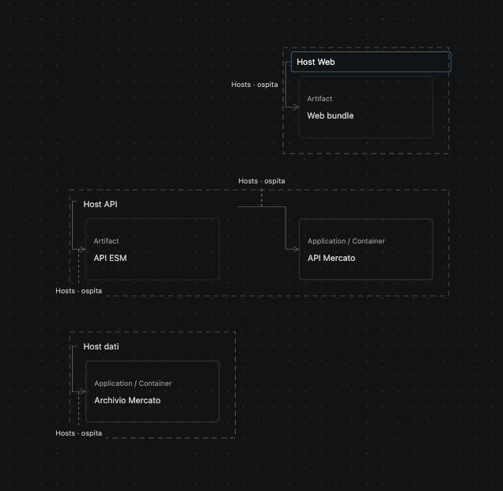

#### Elementi e proprietà

| Elemento | Significato e attenzione |
| --- | --- |
| Deployment Node | Macchina, processo/ambiente o nodo di esecuzione dichiarato; specifica cosa rappresenta nel tuo progetto |
| Artifact | Prodotto distribuito, come bundle o modulo ESM; distinto dalla responsabilità applicativa |
| Container / applicazione | Parte del sistema ospitata; riusa l’identità architetturale quando è la stessa |
| Archivio / risorsa compatibile | Dati o servizio di persistenza collocati nel nodo pertinente |
| Ambiente e tecnologia | Informazioni dichiarate dell’oggetto; non indicare “produzione” o un cloud se non hai una decisione/evidenza |
| Hosts | Collegamento dall’ospitante all’ospitato; esprime collocazione, non invocazione |

I tipi meno comuni si trovano nelle categorie Architecture, Data e Infrastructure del picker. Non rappresentare un database come Artifact se intendi il servizio che persiste i dati; usa il ruolo pertinente e, se utile, un artefatto separato per la sua distribuzione.

#### Costruzione e controllo

Definisci gli host, aggiungi artifact e applicazioni esistenti e collega con Hosts. Completa ambiente e tecnologia dalle proprietà. Mantieni distinta l’ownership architetturale dalla collocazione dichiarata con Hosts. Spostare una scheda cambia il layout; non cambia da solo le responsabilità o i collegamenti.

**Controllo:** per ogni applicazione sai indicare il luogo previsto e distinguere nodo, software e dati. Non presentare un deployment progettato come inventario osservato. La vista non avvia servizi né fornisce provisioning o discovery. Per protocolli e confini di comunicazione usa anche Network (D16).

### D11. Class: tipi, membri e relazioni del software

Per realizzare il modello servono tipi software con responsabilità precise. Quali attributi e metodi appartengono a ciascun tipo? Come rappresentiamo interfacce, dipendenze ed ereditarietà senza confonderle con entità e tabelle?

#### Quando e perché usarlo

Usa Class per chiarire un dominio ricco, un’interfaccia o una collaborazione fra pochi tipi. Non copiare automaticamente ogni classe del repository: un diagramma con centinaia di dettagli non aiuta a prendere decisioni.

Apri **11 Classi e repository**. CheckoutService dipende da Order e da OrderRepository; Order contiene orderId, totalCents e confirm; l’interfaccia espone save. Il risultato testo dei metodi è illustrativo; il contratto eseguibile completo deve usare input e risultati tipizzati nel blueprint.

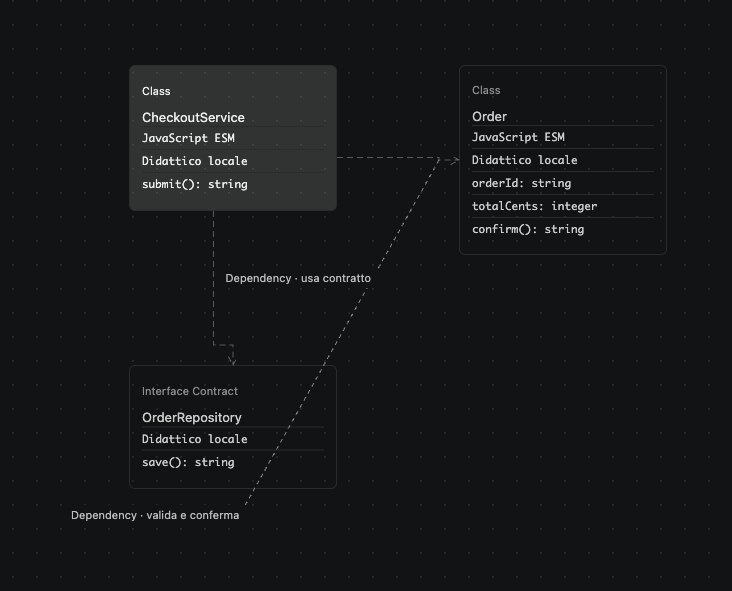

#### Elementi e compartimenti

| Elemento/dettaglio | Interpretazione |
| --- | --- |
| Class | Tipo concreto o progettato; nome distinto dall’istanza di dominio |
| Interface Contract | Contratto che un’implementazione può fornire; stesso oggetto riusabile in UML Component |
| Attributo | Dato del tipo, con nome, tipo, obbligatorietà e nullabilità pertinenti |
| Metodo | Operazione esposta dal tipo; nome e tipo/firma dichiarati, con ruolo Method |
| Tecnologia e ambiente | Contesto dichiarato della rappresentazione; non trasformano da soli il disegno in sorgente |

Usa **Edit Attributes and Technology** per aggiungere o rimuovere membri. Per correggerne uno selezionalo nell’elenco e scegli **Edit Member**. Distingui Attribute e Method: puoi dichiarare più metodi con lo stesso nome se le firme differiscono, ma una firma identica viene rifiutata. Nel laboratorio inserisci confirm, submit e save come nomi, senza le parentesi già visualizzate dal canvas.

#### Collegamenti

Association descrive un legame; Dependency un uso. Inheritance va dalla classe specializzata al tipo generale; Implementation dall’implementazione all’interfaccia. Composition rappresenta una relazione tutto/parte forte legata al ciclo di vita; Aggregation una relazione tutto/parte più debole. Sceglile per il significato, non per abbellire il collegamento. Le molteplicità descrivono quanti oggetti possono partecipare.

Crea le due classi e l’interfaccia, aggiungi i membri, poi le dipendenze. Confronta l’Order di questa vista con l’entità e la tabella: sono rappresentazioni distinte, collegate da mapping espliciti quando necessario.

**Controllo:** ogni membro è nel tipo giusto; una dipendenza non viene scambiata per ereditarietà; le firme sono leggibili. La figura non analizza automaticamente ogni differenza del codice e non implementa metodi. L’importazione e le evidenze di L16 sono il percorso per confrontare la descrizione con i sorgenti reali.

### D12. Use Case: obiettivi degli attori

Il progetto deve offrire risultati utili a chi lo usa. Quali obiettivi raggiunge ciascun attore e a quale sistema appartengono? Come distinguiamo un comportamento sempre necessario da un’aggiunta opzionale?

#### Quando e perché usarlo

Usa Use Case per concordare il perimetro funzionale con utenti e stakeholder, prima di progettare le schermate: “Richiedere reso” è un obiettivo; “aprire la terza modale” è una scelta d’interfaccia.

Apri **12 Casi d’uso**. Cliente può confermare un acquisto e richiedere un reso; Assistenza gestisce il reso. Il pagamento è incluso nella conferma, mentre il coupon estende la conferma solo quando presente. Quest’ultimo è un esempio progettato opzionale, non codice già pronto nel pacchetto.

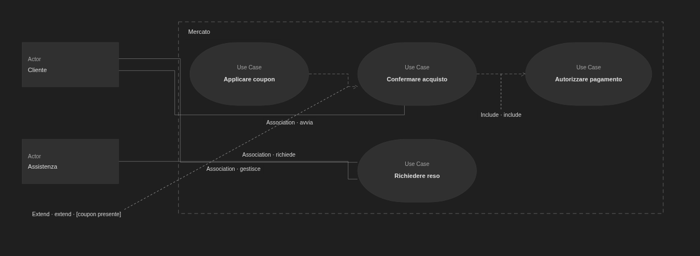

#### Elementi

| Elemento | Uso |
| --- | --- |
| Actor | Ruolo che partecipa all’obiettivo; una persona può ricoprire più ruoli |
| Use Case | Capacità con un risultato per l’attore, chiamata con verbo e oggetto |
| Software System / confine | Sistema cui appartengono i casi; distingue interno ed esterno |
| Association | Partecipazione dell’attore; non è un ordine temporale di esecuzione |
| Include | Dal caso base al comportamento sempre incluso |
| Extend | Dal comportamento aggiuntivo verso il caso base, con condizione di estensione |

Il proprietario dei casi è Mercato. Gli attori rimangono esterni al confine del prodotto anche se le loro schede sono vicine. Se il diagramma non mostra il confine come scheda, consulta il contenimento nelle proprietà e nella lettura testuale.

#### Procedura e significato delle frecce

Aggiungi i due attori esistenti e i quattro casi. Associa Cliente a Confermare acquisto e Richiedere reso, Assistenza a Richiedere reso. Disegna Include da Confermare acquisto ad Autorizzare pagamento. Disegna Extend da Applicare coupon a Confermare acquisto e assegna “coupon presente”. Invertire quest’ultima freccia inverte chi estende chi.

I nomi sono centrati negli ovali, le cui dimensioni si adattano al contenuto. Dopo una modifica usa Arrange Diagram e Fit Diagram per riordinare la vista. Include ed Extend descrivono necessità e opzionalità: l’ordine dei passi appartiene ad Activity e Sequence; i requisiti verificabili a contratti e casi Given/When/Then.

**Controllo:** ogni caso rappresenta un obiettivo e ha un attore o un rapporto funzionale motivato; le azioni interne al database non compaiono come obiettivi del Cliente. Chiarisci le eccezioni nelle descrizioni o nei flussi complementari, senza inserire nel diagramma ogni piccolo passo dell’interfaccia.

### D13. UML Component: responsabilità e contratti

Più componenti possono collaborare attraverso contratti condivisi. Chi fornisce ciascuna interfaccia e chi la usa? Come riusiamo lo stesso contratto nelle viste e distinguiamo una freccia grafica da un collegamento formalizzato nel blueprint?

#### Quando e perché usarlo

Usa questa vista per discutere sostituibilità, contratti pubblici e dipendenze fra moduli. Si affianca a C4 Component: qui l’enfasi è sui rapporti fra componenti e interfacce, non sul dettaglio di un unico container soggetto.

Apri **13 Componenti e interfacce**. Checkout espone Contratto acquisto; Registro esiti fornisce OrderRepository. L’interfaccia è la stessa usata nella vista Class. La sua visualizzazione non è una seconda definizione.

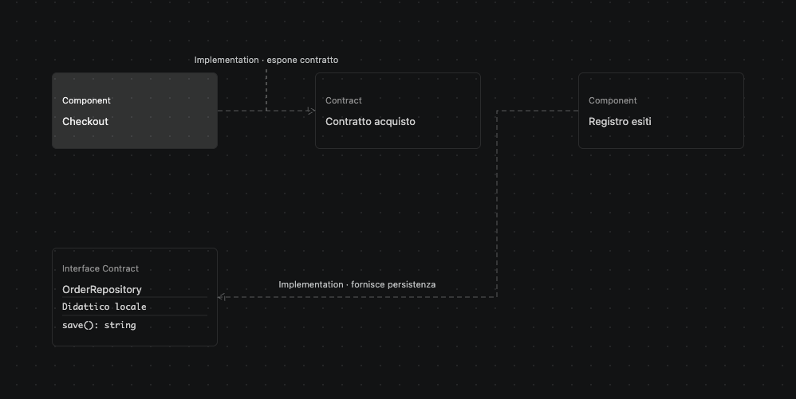

#### Elementi e binding

| Elemento | Ruolo nella vista |
| --- | --- |
| Component | Unità di responsabilità con un confine di interfaccia |
| Contract | Definizione condivisa del contratto, come Contratto acquisto |
| Interface Contract | Interfaccia con operazioni/membri, come OrderRepository |
| Application / Container | Contesto applicativo ammesso quando aiuta a collocare i componenti |
| Porte e operazioni nel blueprint | Interfacce richieste/fornite e binding effettivi da dichiarare separatamente dal solo collegamento grafico |

Il canvas usa i simboli offerti da ADE. Per formalizzare un contratto completa nel blueprint input, risultati, errori, effetti, permessi e criteri delle operazioni pertinenti (L11).

#### Collegamenti e controllo

Implementation va dal componente che fornisce al contratto fornito; Dependency indica chi usa un contratto o un’altra responsabilità. La freccia “fornisce persistenza” di Registro esiti non dimostra che esista un adapter funzionante né che tipi e policy siano già compatibili.

Crea la vista e aggiungi le quattro identità esistenti. Usa **Diagram > Contents > Add Existing Relationship** per includere l’Implementation Checkout–Contratto acquisto e la Communication Checkout–Registro esiti; poi crea l’Implementation Registro esiti–OrderRepository. Per rendere verificabile il collegamento, dichiara porte richieste/fornite, mapping delle operazioni e tipi nel blueprint; consulta le diagnostiche prima della review.

**Controllo:** il contratto appartiene al provider giusto; consumer e provider sono distinti; non confondi Interface Contract con Pagina acquisto. Se cambi una firma condivisa, consulta Show Change Impact e controlla i consumer. Un diagramma può essere leggibile e salvabile pur non essendo ancora pronto alla generazione.

### D14. Package: moduli e direzione delle dipendenze

Il software va organizzato in gruppi con confini comprensibili. Quali moduli o layer scegliamo e da quali altri gruppi dipendono? Come leggiamo la direzione delle frecce e riconosciamo una dipendenza che introduce un ciclo?

#### Quando e perché usarlo

Usa Package per discutere layer, confini organizzativi e direzione delle dipendenze. È adatto anche a un’applicazione singola: non richiede microservizi né una distribuzione separata per ogni package.

Apri **14 Moduli applicativi**. Applicazione usa le regole di Dominio; Adapter implementa contratti del Dominio e collega i casi applicativi. Il dominio non dipende dagli adapter: è la scelta didattica che il diagramma rende facile controllare.

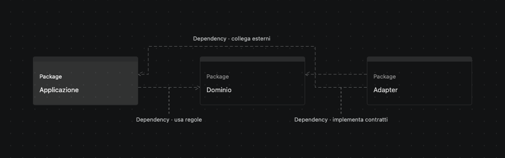

#### Elementi e confini

| Elemento/dato | Significato |
| --- | --- |
| Package | Modulo, namespace o layer semantico non distribuibile; il nome deve dire quale raggruppamento stai usando |
| Descrizione | Responsabilità del gruppo, contenuto incluso/escluso e criterio di raggruppamento |
| Contenimento | Relazione organizzativa con altri elementi ove dichiarata; non equivalente a un semplice trascinamento |
| Dependency | Uso di un altro gruppo; la direzione va dal dipendente al gruppo usato |

Il picker di questa notazione propone Package. Non usare un Container per ottenere una scheda più visibile: cambierebbe il ruolo semantico. Il package Dominio non è automaticamente una cartella chiamata domain; per legarlo ai sorgenti servono mapping o evidenze pertinenti.

#### Costruzione e lettura

Crea tre package con Add Element. Collega Applicazione verso Dominio “usa regole”; Adapter verso Dominio “implementa contratti”; Adapter verso Applicazione “collega esterni”. Dai alle frecce nomi che spieghino perché la dipendenza esiste. Se una dipendenza ha entrambe le direzioni, chiediti se stai nascondendo un ciclo o usando un raggruppamento troppo ampio.

Un vincolo ADR può rendere esplicita una regola sulle dipendenze, ma la sola scelta grafica non impone una regola al compilatore. Un ciclo osservato nel codice richiede un’analisi del codice; un ciclo nel disegno indica ciò che hai dichiarato.

**Controllo:** sai spiegare la differenza fra package e servizio; ogni dipendenza ha un motivo; un lettore riconosce il nucleo e le parti esterne. Usa Class per i tipi interni, UML Component per i contratti e C4 Container per le applicazioni distribuibili.

### D15. Data Flow: dati, trasformazioni e archivi

Per comprendere un comportamento dobbiamo seguire anche le informazioni. Quali dati entrano, come vengono trasformati e dove finiscono? Come distinguiamo i dati trasferiti dalle azioni e dall’ordine temporale delle chiamate?

#### Quando e perché usarlo

Usa Data Flow per seguire dati sensibili, dati di ordine, fonti di prezzo o risultati di un processo. Aiuta quando una vista di chiamate mostra molto movimento ma non chiarisce che cosa attraversa il sistema.

Apri **15 Dati dell’acquisto**. Il Cliente fornisce dati acquisto; Elabora ordine consulta prezzi e disponibilità da Dati catalogo, scrive l’ordine confermato in Dati ordini e restituisce l’esito al Cliente. Le due frecce fra Cliente e processo portano dati diversi e hanno direzioni diverse.


#### Elementi

| Elemento | Significato |
| --- | --- |
| Actor / Software System | Origine o destinatario esterno dei dati nella prospettiva scelta |
| Process | Trasformazione con input e output, ad esempio Elabora ordine; non un processo del sistema operativo |
| Data Store | Archivio logico da cui leggi o in cui scrivi; non richiede già una tabella fisica |
| Resource | Oggetto di dominio compatibile da usare quando chiarisce i dati rappresentati |
| Data Flow | Trasferimento nominato del dato, con direzione origine verso destinatario |

Scegli nomi di dato sulle frecce: “dati acquisto”, “prezzi e disponibilità”, “ordine confermato”. Un’etichetta “esegui” non dice quale informazione passa. Il processo dovrebbe spiegare la trasformazione e non funzionare come un generico nodo di smistamento senza responsabilità.

#### Costruzione e controllo

Aggiungi il Cliente esistente, il processo e i due archivi; collega prima l’ingresso e il risultato, poi le due persistenze. Mantieni il livello coerente: se vuoi dettagliare Elabora ordine, costruisci una seconda prospettiva con trasformazioni più piccole e rendi riconoscibili gli stessi ingressi/uscite.

Non interpretare le frecce come una cronologia completa: l’ordine temporale richiede Sequence o Activity. Una lettura dall’archivio e una risposta al Cliente non dimostrano che sia stata aperta una connessione reale. I tipi, la presenza e i vincoli sui payload vanno nei contratti.

**Controllo:** ogni processo ha ingressi/uscite motivati; distingui dati di catalogo e dati di ordine; le etichette non sono nomi generici di azioni. Se vuoi capire tabelle e FK apri Database Schema; se vuoi capire il protocollo di rete apri Network.

### D16. Network / Infrastructure: connessioni e confini

Le parti del sistema devono comunicare attraverso confini espliciti. Quali nodi e applicazioni sono collegati, e con quali protocolli? Come distinguiamo una connessione progettata da una configurazione osservata, senza confonderla con la collocazione del software?

#### Quando e perché usarlo

Usa questa vista per ragionare su raggiungibilità prevista, esposizione dei servizi e separazione dell’infrastruttura. Esplicita la provenienza delle informazioni, distinguendo configurazione osservata e scelta progettata.

Apri **16 Connessioni progettate**. Rete client raggiunge Web shop e il confine della Rete backend; il backend espone API Mercato, che comunica con Archivio Mercato. HTTPS 443 e SQL sono dichiarazioni dell’esempio. La vista non rappresenta una scansione della macchina o una configurazione applicata.

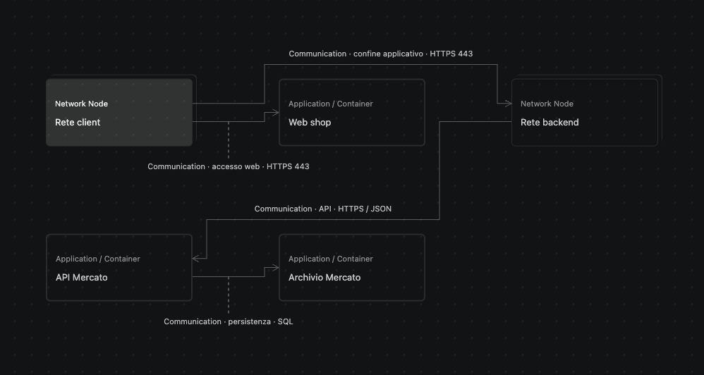

#### Elementi e dettagli

| Elemento | Uso |
| --- | --- |
| Network Node | Nodo/confine di rete, come Rete backend; descrivi se è una zona, una rete o un endpoint concettuale |
| Deployment Node | Host/nodo di esecuzione quando la connessione richiede quel livello di dettaglio |
| Application / Container | Servizio, client o archivio che comunica; riusa le identità delle altre viste |
| Software System | Sistema interno o esterno coinvolto nella connessione |
| Protocollo e ambiente | Mezzo/contesto dichiarati, con versione o porta nel testo pertinente se note |
| Communication | Collegamento direzionale con intento e protocollo; non una regola firewall eseguita |

Non aggiungere un nodo cloud, CDN, VPC o database remoto solo perché è frequente in altri progetti. Se la fonte non lo dice, lascia la scelta aperta. Una rete e un’applicazione non sono lo stesso tipo di oggetto: il confine di rete descrive dove passa la comunicazione, il container chi la effettua.

#### Procedura e controllo

Crea i due Network Node, aggiungi Web shop, API Mercato e Archivio Mercato esistenti. Collega gli estremi con Communication e completa i protocolli da Edit Cardinalities and Protocol. Indica nella descrizione che la topologia è progettata; se stai importando configurazioni reali, conserva le evidenze e il perimetro osservato.

**Controllo:** ogni collegamento dice chi comunica e come; le porte ignote non vengono inventate; le frecce non sono presentate come certificazione di sicurezza o disponibilità. Per collocazione degli artifact usa Deployment; per responsabilità del prodotto usa C4. Nessuna di queste viste esegue automaticamente provisioning, discovery, test di penetrazione o distribuzione.


## Appendici operative


### A1. Installazione e avvio

Per usare gli esempi serve un ambiente pronto. Come prepariamo ADE e scegliamo la versione corretta degli strumenti? Quali operazioni richiedono un account IA o la fiducia nella cartella di lavoro?

Se ADE è già installato e funzionante, torna a T1. Per l’avvio dai sorgenti servono Git, Python 3, gli strumenti di compilazione e il Node indicato in `.nvmrc`: allineare la versione evita incompatibilità con dipendenze e build. In questa revisione è **24.22.1**. Bun serve soltanto per il relativo profilo eseguibile.

#### macOS e Linux

Clona il repository in una cartella dedicata oppure aggiorna un clone pulito. Chiudi l’istanza di sviluppo prima di aggiornare dipendenze e build. Con nvm, dalla radice del clone:

```sh
git clone https://github.com/FrappaF/ADE.git
cd ADE
git checkout 8a069e4b7207be8bcbfee2d572fdeb45e2fc3e6c
nvm install
nvm use
npm run ade:setup
./ade/scripts/dev.sh
```

Il checkout seleziona la revisione documentata, in modalità detached HEAD: puoi usarla per compilare e seguire gli esempi; se vuoi sviluppare ADE, crea prima un tuo branch. `ade:setup` prepara dipendenze, client, motori locali, estensioni ed Electron. Il primo avvio richiede una connessione per gli artifact scaricati. Per gli avvii successivi bastano `nvm use` e `./ade/scripts/dev.sh`. Puoi aggiungere al comando il percorso della cartella di un progetto.

Su macOS verifica gli strumenti con `xcode-select -p`, `xcrun --find clang` e `python3 --version`. Se mancano i Command Line Tools, usa `xcode-select --install` e completa l’installazione. Su Debian/Ubuntu servono `build-essential`, `pkg-config`, `libx11-dev`, `libxkbfile-dev`, `libkrb5-dev`, `libsecret-1-dev`, `libgtk-3-dev`, `libgbm-dev`, `libnss3`, `libasound2-dev` e `xvfb`; per i test senza display anche `xauth`. I nomi possono variare con la distribuzione. La [preparazione del fork alla revisione documentata](https://github.com/FrappaF/ADE/blob/8a069e4b7207be8bcbfee2d572fdeb45e2fc3e6c/ade/docs/fork-development.md#da-un-clone-pulito) raccoglie anche prerequisiti Windows e avvio con `scripts\code.bat`. Il collegamento richiede una connessione.

Se aggiorni il clone a una revisione successiva, seleziona nuovamente il suo Node e riesegui `npm run ade:setup`: il semplice riavvio non ricompila sempre i sorgenti cambiati. Prima di seguire la guida confronta la nuova interfaccia con la revisione indicata in apertura. Il controllo dei tipi e le suite del repository sono strumenti per sviluppare ADE; non servono per usare i progetti di questa guida.

#### Account e dati necessari

Per disegnare, salvare, importare sorgenti, simulare i casi e usare i profili deterministici non serve un account IA. Per conversazioni, interpretazione architetturale e implementazioni assistite devi configurare il provider richiesto dall’azione. La sezione L17 spiega la distinzione fra connessione, modello e budget.

Usa **Manage Workspace Trust** nella palette per consultare la fiducia della cartella. Le operazioni che avviano CLI o test possono richiedere un workspace attendibile. Accorda fiducia alle copie degli esempi che hai estratto e controllato; un progetto importato può contenere comandi eseguibili propri.


### A2. File, workspace, editor e terminale

Il modello va confrontato con file e risultati di esecuzione. Come apriamo il workspace, cerchiamo e modifichiamo il codice? Come eseguiamo comandi e task nella cartella corretta, scegliendo gli strumenti del linguaggio disponibili?

Apri **Progetto > Show IDE**, oppure **Project Settings > Developer Tools** per Files, Terminal, Debug e Git. Files apre il workspace; Terminal crea una sessione nella sua root. Controlla la directory delle sessioni già attive: la conservano anche cambiando progetto.

#### File e workspace

Nell’Explorer crea, rinomina, copia, sposta o elimina file e cartelle dal menu contestuale. Puoi copiare percorsi, rivelare un file nel sistema operativo e consultare timeline e cronologia locale. Apri cartelle e workspace salvati, aggiungi root e dividi gli editor quando devi confrontare più file.

Usa Save As per una copia del documento, Save All per tutti i documenti e l’impostazione Auto Save se adatta al lavoro. Codifica e terminatori sono opzioni del file: cambiarli è una modifica del contenuto fisico. La cronologia locale aiuta a recuperare un file, ma non sostituisce un repository condiviso.

#### Cercare e modificare

| Azione | macOS | Windows / Linux |
| --- | --- | --- |
| Aprire la palette | Cmd+Shift+P oppure F1 | Ctrl+Shift+P oppure F1 |
| Salvare | Cmd+S | Ctrl+S |
| Aprire rapidamente un file | Cmd+P | Ctrl+P |
| Cercare nel file | Cmd+F | Ctrl+F |
| Cercare nel workspace | Cmd+Shift+F | Ctrl+Shift+F |
| Annullare | Cmd+Z | Ctrl+Z |
| Definizione del simbolo | F12, se il provider la supporta | F12, se il provider la supporta |
| Rinominare un simbolo | F2, se supportato | F2, se supportato |

Le associazioni effettive sono consultabili e personalizzabili in **Keyboard Shortcuts**. Per cambiare un simbolo usa la rinomina semantica, quando supportata: aggiorna i riferimenti riconosciuti dal linguaggio. Una sostituzione testuale può coinvolgere parole estranee; consulta l’anteprima e limita i percorsi.

L’editor offre più cursori, selezione di occorrenze e colonne, spostamento/duplicazione righe, commenti, indentazione, snippet, folding e wrap. Per comprendere codice usa outline, breadcrumb, definizioni, riferimenti e gerarchie offerte dal servizio del linguaggio. Completamenti, refactoring, quick fix e formattazione dipendono dal provider disponibile.

JS/TS includono il servizio TypeScript; HTML, CSS e JSON hanno i servizi web pertinenti. La colorazione di un linguaggio non installa automaticamente compilatore o debugger. Questo vale anche per Python, Java, C/C++, Go e gli altri linguaggi riconosciuti.

#### Terminale e task

Nel modulo codice di Mercato esegui `npm test` e `npm start`. Puoi aprire più terminali, dividerli, rinominarli, scegliere il profilo shell, cercare nell’output e terminare un processo dai controlli del terminale. La shell integration, quando presente, mostra comandi e relativo stato.

Dalla palette **Tasks: Run Task** avvia uno script o un task riconosciuto. I task possono essere di build/test, dipendenti o in background e usare problem matcher. Avviare un task è una scelta di esecuzione; l’importazione ordinaria ADE non lo avvia al tuo posto.


### A3. Git, debug e test tecnici

Il lavoro sul codice deve poter essere recuperato e controllato. Come conserviamo e condividiamo una versione con Git? Come seguiamo un calcolo nel debugger, eseguiamo i test e distinguiamo queste prove dalle verifiche ADE?

#### Git

Usa Git per conservare una versione recuperabile e condividere modifiche riconoscibili. Apri **Source Control**, leggi il diff, prepara file o singoli hunk e crea il commit con un messaggio che spieghi il cambiamento. **Push** pubblica i commit sul remoto e richiede account e permessi. **Pull** e Git Sync sono diversi da ADE Sync.

Puoi creare/cambiare branch, consultare cronologia, tag e worktree, usare stash, confrontare revisioni e risolvere conflitti con gli strumenti presenti. Prima di scartare file o ripristinare una revisione leggi il diff. L’undo di una pubblicazione ADE e lo scarto Git proteggono ambiti diversi.

Le pull request complete dipendono da provider o estensioni aggiuntive: la presenza della vista Git non equivale a un client PR completo.

#### Debug tecnico

Usa il debugger per capire come il codice raggiunge un risultato inatteso. Apri **Run and Debug**; nel progetto JavaScript scegli una configurazione Node o un terminale di debug JavaScript, se disponibile. Inserisci un breakpoint in `calculateTotal`, avvia `src/demo.mjs` e osserva `quantity` e `total` con step/continue: puoi seguire il calcolo invece di dedurlo dal solo esito.

I breakpoint possono essere condizionali, logpoint o altri tipi supportati dall’adapter. Stack, variabili, watch e console appartengono al debugger tecnico. Non esiste ancora un debugger visuale ADE che mostri dal vivo l’esecuzione di tutti i diagrammi.

#### Test tecnici e verifiche ADE

La vista **Testing** scopre ed esegue test soltanto se un provider li espone. Puoi consultare esiti, stack, output e coverage quando disponibili. In assenza di discovery per l’esempio Node, `npm test` nel terminale rimane il percorso diretto.

Un test del progetto, un caso indipendente ADE, una simulazione messaging e la verifica del profilo sono prove diverse. Scegli quella pertinente al comportamento che vuoi validare e registra anche ciò che è rimasto non eseguito.


### A4. Documenti, browser, personalizzazione e integrazioni

L’IDE raccoglie anche documentazione e strumenti complementari. Come consultiamo Markdown, notebook e risultati nel browser? Come adattiamo l’ambiente e colleghiamo estensioni, chat e server MCP, riconoscendo ciò che richiede componenti aggiuntivi?

#### Documenti e contenuti

Apri un file Markdown e usa **Markdown: Open Preview** o la preview affiancata. Puoi seguire collegamenti, inserire immagini e usare Mermaid e formule nei contesti supportati. Mermaid nella documentazione e il modello semantico ADE sono oggetti distinti: una figura Mermaid non aggiorna automaticamente le identità del progetto.

I notebook richiedono un kernel per eseguire le celle. La lettura del formato IPYNB e dei renderer non installa da sola un ambiente Jupyter. Immagini, audio, video, webview e editor personalizzati dipendono dai formati e dalle estensioni disponibili.

#### Browser

Il browser integrato dell’editor può aprire URL, navigare, cercare, regolare lo zoom e offrire strumenti di sviluppo ed emulazione. Le azioni di condivisione della scheda, screenshot o elementi con l’agente dipendono dall’integrazione attiva. Puoi sempre aprire il risultato dell’applicazione nel browser esterno quando l’azione è disponibile.

#### Personalizzazione ed estensioni

Usa **Preferences: Open Settings (UI)** per impostazioni grafiche, **Color Theme** per il tema e **Keyboard Shortcuts** per i tasti. Scegli il livello utente, workspace, cartella o linguaggio in base a dove vuoi applicare la preferenza: una scelta del progetto non deve cambiare involontariamente tutti gli altri. I profili separano preferenze ed estensioni per attività diverse.

La vista Extensions mostra estensioni integrate e installate e permette installazione da VSIX e gestione dell’abilitazione. Il prodotto non configura automaticamente il Marketplace Microsoft: disponibilità di gallerie, debugger, kernel e servizi online dipende dalla distribuzione.

Per diagnosticare un problema consulta Problems, Output e i log del servizio pertinente. Mantieni distinta una diagnostica del modello da un errore del parser, del compilatore o dell’estensione.

#### Chat e MCP

La chat generale e quella inline del codice richiedono un provider disponibile. Puoi allegare file/selezioni e altri contesti offerti dall’interfaccia, scegliere modello/modalità e accettare o rifiutare modifiche. È una superficie diversa dalla conversazione temporanea dei diagrammi.

I comandi MCP permettono di aggiungere server, scegliere configurazione utente/workspace, consultarne stato/output e gestire fiducia e strumenti. Avvia server che hai deciso di usare e controlla quali capacità rendono disponibili. La presenza di servizi upstream non significa che tutti siano già configurati per ADE.


### A5. Accessibilità e uso da tastiera

Il modello deve essere leggibile e modificabile con modalità diverse. Come navighiamo nel canvas senza mouse e consultiamo relazioni e contratti come testo? Quali impostazioni adattano lettura e presentazione alle nostre esigenze?

Sul canvas usa Tab per raggiungere gli elementi ed Enter per selezionarli. Nei diagrammi modificabili con layout libero, le frecce spostano il nodo focalizzato e Shift amplia il passo. Sequence usa invece un ordine dichiarato: modifica partecipanti e messaggi dalle proprietà, come in L7, anziché spostarne le coordinate. Con il focus sullo sfondo, le frecce spostano la vista. **Shift+F10** apre il menu contestuale dell’oggetto focalizzato.

**Diagram > Read** e l’Accessible View consentono di controllare elementi, relazioni, condizioni e contratti senza dipendere da colori o disposizione. Con una review attiva viene letto il suo contenuto. L’aiuto contestuale mostra i tasti effettivi; su macOS quelli standard comprendono Option+F1 per l’aiuto e Option+F2 per la lettura, quando non rimappati.

Chiudi il lettore con Escape per tornare al contesto. Se preferisci meno suggerimenti cerca la verbosità ADE nelle impostazioni grafiche. Temi chiari, scuri e ad alto contrasto e preferenze di movimento ridotto aiutano ad adattare la presentazione.

La navigazione implementata e i test automatici non costituiscono una certificazione completa VoiceOver/NVDA su tutte le piattaforme. Se un controllo non annuncia nome o stato, annota oggetto, azione, sistema operativo e tecnologia assistiva per la segnalazione.


### A6. Problemi comuni e recupero

Un comando assente o una verifica bloccata possono avere cause diverse. Come risaliamo dal sintomo al passaggio mancante? Come recuperiamo il lavoro e raccogliamo le informazioni utili per segnalare un difetto?

| Cosa osservi | Cosa controllare e fare |
| --- | --- |
| Non vedo il mio progetto | Open Project deve puntare alla cartella della copia, non al clone ADE né al solo file di codice |
| Il canvas sembra vuoto | Usa Fit Diagram; apri System Map fra Home e Search System. Dettagli in A9 |
| Voglio un elemento già presente | Add Existing Element riusa l’identità; Add Element crea una nuova definizione |
| Ho tolto un nodo ma esiste ancora | È stato rimosso dalla vista; consulta Details/Impact prima dell’eventuale eliminazione dal sistema |
| Non vedo file e terminale | Menu progetto, Show IDE oppure Project Settings > Developer Tools |
| Una voce non compare | Seleziona l’oggetto e la notazione pertinenti; controlla tipo di documento e prerequisiti |
| Next è disabilitato nel blueprint | Se l’elenco richiesto è vuoto, usa Back e crea prima gli elementi o le definizioni necessari |
| Ho compilato il blueprint ma il modello non cambia | Completa il riepilogo con Apply Changes; poi salva il progetto |
| Il testo viene rifiutato nel caso numerico | Usa un numero intero oppure Different Value Type per un caso negativo intenzionale |
| Una condizione non si può salvare | Il risultato finale del predicato deve essere booleano; completa confronto o logica con tipi compatibili |
| Il modello è salvabile ma non generabile | Risolvi le diagnostiche di readiness su tipi, ownership, criteri, binding e runtime |
| Apply non è disponibile | Leggi lo stato corrente: review incompleta/obsoleta, domande aperte o verifica mancante/fallita |
| Ho cambiato un criterio dopo i test | Prepara e verifica una nuova review; non riusare il vecchio risultato |
| I test sono stati annullati | Riesegui la verifica e attendi un esito completo; annullato non equivale a passato |
| Undo è bloccato da un file | Confronta e conserva le modifiche manuali successive; ripristina solo se è la scelta desiderata |
| L’import non ha prodotto architettura | Source Inventory Ready precede Explore Architecture nel percorso incrementale |
| Un’evidenza è superata | Aggiorna l’analisi; apri il file corrente senza assumere valida la vecchia posizione |
| L’account è connesso ma la richiesta fallisce | Controlla separatamente eseguibile, modello esatto, quota e configurazione del provider |
| È finito il budget | Aumenta esplicitamente quello dell’operazione pertinente; il budget IA strutturato e l’esplorazione sono separati |
| Ho chiuso la chat e non vedo la cronologia | La modale è temporanea; riparti dal piano/bozze persistenti o dalla nuova conversazione |
| Sync non è disponibile | Verifica formato del modello e adapter; l’esplorazione v5 non abilita il percorso legacy |
| Bun manca | Installa la versione del profilo e rendila disponibile all’avvio; ADE non ripiega silenziosamente su Node |
| Non vedo test o un debugger | Verifica il provider/estensione; per l’esempio Node puoi comunque eseguire npm test nel terminale |
| Non riesco a salvare | Leggi l’errore corrente e verifica destinazione, permessi, conflitti e stato del documento; salva una copia se appropriato |

Per segnalare un difetto prepara passi riproducibili, risultato atteso/osservato, versione ADE, sistema operativo, diagramma coinvolto e uno screenshot pertinente. Usa una copia sintetica del progetto quando possibile. I log sono negli strumenti Output e nei comandi di apertura log della palette.


### A7. Garanzie, disponibilità e copertura della guida

Ogni risultato ha un perimetro preciso. Che cosa dimostrano un diagramma, una simulazione e una verifica superata? Quali capacità sono disponibili localmente e quali dipendono da profili, provider o strumenti esterni?

| Capacità | Cosa puoi fare oggi | Cosa non implica |
| --- | --- | --- |
| Disegno | Modificare modelli e sedici notazioni nel loro sottoinsieme | Implementazione automatica di ogni forma UML/C4 |
| Importazione | Inventario e analisi dei profili supportati | Esecuzione o comprensione completa di qualsiasi linguaggio |
| Diagrammi IA | Esplorazione, piano, bozze, correzione e review | Prova delle chiamate runtime o infrastruttura realmente installata |
| Chat modello-codice | Chiedere implementazione e test contestuali | Journal/undo deterministico di ogni modifica dell’assistente |
| Worktree | Revisione separata e test Node nel percorso ammesso | Sandbox del sistema operativo o runner universale |
| Profilo eseguibile | Predicati, interazioni, macchine piatte e messaging formalizzati | Corpi arbitrari, framework completi o transazioni distribuite |
| Simulazione | Provare dati, eventi e risposte dichiarati | Monitoraggio di servizi o broker reali |
| Reverse e Sync | Trasformazioni nei sottoinsiemi dichiarati, con review | Ricostruzione illimitata dell’intento da codice arbitrario |
| Dati e runtime | Mapping, schemi rappresentati e piano Node/Bun | Migrazioni automatiche di database o servizi vivi |
| Apply | Scrivere modifiche locali revisionate | Commit, push o deploy |

Gli esempi permettono di provare progettazione e profili locali senza aggiungere servizi. La configurazione IA, gli SDK, gli eseguibili esterni, i kernel e i debugger dipendono dall’ambiente effettivamente installato.

Questa matrice collega le famiglie funzionali del catalogo alle procedure. I comandi di dettaglio dell’editor dipendono dal provider pertinente; non tutte le combinazioni di sistema operativo, estensione e servizio esterno vengono eseguite dal solo progetto di esempio.

| Famiglia | Dove impararla | Disponibilità/prerequisito |
| --- | --- | --- |
| Progetti, salvataggio, recupero, identità, navigazione, mappa | T1-T5; L2; A6 | Locale |
| Elementi, relazioni, proprietà, layout, 16 notazioni | L2-L10; D0-D16 | Locale, compatibilità della vista |
| Contratti, tipi, ownership, porte, mapping, ADR, impatto | L4-L5; L11 | Blueprint valido; readiness da completare |
| Predicati, input tipizzati, casi, review, pubblicazione, undo | L12 | Profilo locale e runtime disponibile |
| Scenari descrittivi, prospettive e interazioni eseguibili | L7; L13; D7-D8 | Dati descrittivi oppure contratto eseguibile esplicito |
| Macchine a stati e messaggistica | L14-L15; D9 | Simulazioni locali; nessun broker richiesto |
| Importazione, scope, evidenze, indici, versioni | L16 | Sorgenti accessibili; servizio semantico pertinente |
| Account IA, conversazioni, diagrammi, benchmark | L17 | Account, CLI/modello e budget espliciti |
| Aggiornamento codice, worktree, Sync e riconciliazione | L18-L19 | Repository/radice pertinenti; provider dove previsto |
| Reverse, migrazione runtime, task e continuità | L20 | Sottoinsieme del profilo e runtime disponibili |
| File, editing, linguaggi, terminale, task | A2 | Servizi del linguaggio e tool locali |
| Git, debug, test e coverage | A3 | Git/remoto, debugger o test provider secondo l’azione |
| Notebook, documenti, media, browser | A4 | Formato, kernel o estensione pertinente |
| Personalizzazione, estensioni, trust, chat e MCP | A1; A4 | Account/SDK/estensioni dove richiesti |
| Accessibilità e presentazione | A5 | Tastiera, lettura testuale e impostazioni del workbench |

Il verbale del laboratorio registra prove su ADE desktop macOS del 14 novembre 2026 e successivi controlli di componenti browser per wizard e casi d’uso. Questa edizione confronta testi, codice ed esempi con il commit indicato in apertura; non costituisce una nuova prova completa del desktop. Le immagini comprendono le 16 notazioni della soluzione, che contiene 18 viste, e schermate dei comandi. I profili eseguibili sono quelli dei moduli didattici. Le procedure IA dipendono dai prerequisiti di L17-L19 e non promettono nomi, numero di bozze o risultati identici tra provider.


### A8. Glossario e riferimenti

La guida usa termini con significati distinti. Che differenza c’è fra modello e vista, criterio e caso indipendente, review e Apply? Dove troviamo definizioni e riferimenti per approfondire senza confondere ciò che progettiamo con ciò che abbiamo verificato?

| Termine | Significato operativo |
| --- | --- |
| Modello | Definizioni condivise di elementi, relazioni, tipi e comportamenti |
| Vista / diagramma | Prospettiva con notazione e layout sul modello |
| Identità | Riferimento stabile, indipendente da nome e posizione |
| Feature | Capacità o area funzionale del sistema |
| Blueprint | Fondazione architetturale e contrattuale condivisa |
| Ownership | Responsabilità esplicita di sistema, container, componente o lifecycle |
| Contratto | Input, risultati, errori, effetti, permessi e criteri pertinenti |
| Predicato | Condizione pura tipizzata con risultato booleano o indeterminato ammesso |
| Criterio di accettazione | Regola di business dichiarata, spesso Given/When/Then |
| Caso indipendente | Input e atteso scritti dall’autore separatamente dal generatore |
| Evidenza | Collegamento versionato a un fatto o range di sorgente |
| Scenario | Occorrenze, condizioni e ordine dichiarato di un comportamento |
| Bozza | Proposta non ancora applicata al modello pubblicato |
| Review | Contenuto e differenze da leggere prima di un’applicazione |
| Baseline | Stato comune usato per confrontare modello e codice |
| Worktree | Cartella Git separata per una revisione del codice |
| Readiness | Completezza e compatibilità per il target/profilo scelto |
| Apply | Applicazione locale delle modifiche revisionate |
| Reverse | Ricostruzione delimitata di modifiche supportate dal sorgente |
| Recovery | Ripresa controllata di un’operazione interrotta |
| ADR | Decisione architetturale con motivazioni, stato e storia |

Questa edizione segue il wizard **Structural Blueprint**, la sidebar, Add Existing Relationship e l’Atlante a livelli della System Map presenti nella revisione indicata in apertura. Le schermate esistenti aiutano a orientarsi; per la sequenza minima del tour valgono gli esiti descritti in T2. Etichette e scorciatoie possono dipendere da contesto, piattaforma e tasti configurati.

Approfondimenti online del repository, fissati alla revisione documentata: [editing visuale](https://github.com/FrappaF/ADE/blob/8a069e4b7207be8bcbfee2d572fdeb45e2fc3e6c/ade/docs/visual-editing.md), [esploratore semantico](https://github.com/FrappaF/ADE/blob/8a069e4b7207be8bcbfee2d572fdeb45e2fc3e6c/ade/docs/semantic-explorer.md), [accessibilità](https://github.com/FrappaF/ADE/blob/8a069e4b7207be8bcbfee2d572fdeb45e2fc3e6c/ade/docs/accessibility.md), [importazione](https://github.com/FrappaF/ADE/blob/8a069e4b7207be8bcbfee2d572fdeb45e2fc3e6c/ade/docs/code-import.md), [collaborazione IA](https://github.com/FrappaF/ADE/blob/8a069e4b7207be8bcbfee2d572fdeb45e2fc3e6c/ade/docs/ai-collaboration.md), [riconciliazione](https://github.com/FrappaF/ADE/blob/8a069e4b7207be8bcbfee2d572fdeb45e2fc3e6c/ade/docs/reconciliation.md) e [profili eseguibili](https://github.com/FrappaF/ADE/blob/8a069e4b7207be8bcbfee2d572fdeb45e2fc3e6c/ade/docs/diagram-driven-ai/dai-12.md). Richiedono una connessione e comprendono anche verbali storici: per le procedure parti dai capitoli di questa guida.

Gli esempi sono sintetici e derivano dai modelli dimostrativi del repository ADE e dal laboratorio Bottega. Sono distribuiti con la licenza MIT del progetto. Il pacchetto non contiene account, credenziali, cronologie IA o repository Git personali.

Per approfondire il significato delle notazioni: [C4 System Context](https://c4model.com/diagrams/system-context), [C4 Container](https://c4model.com/diagrams/container), [C4 Component](https://c4model.com/diagrams/component) e [specifica UML 2.5.1 dell’OMG](https://www.omg.org/spec/UML/2.5.1). Questi riferimenti descrivono le notazioni; per le operazioni effettivamente disponibili in ADE valgono i form e i limiti indicati nella guida. ADE non viene presentato come implementazione completa di ogni costrutto UML.

### A9. System Map: Atlante a livelli e filtri cumulativi

Un sistema può contenere molte viste e identità condivise. Come troviamo le parti coinvolte in una capacità senza aprire tutti i diagrammi? Come combiniamo filtri per attore, area e feature, esploriamo i dettagli e leggiamo le relazioni mantenendo il contesto?

System Map segue i gruppi dichiarati nel modello e permette di raggiungere anche gli elementi non disegnati.

#### Dove aprire la mappa

- Nella sidebar ADE, in alto: **Home**, **System Map** e **Search System**, disposti in verticale. La mappa è disponibile anche quando il progetto nella navigazione è chiuso; **New > Structural Blueprint** raccoglie l’editing strutturale.
- Sopra un diagramma: **System Map**, accanto a **Diagrams**.
- Dalla palette: **A.D.E: Show System Map**. Aprila con `Cmd+Shift+P` su macOS o `Ctrl+Shift+P` su Windows/Linux.

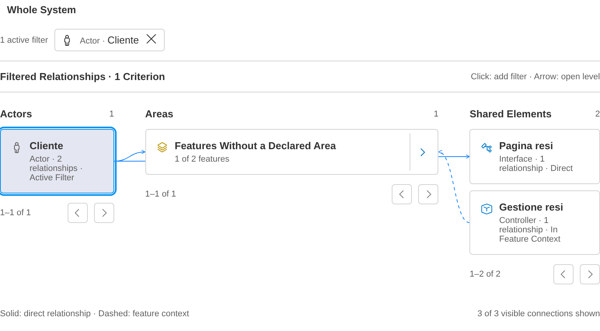

#### Come leggere l’Atlante

A sinistra trovi gli **Actors**. La colonna centrale mostra prima le **Areas**, poi le **Features** dell’area aperta, infine gli **Internal Elements** della feature aperta. A destra, **Shared Elements** raccoglie gli elementi condivisi o non assegnati a una sola feature.

Se il modello non dichiara aree, usa **Features Without a Declared Area**. È il caso del tour Bottega Ordini: il gruppo rende accessibili le feature senza introdurre un’area di business fittizia.

| Controllo | Effetto |
| --- | --- |
| Corpo della scheda | Aggiunge un filtro; il livello corrente rimane aperto |
| Freccia a destra della scheda | Apre il livello inferiore e mantiene i filtri |
| × accanto a un filtro | Rimuove soltanto quel criterio |
| Percorso sopra la mappa | Risale di livello mantenendo i filtri |

#### Prova guidata: Cliente e Conferma acquisto

Isola ciò che serve al Cliente per acquistare: i filtri mantengono il contesto scelto, mentre le frecce permettono di esplorarne i dettagli. Togliere un solo filtro ti farà vedere come cambia il perimetro.

1. Apri Bottega Ordini e premi **System Map**. Clicca sul corpo di **Cliente**: l’attore compare tra i filtri attivi.
2. Clicca sul corpo di **Features Without a Declared Area**. I due filtri, Cliente e area, rimangono entrambi attivi; sei ancora nel livello generale.
3. Premi la freccia del gruppo per aprirlo. Clicca sul corpo di **Conferma acquisto** per aggiungere il filtro della feature.
4. Premi la freccia di Conferma acquisto. Ora vedi gli elementi interni e quelli condivisi collegati al contesto filtrato; Cliente, area e feature restano nella barra dei filtri.
5. Rimuovi il filtro dell’area con la sua **×**. Cliente e Conferma acquisto restano applicati. Cliccare nuovamente una scheda già filtrata mantiene il suo filtro attivo.

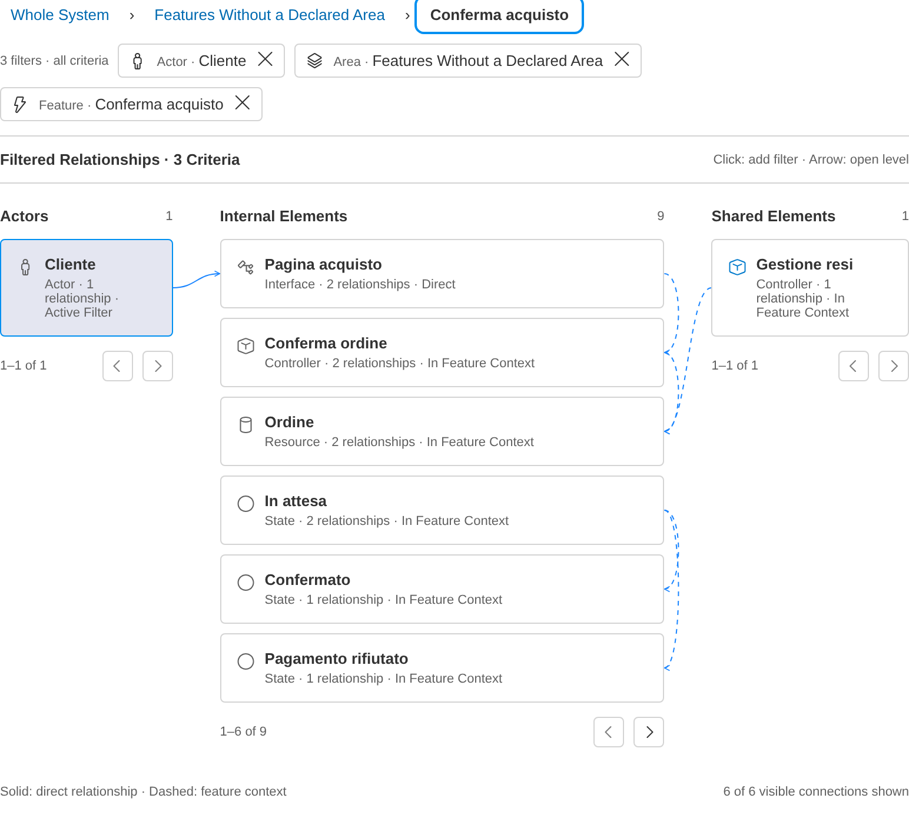

I filtri sono cumulativi: ogni nuovo criterio restringe il contesto comune. Il filtro per un attore conserva i contenuti interni e condivisi delle feature collegate. Con una combinazione incompatibile la mappa mostra uno stato vuoto e lascia tutti i filtri visibili: rimuovi una × per ampliare i risultati.

#### Ricerca, relazioni e sistemi estesi

La ricerca della mappa riguarda l’intero sistema, compresi gli oggetti fuori pagina. Il clic su un risultato aggiunge un filtro; la freccia, quando presente, apre il suo livello. **Inspect …** apre esplicitamente i dettagli dell’identità. I pulsanti dei diagrammi aprono la vista scelta.

Le linee aggregano relazioni dichiarate fra gli oggetti mostrati. Con un attore filtrato, una linea continua indica una relazione diretta e una tratteggiata una relazione nel contesto delle feature. Apri **Relationships** per leggere origine, destinazione, condizioni ed errori originali; un collegamento aggregato non crea una nuova relazione di business.

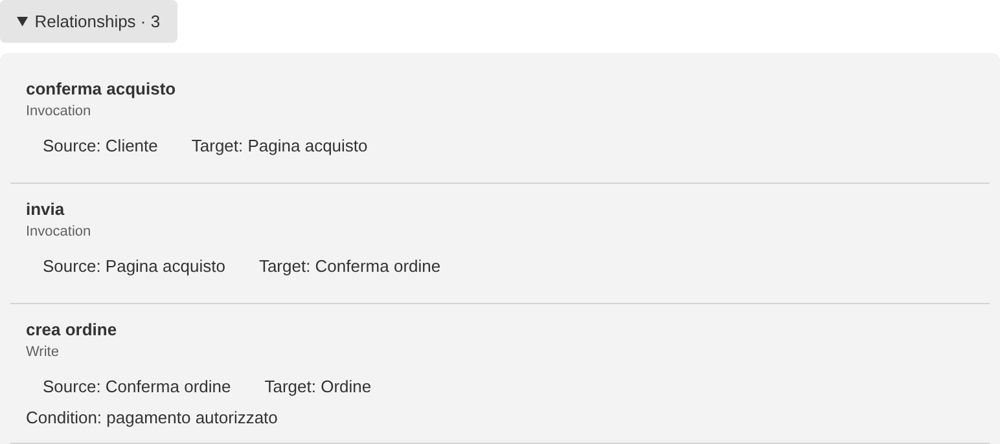

Ogni elenco ha pagine e conteggi propri. Cambiare pagina, livello o scheda, oppure tornare da un diagramma, conserva i filtri nel corso della sessione dell’editor. In una finestra stretta le colonne si dispongono in verticale: conteggi e dettagli delle relazioni restano consultabili.

**Controllo A9:** aggiungi Cliente, area e feature; apri gli elementi interni soltanto con le frecce. Togli una sola × e verifica che gli altri filtri rimangano applicati.
