<!-- Copyright (c) Microsoft Corporation. All rights reserved. Licensed under the MIT License. -->

# Guida completa ad ADE

**Un tour, un progetto costruito da zero, un atlante da consultare.** Edizione 14 novembre 2026.

ADE è un ambiente desktop per progettare software con diagrammi, definire contratti e comportamenti, esplorare codice e lavorare con l’IA. Il canvas è il punto di partenza; codice e strumenti dell’IDE si aprono quando servono. Questa guida insegna il percorso dall’idea alle verifiche, conservando la differenza fra un disegno, una specifica eseguibile e una prova.

## Come usare questa guida

Leggi le tre parti in ordine al primo utilizzo. **La Parte I è un tour di Bottega Ordini**, già pronto: segui un acquisto e poi un reso senza dover prima costruire il modello. **La Parte II è un laboratorio**: realizzi da una cartella vuota il piccolo e-commerce Mercato, impari tutte le 16 notazioni e prosegui con contratti, simulazioni, codice e review. **La Parte III è l’atlante**: per ogni diagramma trovi scopo, momento d’uso, elementi, collegamenti, procedura ed errori da evitare. Le appendici raccolgono installazione e strumenti dell’IDE.

Il tour richiede circa mezz’ora. Il laboratorio completo è pensato per più sessioni: fermati ai controlli di tappa, salva e riprendi. Non occorre completare tutte le prospettive in una sola volta. Nei progetti reali crea solo i diagrammi che aiutano a prendere una decisione: qui li attraversiamo tutti per impararli.

Estrai [i progetti di esempio](progetti-esempio.zip) in una cartella tua. Copia le cartelle intere, inclusi i dati nascosti. Conserva l’archivio originale per ripartire. **Non devi aprire o modificare il JSON del modello:** tutti gli esercizi usano comandi, proprietà e form. Se ADE non parte ancora, svolgi prima A1.

| Materiale | Uso nella guida |
| --- | --- |
| `01-bottega-visuale` | Tour con Acquisto e Resi e rimborsi: due feature, otto viste |
| `07-mercato-laboratorio/inizio` | Spazio iniziale del laboratorio, senza un modello precostruito |
| `07-mercato-laboratorio/tappe` | Due checkpoint visuali per confrontare i primi risultati |
| `07-mercato-laboratorio/soluzione` | Riferimento completo con 18 viste nelle 16 notazioni |
| `07-mercato-laboratorio/moduli` | Esercizi eseguibili di quantità, interazioni, stati e messaggi; ogni sottocartella è una root ADE autonoma |
| `07-mercato-laboratorio/codice` | Piccolo modulo JavaScript da eseguire e importare |
| `02` fino a `06` | Le stesse basi dei laboratori avanzati, disponibili anche separatamente |

I nomi inglesi in grassetto riprendono i controlli dell’interfaccia. **Progetto > Project Settings** significa aprire il menu con il nome del progetto. **Palette** significa `F1`, oppure `Cmd+Shift+P` su macOS e `Ctrl+Shift+P` su Windows/Linux. La ricerca nella palette è anche un’alternativa ai menu. Nella versione HTML l’indice e la ricerca raggiungono i capitoli; clicca le immagini per ingrandirle.

## Parte I - Tour di Bottega Ordini

### T1. Apri il negozio e trova i comandi essenziali

Dalla Home premi **Open Project**, seleziona `01-bottega-visuale` e conferma. Apri la cartella del progetto, non il file del modello. Devi leggere **Bottega Ordini** nella testata e **Struttura acquisto** come diagramma attivo.

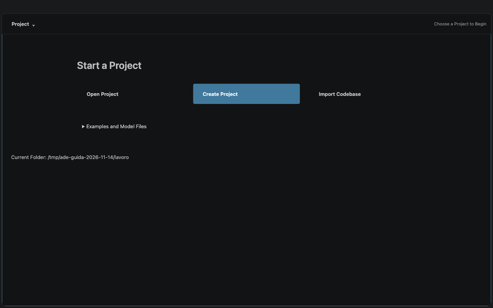

Il negozio di esempio permette a un cliente di confermare un acquisto. Un pagamento autorizzato porta all’ordine confermato; un pagamento rifiutato porta all’esito negativo. La seconda feature gestisce la richiesta di reso e il rimborso. “Entro 30 giorni” è una regola didattica di questo progetto, non una descrizione di obblighi commerciali o legali.


Per ora usa solo quattro punti dell’interfaccia:

1. **Nome del diagramma:** apre il selettore delle viste. Digita parte del nome se l’elenco è lungo.
2. **Un elemento del canvas:** apre le sue proprietà; **Close Properties** le richiude.
3. **Fit Diagram:** inquadra l’intero contenuto. Zoom e trascinamento dello sfondo aiutano a leggere.
4. **Nome del progetto:** consente di tornare alla Home o aprire un altro progetto. Le impostazioni servono più avanti.

**Diagrams** apre e chiude la navigazione laterale; **Code** raccoglie il lavoro sul codice. Il semplice cambio di vista non modifica il modello. **Save** appare quando esistono modifiche; **Model Saved Locally** indica il salvataggio locale, non un commit o una pubblicazione online.

**Controllo T1:** apri il selettore e trova le due feature e le otto viste. Richiudilo con Escape. Se il canvas sembra vuoto, premi Fit Diagram prima di creare qualcosa.

### T2. Segui un acquisto attraverso quattro prospettive

Apri **Struttura acquisto**. Leggi da Cliente a Pagina acquisto, poi a Conferma ordine e infine a Ordine. Il Cliente è un ruolo; Pagina acquisto è l’interfaccia del negozio; Conferma ordine coordina la richiesta; Ordine è la risorsa registrata. La pagina del negozio non è un “diagramma”: è un elemento rappresentato nel diagramma.

Seleziona la relazione verso Ordine. Il collegamento **Write**, “crea ordine”, ha la condizione “pagamento autorizzato”. Le proprietà permettono di leggere il significato senza tenere tutte le etichette aperte sul canvas. Apri le descrizioni degli elementi per vedere il loro ruolo.

Passa a **Flusso acquisto**. Parti da Richiedi pagamento e segui le alternative verso Ordine confermato o Pagamento rifiutato. Qui la domanda è “che cosa succede a seconda dell’esito?”, non “quale oggetto possiede il dato?”.


Apri **Sequenza pagamento** e leggi i messaggi dall’alto verso il basso. Le colonne sono i partecipanti; le frecce esprimono interazioni nell’ordine dichiarato dalla vista. Poi apri **Stati ordine**: In attesa, Confermato e Pagamento rifiutato sono condizioni della risorsa nel tempo. Un’azione come “richiedi pagamento” e uno stato come “confermato” descrivono aspetti diversi.

**Controllo T2:** racconta l’acquisto con quattro frasi: chi collabora, quali alternative esistono, chi chiama chi, come cambia l’ordine. Non premere Code per “eseguire” queste figure: questa variante è descrittiva. L11-L15 mostreranno come aggiungere contratti e prove eseguibili.

### T3. Esplora la seconda feature: resi e rimborsi

Dal selettore apri **Struttura resi**. La richiesta parte dallo stesso Cliente già usato nell’acquisto, passa da Pagina resi a Gestione resi, legge l’Ordine esistente e registra una nuova Richiesta di reso. Ordine e Richiesta di reso sono due oggetti diversi: il reso fa riferimento a un acquisto, non lo sostituisce.


Apri in successione le altre tre viste:

| Vista | Cosa seguire | Domanda a cui rispondere |
| --- | --- | --- |
| Flusso rimborso | Valuta richiesta, Emetti rimborso, Reso non ammesso | Quale condizione ammette il rimborso? |
| Sequenza reso | Richiesta del cliente, invio, lettura ordine, registrazione | Quale informazione deve esistere prima della registrazione? |
| Stati richiesta di reso | Richiesto, Autorizzato, Rimborsato, Rifiutato | Quando una richiesta autorizzata diventa rimborsata? |

Seleziona ogni freccia del flusso e leggi la condizione. Poi guarda la transizione Autorizzato verso Rimborsato: autorizzare e completare il rimborso sono due momenti distinti. Il progetto non contatta una banca né calcola una scadenza: rappresenta la regola concordata per l’esempio.

**Controllo T3:** trova una lettura dell’Ordine e una scrittura della Richiesta di reso. Spiega perché la seconda feature riusa l’Ordine invece di crearne un duplicato chiamato “Ordine resi”.

### T4. Ritrova un elemento e riconosci l’identità condivisa

Apri **Diagrams**, poi **Search System**. Cerca “Ordine” e consulta il tipo e i diagrammi associati. La ricerca considera anche le modifiche non ancora salvate; un risultato può aprire una vista che contiene l’oggetto oppure i dettagli di un’identità ancora non disegnata. La navigazione indietro/avanti torna alle destinazioni visitate.

**System Map**, disponibile anche dalla palette, mostra la gerarchia e tutte le identità. Espandi una feature per trovare i suoi figli. I collegamenti aggregati fra gruppi si possono aprire per leggere le relazioni originali: un numero nell’aggregato non è una nuova relazione di business.

Un elemento conserva la propria identità cambiando nome o posizione. Un diagramma seleziona elementi e relazioni e conserva un layout proprio. **Add Existing Element** riusa un’identità; **Add Element** ne crea una nuova. Due nomi identici non rendono identici due oggetti.

In una copia del tour rinomina la risorsa Ordine in “Ordine cliente” dalle proprietà. Raggiungila da Struttura resi: il nome della stessa risorsa deve essere aggiornato. Cerca **Show Change Impact** sull’elemento per vedere i diagrammi e i riferimenti interessati; poi annulla la rinomina e salva.

**Controllo T4:** distingui il nome della risorsa dai nomi dei diagrammi “Stati ordine” e “Struttura acquisto”, che non devono essere rinominati automaticamente. La rinomina cambia l’identità selezionata, non ogni testo che contiene la parola ordine.

### T5. Fai una prima modifica reversibile

Lavora in una copia di Bottega Ordini. Apri Struttura acquisto e aggiungi una responsabilità di notifica:

1. Premi **Add Element > Component** e scrivi “Notifiche ordine”.
2. Posizionala in uno spazio libero. Seleziona Conferma ordine e premi **Connect**, oppure **Connect Selection** nelle proprietà.
3. Scegli **Invocation**, la destinazione Notifiche ordine e il nome “invia conferma”. Se compare la condizione, usa “ordine confermato”.
4. Seleziona la freccia e controlla origine, destinazione e testo. Richiudi le proprietà.
5. Salva con `Cmd+S` o `Ctrl+S`. Se compare la proposta Update Codebase from Diagrams, scegli **Cancel**: il modello rimane salvato.
6. Prova Undo e Redo. Salva la versione che vuoi conservare, chiudi il progetto e riaprilo.

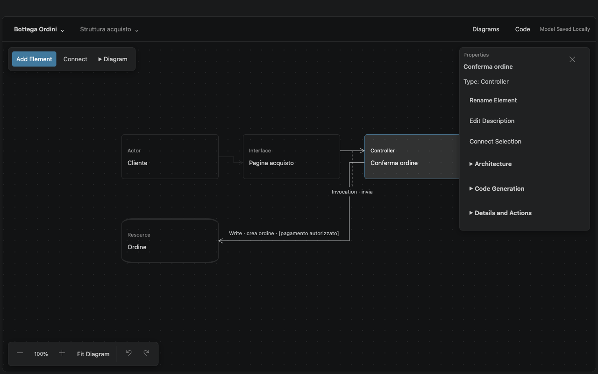

Per togliere solo una rappresentazione usa **Remove from Diagram**. L’eliminazione dal sistema rimuove la definizione condivisa e può coinvolgere altri riferimenti; controlla l’impatto prima di confermarla. Eliminare una vista conserva gli elementi semantici. Se stai cambiando progetto con modifiche pendenti, scegli esplicitamente salvataggio, scarto o annullamento.

**Controllo T5:** dopo la riapertura ritrova la notifica e la relazione; oppure, se hai scelto di annullarle, controlla che siano assenti. Hai completato il tour quando sai raggiungere una vista, leggere una relazione, riusare un’identità e recuperare una modifica.

## Parte II - Laboratorio: costruisci Mercato da zero

### L1. Il progetto, le regole e i punti di ripresa

Costruirai **Mercato**, un piccolo e-commerce didattico. Il Cliente consulta prodotti, conferma un acquisto e può chiedere un reso. L’Assistenza gestisce le richieste. Un servizio Pagamenti esterni autorizza il pagamento; un Corriere esterno rappresenta il confine delle consegne. Questi sistemi sono progettati, non servizi attivi inclusi nel pacchetto.

Le tre feature sono **Catalogo prodotti**, **Acquisto**, **Resi e rimborsi**. Per delimitare l’esercizio assumiamo: quantità intera da 1 a 10 per riga; prezzi in centesimi; almeno una riga per ordine; conferma solo con pagamento autorizzato; richiesta di reso collegata a un ordine esistente; ammissione entro 30 giorni. La gestione reale di tasse, disponibilità concorrente, pagamenti, sicurezza e rimborsi richiederebbe decisioni ulteriori. Il coupon è un esempio opzionale nel diagramma dei casi d’uso, non una funzione già implementata nel modulo JavaScript.

| Tappa | Prodotto del lavoro | Confronto disponibile |
| --- | --- | --- |
| L2-L3 | Prima struttura e confini del sistema | `tappe/01-confini` |
| L4-L5 | Architettura C4 e modelli dati | `tappe/02-architettura-dati` |
| L6-L10 | Tutte le 16 notazioni e seconda feature | `soluzione` |
| L11-L15 | Contratti, quantità verificata, interazioni, stati, messaggi | Sottoprogetti in `moduli` |
| L16-L20 | Codice locale, evidenze, assistenza IA facoltativa, riconciliazione | `codice` e le tue copie di lavoro |

Apri la **root del sottoprogetto** indicato, non l’intera cartella `07-mercato-laboratorio`. ADE lavora sul progetto della root attiva. I moduli sono separati per mantenere distinguibili le review e i profili: non fingono che tutte le 18 viste si trasformino automaticamente in un negozio eseguibile.

Le tappe sono riferimenti visuali progressivi: mostrano le viste già affrontate usando le stesse identità della soluzione. Contengono anche il grafo e il blueprint di riferimento, quindi System Map può mostrare oggetti di lezioni successive. Per un’esperienza davvero da zero usa `inizio` o una nuova cartella tua, senza copiare il modello della soluzione.

**Metodo per ogni lezione:** costruisci nella tua copia, salva, chiudi e riapri quando indicato, confronta il risultato atteso. Per guardare la soluzione aprila in una copia separata; non sovrascrivere il tuo esercizio. Se annulli un form con Escape, la modifica in lavorazione non deve essere pubblicata.

### L2. Crea il progetto e la prima struttura

Dalla Home scegli **Create Project**, inserisci “Mercato” e seleziona `07-mercato-laboratorio/inizio` oppure una nuova cartella vuota. Conferma. Premi **Add Feature** e scrivi “Acquisto”: ADE prepara struttura e flusso iniziali. Aggiungi anche Catalogo prodotti e Resi e rimborsi. Puoi lasciare vuote le viste automatiche non ancora utilizzate.

Apri la struttura di Acquisto. Aggiungi con **Add Element** questi oggetti; le categorie meno frequenti si trovano in **More Element Types**. I gruppi Architecture, Data, Interfaces, Behavior, Flow e Infrastructure raccolgono i tipi compatibili.

| Nome | Tipo | Perché esiste |
| --- | --- | --- |
| Cliente | Actor | Chi richiede l’acquisto |
| Web shop | Application / Container | L’applicazione web usata dal cliente |
| Checkout | Component | La responsabilità che coordina la conferma |
| Ordine | Resource | Il risultato di dominio persistito |
| Pagamenti esterni | Software System, poi scope External System | Il sistema esterno da cui dipende l’esito |
| Gestione resi | Component | La responsabilità che consulterà gli acquisti |

Collega Cliente a Web shop con Communication “naviga”; Web shop a Checkout con Invocation “invia acquisto”; Checkout a Pagamenti esterni con Invocation “autorizza pagamento”; Checkout a Ordine con Write “registra ordine”, condizione “pagamento autorizzato”; Gestione resi a Checkout con Dependency “consulta acquisto”. Per ogni collegamento seleziona l’origine, scegli Connect, tipo, destinazione e nome. Le scelte dipendono dalla notazione e dagli estremi.

Rinomina la vista “01 Panoramica delle responsabilità”. La soluzione la mantiene a livello di progetto per essere una panoramica trasversale: puoi creare una Structure a livello di sistema e usare Add Existing Element per mostrarvi gli oggetti appena creati. La vista automatica della feature può restare come dettaglio locale.

Per sistemare il layout trascina i nodi e lo sfondo. **Diagram > Layout > Arrange Diagram** offre Compact, Balanced e Spacious. **Show Relationship Labels** rende visibili tutte le etichette; una relazione resta leggibile anche nelle proprietà e nella lettura testuale. Il layout è annullabile e non cambia l’ordine eseguibile.

**Controllo L2:** salva, riapri e verifica sei responsabilità e cinque collegamenti con estremi corretti. Cliente, Ordine e Checkout saranno riutilizzati dove il ruolo è compatibile. Le entità e le classi omonime delle lezioni successive saranno invece oggetti distinti.

### L3. Delimita il sistema: casi d’uso e C4 Context

Nella panoramica crea Mercato con **Add Element > More Element Types > Architecture > Software System**. Selezionalo, apri **Properties > Architecture > Scope and Responsibility** e scegli **Governed System**. Crea anche Corriere esterno e riusa Pagamenti esterni; per entrambi scegli **External System** nello stesso form. Crea o riusa gli attori Cliente e Assistenza. Il blueprint mantiene questi dati condivisi, ma la creazione dell’elemento parte dal canvas. Per la vista apri **Edit Structural Blueprint > Structure > C4 View Subject and Context > Create New**. Scegli **L1 · System Context**, il soggetto Mercato e il nome “02 C4 Contesto Mercato”. In **Context Dependencies (Outside the Subject)** seleziona Cliente, Assistenza, Pagamenti esterni e Corriere esterno; premi OK. In **Visible Elements** mantieni selezionato Mercato e seleziona gli stessi quattro oggetti; conferma. Non usare la feature Acquisto come se fosse il sistema intero. Se hai già creato una vista C4 incompleta da Add Diagram, puoi completarla dallo stesso form scegliendola al posto di Create New.

Nel Context riusa il Cliente esistente, il ruolo Assistenza e i due sistemi esterni appena definiti. Le quattro comunicazioni sono: Cliente verso Mercato “acquista e richiede resi”; Assistenza verso Mercato “gestisce richieste”; Mercato verso Pagamenti esterni “autorizza e rimborsa”; Mercato verso Corriere esterno “richiede consegna”. Qui non disegnare tabelle o classi.

Ora crea **Use Case**, “12 Casi d’uso”. Aggiungi Cliente e Assistenza esistenti e i casi Confermare acquisto, Autorizzare pagamento, Richiedere reso, Applicare coupon. Associa Cliente a Confermare acquisto e Richiedere reso; Assistenza a Richiedere reso. Collega Confermare acquisto verso Autorizzare pagamento con **Include** e Applicare coupon verso Confermare acquisto con **Extend**, condizione “coupon presente”. Il confine/proprietario dei casi è Mercato; usa **Change Boundary or Parent** nelle proprietà pertinenti.

Include indica una parte sempre richiesta dal caso base; Extend descrive un’aggiunta condizionata al caso base. Non usare queste frecce per ordinare i clic del checkout. Per i passaggi temporali costruirai Activity e Sequence.

**Controllo L3:** un lettore deve distinguere Mercato dai due fornitori esterni e riconoscere due attori. Nel caso d’uso il pagamento è richiesto; il coupon è opzionale. Confronta il Context con `tappe/01-confini`. D2 e D12 spiegano nel dettaglio le due notazioni.

### L4. Scendi nell’architettura con C4 Container e Component

Dalla panoramica usa **Add Element > More Element Types > Architecture > Application / Container** per i container mancanti: API Mercato, Archivio Mercato e Broker eventi. Riusa Web shop. Nelle proprietà **Architecture > Scope and Responsibility** imposta la responsabilità/runtime; nel blueprint **Structure > Architectural or Lifecycle Owner** assegna a ciascun container il sistema Mercato come proprietario. Apri il blueprint dalla palette **A.D.E: Edit Structural Blueprint** quando devi modificare questi dati condivisi. I quattro container sono Web shop, API Mercato, Archivio Mercato e Broker eventi. Il runtime del Web shop è SPA; API è Service; archivio è Store; broker è Messaging. Sono ruoli architetturali dichiarati, non programmi avviati.

Dal form **C4 View Subject and Context > Create New** scegli **L2 · Containers**, soggetto Mercato e nome “03 C4 Applicazioni e dati”. Mostra il soggetto/confine, i quattro container e Cliente come contesto esterno. Aggiungi Communication: Cliente verso Web shop “naviga” con HTTPS; Web shop verso API Mercato “invia ordini” con HTTPS / JSON; API verso Archivio “legge e scrive” con SQL; API verso Broker “pubblica eventi” con messaggistica dichiarata. In **Edit Cardinalities and Protocol** trovi il protocollo; la tecnologia e l’ambiente stanno nelle proprietà dell’elemento.

Prima di creare la vista aggiungi nella panoramica i Component Registro esiti e Scorte e il Contract Contratto acquisto, usando More Element Types per i tipi meno comuni; Checkout e Gestione resi esistono già. Assegna i proprietari indicati sotto. Poi crea dal form C4 il livello **L3 · Components**, “04 C4 Componenti API”, con soggetto API Mercato. Nel blueprint assegna Checkout, Registro esiti, Gestione resi e Scorte all’API. Scorte rappresenta la responsabilità applicativa per la disponibilità, distinta dall’Archivio Mercato che persiste i dati. Il Contratto acquisto è posseduto da Checkout: nel riferimento è mostrato come contratto di contesto del componente, con ownership esplicita. Seleziona Contratto acquisto come contesto del proprietario diretto; nei visibili includi API Mercato, Checkout, Registro esiti, Gestione resi, Scorte e Contratto acquisto. Il contratto appartiene a Checkout e resta quindi nel perimetro complessivo dell’API. Dichiara il contesto richiesto dal form anziché cambiare proprietari per far entrare una scheda nel rettangolo.

Aggiungi Checkout verso Registro esiti con Invocation “registra esito”; Checkout verso Contratto acquisto con Implementation “espone contratto”; Checkout verso Scorte con Dependency “richiede disponibilità”; Gestione resi verso Checkout con Dependency “consulta acquisto”. Riusa quest’ultima relazione dalla panoramica dove disponibile. Sistema i componenti nel perimetro dell’API; il contratto di Checkout rimane leggibile accanto al provider. Verifica l’ownership dichiarata nelle proprietà, anche quando il canvas sintetizza i contenimenti annidati.

**Controllo L4:** il sistema contiene applicazioni/archivi; l’API contiene responsabilità; Scorte e Archivio Mercato hanno ruoli distinti. Muovere una scheda da solo non modifica l’ownership. Le viste C4 hanno soggetto e perimetro: non sono tre disegni generici con livelli di zoom diversi.

### L5. Progetta dati logici e schema fisico

Crea **ERD**, “05 Entità e cardinalità”. Aggiungi cinque **Entity**, mantenendole distinte dalla risorsa Ordine: Cliente, Ordine, Riga ordine, Prodotto, Reso. Dalle proprietà apri **Edit Attributes and Technology**, aggiungi i membri e assegna i tipi. Se il form richiede un tipo condiviso, crealo da **Data and Operations > Shared Types** nel blueprint: testo e intero sono sufficienti per questi campi.

| Entità | Attributi da inserire | Relazione da costruire |
| --- | --- | --- |
| Cliente | customerId: testo; email: testo | Cliente 1 verso Ordine 0..\* |
| Ordine | orderId: testo; totalCents: intero | Ordine 1 verso Riga ordine 1..\* |
| Riga ordine | quantity: intero; unitPriceCents: intero | Riga ordine 0..\* verso Prodotto 1 |
| Prodotto | sku: testo; priceCents: intero | Il prodotto è riusato in più righe |
| Reso | returnId: testo; reason: testo | Reso 0..\* verso Ordine 1 |

Usa **Association** e imposta le due cardinalità nelle proprietà della relazione. “Cliente 1 - Ordine 0..\*” significa: un ordine ha un cliente; un cliente può avere zero o più ordini. Non invertire i numeri leggendo la freccia come un’azione. La cardinalità è una regola del modello, non un conteggio dei record attuali.

Crea **Database Schema**, “06 Schema dati progettato”. Aggiungi cinque **Table**. Per ogni colonna scegli nome, tipo, ruolo di chiave, obbligatorietà e nullabilità. Nel riferimento tutte le colonne elencate sono richieste e non nulle; sono scelte didattiche esplicite.

| Tabella | Colonne e chiavi | Riferimenti da impostare |
| --- | --- | --- |
| customers | id testo PK; email testo Unique | Nessuno |
| orders | id testo PK; customer_id testo FK; total_cents intero | customer_id verso customers.id |
| order_lines | id testo PK; order_id testo FK; product_id testo FK; quantity intero | order_id verso orders.id; product_id verso products.id |
| products | id testo PK; sku testo Unique; price_cents intero | Nessuno |
| returns | id testo PK; order_id testo FK; reason testo | order_id verso orders.id |

Collega ogni tabella figlia alla tabella referenziata con Association. In **Edit Cardinalities and Protocol** scegli **Source Member** e **Target Member** dai membri reali: ad esempio orders.customer_id verso customers.id, con 0..\* dal lato figlio e 1 dal lato padre. Non basta scrivere “FK” nel nome della freccia. ADE rifiuta il riferimento a una colonna inesistente.

Per collegare dominio e persistenza usa i mapping del blueprint, ad esempio orderId verso orders.id. ERD, tabella e classe non si fondono per omonimia. **Controllo L5:** cinque entità, cinque tabelle, quattro associazioni in ciascuna vista, chiavi e cardinalità leggibili. Salva e confronta `tappe/02-architettura-dati`. Non è stato creato un database né eseguito SQL.

### L6. Descrivi il codice con Class, UML Component e Package

Crea **Class**, “11 Classi e repository”. Aggiungi le classi Order e CheckoutService e l’Interface Contract OrderRepository. Dalle proprietà aggiungi a Order gli attributi orderId testo e totalCents intero e il metodo confirm; a CheckoutService il metodo submit; a OrderRepository il metodo save. Per questi membri illustrativi usa un risultato testo; la firma eseguibile completa sarà nel blueprint. Inserisci il nome del metodo senza duplicare le parentesi che il canvas visualizza.

Collega CheckoutService a Order con Dependency “valida e conferma” e a OrderRepository con Dependency “usa contratto”. I membri sono descrittivi: un metodo disegnato non viene implementato automaticamente. Evita di ricreare la risorsa Ordine come classe cambiandole semplicemente il tipo.

Crea **UML Component**, “13 Componenti e interfacce”. Riusa Checkout, Contratto acquisto, Registro esiti e OrderRepository. Collega Checkout a Contratto acquisto con Implementation “espone contratto” e Registro esiti a OrderRepository con Implementation “fornisce persistenza”. Questa vista concentra l’attenzione sui contratti; C4 Component concentra l’attenzione sul perimetro interno di un container.

Crea **Package**, “14 Moduli applicativi”. Aggiungi Dominio, Applicazione, Adapter. Le dipendenze sono Applicazione verso Dominio “usa regole”; Adapter verso Dominio “implementa contratti”; Adapter verso Applicazione “collega esterni”. Un package è un raggruppamento logico, non un servizio distribuibile.

**Controllo L6:** l’OrderRepository è la stessa identità nelle viste Class e UML Component. Il dominio non dipende dagli adapter. Sai indicare separatamente una classe, un componente e un package, senza usarli come sinonimi.

### L7. Disegna flusso, sequenza e stati dell’acquisto

Apri il flusso automatico della feature Acquisto o crea **Activity / Flowchart** e chiamalo “08 Flusso acquisto”. Aggiungi da More Element Types > Flow: Start “Inizio”, Decision “Scorte disponibili?”, End “Fine”. Aggiungi le Action Valida carrello, Richiedi pagamento, Conferma ordine, Rifiuta ordine. Usa **Control Flow** per la catena Inizio verso Valida carrello verso Scorte disponibili?. Dalla decisione crea due uscite: verso Richiedi pagamento con condizione “disponibili”; verso Rifiuta ordine con “non disponibili”. Dal pagamento prosegui a Conferma ordine con “pagamento autorizzato” o Rifiuta ordine con “pagamento rifiutato”. Entrambi gli esiti raggiungono Fine.

Crea **Sequence**, “07 Sequenza acquisto”, associata ad Acquisto. Riusa Cliente, Checkout, Pagamenti esterni e Ordine. Includi nell’ordine: Cliente verso Checkout “conferma acquisto”; Checkout verso Pagamenti esterni “autorizza pagamento”; Checkout verso Ordine “registra ordine”, condizione “pagamento autorizzato”. La sequenza del riferimento semplifica il canale web e mostra il coordinamento: l’ordine dei messaggi si modifica con le azioni della sequenza, non trascinando soltanto le schede.

Crea **State Machine**, “09 Stati ordine”, scegliendo come proprietaria la risorsa Ordine. Aggiungi In attesa, Confermato, Rifiutato. Collega In attesa a Confermato con transizione Pagamento autorizzato, condizione “esito positivo”; In attesa a Rifiutato con Pagamento rifiutato, condizione “esito negativo”. Non aggiungere una nuova risorsa per ogni stato.

**Controllo L7:** percorri sia l’esito positivo sia quello negativo senza arrivare a un nodo senza seguito involontario. Spiega quale vista mostra alternative, quale ordine fra partecipanti e quale ciclo di vita. Sono descrizioni: per eseguirle servono i contratti di L13-L14.

### L8. Collega la seconda feature senza duplicare l’acquisto

Nella feature Resi e rimborsi prepara una Structure, “Resi - responsabilità condivise”. Aggiungi **esistenti** Cliente e Ordine; crea Pagina resi (Interface/View), Coordinamento reso (Controller), Richiesta di reso (Resource). Collega Cliente verso Pagina resi e questa verso Coordinamento reso con Invocation. Il controller legge Ordine con Read “verifica acquisto” e scrive Richiesta di reso con Write “registra reso”. L’Ordine originale rimane nella feature Acquisto; essere visibile qui non lo sposta.

Nel flusso della nuova feature crea Valuta reso, Emetti rimborso e Rifiuta richiesta. Collega la prima azione alle altre due con condizioni “entro 30 giorni” e “termine superato”. Rinomina la vista “Resi - ammissione e rimborso”. Puoi aggiungere un dettaglio di stato della richiesta come nel tour, ma le 18 viste della soluzione si fermano alle due nuove prospettive per mantenere il riferimento leggibile.

Apri **Show Change Impact** su Ordine. Cerca le due feature e raggiungi i riferimenti. Rinominalo temporaneamente e verifica il riuso, poi annulla. **Controllo L8:** nessun duplicato della risorsa Ordine; la richiesta di reso resta un oggetto autonomo; una lettura è distinta dalla registrazione di una nuova richiesta.

### L9. Progetta collocazione e connessioni

Crea **Deployment**, “10 Distribuzione locale progettata”. Aggiungi Deployment Node Host Web, Host API, Host dati e Artifact Web bundle, API ESM. Riusa API Mercato e Archivio Mercato. Con **Hosts** dichiara: Host Web ospita Web bundle; Host API ospita API ESM e API Mercato; Host dati ospita Archivio Mercato. Indica “Didattico locale” come ambiente e “Processo locale progettato” come tecnologia dei nodi: stai documentando un’ipotesi, non leggendo processi realmente accesi.

Crea **Network / Infrastructure**, “16 Connessioni progettate”. Aggiungi Network Node Rete client e Rete backend; riusa Web shop, API Mercato e Archivio Mercato. Con Communication collega Rete client a Web shop con HTTPS 443; Rete client a Rete backend con “confine applicativo”, HTTPS 443; Rete backend ad API Mercato con HTTPS / JSON; API ad Archivio con SQL.

I protocolli sono dichiarazioni del progetto. La presenza di una freccia non apre una porta, non crea una regola firewall e non dimostra che una connessione sia sicura o raggiungibile. Nel laboratorio non inventiamo cloud o ambienti di produzione non forniti.

**Controllo L9:** sai indicare “dove gira” una parte del sistema nel Deployment e “chi può comunicare con chi” nella Network. Sono due domande diverse anche quando le schede riusano le stesse applicazioni.

### L10. Segui i dati e fai il controllo delle 16 viste

Crea **Data Flow**, “15 Dati dell’acquisto”. Riusa Cliente; crea Process Elabora ordine e Data Store Dati ordini, Dati catalogo. Collega con **Data Flow** Cliente verso Elabora ordine “dati acquisto”; Dati catalogo verso Elabora ordine “prezzi e disponibilità”; Elabora ordine verso Dati ordini “ordine confermato”; Elabora ordine verso Cliente “esito acquisto”. Un nome di dato risponde a “che cosa passa?”, non a “quale pulsante viene premuto?”.

Salva e riapri. Apri la soluzione in una copia per confrontare significato e identità, non le coordinate esatte. Usa la tabella per verificare la copertura:

| Notazione | Vista del riferimento | Lezione |
| --- | --- | --- |
| Structure | 01 Panoramica delle responsabilità | L2 |
| C4 System Context | 02 C4 Contesto Mercato | L3 |
| C4 Container | 03 C4 Applicazioni e dati | L4 |
| C4 Component | 04 C4 Componenti API | L4 |
| ERD | 05 Entità e cardinalità | L5 |
| Database Schema | 06 Schema dati progettato | L5 |
| Sequence | 07 Sequenza acquisto | L7 |
| Activity / Flowchart | 08 Flusso acquisto | L7 |
| State Machine | 09 Stati ordine | L7 |
| Deployment | 10 Distribuzione locale progettata | L9 |
| Class | 11 Classi e repository | L6 |
| Use Case | 12 Casi d’uso | L3 |
| UML Component | 13 Componenti e interfacce | L6 |
| Package | 14 Moduli applicativi | L6 |
| Data Flow | 15 Dati dell’acquisto | L10 |
| Network / Infrastructure | 16 Connessioni progettate | L9 |

Con le due viste Resi hai 18 viste nel riferimento; nella tua copia possono esserci anche le viste vuote preparate automaticamente. Elimina solo quelle davvero inutili, conservando gli elementi del sistema.

**Controllo di coerenza:** Cliente e Ordine sono riusati nelle prospettive compatibili; entità, tabelle e classi restano distinte; tutte le relazioni hanno estremi pertinenti; le condizioni descrivono esiti comprensibili; le ownership corrispondono ai confini; la lettura testuale riporta i dettagli. Non occorre raggiungere una disposizione identica agli screenshot per aver progettato correttamente.


### L11. Trasforma le responsabilità in contratti e decisioni

Torna alla tua root Mercato. Apri il blueprint e crea un tipo record Dati ordine con orderId testo e una collezione di righe tipizzate; per ogni riga dichiara productId testo e quantity intero. Aggiungi un enum Esito acquisto con confirmed e declined. Definisci un’operazione submitCheckout: input ordine, risultato esito, errore tipizzato per input non valido. Associala al Contratto acquisto e al proprietario Checkout. L’operazione del riferimento semplifica l’input al solo orderId per isolare l’esempio di collegamento: arricchiscila con le righe nella tua copia invece di assumere che il contratto semplificato copra un carrello reale.

Dichiara la precondizione “l’ordine contiene almeno una riga”, la postcondizione “l’esito viene registrato” e il criterio Given “scorte disponibili”, When “il cliente conferma”, Then “le scorte sono riservate una sola volta”. Sono regole descrittive finché non colleghi i costrutti e il profilo eseguibile pertinenti. Per un esercizio interamente eseguibile userai la quantità nella prossima lezione.

Un contratto rende esplicito cosa riceve e produce una responsabilità, quali condizioni richiede, quali effetti può avere e come si riconosce un risultato accettabile.

#### Contratti descrittivi e operazioni condivise

Il contratto descrittivo di un elemento offre input, output, condizioni ed errori. Le **operazioni condivise del blueprint** aggiungono firme tipizzate, permessi e criteri Given/When/Then modificabili da form. I criteri legacy di una feature sono un percorso distinto: non tutte le funzioni storiche espongono lo stesso editor guidato. Per i nuovi esercizi usa il blueprint e il template eseguibile.

Nel tuo Mercato scegli dalla palette **A.D.E: Edit Structural Blueprint**, poi **Data and Operations > Shared Operations > submitCheckout**. Il modulo quantità della prossima lezione usa lo stesso form per validateQuantity. Il form dell’operazione raggruppa le azioni:

| Area | Cosa modifichi |
| --- | --- |
| Signature | Input Parameters, Results, Typed Errors |
| Behavior Rules | Effetti dichiarati, precondizioni e postcondizioni descrittive |
| Access and Acceptance | Permessi e criteri di accettazione |
| Rename | Nome dell’operazione |
| Remove Contract Member | Membro da rimuovere quando presente e rimovibile |

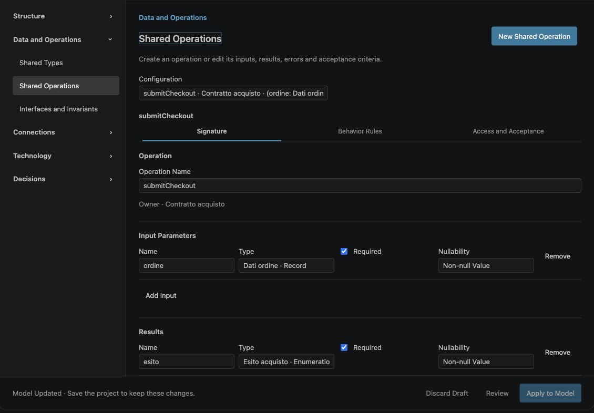

Il titolo conserva l’operazione corrente. **Back** torna alla scelta precedente; **Escape** annulla la modifica in lavorazione. Le proprietà di componenti e contratti pertinenti possono offrire un accesso diretto alle stesse operazioni.

Un criterio efficace per la quantità è: **Given** una quantità intera, **When** viene valutata la precondizione, **Then** soltanto i valori positivi la soddisfano. Il criterio descrive la regola; i casi indipendenti della sezione L12 indicano valori concreti e risultati attesi.

#### Tipi condivisi

In **Data and Operations > Shared Types** definisci primitivi, record, enum, collezioni e riferimenti. Un campo può essere obbligatorio o facoltativo e avere nullabilità ammessa, vietata o ancora sconosciuta. Presenza e nullabilità sono proprietà separate: un campo assente non è un campo presente con valore null.

I vincoli pertinenti comprendono minimo, massimo, pattern e lunghezze. Condividi lo stesso tipo fra operazioni per evitare contratti divergenti. Zero, false, stringa vuota e null sono valori distinti: non usarli come sostituti generici dell’assenza.

#### Ownership, porte e integrazioni

Le aree **Structure**, **Connections** e **Technology** del blueprint permettono di dichiarare sistema governato, sistemi esterni, container, ownership, appartenenze alle feature, interfacce richieste/fornite e collegamenti. Dichiara chi possiede l’operazione e quale porta la espone; collega consumer e provider e mappa le operazioni compatibili.

Le verifiche confrontano tipi, campi obbligatori, nullabilità, risultati, errori, effetti e permessi. Il disegno di una freccia non sostituisce questi binding. Un sistema esterno può essere contesto della vista senza diventare un target da generare nel progetto.

Per trasporti e mapping dichiara protocollo, formato e versione del payload. Collega un campo di dominio a una colonna o a un membro fisico senza fonderne le identità. Una scelta tecnologica sconosciuta può restare esplicita: salva la bozza e risolvi la diagnostica prima di chiedere un comportamento eseguibile.

Apri le decisioni architetturali dal blueprint o cerca **Architecture Decisions** nella palette. Crea una decisione con titolo, contesto, scelta, conseguenze e perimetro. Puoi mantenerla proposta, accettarla, rifiutarla, deprecarla o sostituirla con un’altra decisione. Le revisioni conservano la storia.

Esempio: “I prezzi e i totali sono espressi come interi in centesimi”. Collega la decisione alle responsabilità pertinenti. Se serve un vincolo che il motore possa verificare, aggiungi il vincolo strutturato su tecnologia, libreria, protocollo, persistenza, dipendenza o concorrenza. La sola prosa non viene trasformata in un controllo eseguibile.

Le diagnostiche di readiness indicano cosa impedisce il passo successivo: ownership mancante, tipo sconosciuto, binding incompatibile, criterio o profilo incompleto. Apri l’editor indicato, correggi il dato e prepara di nuovo la review. Una bozza può essere salvata anche quando non è ancora pronta alla generazione.

Prima di modificare un’interfaccia condivisa usa **Show Change Impact** sull’oggetto pertinente. Controlla consumer, relazioni, occorrenze, diagrammi e mapping interessati. Visita i dipendenti e correggi le incompatibilità. L’impatto considera ciò che è rappresentato nel modello e negli indici, non dipendenze runtime mai osservate.

**Controllo L11:** nel progetto principale sai ritrovare il proprietario dell’operazione, i tipi condivisi e la decisione sui centesimi. Una diagnostica irrisolta rimane una scelta da completare, non un invito a riempire campi casuali per ottenere uno stato verde.


### L12. Implementa e verifica il limite della quantità

La regola quantitativa di Mercato è il primo incremento eseguibile. Puoi aggiungerla alla tua root vuota con Add Pure Quantity Feature, come sotto, oppure aprire il modulo dedicato. Il modulo conserva il nome didattico Quantità ordine e isola questa regola dalle viste descrittive del negozio.

#### Creare il template dal principio

Puoi usare la cartella `07-mercato-laboratorio/moduli/quantita` già pronta oppure creare un progetto vuoto e richiamare **A.D.E: Add Pure Quantity Feature** dalla palette. Il comando prepara feature, tipi, operazione `validateQuantity`, predicato e casi di base. Salva il modello. Il nodo visibile “Domain” è il contesto della regola.

La precondizione del template è **quantity maggiore di zero**. I valori appartengono a un tipo intero sicuro. Il testo `due` è quindi un errore di tipo, mentre 0 è un input del tipo corretto che non soddisfa la condizione.

#### Modificare il predicato dal form

Cerca **A.D.E: Edit Pure Predicate** nella palette, scegli `validateQuantity`, poi la precondizione esistente. Conferma lo scope pertinente: **Precondition · Inputs Only** usa gli input; **Postcondition · Inputs and Outputs** consente anche i risultati.

Il costruttore offre **Add Value** per riferimenti e letterali, **Combine Values** per operatori compatibili, cancellazione dell’espressione in lavorazione e **Choose Result and Save** quando esiste un risultato adatto. Un predicato deve terminare con una condizione booleana. I risultati non booleani non vengono proposti come esito finale del predicato.

Per una prova reversibile aggiungi un letterale del tipo Quantity e inserisci `2`: è un numero normale, senza sintassi JSON. Per un testo digita direttamente le parole; per booleani ed enumerazioni scegli una voce. Gli operatori numerici comprendono somma, sottrazione, moltiplicazione, divisione e resto nel sottoinsieme degli interi sicuri. Puoi distinguere presenza e null, combinare condizioni e usare count/any/every sulle collezioni supportate.

Premi **Escape** per uscire senza pubblicare la prova. Per cambiare davvero il limite, componi una nuova condizione, scegli il risultato, conferma e salva. **Clear Detached Expression** svuota la copia in lavorazione: non è una cancellazione immediata del predicato salvato.

#### Scrivere due casi indipendenti

Apri **Progetto > Project Settings > Executable Behavior > Cases and Simulation > Independent Business Expectations**. Scegli **Add Predicate Test Case**, l’operazione e il criterio di business. Crea i due casi seguenti:

| Nome | Input da scegliere | Valore | Risultato atteso |
| --- | --- | --- | --- |
| Zero quantità | Value for quantity | 0 | Not Satisfied |
| Testo non numerico | Different Value Type, poi Text | due | Input Type Error |

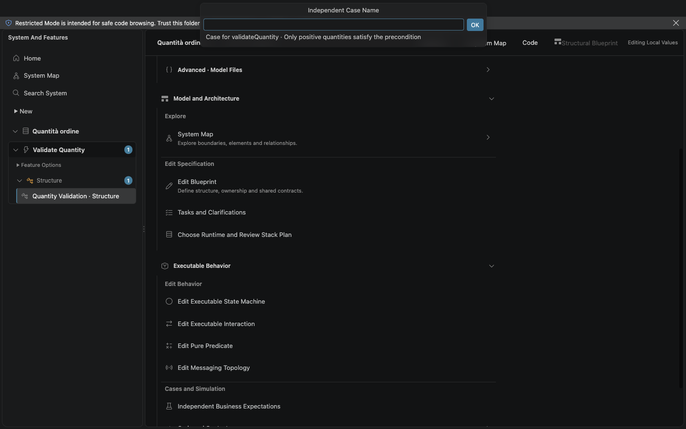

Il nome non può essere vuoto o duplicato. Un testo inserito nel normale campo intero viene rifiutato: per testare deliberatamente un tipo errato usa **Different Value Type**. **Absent** e **Null** permettono di rappresentare quelle condizioni nei casi negativi. Nei form ordinari restano disponibili soltanto le alternative consentite dal contratto.

Seleziona un caso esistente per **Edit Inputs**, **Edit Expected Result** o **Delete Case**. Cambiare un input conserva l’aspettativa precedente finché non la modifichi esplicitamente. L’eliminazione richiede una conferma; **Keep Case** conserva il dato. La conferma senza cambiamenti e l’annullamento non devono creare una nuova revisione.

I risultati attesi disponibili comprendono Satisfied, Not Satisfied, Indeterminate, Input Type Error, Division by Zero e Nonintegral Result or Integer Overflow. Scegli secondo la regola di business e il tipo di espressione. Non ricavare l’atteso copiando automaticamente quello che il programma ha appena restituito.

#### Preparare, verificare, applicare e annullare

1. Salva il modello e apri **Code > Review and Verification > Prepare Model to Code Review**.
2. Leggi comportamento e file previsti. L’azione prepara una proposta locale, senza inferenza IA per il profilo del template.
3. Premi **Run Real Verification** e conferma l’esecuzione locale.
4. Controlla lo stato corrente. Con gli otto casi iniziali e i due appena aggiunti, l’esercizio verificato mostra **10 Derived Cases e 10 Independent Cases**.
5. Solo con review corrente e verifiche superate, scegli **Apply to Project**. Leggi l’elenco dei file e conferma.
6. Controlla i file con Files o il terminale. Per la prova di ritorno scegli **Undo Local Changes** e conferma.


Nel template iniziale la proposta crea un modulo, il test associato, `package.json` e `.gitignore`. Il nome del modulo è assegnato da ADE. Non è necessario rinominarlo o editarlo per completare l’esercizio. La verifica riguarda il comportamento formalizzato e gli attesi del runner; non è un test end-to-end di un negozio reale.

Se cambi modello, criteri o sorgenti pertinenti dopo la review, preparala di nuovo. Quando Code mostra **Review Changes**, aprila e scegli **Prepare New Review**. Una vecchia verifica verde non autorizza ad applicare una revisione nuova. Se l’undo incontra modifiche manuali successive, ADE lo blocca: conserva il tuo lavoro e confronta i file prima di riprovare.

#### Esercizio completo: da quantità positiva a massimo dieci


Usa una copia del modulo quantità di Mercato. La nuova regola accetta gli interi da 1 a 10. Scrivi prima gli attesi: 0 e 11 devono essere Not Satisfied; 1 e 10 devono essere Satisfied.

1. Apri **Edit Pure Predicate**, scegli validateQuantity, la precondizione esistente e Precondition · Inputs Only.
2. Con **Add Value > Add Typed Literal > Quantity**, inserisci `10`.
3. Con **Combine Values > Add Comparison**, scegli `quantity`, poi il letterale `10` e il confronto **minore o uguale**.
4. Con **Combine Values > Add Boolean Logic > All True**, scegli prima la condizione `quantity > 0`, poi `quantity` minore o uguale a `10`.
5. Con **Choose Result and Save**, scegli il risultato che inizia con **and(** e comprende entrambe le condizioni. Salva il modello.
6. Nei casi indipendenti aggiungi “Limite 10” con input 10 e atteso Satisfied e “Oltre limite 11” con input 11 e atteso Not Satisfied.
7. Controlla anche gli attesi iniziali: il caso con input **9007199254740991** era soddisfatto dalla vecchia regola; con il nuovo limite deve essere **Not Satisfied**. Modifica esplicitamente quel risultato con Edit Expected Result. Gli altri attesi iniziali restano pertinenti.
8. Prepara e verifica una nuova review. Se Code mostra Review Changes, aprila e scegli Prepare New Review. Leggi la regola combinata e i risultati, poi applica se vuoi conservare il cambiamento. Non cambiare un atteso soltanto per nascondere un errore: qui la modifica del caso massimo deriva dalla nuova regola di business.

Per confrontare il risultato puoi aprire con Open Project la sottocartella **07-mercato-laboratorio/moduli/quantita/soluzione-limite** del pacchetto: contiene il predicato completo e i dieci casi indipendenti della soluzione.

Controlla infine che modificare soltanto il layout non cambi la regola. Se sai spiegare perché 11 viene rifiutato e quali file saranno applicati, hai completato il percorso principale.

**Traguardo L12:** parti dal template, aggiungi gli attesi indipendenti, modifichi il predicato con il costruttore visuale, prepari una nuova review, verifichi, applichi e annulli. Conserva nel diario del progetto il limite scelto e i casi 0, 1, 10, 11 e tipo errato. Il valore massimo sicuro deve ora essere atteso Not Satisfied: cambiare la regola richiede anche rivedere gli attesi di business.


### L13. Rendi esplicite le chiamate del checkout

Apri `07-mercato-laboratorio/moduli/interazioni` e il diagramma **Checkout e pagamento**. Scorri verticalmente per seguire l’intero flusso. L’interazione principale chiama Payments, valuta un’alternativa, può richiamare la sotto-interazione di persistenza e gestisce una notifica opzionale.

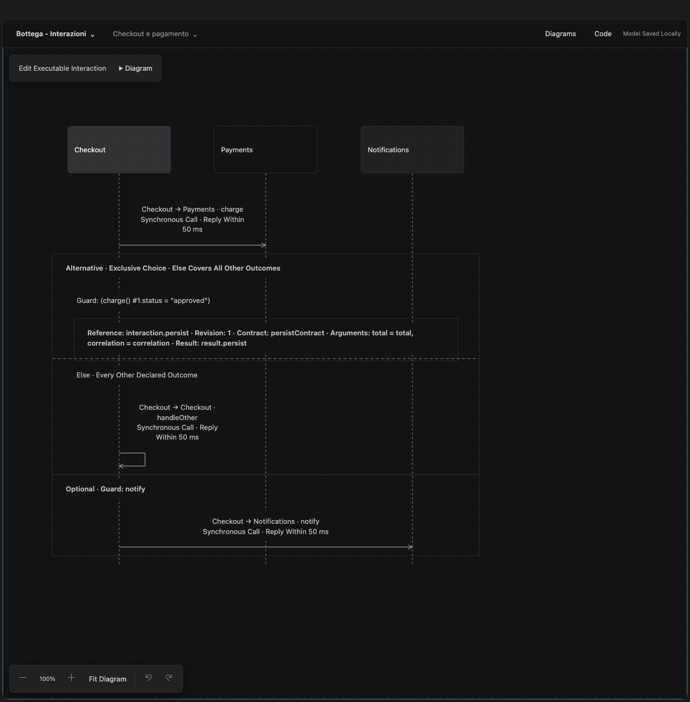

Premi **Edit Executable Interaction** nel canvas o usa il comando omonimo nella palette. Seleziona l’interazione e naviga la gerarchia di messaggi, frame e rami. Per ogni chiamata dichiara mittente, destinatario proprietario dell’operazione, argomenti, modalità sincrona/asincrona, risposta, deadline, correlazione, risultati ed errori pertinenti.

| Costrutto | Uso pratico |
| --- | --- |
| alt | Scegliere un solo ramo in base a guardie; il ramo else copre gli altri esiti |
| opt | Eseguire un corpo soltanto quando la condizione lo richiede |
| loop | Ripetere con guardia, contatore e massimo esplicito |
| par | Avviare rami locali concorrenti e attenderne il join previsto |
| critical | Proteggere una risorsa locale con ordine dei lock coerente |
| ref | Richiamare una sotto-interazione con contratto e revisione espliciti |

Risultati di chiamate ripetute hanno identità distinte. Mantieni gli argomenti nello scope del ramo e della chiamata pertinenti. Il motore rifiuta cicli fra sotto-interazioni e ordini di lock incompatibili.

I casi del progetto comprendono pagamento approvato, alternative, notifica e condizioni di errore. Apri **Independent Business Expectations** per aggiungere un caso dell’interazione: scegli il criterio, inserisci input e risposte simulate, ritardi, completamento/fallimento, output e ordine delle chiamate attesi. Le risposte sono dati: questa verifica non contatta il servizio Payments.

**Esercizio verificato:** prepara la review da Code ed esegui Run Real Verification. L’esempio distribuito ha **sette casi derivati e sette indipendenti**. Prova poi un caso con `notify` vero e scrivi l’ordine atteso includendo la notifica. Annulla gli edit esplorativi se non vuoi conservarli.

**Collegamento a Mercato:** Payments rappresenta Pagamenti esterni; Orders la registrazione dell’Ordine; Notifications la notifica. Studia prima il modulo senza rinominarne le identità o gli attesi. Poi riporta nella tua specifica i contratti effettivamente necessari. Un diagramma descrittivo della soluzione e questa interazione eseguibile sono due livelli distinti del percorso.

**Controllo L13:** sai distinguere la chiamata, la risposta simulata, il ramo alternativo e il criterio indipendente. Una verifica passata non prova un pagamento reale.


### L14. Simula il ciclo di vita dell’ordine

#### Macchine a stati

Apri `07-mercato-laboratorio/moduli/stati`. **Checkout Lifecycle** contiene Draft, Paid e Cancelled. Il contratto eseguibile dichiara inizializzazione, eventi, azioni entry/exit/do, guardie, priorità ed effetti ordinati. Il solo disegno di tre stati non sarebbe sufficiente per eseguirlo.

Dalla palette richiama **A.D.E: Simulate State Machine** e scegli **checkout.paid**. Il rapporto deve mostrare stato **Paid**, evento accettato e transizione **Draft verso Paid**. La traccia distingue valutazione della guardia, annullamento dell’attività do, exit, effetto, entry e commit.


Ripeti con `checkout.failed-charge` per osservare un fallimento dichiarato e con `checkout.dedup-reopen` per il caso con consegna duplicata e riapertura. I risultati attesi sono già inclusi nella variante del progetto.

Per modificare la macchina usa **Edit Executable State Machine**. Dichiara ownership architetturale e di lifecycle, un solo stato iniziale, eventuali stati finali, eventi con payload tipizzato, transizioni interne/esterne, guardia, priorità e azioni. Le azioni richiamano interazioni revisionate. Una self-transition interna e una esterna non hanno lo stesso ciclo di entry/exit.

Nei casi indipendenti dichiara input iniziale, eventi, risposte delle azioni, esiti accettato/rifiutato/duplicato/fallito, transizione ed errore attesi, stato finale, quiescenza e checkpoint quando necessari. Il profilo supporta macchine piatte: niente stati compositi o regioni ortogonali. La simulazione non è un monitor di istanze applicative vive.


**Collegamento a Mercato:** Draft, Paid e Cancelled sono i nomi degli stati del modulo eseguibile. Confrontali semanticamente con In attesa, Confermato e Rifiutato della tua progettazione; non considerarli equivalenti automaticamente, perché “annullato” e “pagamento rifiutato” possono richiedere transizioni diverse. Prima di integrare il modulo nel dominio reale decidi quale lifecycle adottare e i relativi eventi. Questo è un punto di modellazione da discutere, non un mapping implicito.


### L15. Simula pubblicazione e consegna dei messaggi

Apri `07-mercato-laboratorio/moduli/messaggi`. La topologia **checkout.messaging** contiene un producer di queue e uno di topic; le subscription comprendono workers, billing e analytics. Usa **Edit Messaging Topology** per consultare contratti, canali, producer/consumer e policy.

Una queue assegna il lavoro a consumer concorrenti; un topic consente il fan-out alle subscription dichiarate. I contratti dei messaggi hanno nome/versione, payload record e campi per identità, routing e correlazione. Dichiara ack, attesa, tentativi, backoff, dead letter queue, capacità e deduplica/idempotenza invece di assumerli impliciti.

**Simulazione guidata senza broker:**

1. Richiama **A.D.E: Simulate Messaging** e scegli `checkout.messaging`.
2. Scegli **Publish Message**, tempo logico `0` e producer **publish.queue**.
3. Inserisci identità `ordine-guida-1`, `orderId` uguale a `42` e `correlationId` uguale a `checkout-42`.
4. Scegli **Deliver to Worker**, tempo `0`, subscription **workers**, worker `A` e **Handler Succeeds**.
5. Scegli **Finish Scenario**.

Devi osservare una pubblicazione e una consegna, con zero dead letters e zero rifiuti. Il risultato della consegna identifica worker, messaggio, tentativo ed esito.


Per esplorare retry e backoff scegli Handler Fails e tempi logici coerenti con la policy. Per osservare fan-out usa publish.topic e subscription differenti. I casi indipendenti già forniti comprendono competizione, fan-out, deduplica, idempotenza, tentativi esauriti e incompatibilità del contratto; si verificano dalla review del profilo.

La simulazione è locale e non usa la rete. ADE non offre un pannello per avviare o amministrare un broker NATS reale. Un caso simulato passato non dimostra la consegna su un’infrastruttura esterna.

**Collegamento a Mercato:** usa il broker progettato in L4 come contesto e il modulo per verificare una policy locale. Descrivi un evento OrderConfirmed con identità, orderId e correlazione; decidi chi lo pubblica e chi lo consuma. Se vuoi un servizio reale, serviranno implementazione, configurazione, credenziali e prove d’integrazione separate.


### L16. Esegui il modulo di codice e importalo

La cartella `07-mercato-laboratorio/codice` contiene `src/orders.mjs`, una piccola demo e sette test. I prezzi sono in centesimi, la quantità deve essere intera e positiva e checkout restituisce confirmed o declined. Non serve installare dipendenze.

Per provare direttamente l’applicazione, apri un terminale nella cartella ed esegui:

```sh
npm test
npm start
```

Devi ottenere sette test superati e la demo `{ status: 'confirmed', totalCents: 2500 }`.

#### Importazione locale

1. Dalla Home scegli **Import Codebase** e la cartella `07-mercato-laboratorio/codice`.
2. Scegli **Structure and Available Semantic Analysis** per includere la risoluzione JS/TS disponibile, oppure Structure Only per il solo inventario strutturale.
3. Attendi **Source Inventory Ready**. L’importazione non ha installato dipendenze o eseguito l’applicazione.
4. Richiama **A.D.E: Inspect Code Evidence** dalla palette.
5. Cerca la dichiarazione **validateQuantity**: deve puntare a `src/orders.mjs`. Aprila e verifica la funzione.


L’inventario non coincide con un’architettura di dominio già interpretata. Nell’esplorazione incrementale corrente, **Explore Architecture** avvia il percorso IA della sezione L17. Senza account puoi comunque esaminare le evidenze e continuare la progettazione manuale nei progetti visuali.

#### Copertura, scope e versioni

L’importer include sedici profili: JavaScript, TypeScript, TSX, Python, Java, C#, C, C++, Go, Rust, PHP, Ruby, Swift, Dart, Kotlin e Scala. La risoluzione semantica integrata riguarda JS/TS/TSX; bundle SCIP coerenti possono integrare altri produttori supportati. Un riferimento statico non prova una chiamata avvenuta a runtime.

Consulta **Open Full Analysis Details** nell’elenco delle evidenze per inventario, revisioni, diagnostiche e produttori. Distingui analizzato, parziale, non supportato e non classificato. La presenza di evidenze semantiche non elimina automaticamente tutti i residui sintattici.

Usa le azioni di configurazione dello scope del progetto per inclusioni/esclusioni. Leggi l’anteprima e applicala localmente; mantieni fuori cartelle generate e metadati non pertinenti. Le regole Git ignore e le esclusioni ADE partecipano all’inventario. Uno scope cambiato richiede una nuova analisi e può rendere obsolete evidenze e ricerche precedenti.

Le versioni di modello/indice permettono recupero e confronto. Il ripristino storico dell’indice non riscrive i sorgenti correnti. Se un’evidenza risulta superata, aggiorna l’analisi o apri consapevolmente il file corrente senza applicare un vecchio range.

**Controllo L16:** nel nuovo percorso `codice` ottieni sette test passati e un inventario delle dichiarazioni. Apri validateQuantity dal risultato delle evidenze e confrontala con la regola del laboratorio: il modulo iniziale accetta quantità positive senza il massimo 10. È il punto di partenza per la modifica di L18, non la soluzione già aggiornata al nuovo limite.


### L17. Usa l’IA per esplorare, con contesto e review

Questa lezione richiede un account e un modello disponibili. Puoi completare il tour, tutte le viste e i moduli locali precedenti senza eseguirla. I passaggi che seguono spiegano il flusso condizionato; la guida non include una nuova esecuzione remota dei tuoi progetti.

Apri **Progetto > AI Settings**. **Account and Model** distingue connessione, modello per diagrammi e aggiornamento dello stato. **Connect Claude Code or Codex** segue il login offerto dal provider o riconosce una CLI già autenticata. Se hai fatto login esternamente usa **Refresh Account and Models**.


Scegli il modello dal catalogo dell’account quando disponibile. Se il catalogo non viene fornito, usa un identificativo esatto ammesso dal provider. Un modello disponibile in Copilot non diventa automaticamente disponibile nella CLI Codex o Claude. Un eseguibile mancante, un account non autenticato e un modello non valido sono problemi distinti.

**AI Requests** governa le operazioni strutturate: zero prepara soltanto il contesto; una o due invocazioni autorizzano il relativo numero di richieste nel percorso previsto. **Diagram Generation** usa un budget di esplorazione distinto. Aumentare una quota non equivale ad avere già inviato una richiesta; l’invio nella conversazione avvia il lavoro del provider.

Apri soltanto la codebase e i file che vuoi coinvolgere. Prima di inviare leggi contesto, selezioni e perimetro. Lo stato nella modale distingue preparazione, attività degli strumenti, attesa, risposta ed errori. Durante una richiesta evita invii ripetuti; usa il controllo di interruzione se necessario.

La modale dei diagrammi ha una conversazione temporanea: chiudendola la richiesta attiva viene annullata e la cronologia della modale viene azzerata. Piano e bozze già completate rimangono nel progetto. Non usare la chiusura come archivio della conversazione.

Il confronto modelli è in **Advanced · Model Benchmarks**. Serve per prove esplicite: leggi progetto, modello, esito, contesto, tempi e uso riportato. Risultati simulati, token comunicati dal provider e una fattura effettiva sono misure diverse. Il confronto non sostituisce la scelta del modello disponibile al tuo account.

#### Dal codice alle viste proposte

Dopo l’importazione del modulo codice di Mercato, con account e modello configurati, premi **Explore Architecture**. Leggi il messaggio iniziale e invialo soltanto quando sei pronto a condividere il contesto selezionato.

Per l’esempio puoi chiedere:

> Analizza questa piccola codebase degli ordini. Prepara una panoramica delle responsabilità e un flusso del checkout. Distingui la validazione della quantità, il calcolo in centesimi e l’esito del pagamento. Usa le evidenze dei sorgenti; segnala ciò che non puoi ricavare.

L’assistente esplora inventario e sorgenti nel perimetro, propone un piano di viste e prepara bozze condivise. Controlla che il piano risponda alle tue domande e che le responsabilità riusino identità coerenti. Puoi chiedere correzioni, separare scenari o chiarire il significato di una relazione.

Quando il piano è pronto:

1. Apri **Review All Changes**.
2. Leggi prima le anteprime: responsabilità, collegamenti, condizioni e ordine dichiarato.
3. Controlla sorgenti, esclusioni, lacune e diagnostiche pertinenti. Espandi i dettagli quando servono.
4. Se qualcosa non va, torna alla conversazione e chiedi una correzione mirata.
5. Usa **Apply All Changes** per applicare il gruppo revisionato al modello locale.

Un piano incompleto, una bozza invalida o una review diventata obsoleta impediscono Apply. **Continue Generation** riprende il lavoro incompleto; l’esaurimento del budget richiede un ampliamento esplicito. Se cambiano i sorgenti, usa il percorso di aggiornamento per rivedere ciò che è diventato obsoleto invece di ricreare manualmente tutte le viste.

La generazione sceglie le notazioni pertinenti, non una vista di ogni tipo. Gli stati descrittivi non sono attualmente generati da questo percorso incrementale: puoi modellarli manualmente o usare il profilo eseguibile dedicato. I nomi e il numero delle bozze dipendono dall’analisi del provider, quindi non devono coincidere parola per parola con uno screenshot.

**Controllo L17:** prima dell’invio sai quale cartella e quale contesto coinvolgi; prima dell’applicazione sai distinguere evidenza, ipotesi, bozza e vista approvata. Se l’account manca, documenta la lezione come non eseguita e continua con le attività locali.


### L18. Richiedi un aggiornamento del codice e lavora in isolamento

**Code > Update Codebase from Diagrams** apre il percorso di implementazione assistita dal modello salvato. Può essere proposto anche dopo un salvataggio significativo. Il messaggio iniziale è modificabile e include il modello attivo e, quando disponibile, il cambiamento prima/dopo dell’ultimo salvataggio.

Per la codebase didattica, una richiesta concreta è:

> Limita a 10 le unità di un ordine. Mantieni i prezzi e il totale in centesimi. Aggiungi i controlli per 0, 1, 10 e 11, per un valore non intero e per un testo. Conserva gli esiti confirmed/declined e il comportamento non coinvolto. Mostra i test eseguiti e le eventuali scelte ancora da chiarire.

Prima prepara il cambiamento corrispondente nel modello e salvalo. Apri l’azione, controlla la cartella e l’intento e invia il messaggio. Se nel frattempo cambia il modello, prepara un nuovo contesto. Spostare soltanto i nodi non richiede di implementare nuovamente il business.

Al termine leggi le modifiche effettive, controlla i file e riesegui i test del progetto. La chat può modificare codice esistente, ma questo percorso non eredita automaticamente il journal e l’undo del profilo deterministico. Per scartare il lavoro usa la review delle modifiche e gli strumenti Git appropriati. Non considerare il completamento della risposta una prova che tutti i test siano stati eseguiti.

Una copia senza diagrammi interpretati può richiedere prima l’esplorazione o la creazione delle viste. L’aggiornamento usa la codebase del progetto aperto; evita di usare il clone dell’IDE come cartella di destinazione.

#### Una feature in un worktree

Il percorso strutturato in worktree è distinto dalla chat precedente. Richiede una codebase Git importata, almeno un commit, sorgenti senza modifiche pendenti e una feature con criteri di accettazione utilizzabili dal percorso. Il primo runner esegue test Node direttamente avviabili.

Prima crea una copia della modulo codice di Mercato e inizializzala con Git dalla vista **Source Control** o dal terminale. Per una copia nuova senza repository:

```sh
git init
git add .
git commit -m "Base del progetto di esempio"
git status --short
```

L’ultimo comando deve risultare vuoto. La cartella `.ade` è già esclusa dal file ignore dell’esempio. Se Git chiede nome/email, configura la tua identità Git prima del commit.

Nel progetto importato seleziona la feature e cerca **Implement Feature** nelle azioni pertinenti o nella palette. Descrivi l’intento e scegli i file da condividere. Leggi il contesto esatto, poi il piano e le domande. Risolvi i chiarimenti prima della generazione.

ADE prepara le modifiche in un worktree separato: i sorgenti principali restano intatti durante la preparazione. Leggi **Inspect Code Changes** e **Questions and Validation**, esegui i test previsti e controlla l’esito corrente. Solo dopo verifica e review valide applica i file al progetto.

Se la feature non ha criteri riconosciuti o il formato non è supportato, l’azione può restare indisponibile. I criteri delle operazioni condivise e quelli delle feature legacy non sono intercambiabili automaticamente. Questa guida usa il percorso eseguibile della sezione L12 per il laboratorio locale interamente guidato; l’importazione del solo modulo codice di partenza non completa i prerequisiti del worktree.

**Resume Implementation** riprende una review salvata. **Recover Interrupted Implementation** gestisce una transazione interrotta. L’undo ripristina preimmagini soltanto quando non sovrascrive modifiche manuali successive. Un test annullato o interrotto richiede una nuova esecuzione riuscita. Il worktree non è una sandbox del sistema operativo e il percorso non installa automaticamente dipendenze suggerite dal modello.

**Esercizio Mercato:** usa una copia del modulo `codice`, porta il limite a 10, aggiungi prove per 0, 1, 10, 11, decimali e testo e verifica che i totali rimangano in centesimi. La consegna è il diff dei file e il risultato dei test. Non presentare come completata l’implementazione se hai soltanto salvato il diagramma o preparato il messaggio.


### L19. Riconcilia modello e sorgenti con Sync

Sync confronta **baseline comune, modello corrente e codice corrente** nel perimetro configurato. Non equivale a salvare né a fare Git pull. La disponibilità dipende dal formato e dagli adapter: un progetto v5 di esplorazione non abilita implicitamente il Sync legacy.

Apri **Code > Recovery and Synchronization** per le azioni disponibili o cerca **Sync Project** nella palette. Leggi prima il riepilogo locale: file, simboli, dipendenze, viste e conflitti. Se serve una proposta IA, seleziona i file e revisiona il contesto e le finestre di codice prima dell’invio.

Una proposta può includere modifiche puntuali al modello e sostituzioni ancorate nel testo dei file esistenti. Leggi **Sync Proposal** e il confronto del codice. Se ci sono domande aperte, rispondi in modo concreto e prepara la proposta aggiornata. Apply deve restare bloccato finché mancano le condizioni richieste.

Quando modifichi contemporaneamente lo stesso contratto nel modello e nei sorgenti, confronta le tre versioni e decidi quale intento preservare. Conferma le corrispondenze di rinomina soltanto quando sono corrette. Non risolvere un conflitto scegliendo una versione solo per rendere verde la review.

Dopo Apply esegui i test e la build del progetto: Sync non li esegue automaticamente. **Undo Last Sync** ripristina modello e sorgenti se le immagini sono ancora valide. **Recover Sync** gestisce una riconciliazione interrotta. Il ripristino di un vecchio snapshot modello/indice lascia invece invariati i sorgenti.

Il Sync testuale attuale modifica file esistenti; creazione, spostamento ed eliminazione fisica appartengono ai profili strutturali che le supportano. Una proposta in cache può essere riusata senza una nuova chiamata solo per il medesimo contesto valido.

**Esercizio Mercato:** dopo una modifica effettiva del modulo codice aggiorna l’analisi, confronta il nuovo limite con il modello e revisiona la proposta. Conserva la scelta precedente finché il conflitto non è risolto. ADE Sync e Git Sync non sono lo stesso comando: il primo riconcilia artefatti del progetto, il secondo scambia commit con un remoto.


### L20. Completa il ciclo: reverse, runtime e continuità

#### Tornare dal codice al modello

Dopo avere applicato il template quantitativo, apporta in una copia una piccola variazione supportata a un letterale o confronto già emesso. Usa **Reverse Model Behavior from Code** nelle azioni di comportamento, prepara la review, confronta gli effetti e verifica prima di applicare.

Il reverse è delimitato: non ricostruisce l’intento da codice arbitrario. Predicati, interazioni, stati e messaging supportano sottoinsiemi dichiarati. Una modifica fuori grammatica può produrre un mapping parziale e bloccare Apply. ADR, annotazioni e contratti vengono conservati invece di essere dedotti dal testo del sorgente.

Le azioni di spostamento del sorgente gestito permettono percorsi annidati ammessi e aggiornano i riferimenti supportati. Usa la review per controllare collisioni e identità. Non spostare manualmente più copie dello stesso artifact aspettandoti che ADE scelga automaticamente quella corretta.

#### Scegliere Node o Bun

In **Project Settings > Model and Architecture** usa **Choose Runtime and Review Stack Plan**. I profili correnti sono Node ESM e Bun ESM, con versioni previste dal prodotto. Per questa guida il laboratorio usa Node 24.22.1; il profilo Bun richiede Bun 1.3.2 disponibile all’avvio di ADE.

Il piano esplicita implementazione, dipendenze, storage, dati, test, deploy e ritorno. Conserva l’intento di business e riesegui gli stessi casi indipendenti nel runtime scelto. Un vincolo ADR incompatibile deve essere risolto esplicitamente. Il comando non installa Bun e non migra database o broker vivi.

#### Task, chiarimenti e continuità

**Tasks and Clarifications** consente di associare un intento a un target, aggiungere domande/risposte e conservare le revisioni precedenti. Una risposta di chiarimento cambia il contesto: prepara nuovamente la review pertinente.

In **Code > Automatic Preparation** puoi attivare la preparazione continua con un budget di tentativi. Le modifiche semantiche stabilizzate preparano review locali; selezione, zoom e layout non consumano tentativi di business. Il lavoro viene accorpato e serializzato. Il cambio progetto o l’interruzione esplicita fermano la continuità.

Questa modalità prepara proposte, non le applica. Verifica e pubblicazione restano manuali. Un budget esaurito richiede una scelta esplicita; il riavvio non deve avviare da solo nuovi job.

**Controllo L20:** distingui modifiche semantiche e modifiche di layout, preparazione e applicazione, profilo dichiarato e runtime disponibile. La disponibilità di Bun, di un provider o di una connessione esterna è un prerequisito da verificare, non un risultato garantito dall’apertura della cartella.


### L21. Consegna il progetto a un’altra persona

Apri la tua copia principale Mercato e percorri tutte le viste utili. Chiedi a un collega di individuare Cliente, Ordine, conferma e richiesta di reso usando solo navigazione e ricerca. Una vista deve avere un nome che dica quale domanda risolve e relazioni comprensibili senza spiegazioni orali.

Prepara una consegna con il progetto intero, le decisioni ancora aperte, i moduli di codice pertinenti e un riepilogo delle prove. Se usi Git controlla il diff, crea un commit e pubblicalo soltanto sul remoto che vuoi condividere. Non copiare cache, credenziali o cronologie del provider nei materiali didattici.

| Risultato da consegnare | Come lo dimostri |
| --- | --- |
| Modello salvato e riapribile | Chiudi, riapri e raggiungi una vista per ciascuna notazione |
| Due feature collegate senza duplicati | Segui Ordine dall’acquisto al reso e consulta l’impatto |
| Architettura comprensibile | Distingui contesto, container, componenti, package e deployment |
| Dati coerenti | Leggi cardinalità, chiavi e mapping fra identità distinte |
| Comportamento quantitativo verificato | Review corrente, casi indipendenti, Apply e Undo locali |
| Interazioni e policy dichiarate | Casi, tracce di stati e scenario messaging |
| Rapporto con i sorgenti | File aperti dalle evidenze e test tecnici eseguiti |
| IA usata consapevolmente, se disponibile | Perimetro, review, diff e prove; altrimenti indicazione non eseguita |

Una consegna completa non richiede di affermare che il negozio sia pronto per la produzione. Richiede di rendere verificabile ciò che hai progettato, eseguito e lasciato da decidere. Per editor, terminale, Git, debug, accessibilità e strumenti aggiuntivi usa A2-A7.


## Parte III - Atlante dei 16 diagrammi

### D0. Scegli la prospettiva e leggi i simboli

Un diagramma è utile quando risponde a una domanda precisa per un pubblico preciso. Prima di aggiungerlo scrivi mentalmente la domanda: “chi usa il sistema?”, “quali dati esistono?”, “che cosa avviene se il pagamento fallisce?”. Il numero di viste non misura la qualità del progetto. Il laboratorio le attraversa tutte per insegnarne l’uso; una funzione reale può richiederne soltanto due o tre.

#### La procedura comune, senza modello testuale

1. Apri la root del progetto. Dal selettore o dalla navigazione scegli **Add Diagram**; se viene chiesta una feature, seleziona quella pertinente. Per viste a livello di sistema usa la creazione nella sezione di sistema della navigazione.
2. I quattro tipi comuni sono Structure Diagram, Activity Flow, Sequence Diagram e State Diagram. **More Diagram Types** raggruppa gli altri in Architecture, Data, Implementation e Behavior. Entra nel gruppo, scegli la notazione e assegna un nome che dica cosa rappresenta.
3. Per **C4** usa preferibilmente **Edit Structural Blueprint > Structure > C4 View Subject and Context > Create New**: scegli livello, soggetto, nome, dipendenze di contesto e infine elementi visibili. L1 è Context, L2 Container, L3 Component. Mantieni il soggetto selezionato fra i visibili; non deselezionare le caselle già corrette. Il blueprint offre anche L4 Contract: è un perimetro di contratto, non un diciassettesimo tipo di diagramma del catalogo.
4. Per **State Machine** scegli la risorsa proprietaria. Per gli altri tipi aggiungi gli elementi compatibili con Add Element o riusa identità con Add Existing Element. Se un elenco è lungo, filtralo digitando il nome.
5. Seleziona l’origine e usa Connect; scegli tipo, destinazione e nome. Completa condizioni, cardinalità, membri o protocollo quando pertinenti. In una sequenza includi e ordina i messaggi; non usare le coordinate come sostituto dell’ordine dichiarato.
6. Completa proprietà, confini e dettagli. Salva e riapri; usa Read Diagram o la vista accessibile per controllare informazioni che il canvas sintetizza.

Se una nuova vista C4 mostra **Draft Needs Correction**, apri **Edit Blueprint > Structure > C4 View Subject and Context**, scegli la vista e completa tutti i passaggi, inclusi gli elementi visibili. La correzione avviene da form. Il messaggio subjectAndScopeRequired indica il perimetro mancante; subjectNotVisible richiede di includere il soggetto. Non serve aprire Edit Model Specification.

#### Gli elementi: vocabolario condiviso

Il testo del tipo sulla scheda è più affidabile del solo colore. Le forme aiutano la lettura, ma ADE non riproduce ogni convenzione grafica dei linguaggi originali. I picker filtrano i tipi compatibili; la tabella spiega il vocabolario complessivo, non suggerisce di inserire ogni tipo in ogni vista.

| Elemento | Significato e confine d’uso |
| --- | --- |
| Feature | Capacità organizzativa del progetto, ad esempio Resi; raggruppa prospettive, non equivale a un servizio |
| Actor | Ruolo esterno o soggetto che interagisce, ad esempio Cliente; non una specifica persona registrata |
| System | Sistema governato o sistema esterno; il suo scope distingue ciò che progetti da ciò da cui dipendi |
| Container | Applicazione/client, servizio, archivio o messaggistica distribuibile; in C4 non significa necessariamente container Docker |
| Component | Responsabilità interna, ad esempio Checkout; il contenimento dice a quale applicazione appartiene |
| Resource | Oggetto di dominio con identità, contratti o lifecycle, ad esempio Ordine; non è automaticamente una tabella |
| View / Interface della UI | Interfaccia del sistema, come Pagina resi; è un oggetto del prodotto, distinto dal diagramma aperto nell’IDE |
| Controller | Coordinamento di richieste o comportamento; non necessariamente una classe concreta del framework |
| Contract | Definizione condivisa del contratto; può essere collegata al provider e alle operazioni |
| Interface Contract | Interfaccia con membri/operazioni; distinta dalla pagina visuale del prodotto |
| Action | Attività espressa da un verbo; rappresenta qualcosa che accade |
| State | Condizione stabile di una risorsa, espressa di solito con un nome/aggettivo; rappresenta come si trova l’oggetto |
| Entity | Concetto logico dei dati e suoi attributi; indipendente dalla tabella fisica |
| Table | Struttura fisica progettata, con colonne, chiavi e vincoli dichiarati |
| Class | Tipo del progetto software con attributi e metodi; non ogni classe deve diventare un componente |
| Package | Modulo/layer logico non distribuibile; organizza dipendenze del software |
| Deployment Node | Ambiente/nodo che ospita applicazioni o artifact; ne dichiara la collocazione |
| Artifact | Prodotto distribuibile, ad esempio un bundle o modulo; non il ruolo dell’applicazione in sé |
| Network Node | Nodo o confine di connessione; descrive una parte della rete progettata |
| Use Case | Obiettivo/capacità dal punto di vista di un attore; non una singola schermata |
| Process | Trasformazione dei dati in un Data Flow; non implica un processo del sistema operativo |
| Data Store | Archivio nella prospettiva dati o infrastrutturale; può essere logico senza specificare un DBMS |
| Decision | Punto in cui il flusso sceglie in base a condizioni; le uscite devono chiarire le alternative |
| Start | Punto iniziale di un flusso di attività |
| End | Termine dichiarato di un flusso di attività |

#### Come leggere un collegamento

**Invocation** va da chi invoca a chi riceve; **Read/Write** da chi legge/scrive alla risorsa; **Dependency** da chi dipende a ciò che usa. **Transition** collega stato origine e destinazione; **Control Flow** ordina il percorso fra attività. **Data Flow** indica il trasferimento di un dato e deve nominarlo. **Communication** descrive una comunicazione architetturale o di rete, eventualmente con protocollo. **Hosts** va dal nodo ospitante all’oggetto ospitato.

**Association** esprime un legame strutturale; le molteplicità ai due estremi ne precisano il numero consentito. **Composition** e **Aggregation** qualificano un rapporto tutto/parte; **Inheritance** va dal tipo specializzato al generale; **Implementation** dall’implementazione al contratto. Per **Include/Extend** vedi D12. La freccia e il suo testo non sono una prova di esecuzione né un binding completo fra porte e operazioni.

Una **condizione testuale** spiega quando una relazione vale. Una **guardia eseguibile** è invece un’espressione tipizzata nel contratto pertinente. Un **protocollo** dichiara come comunicare; non dimostra una connessione. Una **cardinalità** dichiara quantità ammesse; non conta le istanze correnti. Mantieni queste distinzioni mentre leggi i capitoli seguenti.

### D1. Structure: la mappa delle responsabilità

#### Quando e perché usarla

Usa Structure come prima mappa di una feature o come panoramica trasversale. Risponde a **“quali responsabilità collaborano e con quale relazione?”**. È utile all’avvio di un progetto e quando devi orientare chi entra in una codebase. Il livello è flessibile: proprio per questo devi scegliere uno scopo e mantenerlo. Una panoramica con ogni funzione, tabella e file diventa rapidamente illeggibile.

Nel riferimento apri **01 Panoramica delle responsabilità**. Il Cliente usa Web shop; il web invia l’acquisto a Checkout; Checkout chiede l’autorizzazione e registra Ordine. Gestione resi dipende da Checkout per consultare l’acquisto. La vista sintetizza responsabilità, non la cronologia completa delle chiamate.


#### Elementi e dettagli

| Elemento utile | Come impiegarlo nel diagramma |
| --- | --- |
| Actor | Ruolo che avvia o usa la capacità; Cliente è uno solo anche se compare in altre feature |
| Component / Controller | Responsabilità e coordinamento; il nome deve dire cosa fa, non soltanto “Manager” |
| Resource | Dato/oggetto centrale con identità; Ordine è distinto dal suo schermo e dalla tabella |
| Interface / View | Punto d’interazione, come una pagina o un’interfaccia del sistema |
| System / Container | Contesto esterno o applicazione, quando il perimetro della panoramica lo richiede |
| Contract e altri tipi compatibili | Dettagli mirati da introdurre solo se aiutano a leggere responsabilità e vincoli |

Dalle proprietà assegna descrizione e contenimento. I contratti possono precisare input, output, condizioni ed errori; la vista non obbliga a formalizzare tutto immediatamente. Le categorie avanzate del picker servono a raggiungere tipi meno frequenti, non a riempire il diagramma.

#### Collegamenti, costruzione e controllo

Usa Invocation per la richiesta, Read/Write per l’accesso alla risorsa, Dependency per l’uso strutturale. Nella panoramica Mercato la registrazione è un Write condizionato al pagamento autorizzato. Se la relazione descrive solo una dipendenza non chiamarla “esegue” per suggerire un ordine temporale che non hai dichiarato.

Segui D0, crea una Structure e aggiungi prima le quattro responsabilità principali; collega il percorso, poi introduci pagamento e resi. Riusa le identità esistenti. Se vuoi mostrare tutto il percorso nel tempo, aggiungi Sequence; se vuoi definire un confine architetturale rigoroso, passa a C4.

**Controllo:** un nuovo lettore sa trovare l’ingresso, chi coordina e il risultato. Evita duplicati omonimi, frecce senza significato e mescolanza di livelli non spiegata. Rimuovere dalla vista una responsabilità condivisa non deve eliminarla dal sistema.

### D2. C4 System Context: il confine del prodotto

#### Quando e perché usarlo

Il Context risponde a **“che cos’è il nostro sistema, chi lo usa e da quali sistemi esterni dipende?”**. Usalo con stakeholder, nuovi membri del team e all’inizio di una discussione sul perimetro. È il livello più utile quando la conversazione sta entrando nei dettagli tecnici prima di chiarire responsabilità e confini. Il [riferimento C4 sul Context](https://c4model.com/diagrams/system-context) pone al centro un sistema e il suo ambiente.

Apri **02 C4 Contesto Mercato**: Mercato è il soggetto governato; Cliente e Assistenza sono ruoli; Pagamenti esterni e Corriere esterno sono sistemi di contesto. La vista racconta cosa il negozio deve fare e dove finisce il suo controllo.


#### Elementi

| Elemento | Significato e dato da curare |
| --- | --- |
| Sistema soggetto | Un solo sistema al centro dell’analisi; nome e descrizione esprimono il prodotto |
| Actor | Ruolo umano o soggetto che usa il sistema; Cliente e Assistenza hanno obiettivi diversi |
| External Software System | Sistema non governato qui; pagamento e consegna non diventano codice interno perché compaiono nella vista |
| Contesto dichiarato | Identità esterne ammesse nel perimetro della vista; non una seconda ownership |

Non inserire API, classi o tabelle per colmare spazio. Il tipo System distingue governato ed esterno; il soggetto è impostato dal blueprint. La presenza come contesto non autorizza la generazione o modifica del sistema esterno.

#### Collegamenti e uso in ADE

Communication o Dependency devono descrivere un rapporto comprensibile al lettore: “autorizza e rimborsa”, “richiede consegna”. La direzione segue chi usa/richiede l’altro sistema. Se la comunicazione è bidirezionale, chiarisci la responsabilità con nomi e collegamenti pertinenti invece di presumere che ogni freccia significhi entrambe le direzioni.

Crea il Context dal form C4 di D0: L1, soggetto Mercato, nome, selezione dei quattro oggetti di contesto, selezione dei visibili incluso Mercato. Se mancano attori o sistemi, creali nelle azioni appropriate e completa di nuovo la vista. Aggiungi le relazioni e salva.

**Controllo:** esiste un perimetro unico; i due attori sono distinguibili dai sistemi; nessun componente interno compete con il prodotto per la stessa gerarchia. Se vuoi sapere come Mercato è suddiviso, apri D3. Un Context non rappresenta una topologia di rete né osservazioni di traffico reale.

### D3. C4 Container: applicazioni e archivi

#### Quando e perché usarlo

Questa vista risponde a **“quali applicazioni e archivi compongono un sistema, e come comunicano?”**. Usala per discutere responsabilità distribuibili, tecnologia e confini fra client, servizio e persistenza. Nel lessico C4 un container è un’applicazione o un archivio: non presuppone Docker. Il [riferimento C4 Container](https://c4model.com/diagrams/container) distingue questo livello dalla distribuzione fisica.

In **03 C4 Applicazioni e dati** il sistema Mercato comprende Web shop, API Mercato, Archivio Mercato e Broker eventi; il Cliente resta contesto. Sono scelte progettate per l’esempio, non processi rilevati sul computer.

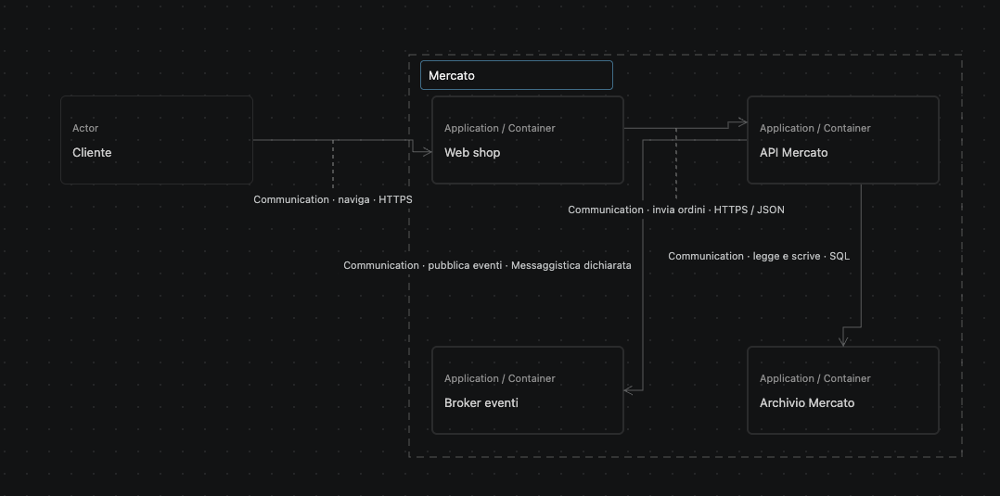

#### Elementi

| Elemento | Uso corretto |
| --- | --- |
| Sistema soggetto/confine | Il sistema che possiede i container; deve essere visibile nella configurazione |
| Application / Container | Applicazione, service, SPA/mobile, store o messaging; assegna responsabilità e runtime pertinenti |
| Data Store | Archivio dichiarato, se è il ruolo che vuoi rappresentare; evita un duplicato del container store già esistente |
| Resource | Risorsa di contesto ammessa dal picker; usala se chiarisce una dipendenza di dominio |
| Actor / External Software System | Contesto che usa o è usato dalle applicazioni, conservando lo scope esterno |

L’ownership è un dato del blueprint: le schede interne sono possedute da Mercato. Trascinarle nel rettangolo non assegna il proprietario. Tecnologia e ambiente vanno dichiarati solo se conosciuti o esplicitamente progettati.

#### Collegamenti, procedura e controllo

Le comunicazioni di Mercato sono HTTPS dal Cliente al Web shop, HTTPS / JSON dal web all’API, SQL dall’API all’archivio e una pubblicazione verso il broker. Il nome della freccia esprime l’intento; il protocollo esprime il mezzo dichiarato. Se due oggetti sono collegati solo per dipendenza architetturale, non inventare protocollo o porta.

Dal form C4 scegli L2, soggetto Mercato, contesto Cliente e i visibili: soggetto, quattro container e attore. Nel blueprint imposta i runtime e l’ownership, poi collega gli oggetti. Posiziona il contesto fuori dal confine. Leggi D4 per il dettaglio interno dell’API e D10 per la sua collocazione.

**Controllo:** ogni container ha una responsabilità e un proprietario; applicazione e host restano distinguibili; un archivio non appare due volte come se fossero due sistemi reali. La vista non esegue installazioni, provisioning, comunicazioni o migrazioni.

### D4. C4 Component: l’interno di un’applicazione

#### Quando e perché usarlo

C4 Component risponde a **“come è organizzato internamente questo container?”**. Usalo quando il livello applicazioni è troppo generico per discutere responsabilità, dipendenze e contratti. Non occorre un diagramma per ogni applicazione: il [riferimento C4 Component](https://c4model.com/diagrams/component) suggerisce di usarlo quando aggiunge valore alla comunicazione.

La vista **04 C4 Componenti API** sceglie API Mercato come soggetto. Checkout, Registro esiti, Gestione resi e Scorte ne sono responsabilità interne. Scorte gestisce la disponibilità a livello applicativo; Archivio Mercato è invece la persistenza. Il contratto posseduto da Checkout viene selezionato esplicitamente nel contesto della proiezione: leggi l’ownership, non dedurla solo dalla posizione.

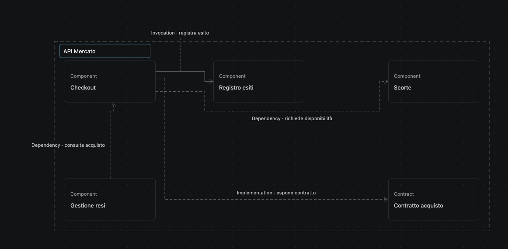

#### Elementi e ownership

| Elemento | Come interpretarlo |
| --- | --- |
| Container soggetto | L’applicazione di cui stai mostrando l’interno; qui API Mercato |
| Component | Responsabilità interna, come Checkout e Registro esiti |
| Controller | Coordinamento interno quando tale ruolo è più preciso del generico componente |
| Resource | Oggetto/risorsa necessario al dettaglio, senza convertirlo automaticamente in classe o tabella |
| Contract / Interface Contract | Contratto condiviso o interfaccia delle responsabilità; operazioni e tipi si completano nel blueprint |
| Context Container e altre dipendenze ammesse | Oggetti esterni al soggetto, dichiarati nel contesto invece di riassegnarli al container |

La soluzione mantiene anche interfacce richieste e fornite per Scorte nel blueprint. Non tutte devono apparire nel canvas: una vista seleziona ciò che aiuta la domanda corrente.

#### Collegamenti e uso

Dependency “richiede disponibilità” collega Checkout a Scorte; Invocation “registra esito” lo collega a Registro esiti; Implementation esprime l’esposizione del Contratto acquisto; Gestione resi dipende da Checkout. Queste relazioni descrivono il rapporto; il controllo di compatibilità fra operazioni richiede porte, tipi e binding espliciti.

Crea il livello L3 dal form C4, scegli API Mercato, contesto pertinente e visibili incluso il soggetto. Dichiara i proprietari in Architectural or Lifecycle Owner e riusa le identità già presenti. Salva e controlla il confine anche in lettura testuale.

**Controllo:** nessun componente diventa un container solo per cambiare forma; nessuna dipendenza esterna viene trascinata nel sistema governato. Se il problema è l’interfaccia fra moduli piuttosto che il perimetro di un’applicazione, usa anche UML Component (D13).

### D5. ERD: concetti, attributi e cardinalità

#### Quando e perché usarlo

L’ERD risponde a **“quali concetti dati esistono e quali legami devono rispettare?”**. Usalo per concordare il dominio prima di decidere nomi di tabelle o dettagli del database. È particolarmente utile quando due persone danno significati diversi alla stessa parola: un ordine, una sua riga e una richiesta di reso hanno identità e vincoli differenti.

Apri **05 Entità e cardinalità**: Cliente, Ordine, Riga ordine, Prodotto e Reso mostrano attributi essenziali. L’ERD del laboratorio è logico; non sostiene che esista già un database con quella struttura.

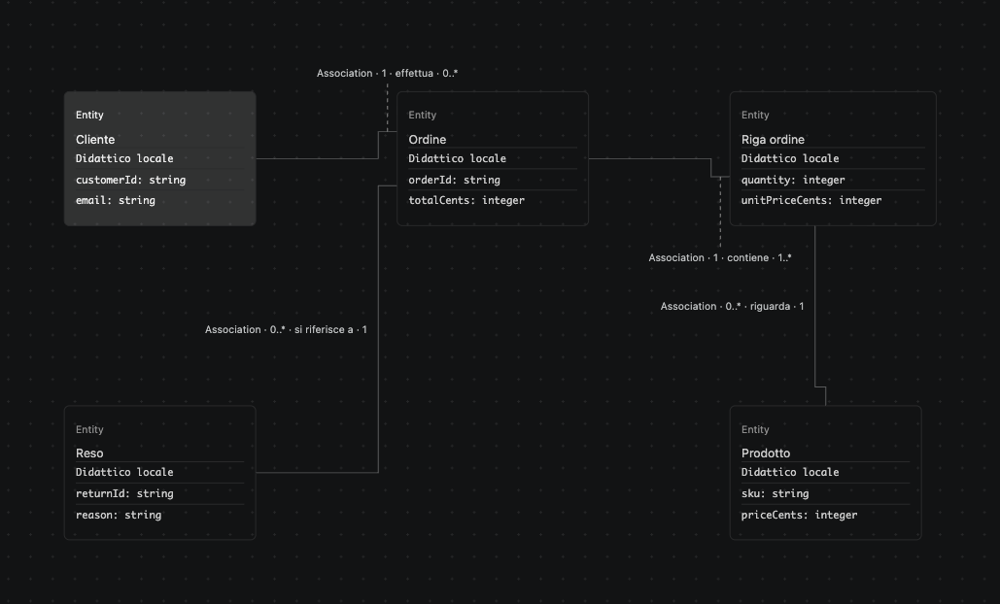

#### Elementi e membri

| Elemento/dettaglio | Significato |
| --- | --- |
| Entity | Concetto logico con identità, come Prodotto; scegli nomi singolari coerenti |
| Resource | Risorsa ammessa dalla notazione, utile se già definita; decidi se è davvero lo stesso oggetto prima di riusarla |
| Attributo | Dato caratteristico dell’entità: quantity appartiene alla Riga ordine, non al Prodotto |
| Tipo | Dominio del valore; testo e intero sono diversi anche quando il valore visualizzato è “42” |
| Presenza e nullabilità | Campo richiesto/facoltativo e valore null ammesso/vietato sono due proprietà distinte |

Un attributo non deve diventare una nuova entità solo per comparire. Viceversa una lista di righe con quantità e prezzo proprio merita un’entità distinta: inserirla come testo libero dentro Ordine nasconde i vincoli.

#### Legami e cardinalità

Association nomina un legame; ove pertinenti la notazione ammette rapporti tutto/parte. Per il laboratorio usa associazioni esplicite. **1** significa esattamente uno; **0..1** nessuno oppure uno; **0..\*** zero o più; **1..\*** uno o più. Il numero vicino a un’entità indica quante istanze di quella entità possono corrispondere all’oggetto all’altro estremo.

“Cliente 1 - Ordine 0..\*” significa che ogni ordine ha un cliente e ogni cliente può avere più ordini. “Riga ordine 0..\* - Prodotto 1” significa che una riga riguarda un prodotto e un prodotto può apparire in molte righe. Il legame Reso verso Ordine dichiara che il reso non è indipendente dall’acquisto.

Crea Entity e membri dalle proprietà, poi collega le identità e modifica le cardinalità. **Controllo:** leggi ogni associazione in entrambe le direzioni. Se una regola non è ancora decisa, segnalala invece di scegliere 1 per comodità. Non interpretare una molteplicità come vincolo già eseguito su record reali; lo schema fisico è D6.

### D6. Database Schema: tabelle e vincoli progettati

#### Quando e perché usarlo

Questa vista risponde a **“come rappresenteremo i dati nella persistenza, con quali colonne e chiavi?”**. Usala dopo aver chiarito il dominio o durante la lettura di schema e migrazioni esistenti. Una proposta di schema deve essere distinta da uno schema verificato sui sorgenti. In Mercato è esplicitamente un progetto didattico SQL, senza DBMS distribuito.

Apri **06 Schema dati progettato**. Le tabelle customers, orders, order_lines, products e returns sono identità differenti dalle cinque entità logiche, anche quando il loro significato è collegato.


#### Elementi e colonne

| Elemento/dettaglio | Come usarlo |
| --- | --- |
| Table | Tabella fisica progettata; nome coerente con le convenzioni del progetto |
| Colonna e tipo | Campo memorizzato e dominio del valore; total_cents intero documenta l’unità monetaria scelta |
| Primary key | Identifica una riga nella tabella; il diagramma ne dichiara il ruolo |
| Foreign key | Colonna di riferimento; collega anche la colonna destinazione reale |
| Unique | Valore o vincolo univoco dichiarato, ad esempio sku; non sostituisce automaticamente la PK |
| Required / Nullable | Presenza richiesta e ammissibilità di null; non confondere “facoltativo” e “vuoto” |
| Data Store / Resource | Archivio o risorsa di contesto ammessi; un archivio può fare da confine facoltativo |

I membri si modificano con Edit Attributes and Technology. Usa i tipi condivisi pertinenti e dichiara ciò che sai. ADE non deduce tutti i dettagli del DBMS da un’etichetta SQL generica.

#### Riferimenti e procedura

Le associazioni fra tabelle riportano membri ai due estremi. orders.customer_id punta a customers.id; order_lines punta a orders.id e products.id; returns.order_id punta a orders.id. Imposta Source Member e Target Member dalle colonne disponibili e poi le molteplicità. Una freccia chiamata “customer_id” senza estremi corretti non documenta una FK completa.

Costruisci prima tabelle e colonne, poi associazioni e riferimenti. Verifica i nomi dei membri dopo una rinomina: un riferimento inesistente deve essere corretto. Usa mapping espliciti per legare orderId del dominio a orders.id. Non fondere entità, tabella e classe per evitare il lavoro del mapping.

**Controllo:** quattro riferimenti validi, PK riconoscibili, nullabilità dichiarata e unità dei valori comprensibili. Il diagramma non esegue DDL, migrazioni o query e non dimostra che il database attivo rispetti i vincoli. Per questo servono migrazioni e test d’integrazione del progetto.

### D7. Sequence: partecipanti e ordine delle interazioni

#### Quando e perché usarla

Sequence risponde a **“chi interagisce con chi, e in quale ordine dichiarato, in questo scenario?”**. Usala per una conferma d’acquisto, una richiesta di reso o un caso d’errore specifico. È utile quando un flusso sembra semplice ma il punto preciso di una lettura, scrittura o risposta cambia il risultato.

Apri **07 Sequenza acquisto**: Cliente richiede la conferma a Checkout; Checkout invoca Pagamenti esterni; poi scrive Ordine con condizione di autorizzazione. La sequenza sceglie un livello di coordinamento e semplifica il canale web. Non è una traccia temporale misurata in produzione.

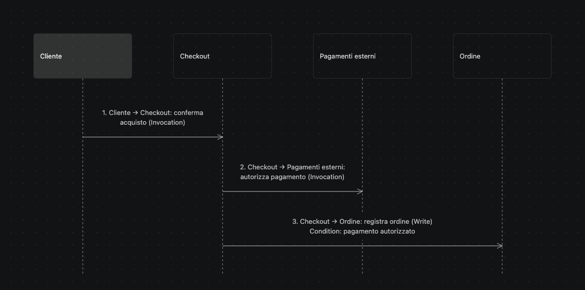

#### Elementi e messaggi

| Elemento | Significato |
| --- | --- |
| Partecipante | Identità che invia o riceve; attore, responsabilità, interfaccia o risorsa compatibile |
| Linea di vita | Colonna che mantiene riconoscibile il partecipante durante lo scenario; non implica un thread o processo dedicato |
| Messaggio | Interazione con origine, destinazione, tipo e nome; l’indice è l’ordine locale dichiarato |
| Read / Write | Accesso a una risorsa; distingue una consultazione da un aggiornamento |
| Condizione | Presupposto dichiarato del messaggio; la sua prosa non è ancora una guardia compilabile |
| Occorrenza / frame, nei modelli pertinenti | Un evento distinto o un gruppo comportamentale; chiamate ripetute non condividono automaticamente lo stesso risultato |

I partecipanti non sono copie degli elementi: riusali con Add Existing Element. Includere una relazione come messaggio non deve creare un duplicato se il significato è lo stesso. Nelle proprietà puoi ordinare partecipanti e messaggi o togliere un messaggio soltanto dalla sequenza.

#### Descrittiva ed eseguibile

Nel modello descrittivo v5 le occorrenze distinguono chiamate, alternative e vincoli d’ordine dichiarati. Nel modulo eseguibile di L13 ogni chiamata dichiara operazione, argomenti, sincronismo, risultati, errori e risposta simulata. I frame alt, opt, loop, par, critical e ref hanno contratti e limiti propri. Non disegnare una guardia testuale aspettandoti che diventi automaticamente un ramo verificabile.

Crea la vista, riusa i quattro partecipanti, includi i tre messaggi e ordina esplicitamente. Per aggiungere un caso negativo, descrivilo come scenario distinto o con le strutture pertinenti, mantenendo chiaro quale ordine è certo e quale è sconosciuto.

**Controllo:** puoi leggere ogni freccia ad alta voce con mittente, destinatario, contenuto e condizione. Il tempo scorre dall’alto in basso nell’ordine dichiarato, ma la distanza verticale non misura millisecondi. Per decisioni indipendenti dai partecipanti usa Activity; per lo stato persistente dell’ordine usa State Machine.

### D8. Activity / Flowchart: passi e alternative

#### Quando e perché usarla

Questa è una sola notazione del catalogo ADE. Risponde a **“quali passi compongono il comportamento e come cambia il percorso in base alle condizioni?”**. Usala per discutere una procedura con persone di ruoli diversi, evidenziare esiti mancanti e definire cosa deve accadere prima di cosa. Non richiede di scegliere subito classi e servizi.

Apri **08 Flusso acquisto**: validazione, verifica disponibilità, pagamento, conferma/rifiuto e conclusione. Nel tour il flusso del rimborso è più piccolo, ma usa lo stesso principio: un’alternativa deve avere un significato leggibile.

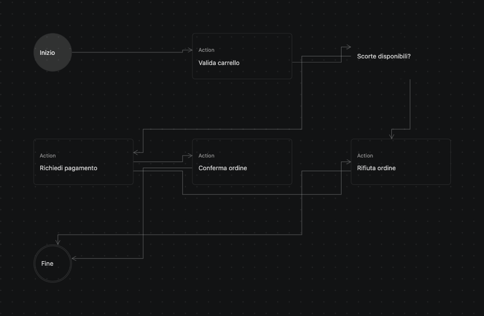

#### Elementi

| Elemento | Come nominarlo e interpretarlo |
| --- | --- |
| Start | Ingresso della procedura, ad esempio Inizio; chiarisci il trigger nella descrizione |
| Action | Passo con un verbo: Valida carrello, Richiedi pagamento; non uno stato come “Pagato” |
| Decision | Domanda o scelta: Scorte disponibili?; ogni uscita deve dire quando è percorribile |
| End | Esito/termine del percorso; non lasciare sospesa una via negativa involontariamente |
| Responsabilità e risorse compatibili | Contesto aggiuntivo quando serve capire chi esegue o cosa viene usato; evita di farlo competere con il flusso |
| Control Flow | Collegamento che guida il percorso fra passi e decisioni |

Le frecce devono avere condizioni comprensibili: disponibili/non disponibili, autorizzato/rifiutato. Due uscite entrambe chiamate “continua” non chiariscono la scelta. Se le condizioni possono sovrapporsi, decidi priorità o esclusività nel contratto pertinente.

#### Costruzione e controllo

Crea prima il percorso principale da Start a End; aggiungi la decisione sulle scorte e poi il ramo di rifiuto. Collega gli esiti del pagamento. Usa la lettura testuale per seguire tutte le relazioni, anche quando il routing si incrocia. Spostare i nodi migliora la lettura, ma non definisce un’espressione o un ordine eseguibile.

L’Activity descrittiva non è automaticamente un workflow eseguibile. Per alternative, concorrenza, ripetizioni e sotto-interazioni verificabili usa i costrutti del profilo di L13: non inferire fork/join o temporizzazione da due frecce disegnate in parallelo.

**Controllo:** ogni ramo conduce a un esito intenzionale; azioni e stati hanno nomi diversi; una decisione ha condizioni che un lettore sa valutare. Se il problema è chi invia il messaggio, aggiungi Sequence; se è la condizione stabile dopo il passo, aggiungi State Machine.

### D9. State Machine: il ciclo di vita di una risorsa

#### Quando e perché usarla

State Machine risponde a **“in quali condizioni può trovarsi questo oggetto e quali eventi gli fanno cambiare stato?”**. Usala per ordini, richieste di reso, prenotazioni e ogni oggetto per cui un’azione è ammessa soltanto in alcune fasi. Aiuta a riconoscere transizioni illegali e differenze fra tentativo, autorizzazione e completamento.

Apri **09 Stati ordine**: la risorsa Ordine possiede In attesa, Confermato e Rifiutato. Il diagramma del tour per Richiesta di reso distingue invece Richiesto, Autorizzato, Rimborsato e Rifiutato. Sono lifecycle di risorse diverse, non un unico elenco di tutti gli stati del negozio.

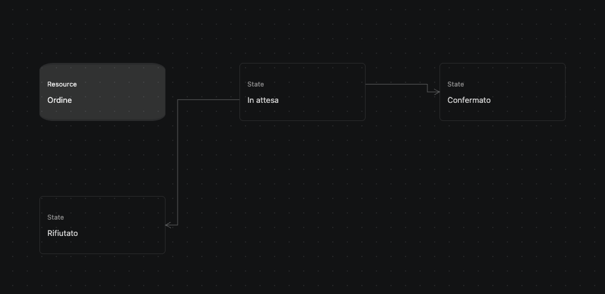

#### Elementi e dettagli

| Elemento/dato | Significato |
| --- | --- |
| Risorsa/proprietario lifecycle | L’oggetto di cui stai descrivendo il ciclo; deve essere esplicito |
| Stato | Condizione dell’oggetto, non attività; “Confermato” si distingue da “Conferma ordine” |
| Transizione | Passaggio da uno stato a un altro con evento/condizione pertinenti |
| Evento | Occorrenza che può attivare il passaggio; nel profilo eseguibile ha payload tipizzato |
| Guardia | Condizione che abilita la transizione; testuale nella descrizione, espressione formale nel contratto eseguibile |
| Azioni ed errori | Effetti associati al passaggio o al lifecycle, nei form e profili che li supportano |

Nel diagramma descrittivo gli stati sono figli della risorsa. Nel contratto eseguibile si dichiarano stato iniziale, finali, eventi, priorità, transizioni interne/esterne e azioni entry/exit/do. Una self-transition interna non ripete lo stesso ciclo di uscita e ingresso di una esterna.

#### Uso e verifica

Crea la State Machine scegliendo Ordine, aggiungi gli stati con Add State e collega le transizioni. Dai nomi a eventi ed esiti. Per il modulo eseguibile usa Edit Executable State Machine e i casi di L14; Simulate State Machine restituisce fasi, eventi accettati/rifiutati e stato finale.

**Controllo:** tutti gli stati appartengono al lifecycle corretto; un ordine già confermato non torna in attesa senza un evento previsto; il caso negativo è modellato. La figura non osserva ordini vivi. Il profilo corrente supporta macchine piatte, senza stati compositi o regioni ortogonali. Se servono retry e consegne, completa la policy di messaggistica invece di inventare stati non motivati.

### D10. Deployment: dove collochiamo software e dati

#### Quando e perché usarlo

Deployment risponde a **“quali nodi o ambienti ospitano le parti distribuibili del sistema?”**. Usalo quando la collocazione conta: separazione del web e dell’API, persistenza, confini di ambiente, artefatti distribuiti. È una prospettiva diversa da C4 Container: un’applicazione descrive responsabilità; un host descrive collocazione.

Apri **10 Distribuzione locale progettata**. Host Web ospita Web bundle; Host API ospita API ESM e API Mercato; Host dati ospita Archivio Mercato. “Locale progettata” è parte del nome per mantenere visibile la natura didattica del disegno.


#### Elementi e proprietà

| Elemento | Significato e attenzione |
| --- | --- |
| Deployment Node | Macchina, processo/ambiente o nodo di esecuzione dichiarato; specifica cosa rappresenta nel tuo progetto |
| Artifact | Prodotto distribuito, come bundle o modulo ESM; distinto dalla responsabilità applicativa |
| Container / applicazione | Parte del sistema ospitata; riusa l’identità architetturale quando è la stessa |
| Archivio / risorsa compatibile | Dati o servizio di persistenza collocati nel nodo pertinente |
| Ambiente e tecnologia | Informazioni dichiarate dell’oggetto; non indicare “produzione” o un cloud se non hai una decisione/evidenza |
| Hosts | Collegamento dall’ospitante all’ospitato; esprime collocazione, non invocazione |

I tipi meno comuni si trovano nelle categorie Architecture, Data e Infrastructure del picker. Non rappresentare un database come Artifact se intendi il servizio che persiste i dati; usa il ruolo pertinente e, se utile, un artefatto separato per la sua distribuzione.

#### Costruzione e controllo

Definisci gli host, aggiungi artifact e applicazioni esistenti e collega con Hosts. Completa ambiente e tecnologia dalle proprietà. Usa Change Boundary or Parent per il contenimento semantico quando pertinente; mantieni coerente la collocazione dichiarata senza presumere che spostare una scheda aggiorni i dati.

**Controllo:** per ogni applicazione sai indicare il luogo previsto e distinguere nodo, software e dati. Non presentare un deployment progettato come inventario osservato. La vista non avvia servizi né fornisce provisioning o discovery. Per protocolli e confini di comunicazione usa anche Network (D16).

### D11. Class: tipi, membri e relazioni del software

#### Quando e perché usarlo

Class risponde a **“quali tipi strutturano il software e quali contratti o relazioni li collegano?”**. Usalo per chiarire un dominio ricco, un’interfaccia o una collaborazione fra pochi tipi. Non copiare automaticamente ogni classe del repository: un diagramma con centinaia di dettagli non aiuta a prendere decisioni.

Apri **11 Classi e repository**. CheckoutService dipende da Order e da OrderRepository; Order contiene orderId, totalCents e confirm; l’interfaccia espone save. Il risultato testo dei metodi è illustrativo; il contratto eseguibile completo deve usare input e risultati tipizzati nel blueprint.


#### Elementi e compartimenti

| Elemento/dettaglio | Interpretazione |
| --- | --- |
| Class | Tipo concreto o progettato; nome distinto dall’istanza di dominio |
| Interface Contract | Contratto che un’implementazione può fornire; stesso oggetto riusabile in UML Component |
| Attributo | Dato del tipo, con nome, tipo, obbligatorietà e nullabilità pertinenti |
| Metodo | Operazione esposta dal tipo; nome e tipo/firma dichiarati, con ruolo Method |
| Tecnologia e ambiente | Contesto dichiarato della rappresentazione; non trasformano da soli il disegno in sorgente |

Usa Edit Attributes and Technology per aggiungere o rimuovere membri. Distingui Attribute e Method. ADE conserva firme differenti per overload; non creare due membri identici per rappresentare la stessa operazione. Nel caso semplice del laboratorio inserisci confirm, submit e save come nomi, senza duplicare le parentesi visualizzate.

#### Collegamenti

Association descrive un legame; Dependency un uso. Inheritance va dalla classe specializzata al tipo generale; Implementation dall’implementazione all’interfaccia. Composition rappresenta una relazione tutto/parte forte legata al ciclo di vita; Aggregation una relazione tutto/parte più debole. Sceglile per il significato, non per abbellire il collegamento. Le molteplicità descrivono quanti oggetti possono partecipare.

Crea le due classi e l’interfaccia, aggiungi i membri, poi le dipendenze. Confronta l’Order di questa vista con l’entità e la tabella: sono rappresentazioni distinte, collegate da mapping espliciti quando necessario.

**Controllo:** ogni membro è nel tipo giusto; una dipendenza non viene scambiata per ereditarietà; le firme sono leggibili. La figura non analizza automaticamente ogni differenza del codice e non implementa metodi. L’importazione e le evidenze di L16 sono il percorso per confrontare la descrizione con i sorgenti reali.

### D12. Use Case: obiettivi degli attori

#### Quando e perché usarlo

Use Case risponde a **“quali obiettivi raggiunge ciascun attore con il sistema?”**. Usalo per concordare il perimetro funzionale con utenti e stakeholder. È utile prima di progettare le schermate: “Richiedere reso” è un obiettivo; “aprire la terza modale” è una scelta d’interfaccia.

Apri **12 Casi d’uso**. Cliente può confermare un acquisto e richiedere un reso; Assistenza gestisce il reso. Il pagamento è incluso nella conferma, mentre il coupon estende la conferma solo quando presente. Quest’ultimo è un esempio progettato opzionale, non codice già pronto nel pacchetto.


#### Elementi

| Elemento | Uso |
| --- | --- |
| Actor | Ruolo che partecipa all’obiettivo; una persona può ricoprire più ruoli |
| Use Case | Capacità con un risultato per l’attore, chiamata con verbo e oggetto |
| Software System / confine | Sistema cui appartengono i casi; distingue interno ed esterno |
| Association | Partecipazione dell’attore; non è un ordine temporale di esecuzione |
| Include | Dal caso base al comportamento sempre incluso |
| Extend | Dal comportamento aggiuntivo verso il caso base, con condizione di estensione |

Il proprietario dei casi è Mercato. Gli attori rimangono esterni al confine del prodotto anche se le loro schede sono vicine. Se il diagramma non mostra il confine come scheda, consulta il contenimento nelle proprietà e nella lettura testuale.

#### Procedura e significato delle frecce

Aggiungi i due attori esistenti e i quattro casi. Associa Cliente a Confermare acquisto e Richiedere reso, Assistenza a Richiedere reso. Disegna Include da Confermare acquisto ad Autorizzare pagamento. Disegna Extend da Applicare coupon a Confermare acquisto e assegna “coupon presente”. Invertire quest’ultima freccia inverte chi estende chi.

Non usare Include per dire “prima” e Extend per dire “dopo”. Il diagramma non specifica il numero di schermate né il dettaglio dei controlli; per il percorso usa Activity e Sequence, per i requisiti verificabili contratti e casi Given/When/Then.

**Controllo:** ogni caso rappresenta un obiettivo e ha un attore o un rapporto funzionale motivato; le azioni interne al database non compaiono come obiettivi del Cliente. Chiarisci le eccezioni nelle descrizioni o nei flussi complementari, senza inserire nel diagramma ogni piccolo passo dell’interfaccia.

### D13. UML Component: responsabilità e contratti

#### Quando e perché usarlo

Questa vista risponde a **“quali componenti forniscono o usano quali interfacce?”**. Usala quando vuoi discutere sostituibilità, contratti pubblici e dipendenze fra moduli. Si affianca a C4 Component: qui l’enfasi è sui rapporti fra componenti e interfacce, non sul dettaglio di un unico container soggetto.

Apri **13 Componenti e interfacce**. Checkout espone Contratto acquisto; Registro esiti fornisce OrderRepository. L’interfaccia è la stessa usata nella vista Class. La sua visualizzazione non è una seconda definizione.


#### Elementi e binding

| Elemento | Ruolo nella vista |
| --- | --- |
| Component | Unità di responsabilità con un confine di interfaccia |
| Contract | Definizione condivisa del contratto, come Contratto acquisto |
| Interface Contract | Interfaccia con operazioni/membri, come OrderRepository |
| Application / Container | Contesto applicativo ammesso quando aiuta a collocare i componenti |
| Porte e operazioni nel blueprint | Interfacce richieste/fornite e binding effettivi da dichiarare separatamente dal solo collegamento grafico |

I simboli e le etichette del canvas esprimono il sottoinsieme offerto da ADE; non occorre introdurre una notazione lollipop manuale per usare i contratti. Nel blueprint completa input, risultati, errori, effetti, permessi e criteri delle operazioni pertinenti.

#### Collegamenti e controllo

Implementation va dal componente che fornisce al contratto fornito; Dependency indica chi usa un contratto o un’altra responsabilità. La freccia “fornisce persistenza” di Registro esiti non dimostra che esista un adapter funzionante né che tipi e policy siano già compatibili.

Crea la vista e aggiungi le quattro identità esistenti. Riusa l’Implementation verso Contratto acquisto se già presente e crea quella verso OrderRepository. Per rendere verificabile il collegamento, dichiara porte richieste/fornite, mapping delle operazioni e tipi nel blueprint; consulta le diagnostiche prima della review.

**Controllo:** il contratto appartiene al provider giusto; consumer e provider sono distinti; non confondi Interface Contract con Pagina acquisto. Se cambi una firma condivisa, consulta Show Change Impact e controlla i consumer. Un diagramma può essere leggibile e salvabile pur non essendo ancora pronto alla generazione.

### D14. Package: moduli e direzione delle dipendenze

#### Quando e perché usarlo

Package risponde a **“come raggruppiamo il software e da quali moduli dipende ogni gruppo?”**. Usalo per discutere layer, confini organizzativi e direzione delle dipendenze. È adatto anche a un’applicazione singola: non richiede microservizi né una distribuzione separata per ogni package.

Apri **14 Moduli applicativi**. Applicazione usa le regole di Dominio; Adapter implementa contratti del Dominio e collega i casi applicativi. Il dominio non dipende dagli adapter: è la scelta didattica che il diagramma rende facile controllare.


#### Elementi e confini

| Elemento/dato | Significato |
| --- | --- |
| Package | Modulo, namespace o layer semantico non distribuibile; il nome deve dire quale raggruppamento stai usando |
| Descrizione | Responsabilità del gruppo, contenuto incluso/escluso e criterio di raggruppamento |
| Contenimento | Relazione organizzativa con altri elementi ove dichiarata; non equivalente a un semplice trascinamento |
| Dependency | Uso di un altro gruppo; la direzione va dal dipendente al gruppo usato |

Il picker di questa notazione propone Package. Non usare un Container per ottenere una scheda più visibile: cambierebbe il ruolo semantico. Il package Dominio non è automaticamente una cartella chiamata domain; per legarlo ai sorgenti servono mapping o evidenze pertinenti.

#### Costruzione e lettura

Crea tre package con Add Element. Collega Applicazione verso Dominio “usa regole”; Adapter verso Dominio “implementa contratti”; Adapter verso Applicazione “collega esterni”. Dai alle frecce nomi che spieghino perché la dipendenza esiste. Se una dipendenza ha entrambe le direzioni, chiediti se stai nascondendo un ciclo o usando un raggruppamento troppo ampio.

Un vincolo ADR può rendere esplicita una regola sulle dipendenze, ma la sola scelta grafica non impone una regola al compilatore. Un ciclo osservato nel codice richiede un’analisi del codice; un ciclo nel disegno indica ciò che hai dichiarato.

**Controllo:** sai spiegare la differenza fra package e servizio; ogni dipendenza ha un motivo; un lettore riconosce il nucleo e le parti esterne. Usa Class per i tipi interni, UML Component per i contratti e C4 Container per le applicazioni distribuibili.

### D15. Data Flow: dati, trasformazioni e archivi

#### Quando e perché usarlo

Data Flow risponde a **“quali informazioni entrano, come vengono trasformate e dove finiscono?”**. Usalo per seguire dati sensibili, dati di ordine, fonti di prezzo o risultati di un processo. Aiuta quando una vista di chiamate mostra molto movimento ma non chiarisce che cosa attraversa il sistema.

Apri **15 Dati dell’acquisto**. Il Cliente fornisce dati acquisto; Elabora ordine consulta prezzi e disponibilità da Dati catalogo, scrive l’ordine confermato in Dati ordini e restituisce l’esito al Cliente. Le due frecce fra Cliente e processo portano dati diversi e hanno direzioni diverse.

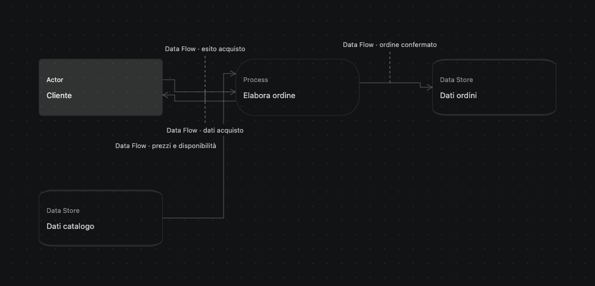

#### Elementi

| Elemento | Significato |
| --- | --- |
| Actor / Software System | Origine o destinatario esterno dei dati nella prospettiva scelta |
| Process | Trasformazione con input e output, ad esempio Elabora ordine; non un processo del sistema operativo |
| Data Store | Archivio logico da cui leggi o in cui scrivi; non richiede già una tabella fisica |
| Resource | Oggetto di dominio compatibile da usare quando chiarisce i dati rappresentati |
| Data Flow | Trasferimento nominato del dato, con direzione origine verso destinatario |

Scegli nomi di dato sulle frecce: “dati acquisto”, “prezzi e disponibilità”, “ordine confermato”. Un’etichetta “esegui” non dice quale informazione passa. Il processo dovrebbe spiegare la trasformazione e non funzionare come un generico nodo di smistamento senza responsabilità.

#### Costruzione e controllo

Aggiungi il Cliente esistente, il processo e i due archivi; collega prima l’ingresso e il risultato, poi le due persistenze. Mantieni il livello coerente: se vuoi dettagliare Elabora ordine, costruisci una seconda prospettiva con trasformazioni più piccole e rendi riconoscibili gli stessi ingressi/uscite.

Non interpretare le frecce come una cronologia completa: l’ordine temporale richiede Sequence o Activity. Una lettura dall’archivio e una risposta al Cliente non dimostrano che sia stata aperta una connessione reale. I tipi, la presenza e i vincoli sui payload vanno nei contratti.

**Controllo:** ogni processo ha ingressi/uscite motivati; distingui dati di catalogo e dati di ordine; le etichette non sono nomi generici di azioni. Se vuoi capire tabelle e FK apri Database Schema; se vuoi capire il protocollo di rete apri Network.

### D16. Network / Infrastructure: connessioni e confini

#### Quando e perché usarlo

Questa vista risponde a **“quali nodi o applicazioni possono comunicare, attraverso quali confini e con quali protocolli dichiarati?”**. Usala per ragionare su raggiungibilità prevista, esposizione dei servizi e separazione fra parti dell’infrastruttura. Il suo valore dipende dall’esplicitare la provenienza delle informazioni: configurazione osservata oppure scelta progettata.

Apri **16 Connessioni progettate**. Rete client raggiunge Web shop e il confine della Rete backend; il backend espone API Mercato, che comunica con Archivio Mercato. HTTPS 443 e SQL sono dichiarazioni dell’esempio. La vista non rappresenta una scansione della macchina o una configurazione applicata.


#### Elementi e dettagli

| Elemento | Uso |
| --- | --- |
| Network Node | Nodo/confine di rete, come Rete backend; descrivi se è una zona, una rete o un endpoint concettuale |
| Deployment Node | Host/nodo di esecuzione quando la connessione richiede quel livello di dettaglio |
| Application / Container | Servizio, client o archivio che comunica; riusa le identità delle altre viste |
| Software System | Sistema interno o esterno coinvolto nella connessione |
| Protocollo e ambiente | Mezzo/contesto dichiarati, con versione o porta nel testo pertinente se note |
| Communication | Collegamento direzionale con intento e protocollo; non una regola firewall eseguita |

Non aggiungere un nodo cloud, CDN, VPC o database remoto solo perché è frequente in altri progetti. Se la fonte non lo dice, lascia la scelta aperta. Una rete e un’applicazione non sono lo stesso tipo di oggetto: il confine di rete descrive dove passa la comunicazione, il container chi la effettua.

#### Procedura e controllo

Crea i due Network Node, aggiungi Web shop, API Mercato e Archivio Mercato esistenti. Collega gli estremi con Communication e completa i protocolli da Edit Cardinalities and Protocol. Indica nella descrizione che la topologia è progettata; se stai importando configurazioni reali, conserva le evidenze e il perimetro osservato.

**Controllo:** ogni collegamento dice chi comunica e come; le porte ignote non vengono inventate; le frecce non sono presentate come certificazione di sicurezza o disponibilità. Per collocazione degli artifact usa Deployment; per responsabilità del prodotto usa C4. Nessuna di queste viste esegue automaticamente provisioning, discovery, test di penetrazione o distribuzione.


## Appendici operative


### A1. Installazione e avvio

Se ADE è già installato e funzionante, torna a T1. Per l’avvio dai sorgenti servono Git, Python 3, gli strumenti di compilazione della piattaforma e la versione Node indicata nel file `.nvmrc` del clone. In questa revisione è Node **24.22.1**. Bun serve soltanto se scegli il relativo profilo eseguibile.

#### macOS e Linux

Clona il repository in una cartella dedicata oppure aggiorna un clone pulito. Chiudi l’istanza di sviluppo prima di aggiornare dipendenze e build. Con nvm, dalla radice del clone:

```sh
git clone https://github.com/FrappaF/ADE.git
cd ADE
nvm install
nvm use
npm run ade:setup
./ade/scripts/dev.sh
```

`ade:setup` prepara dipendenze, client, motori locali, estensioni ed Electron. Il primo avvio richiede una connessione per gli artifact scaricati. Per gli avvii successivi bastano `nvm use` e `./ade/scripts/dev.sh`. Puoi aggiungere al comando il percorso della cartella di un progetto.

Su macOS verifica gli strumenti con `xcode-select -p`, `xcrun --find clang` e `python3 --version`. Se mancano i Command Line Tools, usa `xcode-select --install` e completa l’installazione. Su Debian/Ubuntu servono i pacchetti di compilazione e le librerie desktop elencati nella [preparazione del fork](../fork-development.md#da-un-clone-pulito). La stessa pagina descrive i prerequisiti Windows e l’avvio con `scripts\code.bat`.

Dopo un aggiornamento da Git, seleziona nuovamente Node e riesegui `npm run ade:setup`. Il semplice riavvio non ricompila sempre i sorgenti cambiati. Il controllo dei tipi e le suite del repository sono strumenti per sviluppare ADE; non servono per usare i progetti di questa guida.

#### Account e dati necessari

Per disegnare, salvare, importare sorgenti, simulare i casi e usare i profili deterministici non serve un account IA. Per conversazioni, interpretazione architetturale e implementazioni assistite devi configurare il provider richiesto dall’azione. Il sezione L17 spiega la distinzione fra connessione, modello e budget.

Usa **Manage Workspace Trust** nella palette per consultare la fiducia della cartella. Le operazioni che avviano CLI o test possono richiedere un workspace attendibile. Accorda fiducia alle copie degli esempi che hai estratto e controllato; un progetto importato può contenere comandi eseguibili propri.


### A2. File, workspace, editor e terminale

Apri **Progetto > Show IDE**, oppure **Project Settings > Developer Tools** per Files, Terminal, Debug e Git. Files apre il workspace del progetto. Terminal crea un nuovo terminale nella sua root; le sessioni già attive conservano directory e processi.

#### File e workspace

Nell’Explorer crea, rinomina, copia, sposta o elimina file e cartelle dal menu contestuale. Puoi copiare percorsi, rivelare un file nel sistema operativo e consultare timeline e cronologia locale. Apri cartelle e workspace salvati, aggiungi root e dividi gli editor quando devi confrontare più file.

Usa Save As per una copia del documento, Save All per tutti i documenti e l’impostazione Auto Save se adatta al lavoro. Codifica e terminatori sono opzioni del file: cambiarli è una modifica del contenuto fisico. La cronologia locale aiuta a recuperare un file, ma non sostituisce un repository condiviso.

#### Cercare e modificare

| Azione | macOS | Windows / Linux |
| --- | --- | --- |
| Aprire la palette | Cmd+Shift+P oppure F1 | Ctrl+Shift+P oppure F1 |
| Salvare | Cmd+S | Ctrl+S |
| Aprire rapidamente un file | Cmd+P | Ctrl+P |
| Cercare nel file | Cmd+F | Ctrl+F |
| Cercare nel workspace | Cmd+Shift+F | Ctrl+Shift+F |
| Annullare | Cmd+Z | Ctrl+Z |
| Definizione del simbolo | F12, se il provider la supporta | F12, se il provider la supporta |
| Rinominare un simbolo | F2, se supportato | F2, se supportato |

Le associazioni effettive sono consultabili in **Keyboard Shortcuts** e possono essere personalizzate. La rinomina semantica di un simbolo è diversa da cercare/sostituire una parola in tutto il workspace. Prima di una sostituzione globale consulta l’anteprima e limita i percorsi inclusi/esclusi.

L’editor offre più cursori, selezione di occorrenze e colonne, spostamento/duplicazione righe, commenti, indentazione, snippet, folding e wrap. Per comprendere codice usa outline, breadcrumb, definizioni, riferimenti e gerarchie offerte dal servizio del linguaggio. Completamenti, refactoring, quick fix e formattazione dipendono dal provider disponibile.

JS/TS includono il servizio TypeScript; HTML, CSS e JSON hanno i servizi web pertinenti. La colorazione di un linguaggio non installa automaticamente compilatore o debugger. Questo vale anche per Python, Java, C/C++, Go e gli altri linguaggi riconosciuti.

#### Terminale e task

Nel modulo codice di Mercato esegui `npm test` e `npm start`. Puoi aprire più terminali, dividerli, rinominarli, scegliere il profilo shell, cercare nell’output e terminare un processo dai controlli del terminale. La shell integration, quando presente, mostra comandi e relativo stato.

Dalla palette **Tasks: Run Task** avvia uno script o un task riconosciuto. I task possono essere di build/test, dipendenti o in background e usare problem matcher. Avviare un task è una scelta di esecuzione; l’importazione ordinaria ADE non lo avvia al tuo posto.


### A3. Git, debug e test tecnici

#### Git

Apri **Source Control**. Controlla file modificati e diff, prepara i file o i singoli hunk, scrivi un messaggio e crea il commit. **Push** pubblica i commit sul remoto configurato; richiede account e permessi. **Pull** e la sincronizzazione Git sono operazioni diverse da ADE Sync.

Puoi creare/cambiare branch, consultare cronologia, tag e worktree, usare stash, confrontare revisioni e risolvere conflitti con gli strumenti presenti. Prima di scartare file o ripristinare una revisione leggi il diff. L’undo di una pubblicazione ADE e lo scarto Git proteggono ambiti diversi.

Le pull request complete dipendono da provider o estensioni aggiuntive: la presenza della vista Git non equivale a un client PR completo.

#### Debug tecnico

Apri **Run and Debug** per avviare o collegare un debugger disponibile. Nel progetto JavaScript puoi provare una configurazione Node o un terminale di debug JavaScript, se l’estensione integrata è presente. Inserisci un breakpoint in `calculateTotal`, avvia `src/demo.mjs`, controlla `quantity` e `total` e usa step/continue.

I breakpoint possono essere condizionali, logpoint o altri tipi supportati dall’adapter. Stack, variabili, watch e console appartengono al debugger tecnico. Non esiste ancora un debugger visuale ADE che mostri dal vivo l’esecuzione di tutti i diagrammi.

#### Test tecnici e verifiche ADE

La vista **Testing** scopre ed esegue test soltanto se un provider li espone. Puoi consultare esiti, stack, output e coverage quando disponibili. In assenza di discovery per l’esempio Node, `npm test` nel terminale rimane il percorso diretto.

Un test del progetto, un caso indipendente ADE, una simulazione messaging e la verifica del profilo sono prove diverse. Scegli quella pertinente al comportamento che vuoi validare e registra anche ciò che è rimasto non eseguito.


### A4. Documenti, browser, personalizzazione e integrazioni

#### Documenti e contenuti

Apri un file Markdown e usa **Markdown: Open Preview** o la preview affiancata. Puoi seguire collegamenti, inserire immagini e usare Mermaid e formule nei contesti supportati. Mermaid nella documentazione e il modello semantico ADE sono oggetti distinti: una figura Mermaid non aggiorna automaticamente le identità del progetto.

I notebook richiedono un kernel per eseguire le celle. La lettura del formato IPYNB e dei renderer non installa da sola un ambiente Jupyter. Immagini, audio, video, webview e editor personalizzati dipendono dai formati e dalle estensioni disponibili.

#### Browser

Il browser integrato dell’editor può aprire URL, navigare, cercare, regolare lo zoom e offrire strumenti di sviluppo ed emulazione. Le azioni di condivisione della scheda, screenshot o elementi con l’agente dipendono dall’integrazione attiva. Puoi sempre aprire il risultato dell’applicazione nel browser esterno quando l’azione è disponibile.

#### Personalizzazione ed estensioni

Usa **Preferences: Open Settings (UI)** per impostazioni grafiche, **Color Theme** per il tema e **Keyboard Shortcuts** per i tasti. Le impostazioni possono essere utente, workspace, cartella o linguaggio: controlla il livello prima di cambiarle. I profili separano preferenze ed estensioni per attività diverse.

La vista Extensions mostra estensioni integrate e installate e permette installazione da VSIX e gestione dell’abilitazione. Il prodotto non configura automaticamente il Marketplace Microsoft: disponibilità di gallerie, debugger, kernel e servizi online dipende dalla distribuzione.

Per diagnosticare un problema consulta Problems, Output e i log del servizio pertinente. Mantieni distinta una diagnostica del modello da un errore del parser, del compilatore o dell’estensione.

#### Chat e MCP

La chat generale e quella inline del codice richiedono un provider disponibile. Puoi allegare file/selezioni e altri contesti offerti dall’interfaccia, scegliere modello/modalità e accettare o rifiutare modifiche. È una superficie diversa dalla conversazione temporanea dei diagrammi.

I comandi MCP permettono di aggiungere server, scegliere configurazione utente/workspace, consultarne stato/output e gestire fiducia e strumenti. Avvia server che hai deciso di usare e controlla quali capacità rendono disponibili. La presenza di servizi upstream non significa che tutti siano già configurati per ADE.


### A5. Accessibilità e uso da tastiera

Sul canvas usa Tab per raggiungere gli elementi ed Enter per selezionarli. Le frecce spostano il nodo focalizzato; Shift amplia il passo. Con il focus sullo sfondo, le frecce spostano la vista. **Shift+F10** apre il menu contestuale dell’oggetto focalizzato.

**Diagram > Read** offre la lettura testuale. L’Accessible View nativa descrive elementi, relazioni, condizioni, contratti e struttura pertinente; con una review attiva legge la review. L’aiuto contestuale mostra le associazioni effettive della configurazione. Su macOS i suggerimenti standard comprendono Option+F1 per l’aiuto e Option+F2 per la lettura, quando non rimappati.

Chiudi il lettore con Escape per tornare al contesto. Se preferisci meno suggerimenti cerca la verbosità ADE nelle impostazioni grafiche. Temi chiari, scuri e ad alto contrasto e preferenze di movimento ridotto aiutano ad adattare la presentazione.

La navigazione implementata e i test automatici non costituiscono una certificazione completa VoiceOver/NVDA su tutte le piattaforme. Se un controllo non annuncia nome o stato, annota oggetto, azione, sistema operativo e tecnologia assistiva per la segnalazione.


### A6. Problemi comuni e recupero

| Cosa osservi | Cosa controllare e fare |
| --- | --- |
| Non vedo il mio progetto | Open Project deve puntare alla cartella della copia, non al clone ADE né al solo file di codice |
| Il canvas sembra vuoto | Controlla il diagramma corrente e usa Fit Diagram; cerca l’elemento nella System Map |
| Voglio un elemento già presente | Add Existing Element riusa l’identità; Add Element crea una nuova definizione |
| Ho tolto un nodo ma esiste ancora | È stato rimosso dalla vista; consulta Details/Impact prima dell’eventuale eliminazione dal sistema |
| Non vedo file e terminale | Menu progetto, Show IDE oppure Project Settings > Developer Tools |
| Una voce non compare | Seleziona l’oggetto e la notazione pertinenti; controlla tipo di documento e prerequisiti |
| Il testo viene rifiutato nel caso numerico | Usa un numero intero oppure Different Value Type per un caso negativo intenzionale |
| Una condizione non si può salvare | Il risultato finale del predicato deve essere booleano; completa confronto o logica con tipi compatibili |
| Il modello è salvabile ma non generabile | Risolvi le diagnostiche di readiness su tipi, ownership, criteri, binding e runtime |
| Apply non è disponibile | Leggi lo stato corrente: review incompleta/obsoleta, domande aperte o verifica mancante/fallita |
| Ho cambiato un criterio dopo i test | Prepara e verifica una nuova review; non riusare il vecchio risultato |
| I test sono stati annullati | Riesegui la verifica e attendi un esito completo; annullato non equivale a passato |
| Undo è bloccato da un file | Confronta e conserva le modifiche manuali successive; ripristina solo se è la scelta desiderata |
| L’import non ha prodotto architettura | Source Inventory Ready precede Explore Architecture nel percorso incrementale |
| Un’evidenza è superata | Aggiorna l’analisi; apri il file corrente senza assumere valida la vecchia posizione |
| L’account è connesso ma la richiesta fallisce | Controlla separatamente eseguibile, modello esatto, quota e configurazione del provider |
| È finito il budget | Aumenta esplicitamente quello dell’operazione pertinente; il budget IA strutturato e l’esplorazione sono separati |
| Ho chiuso la chat e non vedo la cronologia | La modale è temporanea; riparti dal piano/bozze persistenti o dalla nuova conversazione |
| Sync non è disponibile | Verifica formato del modello e adapter; l’esplorazione v5 non abilita il percorso legacy |
| Bun manca | Installa la versione del profilo e rendila disponibile all’avvio; ADE non ripiega silenziosamente su Node |
| Non vedo test o un debugger | Verifica il provider/estensione; per l’esempio Node puoi comunque eseguire npm test nel terminale |
| Non riesco a salvare | Leggi l’errore corrente e verifica destinazione, permessi, conflitti e stato del documento; salva una copia se appropriato |

Per segnalare un difetto prepara passi riproducibili, risultato atteso/osservato, versione ADE, sistema operativo, diagramma coinvolto e uno screenshot pertinente. Usa una copia sintetica del progetto quando possibile. I log sono negli strumenti Output e nei comandi di apertura log della palette.


### A7. Garanzie, disponibilità e copertura della guida

| Capacità | Cosa puoi fare oggi | Cosa non implica |
| --- | --- | --- |
| Disegno | Modificare modelli e sedici notazioni nel loro sottoinsieme | Implementazione automatica di ogni forma UML/C4 |
| Importazione | Inventario e analisi dei profili supportati | Esecuzione o comprensione completa di qualsiasi linguaggio |
| Diagrammi IA | Esplorazione, piano, bozze, correzione e review | Prova delle chiamate runtime o infrastruttura realmente installata |
| Chat modello-codice | Chiedere implementazione e test contestuali | Journal/undo deterministico di ogni modifica dell’assistente |
| Worktree | Revisione separata e test Node nel percorso ammesso | Sandbox del sistema operativo o runner universale |
| Profilo eseguibile | Predicati, interazioni, macchine piatte e messaging formalizzati | Corpi arbitrari, framework completi o transazioni distribuite |
| Simulazione | Provare dati, eventi e risposte dichiarati | Monitoraggio di servizi o broker reali |
| Reverse e Sync | Trasformazioni nei sottoinsiemi dichiarati, con review | Ricostruzione illimitata dell’intento da codice arbitrario |
| Dati e runtime | Mapping, schemi rappresentati e piano Node/Bun | Migrazioni automatiche di database o servizi vivi |
| Apply | Scrivere modifiche locali revisionate | Commit, push o deploy |

Gli esempi permettono di provare progettazione e profili locali senza aggiungere servizi. La configurazione IA, gli SDK, gli eseguibili esterni, i kernel e i debugger dipendono dall’ambiente effettivamente installato.

Questa matrice collega le famiglie funzionali del catalogo alle procedure. I comandi di dettaglio dell’editor dipendono dal provider pertinente; non tutte le combinazioni di sistema operativo, estensione e servizio esterno vengono eseguite dal solo progetto di esempio.

| Famiglia | Dove impararla | Disponibilità/prerequisito |
| --- | --- | --- |
| Progetti, salvataggio, recupero, identità, navigazione, mappa | T1-T5; L2; A6 | Locale |
| Elementi, relazioni, proprietà, layout, 16 notazioni | L2-L10; D0-D16 | Locale, compatibilità della vista |
| Contratti, tipi, ownership, porte, mapping, ADR, impatto | L4-L5; L11 | Blueprint valido; readiness da completare |
| Predicati, input tipizzati, casi, review, pubblicazione, undo | L12 | Profilo locale e runtime disponibile |
| Scenari descrittivi, prospettive e interazioni eseguibili | L7; L13; D7-D8 | Dati descrittivi oppure contratto eseguibile esplicito |
| Macchine a stati e messaggistica | L14-L15; D9 | Simulazioni locali; nessun broker richiesto |
| Importazione, scope, evidenze, indici, versioni | L16 | Sorgenti accessibili; servizio semantico pertinente |
| Account IA, conversazioni, diagrammi, benchmark | L17 | Account, CLI/modello e budget espliciti |
| Aggiornamento codice, worktree, Sync e riconciliazione | L18-L19 | Repository/radice pertinenti; provider dove previsto |
| Reverse, migrazione runtime, task e continuità | L20 | Sottoinsieme del profilo e runtime disponibili |
| File, editing, linguaggi, terminale, task | A2 | Servizi del linguaggio e tool locali |
| Git, debug, test e coverage | A3 | Git/remoto, debugger o test provider secondo l’azione |
| Notebook, documenti, media, browser | A4 | Formato, kernel o estensione pertinente |
| Personalizzazione, estensioni, trust, chat e MCP | A1; A4 | Account/SDK/estensioni dove richiesti |
| Accessibilità e presentazione | A5 | Tastiera, lettura testuale e impostazioni del workbench |

Il materiale è stato verificato su ADE nel suo ambiente desktop macOS. Le schermate dell’atlante provengono dall’apertura reale delle 16 viste della soluzione; i profili eseguibili sono quelli dei moduli didattici. Le procedure IA rimangono condizionate e non promettono nomi, numero di bozze o risultati identici tra provider. La documentazione non trasforma una funzione del catalogo condizionata in una capacità sempre disponibile.


### A8. Glossario e riferimenti

| Termine | Significato operativo |
| --- | --- |
| Modello | Definizioni condivise di elementi, relazioni, tipi e comportamenti |
| Vista / diagramma | Prospettiva con notazione e layout sul modello |
| Identità | Riferimento stabile, indipendente da nome e posizione |
| Feature | Capacità o area funzionale del sistema |
| Blueprint | Fondazione architetturale e contrattuale condivisa |
| Ownership | Responsabilità esplicita di sistema, container, componente o lifecycle |
| Contratto | Input, risultati, errori, effetti, permessi e criteri pertinenti |
| Predicato | Condizione pura tipizzata con risultato booleano o indeterminato ammesso |
| Criterio di accettazione | Regola di business dichiarata, spesso Given/When/Then |
| Caso indipendente | Input e atteso scritti dall’autore separatamente dal generatore |
| Evidenza | Collegamento versionato a un fatto o range di sorgente |
| Scenario | Occorrenze, condizioni e ordine dichiarato di un comportamento |
| Bozza | Proposta non ancora applicata al modello pubblicato |
| Review | Contenuto e differenze da leggere prima di un’applicazione |
| Baseline | Stato comune usato per confrontare modello e codice |
| Worktree | Cartella Git separata per una revisione del codice |
| Readiness | Completezza e compatibilità per il target/profilo scelto |
| Apply | Applicazione locale delle modifiche revisionate |
| Reverse | Ricostruzione delimitata di modifiche supportate dal sorgente |
| Recovery | Ripresa controllata di un’operazione interrotta |
| ADR | Decisione architetturale con motivazioni, stato e storia |

La guida descrive l’interfaccia della revisione **2c8d8c23**, pubblicata su main il **14 novembre 2026**. Le schermate sono acquisizioni dell’applicazione con i progetti inclusi. Le etichette possono dipendere da contesto, piattaforma e configurazione dei tasti.

Approfondimenti del repository: [editing visuale](../visual-editing.md), [esploratore semantico](../semantic-explorer.md), [accessibilità](../accessibility.md), [importazione](../code-import.md), [collaborazione IA](../ai-collaboration.md), [riconciliazione](../reconciliation.md) e [profili eseguibili](../diagram-driven-ai/dai-12.md). Questi documenti comprendono anche verbali storici: per il percorso utente corrente parti dai capitoli di questa guida.

Gli esempi sono sintetici e derivano dai modelli dimostrativi del repository ADE e dal laboratorio Bottega. Sono distribuiti con la licenza MIT del progetto. Il pacchetto non contiene account, credenziali, cronologie IA o repository Git personali.

Per approfondire il significato delle notazioni: [C4 System Context](https://c4model.com/diagrams/system-context), [C4 Container](https://c4model.com/diagrams/container), [C4 Component](https://c4model.com/diagrams/component) e [specifica UML 2.5.1 dell’OMG](https://www.omg.org/spec/UML/2.5.1). Questi riferimenti descrivono le notazioni; per le operazioni effettivamente disponibili in ADE valgono i form e i limiti indicati nella guida. ADE non viene presentato come implementazione completa di ogni costrutto UML.
