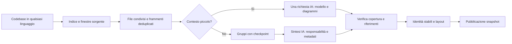

# Generazione semantica: contesto e output compatti

Il modello IA decide responsabilità, aggregazioni, esclusioni e diagrammi. Gli strumenti costruiscono evidenze compatte, verificano le decisioni e producono il documento ADE. Nessun parser decide automaticamente cosa debba diventare un oggetto di dominio.



| Passaggio | Dati e responsabilità |
| --- | --- |
| Evidenze | Dichiarazioni disponibili e intervalli aggiuntivi di testo; HTML, SQL, configurazione e linguaggi senza parser seguono lo stesso protocollo. Ignore e scope continuano a filtrare i file. |
| Compattazione deterministica | Una tabella file contiene percorso, linguaggio e frammenti. Le righe delle unità contengono riferimenti e intervalli, senza hash, percorsi ripetuti o header duplicati. Finestre sovrapposte di classe/metodo condividono il medesimo testo. Gli spazi tra frammenti restano sconosciuti. |
| IA | Produce poche capacità e responsabilità, relazioni supportate dalle evidenze e viste connesse. Può interpretare simboli indicizzati come concetti di dominio: un simbolo non implica un nodo. |
| Copertura | `coverage.targets[i]` assegna la riga `i` a una responsabilità `uN` o `c:key`. Molte righe possono sostenere lo stesso oggetto. `x:key` esclude direttamente la riga; `coverage.exclusions` dichiara una motivazione per chiave. |
| Verifica | Lo schema ha `minItems = maxItems = numero di righe` per il vettore. ADE verifica che le destinazioni esistano, che ogni esclusione rimandi a una motivazione non ambigua, che non siano inventati riferimenti e che gli oggetti e le relazioni compaiano nei diagrammi. |
| Pubblicazione | La conversione risolve i riferimenti, mantiene identità e modifiche manuali e dispone i nodi. Il modello viene pubblicato solo dopo i controlli strutturali e una nuova verifica delle revisioni. |

## Struttura dei dati

Il prompt contiene istruzioni brevi, una legenda e JSON con `format: "compact-v3"`. Le righe di `units` sono `[ref, fileIndex, indexed, name, start, end]`. `indexed` vale 1 quando esiste un simbolo selezionabile; un nome uguale al percorso è sostituito da `null`. Gli intervalli sono offset di stringa JavaScript, quindi unità UTF-16. Sono metadati sul testo, non un vincolo sul linguaggio della codebase. Solo i frammenti effettivamente inviati sono evidenze conosciute.

Esempio della sola decisione di copertura per tre righe: due parti dell'implementazione sostengono il medesimo oggetto Tasks; una terza è bootstrap escluso esplicitamente dall'IA.

```json
{
  "targets": ["c:tasks", "c:tasks", "x:bootstrap"],
  "exclusions": [
    { "key": "bootstrap", "reason": "Bootstrap del framework senza responsabilità applicative" }
  ]
}
```

Non esistono elenchi di indici delle esclusioni da sincronizzare con il vettore: la destinazione `x:bootstrap` identifica direttamente la ragione. Le chiavi possono essere riutilizzate per righe non adiacenti; dichiarazioni identiche sono deduplicate, quelle contraddittorie sono rifiutate. Elementi, concetti, relazioni e diagrammi sono dichiarati una sola volta nelle rispettive collezioni. Per le associazioni non servono motivazioni ripetute: il vettore dichiara già l'aggregazione. Le omissioni dettagliate vengono ricostruite localmente per traceability e checkpoint, senza inventare scelte semantiche.

## Budget e progetti grandi

La scelta fra richiesta unica e gruppi usa la dimensione serializzata delle evidenze compattate. Una richiesta unica ammette fino a 160 unità. I gruppi ammettono fino a 40 unità e si riducono con budget inferiori. Il prompt reale più lo schema vengono controllati ancora prima della CLI: non superano il 75% del budget in byte salvato. Il 25% restante lascia margine per la risposta; è una stima prudenziale, non un calcolo esatto di token né una garanzia sulla finestra del modello. La conferma riporta richieste e limiti in byte.

La sintesi riceve responsabilità già analizzate, interazioni e catalogo compatto, senza reinviare i corpi sorgente. La copertura precedente è un vettore con motivazioni di esclusione raggruppate. Il catalogo mantiene le unità originali per consentire rimappature esplicite. Le descrizioni sono limitate; la lista delle responsabilità inviata alla sintesi rimane limitata a 160 voci e dichiara le eventuali omissioni. Il catalogo e la copertura restano lineari nel numero di unità: se la sintesi eccede il limite, ADE chiede un budget maggiore o uno scope ridotto prima dell'inferenza. Non presume di aver analizzato materiale assente.

Il formato riduce la duplicazione; non certifica qualità, costo o capacità di un modello economico reale. I test con provider simulato verificano protocollo, dimensioni, traceability e pubblicazione, non sostituiscono la valutazione semantica sul progetto dell'utente.

## Errori e ripresa

Un vettore incompleto è rifiutato dallo schema della CLI e dalla validazione locale. Un'esclusione senza motivo o una destinazione sconosciuta riporta la riga e il riferimento coinvolti. ADE non sceglie una destinazione né aggiunge esclusioni per far passare il risultato.

Non ci sono richieste automatiche di riparazione o escalation del modello. **Resume Diagrams** richiede una nuova conferma e riusa i passi completati; al modello viene passato solo un riepilogo dell'errore precedente, fino a 1.200 caratteri. La risposta fallita non viene aggiunta alla conversazione. I checkpoint incompleti creati con il protocollo precedente richiedono **Generation Options → Start Again**; i diagrammi già pubblicati conservano le chiavi riutilizzabili.

## Misura riproducibile

Sul TODO Ruby generato per lo smoke test, con 14 unità e le stesse decisioni simulate:

| Blocco confrontato | Formato esplicito | Formato compatto | Riduzione |
| --- | ---: | ---: | ---: |
| Evidenze | 3.006 byte | 1.794 byte | 40,3% |
| Copertura | 1.037 byte | 277 byte | 73,3% |

Il confronto delle evidenze esclude gli header del formato precedente ed è quindi conservativo rispetto alla duplicazione rimossa. Questi valori misurano i due blocchi, non l'intero prompt, token o addebiti. Lo smoke test desktop `node ade/scripts/smoke-desktop.mjs --semantic-import` salva contesto e misure in `.build/ade-smoke/semantic-todo-context.json` e `semantic-todo-compact-metrics.json`. La [misura registrata](validation/compact-generation-2026-11-06.json) deriva da un provider simulato e conserva i limiti della verifica.
