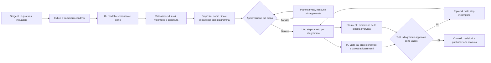

# Generazione semantica: protocollo e prove reali

L’IA sceglie oggetti, capacità, aggregazioni, esclusioni, relazioni e flussi. Gli strumenti preparano le evidenze, espongono le regole ADE, risolvono riferimenti univoci e proiettano il modello dichiarato in un’overview completa.



Il workflow `planned-v1` distingue analisi/proposta e costruzione delle viste. I quattro tipi già supportati in M3 sono struttura, attività, sequenza e stati. L’IA valuta quali sono utili sul progetto; non deve inventare comportamenti per proporli tutti. Nuove notazioni rimangono nella milestone M9.

## Contesto

L’analisi usa ancora `format: "compact-v4"`, con `workflow: "planned-v1"`: mantiene una tabella file con percorso, linguaggio e frammenti, e righe `units` nel formato `[ref, fileIndex, indexed, name, start, end]`. Gli offset sono posizioni UTF-16 del testo, indipendenti dal linguaggio della codebase. I frammenti sovrapposti vengono uniti; gli intervalli non divulgati restano sconosciuti. Header e corpi non vengono ripetuti. Routing, template e linguaggi senza parser seguono lo stesso protocollo delle dichiarazioni indicizzate.

Il contesto include `relationGrammar`, derivata direttamente da `isCompatibleRelation`, e le regole sul proprietario degli stati. Ad esempio `transition` collega stati della stessa risorsa; `write` collega un esecutore a una risorsa. Questo evita che il modello debba indovinare le convenzioni interne di ADE.

## Output

La CLI riceve uno schema specifico per la richiesta:

- `elements.symbol` ammette solo i riferimenti indicizzati effettivamente disponibili; nuovi attori, stati e risorse inferite appartengono a `concepts`, con un’ancora sorgente disponibile.
- `coverage.targets` ha una proprietà obbligatoria per ogni unità sorgente. Il modello assegna direttamente riferimenti, senza contare posizioni.
- Le esclusioni sono codici vincolati dallo schema: `x:framework`, `x:test`, `x:config`, `x:syntax`, `x:generated`, `x:outside-scope`. Il codice scelto dall’IA esprime la motivazione; non esiste una seconda tabella di chiavi da sincronizzare.
- `overview` contiene chiave stabile, nome e intento; `diagrams` resta vuoto durante la proposta. `plan` elenca fino a sette viste con `key`, `name`, `kind`, `feature`, `intent` e `focus`. La prima è l’overview strutturale. Tutti gli oggetti, gli stati e le interazioni necessari devono essere dichiarati nel modello condiviso prima di presentare il piano.

```json
{
  "targets": {
    "u0": "c:tasks",
    "u1": "c:tasks",
    "u50": "u0",
    "u51": "x:framework"
  }
}
```

La dichiarazione di un elemento e la destinazione primaria della sua evidenza hanno significati distinti. Un’azione dichiarata con `symbol: "u50"` resta nel modello anche se `coverage.targets.u50` sostiene una risorsa diversa. La conversione conserva entrambe le tracce. La copertura può sostenere anche una capacità `f:key`.

I riferimenti abbreviati vengono risolti soltanto quando corrispondono a una singola chiave dichiarata. Un nome visuale non viene usato per indovinare identità. Se due oggetti condividono una chiave, sono necessari riferimenti espliciti `c:key` e `f:key`. Riferimenti inventati e relazioni semanticamente incompatibili continuano a bloccare la pubblicazione.

L’overview include gli oggetti dichiarati e tutti gli estremi delle relazioni scelte dall’IA, comprese eventuali capacità coinvolte. Non serve ripetere un secondo elenco completo degli oggetti. Le viste includono automaticamente gli estremi delle relazioni scelte, conservandone l’ordine. Un riferimento a una relazione nel focus del piano viene convertito nei suoi estremi dichiarati; non viene usato per inventare un oggetto. Gli strumenti non inventano ruoli o interazioni.

## Piano e singole viste

La conferma iniziale autorizza soltanto l’analisi, in una richiesta per i progetti piccoli o in gruppi con sintesi per quelli più grandi. L’IA riceve il contesto universale delle evidenze e la grammatica reale di ADE. Deve proporre poche viste motivate e dichiarare una sola volta il grafo semantico e la copertura. Il prompt chiarisce che configurazione e routing sono solitamente evidenze di controller/interfacce, che un contratto non origina invocazioni e che il contenimento non equivale a un messaggio.

Il piano validato viene salvato nello stato `plan`, con un identificativo di revisione. `diagramStep` rifiuta altre inferenze finché `diagramApprovePlan` non approva proprio quel piano sulle stesse revisioni di modello e sorgenti. Annullare la review non consuma richieste di generazione.

Ogni vista successiva riceve soltanto il proprio intento/focus, il catalogo semantico condiviso e fino a dodici unità di evidenza pertinenti, con omissioni esplicite. Non riceve di nuovo l’intera classificazione sorgente, le risposte precedenti o la tabella di copertura. Lo schema consente soltanto riferimenti già dichiarati e restituisce tre campi: `questions`, `nodes`, `relations`. Nome, tipo, chiave e feature provengono dal piano approvato.

| Tipo | Decisione dell’IA | Assistenza deterministica |
| --- | --- | --- |
| Struttura | Oggetti, responsabilità e relazioni del grafo comune; focus delle viste grandi | L’overview fino a 24 nodi viene proiettata senza una richiesta ridondante |
| Attività | Selezione di un flusso coerente e delle sue interazioni | Identità, chiusura degli estremi, connessione e layout |
| Sequenza | Scenario, ordine dei partecipanti e ordine dei messaggi | Schema limitato a invocazioni/letture/scritture; partecipanti che possono prendere parte ai messaggi; verifica di connessione; ordine locale conservato |
| Stato | Stati della risorsa e transizioni evidenziate dal sorgente | Proprietario comune, transizioni compatibili e separazione da azioni/interfacce |

Il completamento controlla l’esistenza e il tipo di ogni diagramma approvato. Tutti devono essere validi prima di sostituire lo snapshot attivo. Non vengono pubblicati insieme parziali, né dichiarati riusciti diagrammi saltati. Le viste condividono identità, elementi e relazioni; non sono modelli duplicati. Sequenze e stati descrivono comportamento inferito dal sorgente, senza tracce runtime inventate.

## Budget e ripresa

Il prompt completo più lo schema non superano il 75% del budget in byte configurato. Il resto è margine stimato per la risposta, non un limite token certificato. L’analisi in una richiesta accetta fino a 160 unità; quella a gruppi fino a 40 per richiesta. La sintesi riceve responsabilità e catalogo senza ripetere i corpi sorgente. Un contesto troppo grande si ferma prima della CLI.

La review del piano indica separatamente diagrammi e richieste massime: per esempio quattro diagrammi, fino a tre nuove richieste dopo la proposta se l’overview è proiettata localmente. Il flusso offre più prospettive rispetto alla vecchia generazione unica e comporta più richieste; token reali e overhead della CLI vanno misurati, senza dedurre prezzi dal numero di chiamate.

Non ci sono riparazioni a pagamento o escalation automatiche. Resume riusa analisi e diagrammi completati e include soltanto una diagnosi precedente limitata a 1.200 caratteri. Le risposte fallite non vengono reinviate. Una modifica di sorgente, modello o configurazione rende il job superato. I job incompleti anteriori al piano richiedono **Generation Options → Start Again**; le viste pubblicate rimangono disponibili.

## Verifica con modelli reali

Il [verbale del nuovo flusso](validation/planned-generation-2026-11-06.json) registra i TODO generati Ruby/HTML/YAML, Ruby con 22 initializer e Go: proposte, viste effettive, consumi, errori iniziali e ripresa reale. Le prove usano `createCodeEngine` e `createCliProvider` della distribuzione. Controllano tutte le operazioni TODO, i tipi proposti e pubblicati, le relazioni e la conservazione dei sorgenti. Terra rimane il modello utilizzato; il campione non certifica progetti arbitrari e la CLI non espone prezzi effettivamente addebitati.

Il [benchmark precedente](validation/live-generation-2026-11-06.json), sul contratto a richiesta unica, aveva misurato Luna 4/6 e Terra 6/6. Quel confronto non misura il nuovo flusso con piano e più richieste.

### Ripetere la prova

Questa invocazione autorizza un test con al massimo quattordici richieste reali su tre fixture, con una esecuzione per fixture:

```bash
ADE_AI_MODEL=gpt-5.6-terra npm run ade:ai:diagram-live -- --runs 1 --max-calls 14
```

`ADE_AI_EXECUTABLE` seleziona il binario e `ADE_AI_CODEX_HOME` una sessione di prova separata. Il runner approva i piani delle fixture per collaudare l’intero percorso; l’app richiede la review dell’utente. Risposte e risultati privati restano nella cartella ignorata `.build/ade-live`. `--resume <cartella-della-prova>` riprende esplicitamente un singolo job incompleto per fixture, senza rifare gli step riusciti. `--cases todo-rails` restringe il campione. Il limite globale delle richieste continua a valere.

`--replay <cartella-della-prova>` rigioca risposte senza inferenza e richiede prompt e schema identici. È marcato come replay con zero chiamate esterne. Le fixture versionate in `fixtures/real-diagrams/planned-terra.json` conservano invece risposte reali selezionate per regressioni della pipeline corrente: non pretendono che il prompt storico coincida byte per byte. La fixture `todo-terra.json` mantiene i casi del precedente contratto v4.

### Verificare il rendering

```bash
ADE_GENERATED_MODEL=/percorso/allo/snapshot/model.ade.json \
  node ade/scripts/smoke-desktop.mjs --generated-diagrams
```

La prova apre tutte le viste dello snapshot reale nell’app, ne verifica nodi e relazioni visibili e salva `.build/ade-smoke/live-generated-N.png`. `--semantic-import` collauda proposta, annullamento, review e rendering dei quattro tipi riusando risposte reali registrate, senza nuove inferenze. `--diagram-workflow` continua a verificare modifica, aggiornamento codice, chat e ripresa con CLI simulata; non certifica l’inferenza di un provider su quei passaggi.
