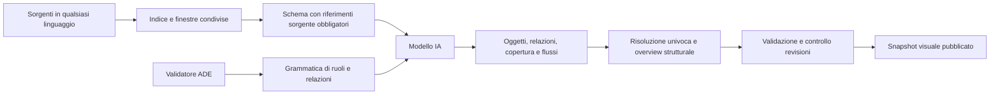

# Generazione semantica: protocollo e prove reali

L’IA sceglie oggetti, capacità, aggregazioni, esclusioni, relazioni e flussi. Gli strumenti preparano le evidenze, espongono le regole ADE, risolvono riferimenti univoci e proiettano il modello dichiarato in un’overview completa.



## Contesto

`format: "compact-v4"` mantiene una tabella file con percorso, linguaggio e frammenti, e righe `units` nel formato `[ref, fileIndex, indexed, name, start, end]`. Gli offset sono posizioni UTF-16 del testo, indipendenti dal linguaggio della codebase. I frammenti sovrapposti vengono uniti; gli intervalli non divulgati restano sconosciuti. Header e corpi non vengono ripetuti. Routing, template e linguaggi senza parser seguono lo stesso protocollo delle dichiarazioni indicizzate.

Il contesto include `relationGrammar`, derivata direttamente da `isCompatibleRelation`, e le regole sul proprietario degli stati. Ad esempio `transition` collega stati della stessa risorsa; `write` collega un esecutore a una risorsa. Questo evita che il modello debba indovinare le convenzioni interne di ADE.

## Output

La CLI riceve uno schema specifico per la richiesta:

- `elements.symbol` ammette solo i riferimenti indicizzati effettivamente disponibili; nuovi attori, stati e risorse inferite appartengono a `concepts`, con un’ancora sorgente disponibile.
- `coverage.targets` ha una proprietà obbligatoria per ogni unità sorgente. Il modello assegna direttamente riferimenti, senza contare posizioni.
- Le esclusioni sono codici vincolati dallo schema: `x:framework`, `x:test`, `x:config`, `x:syntax`, `x:generated`, `x:outside-scope`. Il codice scelto dall’IA esprime la motivazione; non esiste una seconda tabella di chiavi da sincronizzare.
- `overview` contiene chiave stabile, nome e intento. Gli strumenti ne proiettano nodi e relazioni dal modello dichiarato, quando rientra in 24 nodi. `diagrams` contiene eventuali viste focalizzate aggiuntive. Per modelli più grandi il modello compone viste strutturali in `diagrams`.

```json
{
  "targets": {
    "u0": "c:tasks",
    "u1": "c:tasks",
    "u50": "u0",
    "u51": "x:framework"
  }
}
```

La dichiarazione di un elemento e la destinazione primaria della sua evidenza hanno significati distinti. Un’azione dichiarata con `symbol: "u50"` resta nel modello anche se `coverage.targets.u50` sostiene una risorsa diversa. La conversione conserva entrambe le tracce. La copertura può sostenere anche una capacità `f:key`.

I riferimenti abbreviati vengono risolti soltanto quando corrispondono a una singola chiave dichiarata. Un nome visuale non viene usato per indovinare identità. Se due oggetti condividono una chiave, sono necessari riferimenti espliciti `c:key` e `f:key`. Riferimenti inventati e relazioni semanticamente incompatibili continuano a bloccare la pubblicazione.

L’overview include gli oggetti dichiarati e tutti gli estremi delle relazioni scelte dall’IA, comprese eventuali capacità coinvolte. Non serve ripetere un secondo elenco completo degli oggetti. Viste focalizzate con relazioni includono automaticamente i relativi estremi; bozze isolate con un solo nodo senza relazioni vengono assorbite dall’overview. Gli strumenti non inventano ruoli o interazioni.

## Budget e ripresa

Il prompt completo più lo schema non superano il 75% del budget in byte configurato. Il resto è margine stimato per la risposta, non un limite token certificato. La scelta fra richiesta unica (fino a 160 unità) e gruppi (fino a 40) usa le evidenze compattate. La sintesi riceve responsabilità e catalogo, senza ripetere i corpi sorgente. I limiti e le omissioni del riepilogo sono espliciti; un contesto troppo grande si ferma prima della CLI.

Non ci sono riparazioni a pagamento o escalation automatiche. Resume riusa i passi completati e include solo una diagnosi precedente limitata a 1.200 caratteri. I job incompleti dei contratti precedenti richiedono **Generation Options → Start Again**; le chiavi dei diagrammi già pubblicati restano riutilizzabili.

## Verifica con modelli reali

La prova usa la stessa `createCodeEngine` e lo stesso `createCliProvider` della distribuzione, con sorgenti di test generati. Salva prompt, schema, risposta, consumi e risultato; controlla tutte le operazioni TODO, il modello di dominio, le viste collegate, i riferimenti e la conservazione esatta dei sorgenti.

| Modello | Generazioni riuscite sul contratto finale |
| --- | --- |
| `gpt-5.6-luna` | 4 / 6 |
| `gpt-5.6-terra` | 6 / 6 |

Il campione comprende Ruby/HTML/YAML, Ruby con 22 initializer (58 unità sorgente) e Go; ogni progetto è stato generato due volte. Terra è consigliato su questo flusso. Non sono disponibili addebiti monetari effettivi; le percentuali misurano il campione, non una garanzia su codebase arbitrarie. Il [rapporto registrato](validation/live-generation-2026-11-06.json) contiene risultati e token riportati dalla CLI. I diagrammi reali sono stati aperti nell’app desktop.

### Ripetere la prova

Questa invocazione effettua fino a sei richieste reali, utilizzando il login della CLI selezionata:

```bash
ADE_AI_MODEL=gpt-5.6-terra npm run ade:ai:diagram-live -- --runs 2 --max-calls 6
```

`ADE_AI_EXECUTABLE` seleziona il binario; `ADE_AI_CODEX_HOME` permette una sessione di prova separata senza modificare il processo chiamante. I risultati e le risposte rimangono sotto `.build/ade-live`, escluso da Git.

Per rigiocare risposte reali senza inferenza, specificare `--replay <cartella-della-prova>`, lo stesso modello e lo stesso numero di run. Il replay verifica che prompt e schema coincidano esattamente con la registrazione. Il risultato viene marcato come replay e conta zero chiamate esterne.

Le risposte reali selezionate sono anche conservate in `ade/code-import/test/fixtures/real-diagrams/todo-terra.json`. I test di regressione le applicano a inventari sorgente identici, senza account o rete. I test simulati rimangono distinti da queste verifiche.

### Verificare il rendering

```bash
ADE_GENERATED_MODEL=/percorso/allo/snapshot/model.ade.json \
  node ade/scripts/smoke-desktop.mjs --generated-diagrams
```

La prova apre lo snapshot nell’app, controlla i nodi visibili e salva i primi due diagrammi in `.build/ade-smoke/live-generated-0.png` e `live-generated-1.png`. Lo smoke con CLI simulata continua a verificare modifica, aggiornamento codice e ripresa, senza certificare il comportamento di un provider reale su quei passaggi.
