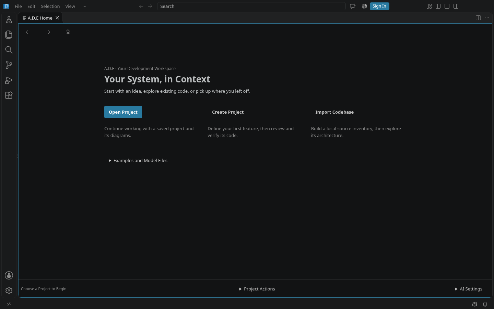
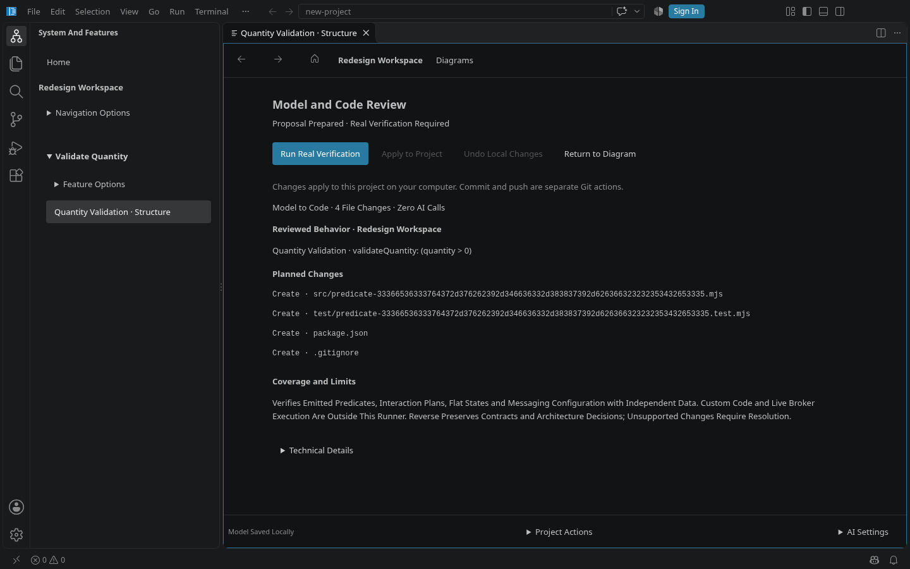
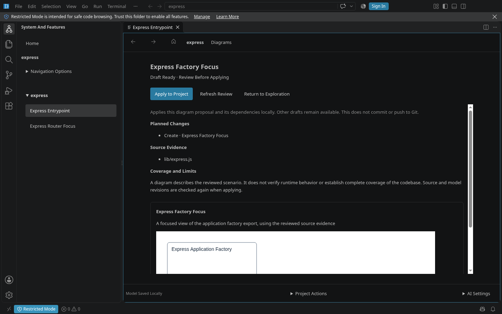

# Implementazione del redesign UI/UX

Questa revisione applica le priorità del [piano di redesign](ui-ux-redesign-plan.md) ai percorsi di creazione, importazione e review. La roadmap comprende anche ricerca con utenti, collaudi assistivi su più sistemi e lavoro successivo sui pannelli; questi elementi non sono dichiarati conclusi dalla sola implementazione.

## Decisioni applicate

La [skill design-philosophy](../../.github/skills/design-philosophy/SKILL.md) guida le scelte: **Calm** riduce gli ingressi concorrenti e separa impostazioni e task; **Focused** dà precedenza all’editor e alla decisione corrente; **Consistent** usa i token nativi per superfici, controlli, caratteri, focus e contrasto. Le modifiche non aggiungono animazioni o dipendenze.

| Piano | Implementazione |
| --- | --- |
| U15a | Il servizio documentale legge i modelli v5 con il lettore del formato corrente. Le bozze con riferimenti incompleti rimangono recuperabili; le forme JSON errate rimangono errori. La funzione di migrazione riconosce v2–v5 senza interpretarli come v1. |
| U01/U14 | La Home presenta Apri progetto, Crea progetto e Importa codebase. Esempi e file modello sono in una disclosure secondaria. Il progetto vuoto offre il template quantitativo e la modellazione libera come scelte distinte. La disponibilità del template usa lo stesso guard del servizio. |
| U05/U09 | La review strutturale occupa l’editor, mostra comportamento dichiarato, file interessati, copertura e risultati, e tiene le decisioni fuori dallo scorrimento delle evidenze. Le differenze tecniche sono una richiesta esplicita. |
| U05/U11 | La review di una bozza importata riunisce modifiche, sorgenti, anteprime e limiti. Aprirla non applica la proposta. L’applicazione è un’azione separata con conferma; le altre bozze restano disponibili. |
| U07/U11 | Stato di salvataggio, esito dei test, applicazione locale e annullamento hanno messaggi distinti. Gli errori precedono lo stato ordinario. Le conferme specificano l’ambito locale e distinguono commit e push. |
| U09/U10/U15b | Preparazione e review sono raggiungibili dal contesto. Impostazioni IA e azioni del progetto sono separate. La UI conserva i gate di Sync, spiega il formato non supportato e indica esplorazione o review strutturale come percorsi pertinenti. Nessun nuovo adapter bidirezionale viene simulato. |
| U13/U16 | Una review fallita conserva contenuto e contesto. Il cambiamento del modello blocca l’applicazione; il servizio di dominio ricontrolla le sorgenti. Una review può essere aggiornata. Una bozza invalida si consulta senza pubblicarla. Consumo tecnico e dettagli diagnostici restano nelle disclosure. |
| U17/U19 | Home e review rifluiscono nella finestra stretta. Nelle aree basse la review scorre come superficie unica con barra decisionale stabile. Gli stati usano token di tema; il focus sopravvive agli aggiornamenti e può passare all’azione successiva dopo un’operazione. Accessible View legge la review attiva e non il diagramma sottostante. |
| U02/U03/U04 | La sidebar dichiara il progetto e il percorso inventario → esplorazione → review. L’apertura dell’editor rispetta la sidebar già scelta. Le proprietà offrono accesso alle evidenze sorgente tramite il servizio esistente, che verifica revisione e range. |

Gli ID dei comandi esistenti sono conservati. File, terminale, Git e debug continuano a usare i servizi nativi del workbench.

## Collaudo

Sono passati **270 test automatici**: 79 browser, 75 dei servizi, 9 del bridge Electron, 95 dei workflow e 12 dei formati. I due percorsi hanno superato **15 passaggi nell’app Electron**. La review è stata controllata nei quattro temi nativi e con zoom al 207,36%; nella prova di zoom la sidebar è stata chiusa esplicitamente con il comando nativo.

Il [verbale di implementazione](validation/ui-ux-redesign-2026-11-10.json) conserva risultati, limiti e riferimenti alle schermate effettive. Il precedente [verbale di audit](validation/ui-ux-workflows-2026-11-10.json) descrive il comportamento prima di questa modifica e rimane una baseline storica.

Il progetto nuovo viene creato dall’interfaccia, riceve la prima feature dal proprio stato vuoto e prepara una review dal canvas. Il runner usa Node 24.22.1 ed esegue i casi derivati e indipendenti del template. Applicazione e annullamento sono operazioni locali esplicite.

Il percorso importato usa Express alla revisione dell’audit. Importazione, proposta e pubblicazione passano dai servizi di produzione. La proposta è scritta dall’esperto per il test: non certifica la qualità di un provider. Il ripristino della sessione di esplorazione viene predisposto nel profilo isolato per collaudare review, conferma, cancellazione, evidenze obsolete e applicazione selettiva senza un account IA. La riapertura desktop del modello v5 esercita il difetto P0 originario.

Le schermate sono acquisizioni dell’app Electron. I test browser delle componenti usano Chromium; quelli di orchestrazione iniettano i servizi terminale/chat. Nessun test locale sostituisce una prova con lettore di schermo reale.

## Schermate verificate

Home con tre ingressi:

Review del progetto nuovo, con comportamento dichiarato e verifica reale:

Review di una proposta su Express, con evidenze e anteprima:

Sono conservate anche le prove [light](validation/ui-ux-redesign-2026-11-10/review-vs.png), [alto contrasto scuro](validation/ui-ux-redesign-2026-11-10/review-hc-black.png), [alto contrasto chiaro](validation/ui-ux-redesign-2026-11-10/review-hc-light.png) e [zoom al 207,36%](validation/ui-ux-redesign-2026-11-10/review-200-percent.png).

## Lavoro successivo

- Completare la riprogettazione dei pannelli proprietà e diagnostici con dimensionamento e persistenza per i contesti avanzati; la revisione attuale concentra il lavoro su Home, task e review.
- Provare i percorsi con NVDA e VoiceOver, scaling OS e repository multi-root; correggere gli eventuali blocchi prima di dichiarare completata la DoD assistiva.
- Verificare account e provider live, marketplace, esecuzione e debug di applicazioni reali, conflitti Git e installazione completa delle estensioni.
- Raccogliere le baseline umane di TTFA, comprensione, recupero e soddisfazione previste dal piano. I test automatici dimostrano il comportamento, non i miglioramenti percentuali di usabilità.
- Validare onboarding contestuale, personalizzazione avanzata e governance dei componenti con le fasi successive della roadmap.
