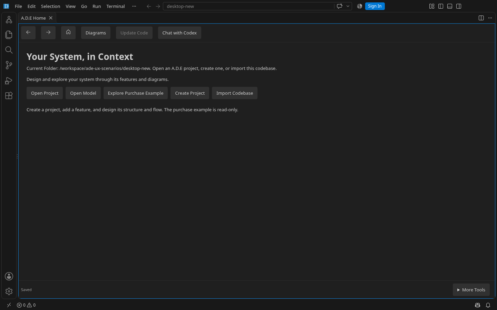
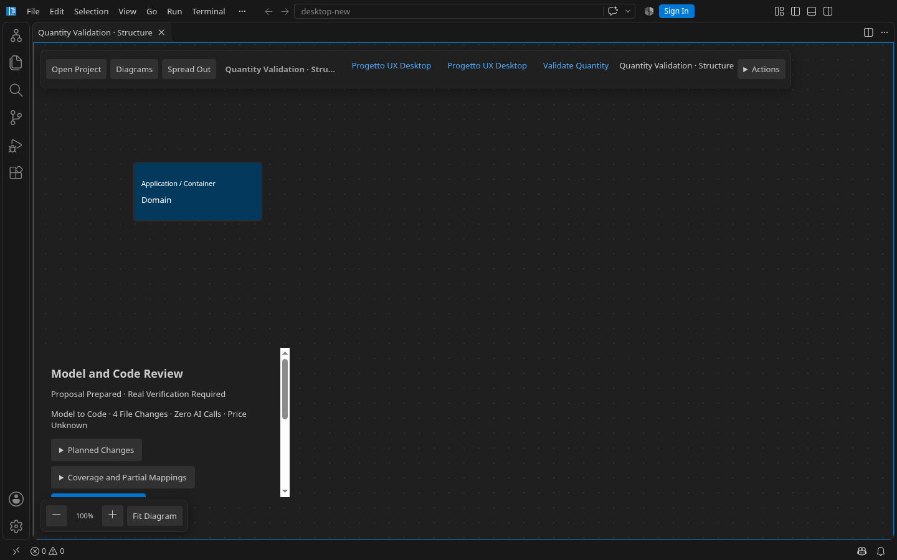
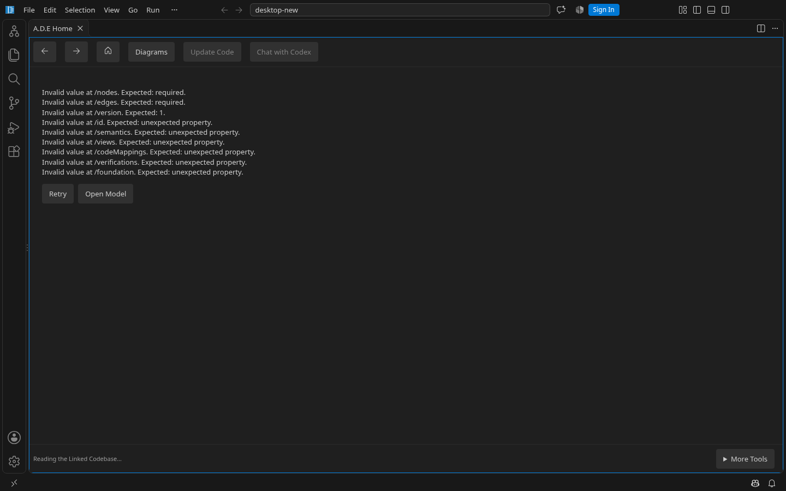

<!-- Copyright (c) Microsoft Corporation. All rights reserved. Licensed under the MIT License. -->

Stato di implementazione: le modifiche e i collaudi successivi a questo audit sono descritti nel [resoconto di implementazione](ui-ux-redesign-implementation.md). Le evidenze originarie qui riportate restano la baseline precedente al redesign.

# Piano di Redesign UI/UX — Fork di VS Code

Audit del 10 novembre 2026 su `feat/m6-dai-validation`, revisione `b78d70c4`. Destinatari: product manager, designer e sviluppatori ADE. L’esperienza target conserva editor centrale, Activity Bar, sidebar, pannelli, status bar, Command Palette e Quick Open di VS Code. Il canvas ADE è un editor specializzato e condivide le stesse regole di orientamento dell’editor testuale.

Il percorso principale deve dichiarare la propria direzione: **nuovo progetto → specifica → review → verifica → pubblicazione locale**, oppure **codebase esistente → inventario → esplorazione → review → applicazione del diagramma → aggiornamento delle evidenze**. “Salvato”, “verificato” e “applicato” sono stati distinti. La pubblicazione ADE riguarda file del progetto locale; non equivale a commit, push o deploy.

Le raccomandazioni sono proposte da implementare. Le capacità attuali sono ricavate dal codice e dalle prove riportate nel [verbale riproducibile](validation/ui-ux-workflows-2026-11-10.json). Le evidenze usano quattro qualifiche: **C** = ispezione del codice corrente; **E** = comportamento esercitato in questa sessione; **V** = osservazione della UI eseguita in questa sessione; **H** = ipotesi di usabilità da verificare con utenti o ambiente reale. I verbali storici non sono nuove prove. Nessuna misura di soddisfazione, tempo umano o frequenza d’uso è stata inventata.

## 1. Executive summary

ADE dispone già di un canvas ampio, proprietà contestuali, undo nativo, review e recupero. Il problema principale è la frammentazione del percorso: l’utente deve collegare azioni che appartengono a modelli operativi differenti e riconoscere prerequisiti distribuiti fra Home, menu tecnici, palette, chat e file di review.

I cinque problemi più gravi sono: caricamento desktop dei modelli v5 instradato al formato legacy; progetto vuoto senza primo passo eseguibile nello stesso stato; review compressa in un overlay con azioni sotto lo scroll iniziale e review dell’esplorazione distribuita fra più editor; gerarchia insufficiente fra apertura progetto, apertura modello, importazione e demo; comandi essenziali di implementazione nascosti sotto più disclosure.

La visione target è un IDE che mostri sempre progetto, oggetto attivo, stato affidabile e una prossima azione utile. L’editor mantiene la precedenza spaziale; i pannelli spiegano il lavoro corrente. Le funzioni tecniche compaiono quando servono, mentre i vincoli che impediscono un’azione rimangono leggibili e risolvibili.

Primi dieci interventi, in ordine operativo:

1. Correggere il caricamento desktop v5 e verificarne apertura, reload e riapertura.
2. Aggiungere al progetto appena creato un primo passo esplicito, coerente con le capacità disponibili.
3. Ridurre la Home a tre ingressi: aprire, creare, importare.
4. Dichiarare sempre direzione e stato del lavoro.
5. Portare la preparazione della review fuori dalle impostazioni IA.
6. Presentare una review leggibile prima dei dettagli tecnici.
7. Uniformare il vocabolario dell’esplorazione incrementale in canvas, sidebar e palette.
8. Rendere file, ricerca, esecuzione e diagnostica accessibili dal workbench senza attraversare menu ADE.
9. Unificare feedback e ripresa, dichiarando capacità e direzioni di aggiornamento supportate.
10. Verificare i due percorsi con tastiera, temi, zoom e tecnologie assistive, misurando successo e recupero.

Le priorità P0 proteggono continuità e correttezza; P1 rende i percorsi comprensibili; P2 migliora efficienza e personalizzazione. Il numero di funzioni mostrate non è una metrica di valore.

## 2. Analisi dei problemi attuali

### 2.1 Evidenze e perimetro dei due percorsi

| Percorso | Evidenza attuale | Conseguenza per il redesign |
| --- | --- | --- |
| Nuovo progetto | C/V: `createProject` crea un modello v4 vuoto e apre la sezione diagramma. Il pulsante `Add Pure Quantity Feature` è nella Home, assente nella schermata successiva alla creazione. E: CLI reale crea, prepara, verifica 16 casi, applica, riapre e annulla. V: creazione, comando prima feature, review, verifica e applicazione locale eseguiti anche in Electron senza provider. | Rendere raggiungibile il primo passo dalla schermata in cui si arriva; distinguere il template quantitativo dalla creazione di una feature generica. La UI funziona conoscendo il comando, ma non ne guida la scoperta. |
| Codebase importata | E: importazione sintattica di Express, ricerca e lettura di `lib/express.js`, proposta redatta dall’esperto, preview, applicazione selettiva, riapertura e riapplicazione idempotente. Il modello pubblicato è v5. | Mostrare “inventario disponibile” prima dell’esplorazione, poi “bozza”, “applicata” ed eventuali evidenze da aggiornare. Una vista dell’entrypoint non certifica la comprensione dell’intero repository. |
| Caricamento del risultato importato | V/E: aprendo da Electron il progetto Express con vista applicata v5 compaiono errori legacy su `/nodes`, `/edges`, `/version`; il canvas non si apre. C: `readDocument` separa solo v4; `migrateSemanticModel` accetta direttamente v2/v3 e tratta il resto come v1. | P0: correggere il loader v5 e provarlo nel ciclo reale di applicazione/riapertura. La riapertura del journal nei servizi non dimostra la riapertura nell’editor. |
| Aggiornamento dopo l’importazione | E: `preview` chiamato direttamente sul servizio legacy rifiuta il modello v5 con `A v4 synchronization adapter is required; legacy Sync cannot rewrite this model`. C: il comando UI `sync` già instrada v5 verso l’esplorazione incrementale e blocca gli altri casi v4/v5 incompatibili. | Limite di capacità, non prova di un secondo bug del pulsante Sync. Conservare i gate, spiegare la direzione supportata e il significato del comando; non promettere aggiornamento bidirezionale per ogni modello importato. |
| Review e layout | V: la review strutturale occupa un overlay basso a sinistra con altezza limitata; “Run Real Verification” è inizialmente sotto lo scroll. Il canvas e la toolbar superiore restano ampi. | U05/U09/U17: assegnare alla fase di review spazio e primaria visibile, conservando la selezione del diagramma. |
| Competenze ereditate | C: ricerca, Git, debugger, terminale ed estensioni appartengono al workbench VS Code. | Riutilizzare queste superfici; il piano non attribuisce ad ADE nuovi motori di debug, hosting, collaborazione o gestione estensioni. |

Fonti di implementazione: [editor e Home](../../src/vs/workbench/contrib/ade/browser/adeEditor.ts), [creazione e apertura](../../src/vs/workbench/contrib/ade/browser/adeProjectService.ts), [esplorazione e review](../../src/vs/workbench/contrib/ade/electron-browser/adeAiService.ts), [Sync legacy](../code-import/syncCode.ts), [bridge nativo](../code-import/nativeHost.ts), [review strutturale](../../src/vs/workbench/contrib/ade/browser/adeStructuralReview.ts), [accessibilità esistente](accessibility.md).

Prove eseguite sulla revisione indicata: **95/95** test mirati dei percorsi e **72/72** test dei servizi nativi; tre anteprime Chromium senza errori, anche esaminate visivamente. La prova CLI indipendente verifica 8 casi derivati e 8 indipendenti. Express è fissato a `43fca52d28a422c8be48fd489cbd4f2d6152bab6`: l’inventario sintattico comprende 217 voci, 142 file analizzati e 129 dichiarazioni; la vista redatta dall’esperto copre soltanto le esportazioni di `lib/express.js`. Nessuna inferenza, esecuzione dell’app Express o sua suite di test in questa prova.

La build client include engine e adapter MCP; il download di Electron e l’avvio su Xvfb sono riusciti. Il setup completo standard si è fermato prima su prerequisiti X11 e poi sul download di ripgrep da `api.github.com` negato dall’ambiente. Sono state installate dipendenze locali e compilate le dipendenze native necessarie per una build mirata: le prove Electron disabilitano le estensioni eseguibili integrate. Non certificano installazione completa, provider live, debug adapter, marketplace, macOS o lettori assistivi reali.

Schermate correnti, non mockup del redesign:



La Home non assegna una priorità evidente ai tre ingressi di lavoro; “Open Model” e demo competono con essi.



La review è funzionale nella prova, ma una fase principale occupa solo una piccola parte della superficie disponibile. L’azione di verifica richiede scorrimento del riquadro.



Il risultato valido nei servizi viene rifiutato dal caricamento desktop. “Saved” rimane visibile sotto la diagnostica, senza spiegare che riguarda la persistenza e non la validità del modello.

Per riprodurre il P0 senza provider, aprire con **A.D.E: Open Model** il [modello v5 effettivamente pubblicato](validation/ui-ux-2026-11-10/express-entrypoint-v5.ade.json). Il lettore di dominio lo valida; l’editor di questa revisione lo passa al percorso legacy. Il risultato atteso dopo la correzione è il diagramma “Entrypoint Express”, senza mutare il file per il solo caricamento.

La [schermata dell’inventario Express pronto](validation/ui-ux-2026-11-10/imported-inventory.png) documenta l’importazione nativa riuscita prima dell’esplorazione. Una successiva riapertura in un profilo isolato mostra “Explore Architecture”. La [prova a 1024×768](validation/ui-ux-2026-11-10/new-project-narrow.png) documenta il progetto nuovo riaperto e il canvas operativo: spostamento da tastiera e undo riusciti. Non estendere questi esiti al caricamento v5, a zoom 200% o a uno screen reader reale. L’undo della pubblicazione è verificato nella CLI; il corrispondente percorso desktop resta da collaudare.

### 2.2 Mappa delle criticità

Tipi: **AI** architettura informativa; **GV** gerarchia visiva; **IN** interazione; **LL** linguaggio; **AC** accessibilità. Ogni riga indica le dimensioni pertinenti; l’assenza di una dimensione non certifica conformità. Gravità: critica = percorso interrotto o integrità a rischio; alta = task principale difficile; media = rallentamento o rischio contestuale.

| Area | Problema osservato | Impatto UX | Gravità | Soluzione proposta | Priorità |
| --- | --- | --- | --- | --- | --- |
| Primo avvio e welcome | C, AI/GV/LL: cinque ingressi nella Home, senza una scelta iniziale dominante; “Open Model” non spiega la differenza da progetto. | Scelta iniziale difficile per chi non conosce ADE. | Alta | U01: tre ingressi orientati al compito; modello e demo secondari. | P1 |
| Activity Bar | C/H, AI/LL: contenitore “System and Features” separato dai file; comprensione dell’icona da misurare. | Si può cercare il filesystem nell’albero semantico. | Media | U02: tooltip e titolo “Diagrammi”; mantenere Explorer e Search native. | P1 |
| Sidebar primaria | C, AI/IN/LL: sidebar opzionale; può ancora invitare a “Build Diagrams with AI” mentre il canvas parla di esplorazione. | Modelli mentali discordanti fra superfici. | Alta | U03: stessi nomi e stati; apertura esplicita, collasso persistente. | P1 |
| Explorer e file | C/H, AI/IN: `Files` è anche sotto `Actions → More Tools`; trovare il sorgente dal diagramma richiede distinguere albero e Code Evidence. | Passaggi extra fra comprensione e modifica. | Alta | U04: Explorer globale e “Apri sorgente” contestuale alle evidenze correnti. | P1 |
| Editor e tab | C/V, AI/GV/IN: la review incrementale apre JSON e immagini pinned; quella strutturale è compressa nell’overlay e richiede scroll per la primaria. | Confronto distribuito, tab accumulate e fase successiva poco visibile. | Alta | U05: una review editor con sintesi, differenze e anteprima; JSON tecnico espandibile. | P1 |
| Pannelli inferiori | C/H, AI/GV: terminale, output, problemi e debug hanno scopi diversi; il ritorno al canvas esiste già. | Output del runner confondibile con diagnostica del codice. | Media | U06: etichettare processo e ambito; aprire il pannello pertinente solo su richiesta/errore. | P1 |
| Status bar | H, GV/LL/AC: carico globale non misurato; ADE espone già uno stato locale, talvolta dentro Actions. | Stato del documento e della pubblicazione difficili da confrontare. | Media | U07: stato globale essenziale; stato ADE vicino all’editor e sempre leggibile. | P1 |
| Palette e Quick Open | C/H, AI/LL: molti comandi ADE, alcuni con più sinonimi; Quick Open riguarda file, Search System il dominio. | Ricerca nell’indice sbagliato. | Alta | U08: categorie e descrizioni esplicite, alias compatibili. | P1 |
| Menu e scorciatoie | C, AI/IN/AC: `Implement Feature` è sotto Actions, More Tools, AI Settings, Guided Feature Implementation. | Una fase principale si presenta come configurazione avanzata. | Alta | U09: prossimo passo visibile e comandi frequenti entro un menu. | P1 |
| Impostazioni | C, AI/LL: configurazione IA e azioni operative condividono la stessa disclosure. | Configurazione percepita come prerequisito a ogni task. | Alta | U10: setup al momento del bisogno; impostazioni separate dalla review. | P1 |
| Ricerca globale | H, AI/LL/IN: verificare distinzione file/testo/simbolo/elemento semantico. | Risultati irrilevanti o mancanti interpretati come assenze. | Media | U08: scope visibile e percorso verso la ricerca corretta. | P2 |
| Source control | C/H, AI/LL: Git nativo disponibile; “Publish” locale può essere interpretato come push. | Aspettativa errata su salvataggio e condivisione. | Alta | U11: “Applica al progetto”, Git separato con branch e diff nativi. | P1 |
| Estensioni | H, AI/IN: disponibilità marketplace e configurazioni non collaudate qui. | Un requisito del linguaggio può sembrare un errore ADE. | Media | U12: Extensions nativa; spiegare requisiti verificati senza proporre installazioni speculative. | P2 |
| Notifiche e dialoghi | C, AI/IN/LL: review proposta → editor JSON → immagine → conferma; alert tecnici delle bozze mostrano codice/path/args. | Cambio di contesto e diagnosi poco operativa. | Alta | U05/U13: review unica, errore con causa e azione; conferma per applicazione con effetti. | P1 |
| Empty state | C/V, AI/LL/IN: progetto appena creato senza viste; prima feature quantitativa non offerta nello stesso stato. | L’utente non trova la prosecuzione funzionante. | Alta | U14: azione pertinente nello stato vuoto e spiegazione del risultato. | P0 |
| Error state | E/C/V, IN/LL: apertura desktop del risultato v5 rifiutata dal loader legacy; sotto l’errore compare “Saved”. | Percorso interrotto e feedback ambiguo su validità/salvataggio. | Critica | U15: loader corrente, capacità dichiarate e recupero; nessun successo ambiguo. | P0 |
| Loading e progress | C, GV/LL/AC: contatori tool/byte visibili nell’esplorazione; non rappresentano percentuale di comprensione né costo totale. | Falsa percezione di completamento o spesa. | Alta | U16: fase e risultato persistito; contatori nel dettaglio, dati ignoti dichiarati. | P1 |
| Layout e personalizzazione | C/H, GV/IN/AC: toolbar e proprietà sono overlay; eventuali sovrapposizioni da misurare alle diverse larghezze. | Il contenuto selezionato può essere coperto. | Media | U17: spazio protetto per controlli, pannelli adattivi, ripristino reversibile. | P2 |
| Onboarding contestuale | C, AI/LL: l’onboarding upstream è disabilitato; Home spiega struttura e flusso ma non l’intero ciclo review/verifica. | Il primo risultato non chiarisce come arrivare al codice. | Alta | U18: suggerimento singolo al passaggio rilevante, ripetibile e disattivabile. | P1 |
| Accessibilità | C/H, AC/IN: esistono focus, Accessible View e aiuto; non equivalgono a collaudo con screen reader reale. | Ostacoli possibili in overlay, grafi e aggiornamenti asincroni. | Alta | U19: tastiera completa, semantica nativa, focus stabile e audit assistivo. | P1 |

### 2.3 Contratti delle raccomandazioni

I problemi e l’impatto sono nella tabella precedente; qui ogni ID specifica superficie, comportamento, eccezioni e verifica. I criteri sono requisiti di accettazione proposti, non risultati già ottenuti.

| ID | Dove e comportamento atteso | Eccezioni e casi limite | Verifica di riuscita |
| --- | --- | --- | --- |
| U01 | Home: Apri progetto, Crea progetto, Importa codebase; il contesto può evidenziarne una. Demo e file modello in “Altre opzioni”. | Nessun recente: non inventare una lista. Cartella con progetto: proporre apertura, preservando file esistenti. Clone usa `Git: Clone` se disponibile. | 5/6 partecipanti scelgono l’ingresso corretto entro 10 s; nessuna perdita sul riuso di cartella. |
| U02 | Activity Bar: navigazione stabile, nome accessibile e tooltip; contenitori secondari riordinabili con strumenti upstream. | Non rimuovere pin dell’utente né viste registrate da estensioni; overflow conserva accesso da tastiera. | Explorer e diagrammi riconosciuti separatamente da 5/6 partecipanti; tutti i pin recuperabili. |
| U03 | Sidebar diagrammi: stato inventario/bozze/applicati coerente col canvas; niente configurazione IA nell’albero. | Viste senza feature sotto gruppo di sistema; scope multi-root sempre dichiarato. | Stessa proposta e stesso stato in sidebar/canvas; selezione e gruppi conservati dopo riapertura. |
| U04 | Proprietà: “Apri sorgente” con file e posizione quando l’evidenza è corrente; Explorer nativo raggiungibile direttamente. | Evidenza obsoleta: spiegare e offrire rilettura. Nessun range inventato per elementi manuali. | Apertura esatta del range; navigazione di ritorno conserva nodo e camera. |
| U05 | Editor review: nome vista/feature, modifiche, evidenze, limiti, preview e azione appropriata nello stesso editor. Dettagli JSON su richiesta. | Bozza invalida consultabile ma non applicabile; modello cambiato invalida review; applicare una bozza non applica le altre. | Il revisore identifica impatto e limiti senza aprire JSON; annullamento senza mutazioni; guard di freschezza attivo. |
| U06 | Pannello inferiore: titolo processo, root, stato e filtro; “Mostra output” conduce al risultato pertinente. | Errore di avvio mantiene log; processi lunghi continuano quando il pannello è chiuso; Stop sempre raggiungibile. | Individuazione della causa e ritorno al file in ≤2 azioni; chiudere il pannello non ferma processi. |
| U07 | Stato: documento salvato/non salvato, processo attivo, proposta pronta/da verificare/applicata; una sola priorità dominante. | Concorrenza: mostrare errore bloccante prima del completamento ordinario; non cancellare dirty con un successo del runner. | Nessun “Salvato” usato come prova di pubblicazione o test; stato aggiornato anche da tastiera/lettore. |
| U08 | Palette: verbi e categorie stabili; Quick Open file, simboli nativi, Search testo e Search System distinti nel copy. | Comando non applicabile: motivazione contestuale, alias storici mantenuti; evitare shortcut globali aggiuntive indiscriminate. | 90% dei comandi cercati trovati entro 15 s; ricerca vuota dichiara scope. |
| U09 | Toolbar: 1–3 azioni di task; preparazione, verifica o applicazione dipendono dallo stato. Menu secondario a un livello per azioni comuni. | Su finestra stretta tenere primaria e overflow; undo/save sempre via shortcut; non spostare comandi durante il focus. | Avvio fase principale in ≤1 azione dal contesto; nessuna azione comune richiede tre disclosure. |
| U10 | Settings: account/modello/budget/configurazione; la review rimane parte del progetto. Setup richiesto solo quando manca. | IA disattivata: rispettare scelta; CLI assente: spiegare il prerequisito; non suggerire capacità provider non disponibili. | Annullare setup non invia richieste; configurazione valida riusata nel task successivo. |
| U11 | Review: “Applica al progetto” e ambito locale. SCM: commit/push/pull nativi, con repository selezionato. | Modifiche già applicate restano non committate; conflitti Git e conflitti modello distinguibili. | 6/6 partecipanti distinguono applicazione locale, commit e push; nessun push implicito. |
| U12 | Extensions: richiesta motivata nel contesto del file; dettaglio e installazione nell’editor nativo Extensions. | Offline/policy/marketplace assente: stato esplicito e alternative realmente disponibili. | Configurazione recuperabile senza perdere il file; installazione mai avviata dalla sola apertura di una guida. |
| U13 | Feedback: evento ordinario nello stato; errore inline vicino all’azione, dettagli tecnici espandibili, Retry/Resume pertinenti. | Conferma per sovrascrittura, perdita di lavoro e applicazione con effetti; annullamento silenzioso. | Ripresa conserva risultati e selezione; zero toast ripetuti per lo stesso evento. |
| U14 | Empty state progetto: “Progetto creato. Definisci la prima feature”; esplicitare il template quantitativo già disponibile e l’alternativa di modellazione libera. | Nessuna generazione generica promessa; template utilizzabile solo nello stato ammesso dal servizio. | Prima feature supportata creata senza tornare alla Home né cercare un comando sconosciuto. |
| U15 | Servizio documentale: riconoscere e leggere il formato v5 corrente. Ogni azione conserva i gate modello/profilo/adapter; UI spiega capacità e direzioni supportate. | Se manca un adapter, il redesign non lo crea: supporto funzionale separato. Non suggerire di reimportare perdendo annotazioni; draft ed errori strutturali devono restare distinguibili. | Apertura/reload/riapertura v5 e regressioni v1–v4; guard Sync conservati; dati intatti dopo errore. |
| U16 | Progress: “Inventario locale”, “Esplorazione”, “Bozza pronta”, “Applicazione”; mostrare ultima attività e annullamento appropriato. | Percentuale solo con totale noto; tool call ≠ inferenza; token/prezzo ignoti non diventano zero; ripresa non riparte automaticamente da zero. | Ogni stato ha azione successiva e semantica leggibile; completamento corrisponde a risultato persistito. |
| U17 | Layout: editor prioritario, sidebar/pannelli ridimensionabili, proprietà sul lato e protezione del focus selezionato. | A larghezza ridotta proprietà sotto o in vista dedicata; multi-editor e scelte manuali rispettate; reset esplicito. | Task completati a 1024×768 e zoom 200%; nessun controllo primario tagliato o coperto. |
| U18 | Onboarding: un suggerimento dopo un evento utile, con “Non mostrare più” e comando per ripetere. | Esperti possono saltare tutto; errori di integrità non sono suggerimenti disattivabili. | Nessun overlay bloccante; guida non ricompare dopo dismiss; miglioramento del primo task misurato. |
| U19 | Tutte le superfici: semantica, ordine di lettura, focus visibile e ritorno al controllo equivalente dopo render/chiusura. | Il canvas mantiene una lettura testuale equivalente; errore di progetto non legge un vecchio modello valido. | Percorsi completi senza mouse, con screen reader reale e quattro temi; zero trappole di focus. |

## 3. Mappa dei job-to-be-done

Frequenze attese da validare con ricerca, non telemetria osservata: quotidiana, per progetto, occasionale. La metrica riguarda il compito, non la quantità di click in astratto.

| Job e utente primario | Frequenza | Percorso ideale | Attrito attuale e superfici | Azioni primarie | Secondarie da degradare | Metrica |
| --- | --- | --- | --- | --- | --- | --- |
| Iniziare un progetto; sviluppatore nuovo in ADE | Per progetto | Crea → cartella/nome → prima feature supportata → editor | C: Home e vuoto disallineati; Home, picker, canvas | Crea, definisci feature, salva | Demo, JSON modello, configurazione provider | Prima azione utile riuscita ≤2 min nel test guidato |
| Comprendere una codebase; maintainer | Per progetto/quotidiana | Apri/importa → inventario → domanda → bozza → evidenze → applica | E/C: inventario distinto dall’architettura; Home, chat, review | Importa, esplora, rivedi | Budget e protocollo MCP | ≥90% conclude il task, nessuna copertura sovrastimata |
| Trovare file/simbolo/testo; sviluppatore | Quotidiana | Quick Open/simboli/Search → risultato → editor | H: scope confondibili; palette, Search, Explorer | Cerca, apri, torna | Opzioni avanzate regex/esclusioni | File noto trovato entro 15 s |
| Trovare responsabilità; architetto/maintainer | Quotidiana | Search System → elemento → diagrammi/evidenze | C: dominio separato dai file; sidebar, proprietà | Cerca elemento, apri sorgente | Identificativi e metadati parser | Responsabilità corretta e range verificabile |
| Scrivere/modificare; sviluppatore | Quotidiana | Apri → modifica → salva → esegui test appropriato | C/H: distinguere cambiamento layout/semantica/codice; editor e diff | Modifica, salva, undo | Opzioni di layout e benchmark | Nessuna perdita; ripresa della selezione dopo ritorno |
| Eseguire/verificare; sviluppatore | Quotidiana | Task nativo o verifica ADE pertinente → risultato → sorgente | C: runner strutturale non esegue tutta l’app; toolbar, terminale/output | Avvia, arresta, apri risultato | Runtime alternativi e piani stack | Utente identifica cosa è stato verificato in 6/6 prove |
| Diagnosticare; sviluppatore | Quotidiana | Problema → file/range → modifica → nuova verifica | H/C: output runner e Problems hanno origini diverse | Apri errore, filtra, riprova | Log completi, diagnostiche provider | Recupero riuscito ≥90% nel corpus di errori |
| Debug; sviluppatore | Quotidiana/occasionale | Run and Debug → configurazione disponibile → breakpoint → step | H: disponibilità adapter e configurazioni non verificata | Avvia, breakpoint, continua/stop | Launch avanzato e trace | Scenario campione concluso senza guida esterna |
| Versionare/condividere; sviluppatore/team | Quotidiana | SCM → diff → stage → commit → push/pull | C/H: ambiguità Publish locale/Git; SCM e review | Diff, commit, sync remoto esplicito | Git avanzato, stash, rebase | Nessun commit/push non intenzionale; conflitto risolto |
| Installare/configurare estensione; sviluppatore | Occasionale | Requisito verificato → Extensions → installa → configura | H: marketplace, policy e rete da verificare | Leggi requisito, installa, configura | Catalogo intero e raccomandazioni non pertinenti | ≥90% torna al file senza perdere contesto |
| Personalizzare; esperto | Occasionale | Settings o layout nativo → prova → conserva/ripristina | H: overlay e persistenza a più dimensioni | Cambia, anteprima, reset | Profili ed esportazione | Personalizzazione reversibile in ≤30 s |
| Ritrovare azione/recuperare; ogni utente | Quotidiana/occasionale | Stato/motivo → palette o azione inline → ripresa | C/E: sinonimi, menu profondi, Sync incompatibile | Trova comando, Resume, Undo | Restart completo e log grezzi | ≥90% recupero senza ricreare il progetto |

## 4. Nuova architettura dell’interfaccia

| Livello | Scopo | Contenuto ammesso | Regole |
| --- | --- | --- | --- |
| Primario | Lavoro corrente | Editor di codice/canvas/review, oggetto attivo, 1–3 azioni del task | Una sola azione accentata; stato del documento vicino al titolo; evitare toolbar globali di generazione. |
| Navigazione | Cambiare oggetto o area | Activity Bar, sidebar scelta, progetto/root, file e diagrammi | Posizione stabile; una sidebar primaria; nessuna configurazione incorporata nell’albero. |
| Contestuale | Agire sull’oggetto | Proprietà, evidenze, contratti, SCM/test/debug della selezione | Compare per selezione o comando; chiusura reversibile, focus restituito; non sottrae inutilmente spazio al codice. |
| Diagnostico | Capire processi e problemi | Problems, terminale, Output, Debug Console, risultato runner | Un pannello inferiore selezionato, filtrabile, chiuso nel profilo iniziale; stato processo visibile anche da chiuso. |
| Avanzato | Configurare e usare capacità rare | Settings, account, profili, budget, benchmark, dettagli schema | Palette, Settings e menu secondari; recupero dal contesto quando diventa necessario. |
| Transitorio | Dare feedback | Toast, conferme con effetti, progress breve, errore locale | Non occupa permanentemente l’editor; nessuna modale per un completamento ordinario. |

Nel profilo iniziale rimangono editor/Home, Activity Bar e status bar essenziale. Dopo l’apertura di una cartella di codice può essere visibile Explorer; dopo l’apertura di un progetto ADE si mantiene la preferenza corrente per la sidebar diagrammi, oggi già opzionale. Non forzare entrambe le sidebar né ripristinare il terminale come onboarding. Un layout già personalizzato prevale sui default.

Sul canvas restano titolo e contesto, selettore Diagrammi, azione di task e menu Altre azioni. Il cambio progetto usa un controllo di progetto riconoscibile. `Spread Out`, benchmark, modalità tecniche, configurazione provider e opzioni dei diagrammi passano al menu o alla palette: non sono il lavoro primario a ogni apertura. Salva e undo/redo restano immediati da tastiera e nel menu standard dell’editor.

Le evidenze appartengono all’elemento o alla proposta selezionata. Mostrare l’origine delle affermazioni, la loro revisione e gli eventuali limiti nella review; schemi, hash e ricevute stanno nel dettaglio tecnico. Gli avvisi di evidenza obsoleta restano accanto alla vista interessata. Un badge conta bozze da rivedere o problemi azionabili, non il totale di simboli importati.

Le funzioni spostate conservano gli ID comando, gli alias e le associazioni esistenti. Il vecchio punto di accesso può mostrare temporaneamente un collegamento al nuovo comando. Help e ricerca nella palette indicano nome, area e shortcut effettiva. Non rimuovere accesso a terminale, Git, debug o file dalla navigazione standard per ridurre il rumore ADE.

### Principi vincolanti e applicazione

| Principio | Regola operativa | Prova richiesta |
| --- | --- | --- |
| Editor al centro | Codice/canvas/review occupa lo spazio residuo prioritario; pannelli supportano il task. | Misurare area e completare modifica a layout ampio/stretto. |
| Gerarchia esplicita | Ogni stato mostra attività, oggetto, primaria, contesto e accesso all’avanzato. | Il partecipante li identifica senza aprire Settings. |
| Progressive disclosure | Comuni immediati; dettagli rari nel contesto o menu. | Audit profondità U09 e task frequenti. |
| Riduzione del rumore | Ogni elemento persistente deve avere scopo nel task corrente. | Revisione con conteggio controlli/zone prima e dopo. |
| Prevedibilità | Stessi nomi, posizioni e componenti per stati equivalenti. | Nessuna variante canvas/sidebar/palette dello stesso stato. |
| Orientamento continuo | Root, oggetto, dirty, esecuzione e attenzione distinguibili. | Cambio progetto, riapertura e ritorno dal terminale. |
| Keyboard-first | Nessuna fase essenziale dipende da drag o hover. | Due percorsi completati senza puntatore. |
| Accessibilità | Contrasto, focus, nomi e semantica sono criteri di rilascio. | Matrice della sezione 11 superata. |
| Densità utile | Alberi e risultati densi, gruppi chiari; metadati secondari. | Leggibilità e selezione alle due densità. |
| Onboarding progressivo | Spiegazione singola quando cambia il bisogno. | Skip/dismiss persistente; nessun tour obbligatorio. |

## 5. Gerarchia visiva e layout

### 5.1 Struttura e dimensionamento

I valori seguenti sono vincoli proposti da validare sui task; le misure strutturali non sostituiscono i token dei componenti. A 1440×900, con una sidebar, l’editor deve conservare almeno il 65% della larghezza utile quando non c’è una review affiancata. A larghezze inferiori si privilegia una superficie di lavoro per volta senza distruggere lo stato delle altre.

| Regione | Specifica proposta | Collapse/expand e limite |
| --- | --- | --- |
| Activity Bar | Misura nativa del workbench; nessun secondo rail ADE | Visibilità secondo preferenza upstream; overflow accessibile. |
| Sidebar | Default 256 px, minimo 200, massimo `min(400 px, 30% finestra)` | Ctrl/Cmd+B; ripristino larghezza per workspace; nomi completi da tooltip e lettore. |
| Editor | Spazio flessibile, nessuna larghezza fissa del canvas; contenuto sempre navigabile | Sotto 640 px utili chiudere solo pannelli automatici, non quelli fissati dall’utente. |
| Proprietà | 280–360 px su desktop; non coprire nodo focalizzato o azione primaria | Esc chiude; a meno di 1100 px di finestra preferire sezione inferiore o editor dettagli. |
| Pannello diagnostico | Default 28% altezza, minimo 160 px, massimo 45% | Ctrl/Cmd+J; massimizzazione esplicita, ripristino altezza precedente. |
| Review | Editor dedicato; sintesi sempre prima del diff; preview e diff affiancati solo con spazio sufficiente | A larghezza ridotta sezioni impilate senza scroll orizzontale dei comandi; codice mantiene scroll nativo. |
| Menu canvas | Larghezza contenuta; una riga su desktop; primaria e overflow su stretto | Niente menu oltre i bordi o sotto proprietà; chiusura Esc e ritorno al trigger. |

```text
┌─────────────────────────────────────────────────────────────────────┐
│ Title bar  ·  Progetto/root  ·  Command Center                       │
├─────┬─────────────────┬─────────────────────────────────────────────┤
│ Act.│ Sidebar scelta  │ Tab: file / diagramma / review               │
│ bar │ File O diagrammi├─────────────────────────────────────────────┤
│     │                 │ Oggetto · stato     [Prossima azione] […]   │
│     │                 │                                             │
│     │                 │ EDITOR CENTRALE            Proprietà        │
│     │                 │ codice o canvas            su richiesta     │
│     │                 │                                             │
│     │                 ├─────────────────────────────────────────────┤
│     │                 │ Problems | Terminal | Output | Debug        │
│     │                 │ Un pannello, opzionale, chiuso al primo uso  │
├─────┴─────────────────┴─────────────────────────────────────────────┤
│ Stato essenziale · branch/root · problemi · processo attivo          │
└─────────────────────────────────────────────────────────────────────┘
```

La toolbar e il pannello proprietà non devono generare una gara di accenti. Superficie editor dominante, navigazione neutra, metadati attenuati ma leggibili, colore semantico riservato a stato e attenzione. Riservare una fascia sicura per i controlli quando si esegue Fit Diagram; panning e zoom non modificano il modello. Gli aggiustamenti di layout rimangono annullabili quando cambiano le coordinate dei nodi.

### 5.2 Tipografia, densità e stati

Usare i ruoli già registrati: `heading1` 26/600 solo nella Home; `heading2` 18/600 per sezione principale; `heading3` 13/600 per gruppi; `body1` 13/400 per contenuto e aiuto; `label1` 12/400 per controlli secondari; `body2` 11/400 solo per metadati. Il codice usa font e dimensione configurabili nell’editor, senza imporre la scala UI. Non ridurre a 10–11 px le istruzioni necessarie per completare un task. Pesi ammessi 400 e 600.

Spaziatura: 4/8 px fra elementi strettamente correlati, 12/16 fra gruppi, 24 fra sezioni; usare la scala completa dei token quando necessario. Un separatore marca un cambio di funzione, non ogni riga. Card solo per oggetti autonomi, come una bozza; niente card annidate per ogni proprietà. Alberi nativi per file; non attribuire `role=tree` a una lista di pulsanti senza implementarne il modello tastiera.

Liste: default confortevole con righe da 28–32 px; densità compatta 24 px, con target e separazione accessibili. Titolo, stato e una sola riga di metadati; dettagli lunghi su selezione. Conservare indentazione nativa negli alberi. Il canvas deve preferire viste focalizzate a testo sempre più piccolo.

| Stato | Regola visiva e interattiva |
| --- | --- |
| Default | Superficie neutra, azione primaria unica; controlli riconoscibili senza focus permanente. |
| Hover | Cambia superficie del controllo, non gerarchia del testo; non rivela informazioni indispensabili solo al puntatore. |
| Active | Feedback breve durante l’attivazione; niente cambio di etichetta che sposti il focus. |
| Selected | Token selezione e indicatore persistente; `aria-current`/`aria-selected` secondo semantica. |
| Disabled | Testo leggibile e motivo visibile nel contesto; una spiegazione azionabile resta focalizzabile. |
| Focused | Anello focus dedicato, non solo colore di fondo; nessun clipping. |
| Error | Icona più testo e azione di recupero; rosso riservato alla causa che richiede attenzione. |
| Warning | Spiega limite e possibilità di continuare; giallo non equivale a blocco. |
| Success | Conferma discreta nello stato; verde temporaneo solo se aiuta a riconoscere l’esito. |

Badge: massimo un conteggio dominante per contenitore, derivato da elementi azionabili; aggiornamento senza animazione continua. Nessun badge per ogni file importato o per successi già letti. Le notifiche non devono duplicare il banner e la status bar per lo stesso completamento. Le 1–3 azioni primarie sono azioni del task, non un limite artificiale ai normali controlli dell’editor.

## 6. Regole di progressive disclosure

### 6.1 Policy di classificazione

La classificazione iniziale è un’ipotesi di prodotto; raccogliere frequenze su campioni consensuali. Una funzione usata in ≥50% delle sessioni di lavoro o necessaria a evitare perdita di dati è candidata essenziale. Una fase frequente solo in uno stato è primaria contestuale. Fra 10–50% o per gestione di oggetti specifici, secondaria; sotto il 10%, tecnica o configurativa, avanzata. Una funzione condizionata da errore, conflitto o supporto particolare è rara finché non si verifica la condizione. Il rischio prevale sulla frequenza: Stop e recupero non diventano difficili da trovare perché usati poco.

| Classe | Funzioni del prodotto | Accesso e condizione |
| --- | --- | --- |
| Essenziale | Aprire/creare/importare, file attivo, Salva, Undo, ricerca, palette, processo in esecuzione | Home, navigazione globale, menu standard e shortcut; Stop subito quando pertinente. |
| Primaria | Definire prima feature, esplorare inventario, rivedere bozza, preparare/verificare/applicare, aprire evidenza selezionata | Nello stato che la rende utile, con una sola primaria accentata. |
| Secondaria | Aggiunta diagramma, proprietà estese, layout, etichette relazioni, Save Copy, cronologia | Menu contestuale o sezione dedicata, accessibile da tastiera. |
| Avanzata | Provider/modello, budget, stack/runtime, benchmark, JSON, profili, piani infrastrutturali | Settings, palette o menu tecnico riconoscibile; ragioni di indisponibilità nel contesto. |
| Rara | Recupero interrotto, risoluzione conflitto, riallineamento dopo evidenza obsoleta | Promossa a primaria nello stato di errore; resta ricercabile in palette. |

Non nascondere una funzione comune solo perché il suo servizio ha prerequisiti. Mostrare nel contesto la funzione con motivo e passo risolutivo quando è pertinente. Se la capacità non esiste, non presentare il requisito come una semplice configurazione mancante. IA esplicitamente disattivata e feature non rilasciate rispettano i rispettivi gate.

### 6.2 Scelta della superficie

| Controllo | Usarlo per | Evitarlo quando |
| --- | --- | --- |
| Pannello | Attività persistente parallela: proprietà, terminale, diagnostica, debugger | Singola scelta o conferma; non aprirlo automaticamente per un successo. |
| Menu contestuale | Azioni sull’elemento/file/relazione selezionata | Unica via a operazioni frequenti globali; offrire anche palette. |
| Dropdown/Quick Pick | Scegliere diagramma, progetto recente, runtime disponibile | Grande editor di configurazione o sequenza di domande senza contesto. |
| Sezione espandibile | Evidenze, limiti, output, dettagli tecnici correlati | Primo passo obbligatorio, errore bloccante o primaria nascosti in più livelli. |
| Badge | Quantità di lavoro da rivedere o errori azionabili | Decorazione, progresso indeterminato, conteggio simboli senza azione. |
| Toast | Evento breve fuori dalla superficie attiva che richiede attenzione | Normale salvataggio o risultato già mostrato inline; mai per chiedere un workflow complesso. |
| Command Palette | Tutti i comandi significativi, avanzati e alternativa tastiera | Sostituto esclusivo delle azioni principali del primo uso. |
| Modale | Decisione con conseguenze: perdita di modifiche, applicazione non banale, sovrascrittura | Aiuto, guida, output, successo, semplice cambio di vista. Review lunga in editor dedicato. |

Per U05 la conferma di applicazione può essere integrata nella review con ambito, riepilogo e pulsante espliciti, se conserva le stesse garanzie del servizio. Non eliminare il controllo della revisione né anticipare l’applicazione alla sola apertura dell’anteprima.

## 7. Flussi prioritari da ridisegnare

“Attuale” indica C/E dove specificato; “target” descrive il comportamento ideale proposto. Per Git, estensioni e debug i servizi nativi esistono, ma il loro successo in un progetto specifico dipende dai prerequisiti e non è stato dedotto dalla presenza del comando.

### 7.1 Primo avvio e apertura di un progetto

**Obiettivo:** raggiungere un oggetto su cui lavorare. **Attuale C/E:** Home con più ingressi; progetto nuovo v4 vuoto; prima feature quantitativa via comando distinto. **Target e schermate:** Home → scelta cartella → stato del progetto → editor; un utente esperto può aprire subito una cartella/file. **Percorso felice nuovo:** Crea → nome/cartella → prima feature supportata → specifica → Salva. **Percorso importato:** Importa → cartella/scope → inventario locale → Esplora architettura → review di una bozza → Applica diagramma.

- **Obbligatorio:** scegliere destinazione e riconoscere progetto esistente; prima di applicare, rivedere la proposta. La scelta provider avviene solo se serve inferenza.
- **Opzionale:** demo in sola lettura; file modello; clone attraverso Git nativo disponibile; tutorial.
- **Decisioni:** cartella vuota, progetto ADE esistente, sorgenti senza modello, workspace multi-root. Non sovrascrivere un progetto riconosciuto.
- **Copy:** “Scegli da dove iniziare”; “Progetto creato. Definisci la prima feature”; “Inventario locale pronto. Esplora una responsabilità alla volta”.
- **Tastiera:** Tab secondo ordine visivo, Enter attiva, Esc annulla picker senza mutazioni; palette offre gli stessi ingressi.
- **Da non mostrare:** benchmark, configurazioni di runtime rare, catalogo completo delle notazioni, provider già configurato a ogni avvio.
- **Accettazione/metrica U01/U14:** 90% completa il percorso base; progetto esistente preservato; primo oggetto modificabile entro 2 min senza tempo di inferenza.

### 7.2 Apertura e navigazione di un file

**Obiettivo:** leggere il sorgente pertinente senza perdere il diagramma. **Attuale C:** Files ed evidenze disponibili, albero semantico distinto dall’Explorer. **Target e schermate:** canvas/proprietà → Apri sorgente → editor nativo → Torna al diagramma; in alternativa Explorer → file. Il file aperto da evidenza evidenzia il range corrente.

- **Obbligatorio:** scegliere file o evidenza; verificare la revisione prima di usare un range.
- **Opzionale:** split editor, pin tab, breadcrumb e simboli.
- **Decisioni:** evidenza vecchia, file rimosso, elemento manuale senza sorgente, più root. Offrire rilettura o ricerca; nessun salto su un range inventato.
- **Copy:** “Apri sorgente · lib/express.js”; “Il file è cambiato. Aggiorna l’evidenza prima di usare questa posizione”.
- **Tastiera:** Ctrl/Cmd+P, navigazione editor nativa, comando ADE Return to Model con binding effettivo.
- **Da non mostrare:** parser/schema e tutti i file correlati quando esiste una destinazione precisa.
- **Accettazione/metrica U04:** apertura esatta in una azione dall’evidenza; ritorno con vista, selezione e camera conservate.

### 7.3 Ricerca di file, simbolo o testo

**Obiettivo:** trovare un oggetto noto o esplorare un termine. **Attuale C/H:** Quick Open e ricerca nativa sono distinti da Search System; la confusione richiede test. **Target e schermate:** punto d’ingresso riconoscibile → campo con scope → risultati → editor/proprietà.

- **Obbligatorio:** query e scope leggibile; nessuna richiesta IA per una ricerca locale.
- **Opzionale:** regex, case, include/exclude, filtri per tipo di elemento; conservarli con indicatore quando attivi.
- **Decisioni:** cercare in file, simboli documento/workspace, testo o elementi del sistema; zero risultati non prova assenza nell’intero progetto.
- **Copy:** “Cerca nei file del workspace”; “Cerca elementi del sistema”; “Nessun risultato in questa selezione. Amplia l’ambito”.
- **Tastiera:** Ctrl/Cmd+P, Ctrl/Cmd+Shift+F, Ctrl/Cmd+Shift+O; frecce/Enter nei risultati, Esc torna all’editor.
- **Da non mostrare:** filtri avanzati tutti espansi o anteprime tecniche senza risultato selezionato.
- **Accettazione/metrica U08:** 90% trova il file noto entro 15 s; filtri non nascosti quando limitano la ricerca.

### 7.4 Modifica, salvataggio ed esecuzione

**Obiettivo:** ottenere un cambiamento verificato. **Attuale E/C:** la feature quantitativa può produrre codice con 16 casi verificati; review/verifica/applicazione esistono. Update Code legacy è indisponibile per v4/v5. **Target e schermate:** editor → Salva → review supportata → verifica pertinente → Applica al progetto → task di esecuzione quando configurato.

- **Obbligatorio:** rispettare il contratto del profilo; review e verifica prima dell’applicazione del codice generato; stato dirty visibile.
- **Opzionale:** chat per attività supportate, cambiamento runtime con review, esecuzione dell’app tramite task nativo, formattazione.
- **Decisioni:** cambiamento di layout, semantica o codice; aggiornamento supportato o parziale; verifica ADE o test/app del progetto. Il runner strutturale non è una certificazione di tutto il codice custom.
- **Copy:** “Proposta pronta. Verifica prima di applicare”; “16 casi verificati · ambito: regola quantità”; “Applicato ai file locali. Le modifiche Git restano da rivedere”.
- **Tastiera:** Ctrl/Cmd+S, Undo/Redo nativi, task da palette; risultato raggiungibile senza passare dal puntatore.
- **Da non mostrare:** prezzi ignoti o “Zero AI Calls” come messaggio principale; promesse di generazione arbitraria da un template limitato.
- **Accettazione/metrica U07/U09/U15:** nessuna applicazione dopo verifica fallita o review obsoleta; ≥90% riconosce cosa è stato eseguito e cosa soltanto salvato.

### 7.5 Lettura e risoluzione di errori e warning

**Obiettivo:** passare da un problema alla correzione. **Attuale C:** errori modello e log del runner esistono, con origine diversa dai Problems nativi. **Target e schermate:** indicatore pertinente → elenco filtrato → dettaglio con causa/posizione → editor → nuova verifica.

- **Obbligatorio:** severità, origine, oggetto e azione; collegamento al file solo se disponibile.
- **Opzionale:** output completo, filtri, copia diagnostica tecnica.
- **Decisioni:** errore sintattico, vincolo del modello, caso indipendente fallito, autenticazione o capacità non supportata. Warning informativo non blocca indiscriminatamente.
- **Copy:** “La verifica indipendente non coincide con la regola. Rivedi il confronto”; “Questa operazione non supporta il modello corrente. I file sono invariati”.
- **Tastiera:** problemi successivo/precedente nativi dove applicabili; Tab raggiunge azione e dettagli; errore annunciato una volta.
- **Da non mostrare:** stack trace come titolo, toast duplicati, verde “salvato” come risposta all’errore di pubblicazione.
- **Accettazione/metrica U06/U13:** recupero ≥90% sui casi campione; nessun problema bloccante scompare chiudendo la notifica.

### 7.6 Debug di un’applicazione

**Obiettivo:** osservare un’esecuzione reale. **Attuale C/H:** Debug apre la vista upstream; non sono certificati adapter/configurazioni del progetto. **Target e schermate:** Run and Debug → configurazione realmente disponibile → editor con breakpoint → variabili/stack → stop.

- **Obbligatorio:** runtime e configurazione validi; distinguere avvio da attach e simulazione ADE da debugger.
- **Opzionale:** creazione guidata configurazione nativa, watch, console, logpoint.
- **Decisioni:** adapter assente, porta occupata, nessuna configurazione, processo terminato. Spiegare il prerequisito specifico; niente wizard ADE parallelo.
- **Copy:** “Scegli una configurazione di debug”; “Nessuna configurazione disponibile per questo progetto”.
- **Tastiera:** binding nativi F5/Shift+F5 e step dove supportati da OS/keymap; menu sempre equivalente.
- **Da non mostrare:** controlli debug fuori sessione o come parte obbligatoria dell’onboarding ADE.
- **Accettazione/metrica U06/U12:** task con breakpoint completato su progetto configurato; processo arrestabile e ritorno al file senza perdere contesto. Baseline da raccogliere.

### 7.7 Commit, push, pull e conflitti Git

**Obiettivo:** condividere un cambiamento intenzionale. **Attuale C/H:** SCM è nativo; pubblicazione ADE scrive localmente. **Target e schermate:** Applica locale → SCM → diff → stage → commit → push; pull e conflitti rimangono nel flusso Git nativo.

- **Obbligatorio:** root/branch corretti, review del diff, risoluzione di conflitti prima del commit quando necessaria; conferme secondo comportamento nativo.
- **Opzionale:** commit selettivo, stash, cronologia, rebase per esperti.
- **Decisioni:** repository assente, più repository, credenziali mancanti, remote divergente, conflitto fra generato e custom. Non trasformare un conflitto del modello in una risoluzione Git automatica.
- **Copy:** “Applicato in locale”; “Rivedi le modifiche in Controllo versione”; mantenere Commit/Push/Pull per operazioni Git.
- **Tastiera:** SCM e comandi Git da palette; diff e merge editor nativi completamente navigabili.
- **Da non mostrare:** push come effetto collaterale dell’applicazione ADE; pannelli Git aperti senza motivo nel primo avvio.
- **Accettazione/metrica U11:** 6/6 partecipanti distinguono le tre fasi; fixture Git locale con remote usa e getta per verificare pull/push/conflitto senza coinvolgere repository di produzione.

### 7.8 Installazione e configurazione di un’estensione

**Obiettivo:** ottenere la capacità richiesta dal file/task. **Attuale H:** mercato, policy e installazione non verificati in questo audit. **Target e schermate:** esigenza riconosciuta → dettaglio Extensions → installazione esplicita → configurazione richiesta → ritorno al file.

- **Obbligatorio:** scelta esplicita dell’estensione; motivo pertinente e disponibilità verificata.
- **Opzionale:** raccomandazioni workspace, configurazioni avanzate e aggiornamenti.
- **Decisioni:** offline, publisher/extension non disponibile, blocco organizzativo, reload necessario. Non attribuire alla policy un’assenza dal catalogo senza dato autorevole.
- **Copy:** “Questa estensione richiede configurazione. Apri le impostazioni richieste per continuare”.
- **Tastiera:** Ctrl/Cmd+Shift+X dove previsto; ricerca, installazione e link configurazione navigabili.
- **Da non mostrare:** catalogo completo al primo avvio e installazioni non richieste.
- **Accettazione/metrica U12:** recupero dopo offline e configurazione incompleta; ≥90% ritorna al task, file e selezione conservati.

### 7.9 Personalizzazione di layout e impostazioni

**Obiettivo:** adattare l’IDE senza perderne l’orientamento. **Attuale C/H:** canvas, sidebar e pannelli usano servizi e preferenze del workbench; verificarne la composizione alle diverse misure. **Target e schermate:** Settings/Layout → scelta → feedback immediato → persistenza → reset esplicito.

- **Obbligatorio:** conservare preferenza per workspace/profilo con ambito dichiarato.
- **Opzionale:** densità compatta, font, temi, pin delle viste, layout affiancati.
- **Decisioni:** preferenza globale o workspace; finestra stretta; multi-monitor e scaling; reset non deve modificare modello/codice.
- **Copy:** “Ripristina layout del workbench”; “Questa preferenza si applica al workspace”.
- **Tastiera:** Ctrl/Cmd+, per Settings; palette per toggling; split e focus group nativi.
- **Da non mostrare:** pannello impostazioni permanente nella sidebar diagrammi o reset automatico delle scelte dell’utente.
- **Accettazione/metrica U17:** cambio e ripristino entro 30 s; nessuna mutazione del progetto; riapertura coerente.

### 7.10 Recupero dopo errore o azione non riuscita

**Obiettivo:** continuare dal lavoro conservato. **Attuale E/C/V:** journal, riapertura dei servizi, guard di evidenza e pubblicazione idempotente funzionano nei casi provati; l’apertura desktop v5 è bloccata. Il Sync legacy non supporta v5 e il comando UI già lo devia verso l’esplorazione. **Target e schermate:** stato con causa → azione appropriata → review rinnovata se necessaria → ripresa.

- **Obbligatorio:** classificare errore e ciò che è persistito; nessuna applicazione con review stantia.
- **Opzionale:** log, copia, esportazione, restart completo dietro opzioni con conseguenze leggibili.
- **Decisioni:** Retry per errore transitorio, Resume per sessione persistita, rivedi per cambiamento del modello, supporto mancante per operazione incompatibile; budget esaurito richiede estensione esplicita.
- **Copy:** “La bozza è conservata. Riprendi l’esplorazione”; “Il progetto è cambiato dopo la review. Prepara una nuova review”; “Sync non supportato per questo modello. Apri le evidenze o continua l’esplorazione; l’aggiornamento bidirezionale richiede supporto aggiuntivo”.
- **Tastiera:** focus sul titolo dell’errore solo quando interrompe il task; azione inline raggiungibile; Esc chiude dettagli, non cancella il recupero.
- **Da non mostrare:** Start Again come pari di Resume, suggerimento di cancellare `.ade`, retry che ripete indefinitamente un’operazione incompatibile.
- **Accettazione/metrica U13/U15/U16:** ≥90% recupera senza rifare il progetto; originali intatti nei casi di errore, cancellazione e conflitto.

## 8. Onboarding e primo utilizzo

L’onboarding accompagna quattro momenti: scegliere l’ingresso, raggiungere il primo oggetto, capire la prima review, tornare al lavoro dopo verifica/applicazione. Un suggerimento è pertinente solo se l’azione esiste nel contesto; nessun tour a tappe obbligatorie. “Salta”, “Non mostrare più questi suggerimenti” e “A.D.E: Mostra guida contestuale” devono essere disponibili; quest’ultimo è un comando proposto da aggiungere, non una capacità già verificata.

Quando si crea un progetto, l’empty state propone la prima feature supportata; il template quantità spiega che è un esempio eseguibile modificabile, con criterio indipendente. La modellazione libera rimane disponibile ma non implica generazione universale. Quando si importa, l’inventario locale è già utile senza IA; il suggerimento successivo spiega cosa chiedere a Codex e che una bozza richiede review. Dopo applicazione, indicare dove aprire sorgenti o verifiche supportate. Una semplice apertura non avvia inferenze a pagamento.

| Contesto | Copy italiano proposto | Azione e limite |
| --- | --- | --- |
| Schermata iniziale | **“Inizia dal tuo progetto”**. “Apri una cartella, crea un progetto visuale o importa una codebase da esplorare.” | Apri progetto / Crea progetto / Importa codebase. Demo e Apri modello secondari. |
| Explorer vuoto | “Nessuna cartella aperta. Apri una cartella per esplorare e modificare i file.” | Apri cartella; Clona repository solo se Git disponibile. |
| Terminale vuoto | “Apri un terminale nella cartella del progetto per eseguire comandi.” | Nuovo terminale; root indicata prima dell’avvio. |
| Problems vuoto | “Nessun problema segnalato dai controlli attivi.” | Specificare filtri attivi; non dire che l’app è priva di errori. |
| Source control senza repo | “Questa cartella non contiene un repository Git.” | Inizializza repository o Apri repository; azione esplicita. |
| Source control pulito | “Nessuna modifica locale in questo repository.” | Nome root e branch; non implica sincronizzazione col remote. |
| Nessun progetto recente | “I progetti che apri compariranno qui.” | Gli ingressi iniziali restano disponibili; niente demo spacciata per recente. |
| Progetto visuale vuoto | “Progetto creato. Definisci la prima feature. Puoi iniziare dalla regola quantità o modellare struttura e flusso.” | Aggiungi regola quantità / Aggiungi feature; spiegare capacità diverse. |
| Inventario importato | “Inventario locale pronto. Cerca i sorgenti oppure esplora l’architettura con Codex.” | Cerca sorgenti / Esplora architettura; nessun diagramma finto. |
| Estensione da configurare | “Questa estensione richiede configurazione prima di avviare {azione}.” | Apri impostazioni richieste; indicare il requisito noto. |
| Azione non riuscita | “{Azione} non completata: {causa comprensibile}. {Stato conservato}.” | Riprova/Riprendi/Rivedi secondo causa; dettagli tecnici espandibili. |
| IA non collegata | “Collega Codex per esplorare l’architettura. L’inventario locale rimane disponibile.” | Collega account/CLI secondo integrazione reale; annullamento senza invio. |

I copy sono contenuti proposti per localizzazione `nls`, non stringhe già distribuite. In italiano usare maiuscole grammaticali; i titoli inglesi dei comandi distribuiti conservano la convenzione corrente del repository finché il team non riconcilia title case e sentence case. Evitare una modifica isolata di casing su una sola superficie.

## 9. Sistema di design

Il sistema minimo riusa token e componenti del workbench. Non introdurre una libreria parallela ADE per pulsanti, dialoghi, palette o alberi. Riferimenti: [filosofia di design](../../.github/skills/design-philosophy/SKILL.md), [token del repository](../../.github/instructions/design-tokens.instructions.md), [CSS ADE](../../src/vs/workbench/contrib/ade/browser/media/ade.css). Calma significa superfici di supporto discrete; focus significa un oggetto e una primaria dominanti; coerenza significa stessi ruoli/token; movimento utile significa orientamento o conferma, senza ornamento continuo.

### 9.1 Token minimi

| Ruolo | Token esistente da riusare | Regola |
| --- | --- | --- |
| Superficie editor | `editor.background`, `editor.foreground` | Sfondo opaco dell’editor; non rendere trasparente `.monaco-editor-background`. |
| Superficie navigazione | `sideBar.background`, `sideBar.foreground` | Neutra, non accentata come il contenuto principale. |
| Superficie flottante | `editorWidget.background`, `widget.border`, `widget.shadow` | Proprietà/menu sopra il canvas distinguibili anche in alto contrasto. |
| Testo principale/secondario | `foreground`, `descriptionForeground` | Secondario non significa illeggibile; testare contrasto sullo sfondo reale. |
| Azione primaria | `button.background`, `button.foreground`, `button.hoverBackground` | Una primaria di task; niente accento permanente a tutte le azioni IA. |
| Azione secondaria | `button.secondaryBackground`, `button.secondaryForeground` | Stesso componente, gerarchia più quieta. |
| Successo | `testing.iconPassed` | Esito verificato, accompagnato da testo e ambito. |
| Warning/errore | `editorWarning.foreground`, `editorError.foreground`, `errorForeground` | Distinguere limite, errore del file e errore della UI. |
| Bordi | `panel.border`, `widget.border`, `contrastBorder` | Uno stroke ordinario; nessuna cornice per ogni gruppo. |
| Focus/selezione | `focusBorder`, `list.activeSelectionBackground`, `list.activeSelectionForeground` | Focus ≠ selezione; visibili contemporaneamente. |

In CSS i colori diventano variabili `--vscode-*`; verificare la registrazione prima dell’uso. Non aggiungere colori hex per “sistemare” un solo tema. Dark, light, HC dark e HC light condividono gli stessi ruoli: cambiano i valori del tema, non il significato dello stato. Per HC prevedere bordi e indicatori anche quando ombre e riempimenti non sono distinguibili.

Tipografia: scala della sezione 5, font UI nativo e codice configurabile. Spaziatura sulla scala 0/2/4/6/8/10/12/16/20/24/28/32/36/40 attraverso i token registrati. Griglia logica a 4 px con passi di 2 px per aggiustamenti ammessi; misure strutturali responsive separate. Raggi per ruolo: Control 4 px, Inner 6 px, Outer 8 px; pill solo per una semantica realmente compatta, non per tutti i pulsanti. Shadow solo agli overlay; focus e selezione non dipendono dall’elevation.

Layer: editor/contenuto → overlay contestuali → menu/Quick Pick → dialoghi e servizi di focus upstream. Evitare nuovi `z-index` arbitrari che scavalchino palette o dialoghi. Nessuna animazione è necessaria a capire lo stato. Eventuali transizioni 100–150 ms, interrompibili; con riduzione del movimento rimuovere movimento e mantenere aggiornamento immediato.

### 9.2 Contratto dei componenti

| Componente | Specifica minima |
| --- | --- |
| Button | Verbo concreto, primaria/secondaria, nome accessibile, disabled spiegato; click ed Enter producono lo stesso esito. |
| Input | Label persistente, descrizione collegata, errore vicino al campo; placeholder non è label. Convalida non perde il testo. |
| Select/Quick Pick | Scelta attuale e opzioni disponibili esplicite, ricerca dove utile, Esc senza applicare. |
| Checkbox/toggle | Checkbox per opzione differita; toggle solo per preferenza applicata subito; nome e stato annunciati. |
| Tab | Oggetto/documento, dirty e chiusura nativi; preview riusabile, pin esplicito per permanenza. |
| Tree/list | Componenti upstream per alberi/risultati; selezione e focus separati, nomi lunghi recuperabili; ordine semantico stabile. |
| Badge | Conteggio azionabile, nome completo per lettore, non unico veicolo dello stato. |
| Tooltip | Spiega azione e shortcut effettiva; non contiene l’unica istruzione obbligatoria. Usare hover service del workbench. |
| Toast | Evento specifico, nessuna duplicazione, azione facoltativa; dismiss non cancella errore persistente. |
| Dialog | Titolo con conseguenza, azioni esplicite, annullamento, focus iniziale appropriato e ritorno al trigger. |
| Command Palette | Registro nativo, categoria coerente, alias e contesto; non una seconda palette nel canvas. |
| Status bar | Stato globale essenziale e collegamenti ai dettagli; niente contatori tecnici sempre presenti. |
| Sidebar/panel | Titolo, scope, collapse, resize, focus group; apertura non modifica il documento. |

Icone: Codicons esistenti, 16 px per azioni autonome e 12 px con variante compact nelle righe dense; il target è più grande del glifo. Etichetta testuale per azioni importanti; icona sola per convenzioni riconoscibili con tooltip/nome accessibile. Lingua coerente: progetto, modello, diagramma, bozza, review, verifica, applicazione locale; spiegare il termine alla prima occorrenza, senza usare snapshot/packet/seal come istruzione ordinaria.

## 10. Command Palette, scorciatoie e keyboard-first

Usare categorie orientate al lavoro: Progetto, Navigazione, Diagramma, Review e verifica, Recupero, Configurazione. Nella localizzazione inglese mantenere il prefisso ADE e il casing corrente. Il nome mostra verbo più oggetto; la descrizione spiega il contesto. I comandi tecnici restano ricercabili ma non occupano la toolbar. I titoli proposti sostituiscono il linguaggio ambiguo, preservando ID e alias quando il comportamento è identico.

| Comando | Etichetta proposta | Categoria | Scelta rapida consigliata | Visibilità | Note |
| --- | --- | --- | --- | --- | --- |
| `ade.openProject` | A.D.E: Apri progetto | Progetto | Palette | Home + controllo progetto | Esistente; non assegnare nuovo binding globale. |
| `ade.createProject` | A.D.E: Crea progetto | Progetto | Palette | Home | Esistente; deve portare al primo passo utile. |
| `ade.importCodebase` | A.D.E: Importa codebase | Progetto | Palette | Home | Esistente; nessuna inferenza implicita. |
| `workbench.action.quickOpen` | Vai al file | Navigazione | Ctrl/Cmd+P | Globale | Riutilizzare comportamento nativo. |
| `workbench.action.showCommands` | Mostra comandi | Navigazione | Ctrl/Cmd+Shift+P, F1 | Globale | Non sostituire il motore nativo. |
| `workbench.action.findInFiles` | Cerca nei file | Navigazione | Ctrl/Cmd+Shift+F | Search | Scope e filtri espliciti. |
| `workbench.action.gotoSymbol` | Vai al simbolo nel file | Navigazione | Ctrl/Cmd+Shift+O | Editor | Workspace symbols via comando nativo separato. |
| `ade.search` | A.D.E: Cerca elementi del sistema | Navigazione | Palette | Contesto diagrammi | Non cerca tutto il testo dei file. |
| `ade.showDiagram` | A.D.E: Torna al diagramma | Navigazione | Ctrl+Alt+D / Cmd+Alt+D | Canvas + palette | Binding già previsto; risolvere quello effettivo. |
| `ade.showNavigation` | A.D.E: Mostra navigazione diagrammi | Navigazione | Palette | Menu Diagrammi | Rispetta visibilità/sidebar dell’utente. |
| `ade.createPureFeature` | A.D.E: Aggiungi regola quantità | Diagramma | Palette | Progetto vuoto compatibile | Template esistente; non rinominarlo in generazione generica. |
| `ade.ai.buildDiagrams` / `ade.ai.resumeDiagrams` | A.D.E: Esplora architettura / Riprendi esplorazione | Diagramma | Palette | Inventario/sessione | Etichette proposte per modalità incrementale; mantenere distinzione legacy quando attiva. |
| `ade.ai.reviewDiagramProposal` | A.D.E: Rivedi bozza diagramma | Review e verifica | Palette | Bozza disponibile | Esistente; nuova review leggibile U05. |
| `ade.ai.implement` | A.D.E: Prepara review modello → codice | Review e verifica | Palette | Modello/profilo supportato | Il comportamento attuale dipende dalla versione; descrizione contestuale necessaria. |
| `ade.ai.verify` | A.D.E: Verifica proposta | Review e verifica | Palette | Review corrente | Shortcut dedicata solo dopo ricerca d’uso; non confliggere con Run Tests upstream. |
| `ade.ai.apply` | A.D.E: Applica modifiche verificate | Review e verifica | Palette | Verifica superata | Locale; nessun binding distruttivo di default. |
| `ade.ai.undo` | A.D.E: Annulla applicazione | Recupero | Palette | Undo disponibile | Diverso dall’undo del layout/documento; spiegare effetto sui file. |
| `workbench.action.files.save` / `undo` / `redo` | Salva / Annulla / Ripeti | Editor | Binding nativi della piattaforma | Sempre | Il suggerimento usa keybinding service, non stringhe hardcoded. |
| `workbench.action.toggleSidebarVisibility` | Mostra/nascondi sidebar | Layout | Ctrl/Cmd+B | Globale | Nessun reset dell’albero. |
| `workbench.action.togglePanel` | Mostra/nascondi pannello | Layout | Ctrl/Cmd+J | Globale | Il processo continua da chiuso. |
| Accessible View / Accessibility Help | Leggi contesto / Aiuto accessibilità | Accessibilità | Linux Alt+Shift+F2/F1; macOS Option+F2/F1 | Canvas, proprietà, sidebar | Usare comandi/binding nativi effettivi; Esc ritorna all’origine. |

Le combinazioni sono default consigliati, soggetti a layout tastiera, OS ed estensioni. Le implementazioni devono risolvere il keybinding corrente, supportare personalizzazione e includere le `when` corrette. Prima di aggiungere una shortcut, controllare collisioni nel registro e provarla con focus in editor, canvas, terminale e campo input. Frecce nel canvas: nodo focalizzato = spostamento annullabile; sfondo focalizzato = pan; Home = fit dove già implementato. Non intercettare tasti di scrittura nei campi. Tab percorre controlli, F6/servizi upstream cambiano regione secondo keymap. Un suggerimento contestuale breve appare una volta, poi rimane nell’aiuto.

## 11. Accessibilità e usabilità

Target: requisiti WCAG 2.2 AA applicabili alle superfici web dell’IDE, con verifica desktop delle interazioni. Nessun punteggio automatico da solo certifica l’accessibilità del canvas.

| Requisito | Criterio verificabile | Metodo e casi limite |
| --- | --- | --- |
| Contrasto testo | ≥4,5:1 testo normale, ≥3:1 testo grande secondo definizione WCAG | Misura colori computati in light/dark/HC; metadati necessari inclusi. |
| Contrasto controlli | ≥3:1 per bordi/indicatori necessari e focus contro superfici adiacenti | Non affidarsi al solo colore; selezione/focus simultanei e disabled comprensibile. |
| Target | Nuovi target almeno 24×24 CSS px; 32 px preferito nei menu e 44 px in modalità touch | Eccezioni native/inline documentate; hit area relazione più ampia del tratto; no sovrapposizione target. |
| Focus visibile | Indicatore continuo equivalente a contorno 2 px, contrasto ≥3:1, non coperto | `:focus-visible`; provare overlay, scroll, menu e rigenerazione DOM. |
| Tastiera completa | Ogni operazione essenziale ha equivalente; nessuna trappola | Nuovo progetto e importato completati senza mouse; drag ha alternativa. |
| Ordine di focus | Corrisponde alla lettura: contesto → primaria → contenuto → dettagli → diagnostica | Niente tabindex positivi; ritorno al trigger o successore sensato se rimosso. |
| Screen reader | Nome, ruolo, stato e relazione comprensibili; aggiornamenti ordinari `status`, errori bloccanti `alert` | Prova reale con NVDA/Windows e VoiceOver/macOS; Orca/Linux se supportato. Non equiparare emulazione e lettore reale. |
| Canvas equivalente | Accessible View presenta oggetti, relazioni, condizioni, origine e limiti; SVG decorativo non duplica annunci | Stessa semantica di canvas e modello; nessun vecchio contenuto durante errore/loading. |
| Motion | Riduzione movimento rispettata, niente flash o feedback solo animato | Con `prefers-reduced-motion`, tutti i task restano comprensibili. |
| Zoom/scaling | Task completi a zoom 200% e scaling OS 125/150/200%; controlli non tagliati | Finestre 1440×900 e 1024×768; il grafo può scorrere, etichette/azioni fuori dal grafo devono refluire. |
| Label e tooltip | Label persistenti e nomi univoci per icone; tooltip disponibile anche su focus | “Chiudi proprietà” distinto da “Chiudi editor”; placeholder mai unica etichetta. |
| Errori | Causa, oggetto, effetto e recupero; non cancellare input né modifiche | Errore parser, auth, budget, review stantia, Sync non supportato, file rimosso. |
| Densità e testo | Rispetto font editor e scaling UI; due densità senza ridurre target sotto soglia | Nessuna preferenza che nasconda stato essenziale; test con nomi lunghi e italiano. |

Il rilascio richiede una valutazione esperta delle superfici nuove e almeno un task con tecnologia assistiva reale sui percorsi principali. La verifica della ripresa deve includere cambiamento esterno del documento mentre il lettore è aperto, chiusura della superficie originaria e rimozione dell’elemento selezionato. La UI non può dipendere dalla memoria visiva di dove era apparso un toast.

## 12. Anti-pattern da eliminare

- Mostrare tutte le funzioni sempre, senza relazione con oggetto e stato.
- Usare icone importanti senza label, tooltip e nome accessibile.
- Aprire modali per informazioni, completamenti, aiuto o tour.
- Accumulare badge, accenti, toast e banner per lo stesso evento.
- Nascondere il primo passo, la verifica o l’applicazione sotto catene di disclosure tecniche.
- Creare menu profondi con categorie come “More Tools” che mescolano navigazione, configurazione e task.
- Trasformare la sidebar di navigazione in un pannello di configurazione.
- Sovraccaricare la status bar con prezzi ignoti, hash e contatori di protocollo.
- Usare sinonimi incoerenti per esplorazione, generazione, Sync e aggiornamento.
- Aggiungere un’azione senza assegnarle livello, contesto, stato, alternativa tastiera e metrica.
- Trattare l’onboarding come una sequenza di pop-up o un requisito per aprire un file.
- Mostrare “Salvato” come garanzia di modello valido, codice verificato o operazione riuscita.
- Far sembrare che un inventario sintattico, una simulazione e un’esecuzione reale abbiano la stessa forza di evidenza.
- Offrire un’operazione incompatibile e poi chiedere all’utente di procurarsi un adapter.
- Interpretare una proposta valida come prova di fedeltà completa, o un’esplorazione non svolta come assenza verificata.

## 13. Roadmap di implementazione

Le finestre decorrono dall’avvio del lavoro e sono un ordine di pianificazione, non date promesse. Owner suggeriti: team workbench per UI/navigazione; team dominio/bridge per compatibilità e transazioni; designer con PM per copy e ricerca; referente accessibilità con QA per collaudi. Gli ID U rimandano a problema, impatto, comportamento e casi limite delle sezioni 2 e 7. Una soluzione grafica non può chiudere un bug di adapter o caricamento.

### Fase 1 — Quick wins, 0–4 settimane

| Intervento e descrizione | Area / priorità | Impatto atteso | Sforzo | Dipendenze | Accettazione | Metrica |
| --- | --- | --- | --- | --- | --- | --- |
| U15a — Caricamento v5: usare il lettore del formato corrente senza fallback legacy | Servizio documentale, P0 | Rendere riapribile il risultato dell’esplorazione | Medio | Contratto v5 e diagnostiche strutturali | Aprire/reload/riaprire progetto v5 pubblicato; v1–v4 e draft conservano comportamento previsto | 100% casi roundtrip desktop passati |
| U15b — Compatibilità Sync: conservare i gate esistenti e chiarire etichetta, direzione e capacità | Code service/toolbar, P1 | Rendere comprensibile un confine funzionale già protetto | Basso per UI; alto per un adapter completo | Matrice capacità del bridge | v5 mantiene deviazione verso esplorazione; motivo e percorso supportato; nessuna perdita | 0 attivazioni incompatibili e ≥90% comprensione |
| U14 — Prima feature nello stato vuoto: ingresso al template quantitativo e modellazione libera distinti | Home/empty state, P0 | Sbloccare il primo risultato | Basso | Guard corrente `createPureFeature` | Primo template creato dalla schermata dopo Create Project | TTFA e completamento primo task |
| U01/U03/U08 — Nomi coerenti: progetto/modello, inventario/esplorazione/bozza | Home/sidebar/palette, P1 | Migliorare orientamento | Basso | Glossario e modalità legacy identificata | Stessi nomi fra superfici; alias mantenuti; localizzazione | Comando trovato ≤15 s |
| U07/U11 — Stato affidabile e “Applica al progetto” locale | Editor/review/status, P1 | Distinguere salvataggio, verifica e condivisione | Basso | Stati autorevoli esistenti | Errore non accompagnato da successo ambiguo; Publish non implica push | 6/6 riconoscono ambito locale |
| U09/U10 — Separare task e impostazioni; primaria visibile nella review | Toolbar/menu, P1 | Ridurre profondità e ricerca | Medio | Stato di review e guard di freschezza | Preparazione/verifica/applicazione raggiungibili nel contesto; primaria non sotto scroll iniziale | Profondità primaria ≤1 |
| U13/U16 — Errore e ripresa coerenti; dettagli tecnici espandibili | Feedback, P1 | Migliorare recupero | Basso | Journal e classificazione errori | Retry/Resume/Rivedi corretti, nessun toast duplicato | Recupero ≥90% su fixture |

L’implementazione dell’adapter bidirezionale completo è un progetto funzionale distinto: prima definire operazioni supportate, regioni gestite, criteri di conflitto e preservation. Non presentare la sola disabilitazione di un pulsante come completamento di questa capacità.

### Fase 2 — Ristrutturazione, 1–3 mesi

| Intervento e descrizione | Area / priorità | Impatto atteso | Sforzo | Dipendenze | Accettazione | Metrica |
| --- | --- | --- | --- | --- | --- | --- |
| U05 — Review unificata: sintesi, diff, preview, limiti ed effetti nello stesso editor | Editor review, P1 | Decisioni più comprensibili | Alto | U15a, servizi proposal/structural, guard transazionali | Bozza invalida consultabile; applicazione selettiva; JSON secondario | 90% comprende effetto senza JSON |
| U01/U02/U03 — Tre ingressi e navigazione coerente; sidebar contestuale | Home/Activity Bar/sidebar, P1 | Ridurre scelta iniziale e confusione fra file/modello | Medio | Glossario e migrazione label | Apertura/creazione/importazione e multi-root verificati; pin rispettati | Apertura progetto e TCR |
| U04/U06 — Continuità diagramma → sorgente → esecuzione → diagnostica | Explorer/editor/pannello, P1 | Ridurre cambi di contesto | Medio | Source range guard e task nativi | Range corrente, ritorno preservato, processi separati per root | Tempo ritorno e recupero |
| U08/U09 — Palette ordinata e azioni contestuali senza menu profondi | Comandi e shortcut, P1 | Migliorare velocità da tastiera | Medio | Registro comandi/alias | Nessuna collisione nuova, `when` corretti, scoperta dal contesto | Trovabilità ≥90% |
| U17/U19 — Layout adattivo e componenti di base coerenti | CSS/workbench, P1 | Rendere affidabili focus e reflow | Medio | Token registrati, review U05 | 1024×768, zoom 200%, quattro temi; primaria sempre raggiungibile | Zero blocchi di layout nei task |
| U18 — Guida contestuale progressive e misurazione dei due percorsi | Home/empty state/help, P1 | Ridurre tempo al primo risultato | Medio | U01/U14, consenso ricerca | Skip/repeat/off; nessun popup obbligatorio; prova con nuovi utenti | TTFA −30% rispetto baseline |

### Fase 3 — Evoluzione, 3–6 mesi

| Intervento e descrizione | Area / priorità | Impatto atteso | Sforzo | Dipendenze | Accettazione | Metrica |
| --- | --- | --- | --- | --- | --- | --- |
| U17 — Personalizzazione avanzata su layout/profili nativi, adattamento ai contesti | Layout, P2 | Aumentare efficienza di esperti e finestre diverse | Alto | Fase 2 e persistenza verificata | Nessun cambio automatico delle scelte manuali; reset reversibile | Tempo ripristino ≤30 s |
| U19 — Audit assistivo completo e correzione dei percorsi residui | Intero workbench ADE, P1 | Accesso equivalente ai task | Alto | Componenti stabili, QA con tecnologie reali | Nessun blocker nei due percorsi; issue residue con owner e severità | 100% requisiti critici accessibilità |
| U12 — Flussi prerequisiti/estensioni coerenti con configurazione e policy native | Settings/Extensions, P2 | Ridurre configurazioni fallite | Medio | Marketplace/policy realmente disponibili | Offline e configurazione incompleta recuperabili | Recupero setup ≥90% |
| Governance del sistema di design: inventario componenti, esempi e controllo PR | Design/workbench, P2 | Prevenire deriva e rumore incrementale | Medio | Token e contratti fase 2 | Ogni nuova superficie supera DoD e ha ruolo esplicito | Nessuna nuova variante immotivata |
| Misurazione continuativa e ottimizzazione con ricerca task-based | Prodotto/QA, P2 | Verificare impatto reale | Medio | Baseline, consenso, eventi minimizzati | Dati aggregati per percorso e versione; nessun codice/prompt nei dati UX | Trend mensile di TCR, TTFA e recupero |

Sequenza critica: **caricamento v5 → capability gate → primo passo → stato/review → accessibilità e ricerca utenti**. L’audit assistivo iniziale e i requisiti tastiera iniziano in fase 1; fase 3 completa la copertura, senza rinviare l’accessibilità delle superfici già distribuite.

## 14. Metriche di successo

Le baseline umane sono da raccogliere sulla revisione corrente prima del redesign. Il conteggio di cinque ingressi Home e i difetti riprodotti sono osservazioni, non una baseline di performance degli utenti. I target seguenti sono ipotesi di accettazione da confermare con PM e ricerca. Tempi di attesa del provider, rete, installazione e compilazione vanno separati dal tempo di interazione.

| Metrica | Definizione | Baseline da raccogliere | Target proposto | Metodo | Frequenza |
| --- | --- | --- | --- | --- | --- |
| Time to first successful action | Da Home pronta a primo oggetto modificabile salvato; nuovo/importato separati | Mediana/p90 su 6 nuovi utenti e 6 esperti; non ancora raccolta | Mediana ≤2 min e −30%; attese escluse e rendicontate | Task registrato, eventi inizio/fine con consenso | Prima/dopo ogni fase |
| Tempo apertura progetto | Da scelta Apri a editor pronto sul progetto corretto | Mediana/p90, stesso hardware e progetto, cold/warm separati | Mediana ≤30 s per progetto campione; nessun errore root | Task controllato e tempi servizio distinti | Ogni release |
| Tempo ricerca comando | Da intenzione espressa all’attivazione corretta | Ricerca di 8 comandi frequenti; baseline ND | 90% entro 15 s | Test moderato palette/menu | Ogni milestone UX |
| Task completion rate | Task conclusi senza assistenza / task tentati | Due percorsi più 10 flussi, denominatore includendo fallimenti | ≥90%; 100% casi di integrità automatizzati | Test task-based, separare fixture da repository reale | Ogni milestone |
| Error recovery rate | Riprese riuscite senza ricreare progetto / errori indotti recuperabili | Auth, file rimosso, verifica fallita, conflitto, budget, review stantia | ≥90%; zero perdita dati | Fixture e test moderato, traccia scelta Retry/Resume/Rivedi | Ogni release |
| Rumore iniziale | Ingressi di task e controlli focusabili visibili; misurare separatamente chrome nativo | V: 5 ingressi nel corpo Home; conteggio totale/zone da standardizzare | 3 ingressi di task, 1 primaria contestuale; nessun aumento chrome | Screenshot e DOM con stesso profilo, viewport e tema | A ogni PR Home/layout |
| Profondità azioni comuni | Numero di aperture menu per raggiungere prima azione del task | C: implementazione sotto più disclosure | ≤1 apertura per azioni frequenti; primaria disponibile nello stato | Inventario percorsi e prova tastiera | Ogni PR navigazione |
| Uso Command Palette | Quota di attivazioni corrette da palette; distinta da successo totale | Preferenze nuovi/esperti, baseline ND | Nessun target di quota obbligatorio; successo ≥90% con entrambi i canali | Sessioni consensuali aggregate | Mensile |
| Scoperta funzioni spostate | Utenti che trovano un’azione degradata / utenti che ne hanno bisogno | Confronto vecchia/nuova posizione | ≥90% entro 30 s, nessun comune perso | Task di ritrovamento, non click grezzi | Dopo riorganizzazione |
| Comprensione dello stato | Identifica correttamente salvato/verificato/applicato/commit/push | 6 domande situazionali, baseline ND | 6/6 distinguono applicazione locale da push; ≥90% stati totali | Intervista task-based dopo azione | Ogni milestone review |
| Satisfaction score | Facilità del task su scala SEQ 1–7; commento sulla causa | SEQ per nuovo/importato, baseline ND | Mediana ≥6/7 senza peggiorare esperti | Questionario dopo ogni task | Ogni studio |
| Usabilità qualitativa | Errori di modello mentale e richieste d’aiuto per task | Note/codifica osservazioni con severità | Nessun problema critico ripetuto; riduzione ≥50% attriti ricorrenti | Due valutatori, confronto disaccordi | Ogni studio |
| Accessibilità | Requisiti applicabili superati / requisiti valutati, più blocker separati | Matrice per tema/OS/tecnologia; non ancora completa | 100% criteri critici, zero trappole; score non maschera blocker | Manuale + automatico, NVDA/VoiceOver | PR superficie + audit release |
| Continuità tecnica | Task nuovo e importato completabili dopo save/reopen/source edit | E: 95 test mirati passati; loader v5 desktop bloccato, adapter legacy v5 non supportato | Entrambi i percorsi desktop verdi; regressione P0 loader e guard delle capacità | Electron più servizi con repository/versione fissati | Ogni PR che tocca bridge/formati |
| Costo d’interruzione | Nuovi tab tecnici, cambi superficie e perdita selezione per review | C/V: review e overlay attuali; conteggi umani ND | Una review principale; nessuna perdita selezione; JSON solo su richiesta | Registrazione task e audit DOM | Ogni milestone review |

Gli studi iniziali possono usare 6 nuovi utenti e 6 esperti come campione formativo; non sono una stima statistica della popolazione. Separare risultati per familiarità con VS Code/ADE, piattaforma e percorso. Non aggregare il fallimento di apertura v5 con un task saltato. Qualsiasi raccolta continuativa usa il meccanismo di consenso esistente; niente sorgenti, path privati, prompt o contenuti delle review negli eventi UX.

## 15. Definition of done

Questa checklist si applica a ogni cambiamento implementato. Il completamento dell’audit non equivale all’implementazione del redesign né alla chiusura dei P0.

- [ ] L’azione principale è raggiungibile entro un’interazione prevedibile dal contesto corretto.
- [ ] La funzione ha una posizione chiara nella gerarchia e un oggetto dichiarato.
- [ ] L’etichetta è comprensibile senza documentazione; alias e localizzazione sono coerenti.
- [ ] Default, hover, active, selected, disabled, loading, error e successo sono definiti.
- [ ] Il comportamento da tastiera e l’ordine di focus sono definiti e provati.
- [ ] Contrasto, focus, target, nomi accessibili e lettura equivalente rispettano la sezione 11.
- [ ] L’elemento non aumenta il rumore visivo permanente senza un motivo misurabile.
- [ ] Le funzioni avanzate sono secondarie e restano scopribili da contesto/palette.
- [ ] Componenti, token, spaziatura, tipografia ed elevation sono coerenti col sistema di design.
- [ ] Esiste una metrica con baseline, target e metodo; i dati mancanti restano dichiarati.
- [ ] È stata svolta almeno una valutazione esperta o prova utente pertinente; il risultato è conservato.
- [ ] Nuovo progetto e codebase importata sono provati fino al risultato previsto o al recupero esplicitamente supportato.
- [ ] Formato modello, profilo e adapter sono compatibili prima dell’azione; nessun fallback legacy scorretto.
- [ ] Review stantia, cancellazione, errore, modifica esterna e riavvio non causano perdita né applicazione implicita.
- [ ] “Salvato”, “verificato”, “applicato in locale” e stato Git non si contraddicono.
- [ ] Finestra stretta, zoom, quattro temi e tecnologia assistiva reale sono inclusi nel collaudo della superficie.
- [ ] Codice custom, layout e annotazioni estranei all’operazione sono preservati; limiti del runner sono leggibili.

### Le 10 decisioni di design vincolanti per il team

1. L’editor attivo, testuale o visuale, mantiene la precedenza spaziale e informativa.
2. Ogni stato dichiara progetto, oggetto, direzione del lavoro e una prossima azione utile.
3. Nessuna azione viene offerta come eseguibile senza supporto verificato per formato, profilo e adapter correnti.
4. La Home presenta tre ingressi di task; il progetto appena creato offre subito il primo passo realmente supportato.
5. Le fasi frequenti rimangono immediatamente accessibili; configurazione e strumenti rari usano superfici secondarie riconoscibili.
6. Ogni proposta si rivede con sintesi, effetti, evidenze e limiti prima dell’applicazione esplicita.
7. Salvataggio, verifica, applicazione locale e condivisione Git hanno nomi e stati distinti.
8. Errori e riprese preservano lavoro, identità e contesto; un fallimento non viene presentato come successo parziale indistinto.
9. Tastiera, lettura assistiva, contrasto e adattamento del layout sono requisiti di completamento.
10. Ogni nuova superficie riusa il design system e dimostra il proprio valore con un task e una metrica, prima di aggiungere rumore permanente.
